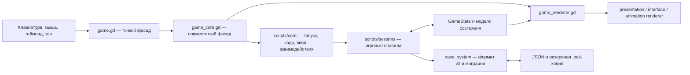

# Архитектура «Бабушкиной фермы»

Проект построен как набор узких игровых систем вокруг типизированного состояния. Сцена остаётся точкой интеграции Godot, но правила фермы, боя, экономики и прогресса не зависят от отрисовки.

## Общая схема



Главный принцип потока данных: **ввод вызывает операцию → система проверяет правило → модель изменяет состояние → renderer читает новое состояние**. Отрисовка не изменяет мир, а обработчик клавиши не содержит экономических или боевых правил.

## Пространственный контракт арта

`WorldVisualProfileSystem` нормализует `visual_size`, `anchor`, `collision_size` и `collision_offset`, а `WorldVisualAuditSystem` агрегирует каталоги земли, зданий, окружения, существ, интерьеров, воды и мирового лута. `ContentRegistry` валидирует их при запуске. Renderer получает уже готовый прямоугольник и не владеет уникальными размерами или таблицами профилей.

`WorldVisibilitySystem` переводит фактический viewport и смещение камеры в мировую область видимости с учётом тряски и запасом 24 px. Деревья, деревенский декор и фасады отправляют команды только при пересечении полной области изображения с камерой. `TreeOcclusionSystem` хранит эту область на один визуальный кадр и отсекает дальние кроны до создания packet/opacity-записи; частично видимые кроны сохраняются. Это ограничение относится к renderer-у: игровое состояние и навигация продолжают обновляться независимо от видимости.

`world_sprite_manifest.json` хранит художественные семейства и ожидаемые размеры. `check_world_sprite_manifest.py` автоматически обходит все GDScript внутри `scripts`, сопоставляет мировые ссылки с манифестом, находит мёртвые preload и может сформировать JSON-отчёт actual/runtime/target. Поэтому добавление нового runtime-файла не требует ручного расширения списка сканируемых владельцев.

## Композиционный слой

| Файл | Ответственность |
| --- | --- |
| `main.tscn` | Корневая сцена приложения |
| `scripts/game_context.gd` | Ресурсы сцены, совместимые свойства и общий контракт систем |
| `scripts/game.gd` | Тонкая точка подключения сцены без собственной логики |
| `scripts/game_core.gd` | Совместимый фасад игровых операций без реализации platform routing и preview |
| `scripts/core/game_bootstrap.gd` | Фазовая инициализация сервисов, мира, preview и runtime-систем |
| `scripts/core/game_loop.gd` | Единственный порядок обновления физического кадра и правила его остановки |
| `scripts/core/game_input_router.gd` | Приоритетная маршрутизация клавиатуры, мыши, геймпада и тача |
| `scripts/core/game_interaction_router.gd` | Выбор ближайшего взаимодействия и передача операции feature-системе |
| `scripts/core/game_preview_controller.gd` | Захват автоматических визуальных эталонов без загрязнения игрового цикла |
| `scripts/game_renderer.gd` | Совместимый фасад отрисовки мира и интерфейсов верхнего уровня |
| `scripts/presentation` | Небольшие тематические отрисовщики, которые только читают состояние |
| `scripts/editor` | Инструменты разработки и persistence их документов вне runtime-правил |
| `scripts/world_background.gd` | Фоновая геометрия и тайлы мира |

`game.gd` намеренно состоит только из наследования `game_core.gd`. Совместимые публичные операции остаются доступны сцене и тестам через core, но игровые правила делегируются профильным системам. Фасад не содержит методов `draw_*` и не владеет вторыми копиями игровых данных; свойства контекста проксируют значения в `GameState`.

Практическая карта каталогов, аналогии с веб-архитектурой и правила размещения нового файла находятся в [карте модулей](docs/MODULE_STRUCTURE.md).

## Модель состояния

```text
GameState
├── PlayerState      позиция, характеристики, профиль, отношения, диалог и визуальный отклик
├── InventoryState   количества, слоты, hotbar, экипировка, прочность и уровень рюкзака
├── WorldState       время, деньги, грядки, локация и изменяемые объекты мира
├── StorageState     установка и разреженное содержимое домашнего сундука
├── ForgeState       постоянные уровни улучшения экипировки
└── ContractState    ежедневные статусы, репутация и состояние доски гильдии
```

Модели наследуют `RefCounted`, не читают ввод и не зависят от `Node`. Это позволяет создавать состояние в тесте без запуска сцены. Временные состояния окон и анимаций остаются в контексте сцены, если они не являются частью сохраняемого прогресса.

## Владельцы игровых правил

| Подсистема | Единственная ответственность |
| --- | --- |
| `player_system.gd` | Движение, здоровье, опыт и кадр героя |
| `potion_system.gd` | Еда, восемь зелий, временные эффекты, невидимость и снятие скрытности атакой |
| `skill_system.gd` | Общий уровень героя, ремесленный опыт, восстановление ресурсов и бонусы рангов практики |
| `talent_system.gd` | Четыре ветки способностей, зависимости, расход очков уровня и постоянные игровые эффекты |
| `talent_renderer.gd` | Общая геометрия карточек для отрисовки, мыши и касания, линии зависимостей и XP-шкала |
| `navigation_system.gd` | Геометрия коллизий и проверка проходимости |
| `inventory_system.gd` | Каталог предметов, динамические слоты, hotbar и экипировка |
| `farm_system.gd` | Обработка грядок, четыре стадии роста и повторный полив |
| `fishing_system.gd` | Конечный автомат заброса, подсечки, физики рыбы, качества и сокровищ |
| `fishing_renderer.gd` | Экранные шкалы и процедурные пиктограммы рыбалки |
| `combat_system.gd` | Пять уровней врагов, AI движения и атак, масштабирование урона, опыта и добычи |
| `environment_hazard_system.gd` | Укоренённые контактные и дистанционные природные угрозы |
| `resource_system.gd` | Добыча камня и цветных кристаллов |
| `tree_system.gd` | Прочность деревьев, рубка, древесина, стадии восстановления и коллизии |
| `pirate_ship_system.gd` | Геометрия палубы, мачт, пушек и единые границы движения корабля |
| `pirate_ship_renderer.gd` | Статическое представление моря, корпуса, палубы, парусов и корабельного оборудования |
| `shop_system.gd` | Покупки, продажи и каталог товаров |
| `crafting_system.gd` | Рецепты и атомарные транзакции крафта |
| `storage_system.gd` | Установка домашнего сундука и атомарный перенос стеков между ним и рюкзаком |
| `forge_system.gd` | Стоимость, пределы и постоянные эффекты улучшений оружия, брони и стрел |
| `contract_system.gd` | Детерминированные ежедневные заказы, сдача предметов, награды и ранги гильдии |
| `quest_system.gd` | Пять последовательных сюжетных глав, десять побочных миссий, реестр 12 NPC, цели, состояния и награды |
| `tutorial_system.gd` | Последовательность полного обучения |
| `discovery_system.gd` | Радиус знакомства и одноразовые контекстные карточки |
| `wildlife_system.gd` | Блуждание, страх, охота и добыча животных |
| `forage_system.gd` | Возобновляемый дикий урожай и таймеры созревания |
| `loot_container_system.gd` | Сидированная расстановка тайников и случайная добыча |
| `world_system.gd` | Каталог локаций и переходы между ними |
| `building_system.gd` | Восемь внешних зданий, интерьерные локации, этажи и условия доступа |
| `companion_system.gd` | Найм, состав группы, следование и характеристики напарников |
| `save_system.gd` | Сериализация v2, миграция v1 и восстановление из backup |
| `locale_system.gd` | Каталог языков и разрешение локализованных строк |
| `audio_system.gd` | Темы локаций, адаптивный боевой кроссфейд и сигналы действий без громких шагов |
| `menu_system.gd` | Команды главного меню и паузы, универсальный ввод и временное `MenuState` |
| `settings_system.gd` | Постоянные параметры звука, окна, VSync и типизированное `SettingsState` |
| `animation_system.gd` | Состояния и временные шкалы анимаций |
| `animation_asset_registry.gd` | Стандарт 8 направлений × 3–5 кадров и полнота аудита движущихся типов |
| `adventure_polish_system.gd` | Создание героя, ветвящиеся диалоги, отношения, фиксация цели, прочность, ремонт и события отклика |
| `adventure_polish_renderer.gd` | Мини-карта, окна создания и диалога, телеграфы боя, следы и нарезка атласа эффектов |
| `npc_movement_system.gd` | Временные и погодные расписания, переходы между улицей и помещениями, безопасные маршруты жителей |
| `village_life_system.gd` | Вкусы подарков, дневные ограничения, отношения, реплики и личные поручения жителей |
| `village_event_system.gd` | Игровые правила ярмарки, праздника, ночного торговца и нападения на деревню |
| `interior_renderer.gd` | Тематические полы и атласная мебель отдельных помещений |
| `village_event_renderer.gd` | Визуальные объекты календарных событий на площади |
| `world_polish_renderer.gd` | Единая нарезка 5×4 атласа мебели, событий, оружия и частиц |
| `debug_playground_system.gd` | Изолированный стенд, пауза, покадровый шаг, инспектор и диагностические слои |
| `debug_overlay_system.gd` | Диагностика реальной проходимости, кэш видимой сетки, пауза и noclip поверх текущей локации |
| `debug_overlay_renderer.gd` | Цветная навигационная сетка, хитбоксы, маршруты, подписи и панель F11 |
| `first_level_art_system.gd` | Детерминированная нарезка master-арта первой локации на игровую сетку |
| `presentation_system.gd` | Чистые расчёты раскладки, направлений и общего профиля дыхания/шага |
| `visual_asset_system.gd` | Разметка сгенерированных атласов биомов, пиратов, предметов и зелий |
| `world_event_system.gd` | Чистый календарь сезонов, погода, рост культур, затмение и переход через портал |
| `atmosphere_renderer.gd` | Экранное освещение, свет домов, дождь, снег, гроза и луна без изменения состояния |

## Ввод, представление и контент

Эти компоненты связывают платформу и правила, но не владеют игровым прогрессом:

- `input_system.gd` регистрирует InputMap-действия, обеспечивает мгновенную реакцию и безопасное удержание;
- `presentation_system.gd` выполняет чистые расчёты atlas-кадров, координат и областей взаимодействия;
- `interface_renderer.gd` рисует HUD, рюкзак и модальные интерфейсы;
- `menu_renderer.gd` рисует главный экран, паузу и настройки по общим hit-зонам;
- `contract_renderer.gd` изолирует таблицу заказов и визуальное представление репутации гильдии;
- `animation_renderer.gd` рисует анимированные сущности и эффекты;
- `render_system.gd` определяет порядок слоёв мира;
- `content_registry.gd` проверяет ссылочную целостность data-driven каталогов.

Статический предмет объявляется один раз в `InventorySystem.ITEM_DATA`. Магазин, крафт, добыча, локализация и UI ссылаются на строковый идентификатор и не создают собственную конкурирующую модель предмета.

## Кадр игры

1. Godot передаёт событие через `game.gd` в `game_core.gd`.
2. `input_system` обновляет состояние удерживаемых клавиш или вызывает публичную операцию фасада.
3. Профильная система проверяет расстояние, ресурс, стоимость и допустимость перехода.
4. Система изменяет `GameState` и публикует результат через сообщение, звук или событие обучения.
5. `_process` обновляет время, календарные события, существ, эффекты и автоматы состояний.
6. `game_renderer` рисует мир, затем `atmosphere_renderer` накладывает погоду и освещение, а интерфейс остаётся незатемнённым.

## Сохранение

Сохраняемое состояние преобразуется в словарь только внутри `save_system.gd`. Запись атомарная: предыдущая полная версия остаётся в `.bak`. Загрузка мигрирует отделённую копию документа, затем `SaveValidationSystem` проверяет обязательные поля, конечные числа, пары координат и вложенные записи до первого изменения живого состояния. Новые группы необязательны для старых файлов; повреждённый основной документ приводит к проверке `.bak`. `SaveVectorCodec` явно кодирует координаты ловушек, мебели и снарядов числовыми парами и восстанавливает игровые векторы; прежние строки `(x, y)` поддерживаются при миграции. Поэтому повреждённый или частично записанный JSON не должен оставлять игру наполовину загруженной.

Запись прогресса, черновиков и опубликованных карт выполняется через `AtomicJsonStore`: соседний `.tmp` сбрасывается и сверяется с прочитанным текстом и схемой; целевой файл заменяется одним переименованием. Предварительного удаления основного файла нет. Резерв тоже проходит временную запись и замену, причём только из валидного предыдущего слота; повреждённый основной файл сохраняет уже имеющуюся `.bak`. Godot поддерживает замену существующего файла в [DirAccess.rename_absolute](https://docs.godotengine.org/en/4.7/classes/class_diraccess.html#class-diraccess-method-rename-absolute). Это защита от отказов файловых операций; отдельную гарантию физического сброса диска при отключении питания проект не заявляет.

Отсутствующие ячейки экипировки получают пустые значения из InventoryState.DEFAULT_EQUIPMENT; существующие предметы сохраняются. Старый слот без памяти животных дополняется шестью записями стартового двора, сохраняя уже записанные fed_day, collected_day и bond. Это позволяет продолжать движение, бой и животноводство после миграции.

Изменение схемы требует:

1. повысить номер версии;
2. добавить миграцию с предыдущей версии;
3. проверить новое сохранение, старое сохранение и повреждённый основной файл;
4. обновить [руководство игрока](docs/GAME_GUIDE.md), если сохраняется новая видимая сущность.

## Правила изменений

1. Новая механика расширяет единственного владельца ответственности или получает отдельную узкую систему.
2. UI и ввод вызывают публичную операцию; правила не дублируются в обработчиках клавиш.
3. Система не читает платформенный ввод и не рисует. Renderer не меняет игровое состояние.
4. `game.gd` не содержит реализацию, `game_core.gd` не рисует, а совместимое свойство не хранит вторую копию значения из `GameState`.
5. Новая пользовательская механика получает автотест, шаг туториала, пункт [QA_CHECKLIST.md](QA_CHECKLIST.md) и актуальную документацию.
6. Каждый метод документируется русским комментарием `##`; тест дополнительно описывает сценарий, исходное состояние и ожидание.
7. Архитектурные лимиты и ссылочная целостность проверяются `tools/check_architecture.sh`; превышение устраняется разбиением до merge.

Практический порядок работы и команды находятся в [руководстве разработчика](docs/DEVELOPMENT.md).

## Кухня и хозяйственные цепочки

`CraftingSystem` разделяет станции workbench и cauldron до списания ингредиентов. Кухня использует точные рецептурные количества; ремесленная экономия и пятый бонус относятся только к верстаку. Отдельный счётчик profile.workbench_crafts мигрирует из прежнего craft_count и сохраняется вместе с профилем. За одно действие выполняются не более 99 полных партий. Неподходящая станция, закрытый талант и нехватка ресурсов не меняют запасы.

`FoodSystem` применяет эффекты из ItemPresentationSystem.FOOD_EFFECTS: карточка, рецепт и фактическое восстановление используют один каталог. Все зарегистрированные съедобные продукты имеют эффект. Кухня развивает фермерство; хозяйственный крафт развивает ремесло. Новые предметы добавлены в конец списка слотов, сохраняя исторические индексы сохранений.

## Контакт дальних атак

`EnemyProjectileSystem` хранит временные снаряды в metadata игрового узла: исходный тип, фиксированное направление, скорость, оставшуюся дальность и позицию наконечника. Стрелы скелетов, пиратов и капитана, заряды рыцаря, призрака и обоих стреляющих растений проходят одним конвейером. Движение проверяет весь отрезок подшагами до препятствия или пересечения с радиусом героя; один снаряд наносит урон один раз. Монеты капитана списываются только после результативного попадания. Пауза меню сохраняет позиции; успешная загрузка и смена локации очищают угрозы. Осколки и мухи босса сохраняют уже существующий физический конвейер `CaveBossProjectileSystem`.

`FarmLifeSystem.simulation_delta` отсчитывает hit_stop до возможного раннего выхода из GameLoop и возвращает остаток кадра. Поэтому остановка 35/70 мс заканчивается самостоятельно. Меню проверяются раньше и не расходуют оставшийся стоп-кадр.

Скелет использует отдельные листы `skeleton_v2/walk.png` и `actions.png`, 3×8 ячеек по 128 px. Фигуры измерены как связные компоненты и размещены с прозрачными полями, а не вырезаны по предполагаемой сетке исходника. Отпускание стрелы совпадает с началом третьего кадра стрельбы, на 0,48 с.

## Контакт оружия героя

`PlayerAttackSystem` запускает подготовку через общий `WeaponSystem` и фиксирует оружие, базовый урон, направление, цель и момент контакта. Меч, копьё, топор и молот проверяют доступное тело в сохранённом направлении на 43% временной шкалы; лук и посох выпускают снаряд на 62%. `PlayerAttackTargets` связывает обычных врагов, призыв, зверей, сюжетного слизня и двух событийных боссов с их существующими конвейерами здоровья и наград. Миньон имеет временный устойчивый идентификатор, поэтому уплотнение массива не подменяет цель.

`PlayerProjectileSystem` проверяет путь шагами не более шести пикселей, включая участок от тела до руки. Преграда поглощает снаряд; первое пересечённое тело получает один контакт. Направление не обновляется после начала подготовки, длительность и остаточный полёт большого кадра учитываются отдельно. Прочность расходуется один раз на начатую атаку; серия и критический множитель меняются только при попадании. Входящий урон отменяет ещё не выпущенный контакт, но не стрелу в воздухе. Напарники и отдельные заклинания сохраняют свои подтверждённые конвейеры урона.

`AnimationSystem` сначала продвигает прежние реакции, затем разрешает новые контакты: свежая реакция на попадание не исчезает в том же длинном кадре. Все меню приостанавливают подготовку и полёт. Успешная загрузка, поражение и синхронизация другой комнаты очищают временные угрозы обеих сторон; невалидный документ их не трогает. Старые декоративные projectiles внутри estate принимаются при миграции, затем очищаются. Регент имеет опору на настоящем полу в (576,315); рисунок остаётся на прежнем месте благодаря отдельному смещению тела.

## Полные действия героя

`HeroActionVisualSystem` выбирает 96 самостоятельных RGBA-кадров кирки, топора, лейки, удочки, молота и посоха. Production-кадры лежат в `assets/game/characters/hero_v3/actions_v2`; мастер-листы, точные промпты и измерения — в `docs/concepts/hero-actions-2026-10-12/v2`. Измеряются целые связные фигуры; одинаковые ячейки захватывали выступающие соседние инструменты. Godot заранее подготавливает экранный размер и добавляет прозрачный двухпиксельный край после нарезки.

Опора измерена по двум ботинкам, отдельно от инструмента и свечения. Масштаб тела постоянен для набора; контактная поза может выступать ниже опоры. Бой сохраняет оружие и направление начала атаки. Зарядка удочки удерживает замах, отпускание запускает заброс, ожидание сохраняет снасть в руках; конец лески измерен по спокойному кадру. Полная поза подавляет наложение второго инструмента или оружия.

## Жители и спутники: общая опора

`ResidentVisualSystem` выбирает видимый целый кадр из пяти подготовленных атласов 512×1024. Сохранены восемь направлений и четыре фазы; источники 888×1776 переиспользованы без изменения оригиналов. Offline-подготовка измеряет ботинки и верх тела, нормализует рост до 84 px, укладывает фигуру в безопасную ячейку128×128 с опорой(64,120). Правые строки зеркальны левым. Число пикселей набора уменьшено на 66.8%; это расчёт размеров PNG, не замер VRAM.

Герой, бабушка, остальные жители и спутники используют физическую позицию как точку стоп. Прежний человеческий offset+24 удалён, тень остаётся на той же позиции. Рамки инспектора берутся из реальной позы, включая направление и фазу спутника. В диалогах и окне персонажа источник вписывается с сохранением пропорций. Редактор предлагает пять отдельных шаблонов подготовленных фигур; старые мастер-листы не появляются как случайный декор.

Три ячейки событий деревни очищаются от внешнего служебного канта один раз через `WorldPolishRenderer.event_texture`. Более тёмный пурпурный ключ включён только для этих событий; исходный атлас, другие предметы и эффекты не изменяются. Портал использует стандартную локальную очистку мягкого внешнего канта; непрозрачный камень и светящееся ядро сохраняются. Подготовка выполняется до первого игрового кадра.

## Животноводство стартовой фермы

`LivestockData` хранит устойчивые animal id, виды, интервалы, загоны, открытые калитки и основания построек. `LivestockSystem` отвечает за дневные маркеры ухода, отдельный запас продукции (0–3), дружбу и ограниченные прогулки. Большие исходные изображения хранятся только в `docs/concepts/farmyard-2026-10/v1/sources`; runtime загружает 30 маленьких самостоятельных PNG через `LivestockVisualSystem`. `LivestockRenderer` разделяет объекты по глубине относительно героя, используя те же опоры.

Перед перезаписью маркера корма или воды рассчитывается продукция прошлого обслуженного дня. production_day предотвращает повторную выдачу после сбора/загрузки; last_yield_day задаёт интервалы шерсти и трюфелей. Новые поля сохраняются внутри estate.expansion.animals и дополняются при загрузке старых слотов; исходные hen/cow/sheep сохраняют свои id, дружбу и collected_day. Конечная стартовая выдача корма помечена livestock_started. Производство не использует реальное время операционной системы.

Чертёж деревни имеет ревизию 4. Миграция переносит только пять исходных плодовых объектов на прежних шаблонных координатах; пользовательские посадки внутри новых препятствий переносятся в ближайшую свободную пригодную клетку без потери культуры, стадии, полива или таймеров. Остальные пользовательские позиции сохраняются. Территория загонов не допускает вспашку. Центральный проход шириной 72 px и физические разрывы оград остаются доступны герою.

Южный луг расширен на семь рядов сетки 24 px: размер деревни 2400×1368, сетка 100×57. `WorldBoundsSystem.size(location)` задаёт общий контракт границ для движения, камеры, свободных грядок и оград. Остальные наружные карты сохраняют 2400×1200, интерьеры используют свои комнаты. Загоны имеют размеры 192×144, 288×144 и 288×120; кормушка и вода доступны с центрального прохода. Шесть кадров свинки подготовлены шириной 50–52 px без дополнительного масштабирования при отрисовке.


### Кеш неподвижного грунта и политика кадров

WorldBackground владеет SubViewport 2400×1368 и VillageTerrainCanvas. На графическом renderer грунт собирается UPDATE_ONCE, готовность подтверждается frame_post_draw; до готовности и в headless используется прямой модульный renderer. Season/weather инвалидируют кеш; сцена освобождает viewport вместе с собой. Нет GPU-readback в игровом кадре, отдельной нарисованной карты на диске или второй навигации. RenderPacingSystem включает перерисовку по изменениям с idle sleep 500 мкс и без второго FPS-таймера поверх VSync. DebugGridBuildSystem распределяет поколение по пакетам до 1 мс. [Нативные измерения](docs/reports/performance-2026-10-12/README.md).

## Алхимические каталоги и сохранение растений

AlchemyHerbData описывает 24 источника и их стабильные ID; AlchemyProductData формирует 148 предметов и переводы; AlchemyRecipeData формирует 131 рецепт. Исторические массивы выделены в BASE_RECIPES, BASE_PRODUCTS, BASE_ITEM_DATA и дополняются новыми данными один раз. Индексы старого крафта и лавки сохраняются. LocaleSystem также дополняет базовые переводы; AlchemyLocale хранит обучение и тексты эффектов.

AlchemySystem владеет estate.expansion.alchemy: уникальные открытия, опыт, число партий и таймеры repellent/mining. CraftingSystem проверяет физическую станцию, ранг, талант, лабораторию и все входы до изменения запасов. Повтор не выдаёт опыт; побочный жмых проводится отдельно после основного выхода. PotionSystem использует тот же каталог эффектов, что карточки предметов. GameLoop приостанавливает обработку таймеров вместе с миром.

ForageSaveSystem восстанавливает 16 старых статических узлов по историческому порядку, новые травы — по ID, старые динамические фруктовые деревья — отдельными записями. Это предотвращает замену пользовательской яблони травой после расширения массива. SaveValidationSystem проверяет структуру до изменения живой игры; AlchemySystem.restore пересчитывает XP по известным уникальным открытиям. Новые травы имеют пустое основание и отсекаются до навигационных проверок; их изображение не становится стеной. Renderer повторно использует прежний сезонный атлас и группирует цветные соцветия в один draw_multiline.

[Спецификация и каталог](docs/design/ALCHEMY.md).

AlchemyIconSystem предоставляет настоящие Texture2D общему реестру: прежние иконки сырья и векторные флаконы, подготовленные один раз из SVG в память до первого кадра. Во время отрисовки нет импорта и загрузки. Строки стоимости используют общую row_ingredients_text в renderer и аудите. Длинные эффекты в лунном рюкзаке занимают две строки с тем же метрическим контрактом.

## Горн и очередь плавки

FurnaceData владеет девятью материалами, пятью видами топлива, семью технологиями, уровнями и источниками сырья. Все реестры дополняются после прежних записей. FurnaceSystem хранит estate.expansion.furnace: уровень, heat, fuel, queue и completed. Сырьё резервируется при enqueue, результат выдаётся только при завершении update. Рецепт сверяется с каноническим ID; слот содержит ID, duration и remaining. Улучшение пересчитывает оба времени с сохранением доли готовности. Расход жара учитывает только активную работу и текущую эффективность, без фоновых часов или потерь при простое.

GameLoop вызывает обновление горна внутри обычного мира после проверки модальных окон. SaveValidationSystem проверяет очередь до первой мутации, restore нормализует известные работы и диапазоны. Профиль workbench_crafts устанавливается до первой партии и не изменяется горном. FurnaceRenderer использует прежнюю печь, существующие текстуры и один подготовленный в память SVG стеклянных пластин. Материалы иных локаций и исчерпанные источники отсекаются до вычислений навигации.

Метаданные capture_windowed отключают только применение display-настроек в техническом предпросмотре; обычная игра сохраняет прежнюю загрузку настроек. Контрольная сцена рисуется нативным GPU в отдельном SubViewport 1152×648, поэтому асинхронное изменение размера окна macOS не изменяет размер кадров. [Спецификация](docs/design/FURNACE.md).

## Постоянные знания и вторичная сборка

ResearchData владеет тридцатью видами, каноническим составом, классом сложности, размерами партий, ценами изучения и улучшений, шестью расходниками/деталями и одиннадцатью новыми рецептами. ResearchSystem хранит estate.expansion.research с level, known и dismantled. Стол гильдии и разборочный верстак кузницы используют разные station ID и настоящие точки подхода. Проверка reason предшествует любой мутации. Изучение сохраняет образец, знания открываются один раз для всего вида; разборка использует только канонический каталог и уменьшает возврат при износе.

Исследование и разборка имеют собственные индексы каталога, сохраняя crafting_open и штатную модальную паузу. Они не регистрируются ложными рецептами создания вещей. CraftingSystem направляет ввод и действия в ResearchSystem; ResearchRenderer рисует отдельную карточку без скрытого выхода до изучения. ResearchLayoutAudit проверяет все её тексты на шести языках при 120%. ResearchIconSystem готовит SVG-текстуры четырёх материалов до первого кадра и переиспользует два существующих PNG; кэш не пересоздаётся в draw.

Новые рецепты study_kind требуют постоянного знания и точных затрат без двойного выхода. Старые рецепты остаются на прежних индексах. Переплавка осколков проходит обычный FurnaceSystem с каноническим ID recovery:glass, очередью, топливом и сохранением. Загрузчик проверяет структуру знаний до изменения мира; restore удаляет неизвестные виды и дубликаты. Удаление последнего экземпляра не оставляет старую заточку новой вещи. [Спецификация](docs/design/RESEARCH.md).

## Ремесленные очереди и выбранные спрайты A

WorkshopData хранит 28 предметов, точки трёх станков, цены и дополнительные исследования; WorkshopRecipeData — 37 технологий с каноническими ID. WorkshopSystem резервирует сырьё и энергию, независимо продвигает очереди только из GameLoop.update_world и сохраняет прогресс в estate.expansion.workshops. Стеклодув использует каталог топлива горна, но собственный запас. Шесть обжигов исполняет FurnaceSystem. Обычные рецепты кухни и верстака не попадают в производственную очередь.

WorkshopVisualSystem выбирает один из 12 заранее загруженных ресурсов по сохранённому уровню. InteriorVisualSystem владеет общей коллизией и опорой; InteriorRenderer рисует станки перед героем или после него по обычному порядку глубины. WorkshopIconSystem кеширует иконки при старте. Общая CraftingSystem.visible_rows/list_start обслуживает и рисование, и выбор мышью: очередь/цена не перекрывают выбираемые строки.

## Личная мастерская в подвале

`BasementData` задаёт комнату, пол 92×51 по 24 px, ориентации и цены десяти станков. `BasementLayoutSystem` владеет основаниями и единственной рабочей стороной, проверяет коллизии радиуса героя 18 и связность на подрешётке 12 px, сохраняя проходы шириной 48 px. `BasementInputSystem` кеширует предварительную проверку по координатам/повороту/ревизии и управляет самостоятельной камерой размещения. Чертёж и размещение входят в общую паузу `GameLoop`.

`estate.expansion.basement.objects` содержит устойчивые ID, вид, координаты, направление, уровень/стадию, работу, расход, журнал оплаты и собственную производственную память. `BasementConstructionSystem` оплачивает размещение/улучшение атомарно, продвигает только удерживаемую работу и рассчитывает однократный демонтаж. `BasementStationSystem` связывает существующие Crafting/Research/Forge с выбранным экземпляром. Общие знания не копируются в каждый стол; уровни сложности определяет рабочий экземпляр.

`BasementProductionSystem` обновляет личные очереди один раз; старые `FurnaceSystem.update` и `WorkshopSystem.update` явно получают общественное состояние, поэтому выбранный личный станок не обновляется повторно. Заказы сохраняют точный состав оплаченных ингредиентов для демонтажа. Валидация слота проверяет весь набор до изменения игры; загрузка сбрасывает физическое удержание и выбор, сохраняя работу и материалы.

`BasementRoomRenderer`, `BasementVisualSystem` и `BasementRenderer` собирают выбранный A из самостоятельных текстур и ресурсов; глубина объектов определяется общей нижней опорой, отрисовка ограничена камерой. F10 показывает те же основания и рабочие точки. Исходные дизайн-макеты отделены в `docs/design/cellar-workshop`, игровые изображения — в `assets/game/basement`. `BasementLayoutAudit` проверяет подписи и цены на шести языках; два профильных suite подключены через `CraftingPipelineSuite`.
