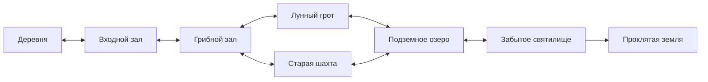

# Лабиринт пещер — шесть игровых комнат

Расширение выбранного дизайна пещеры от 11 октября 2026 года. Все изображения сняты настоящим renderer Godot. Каждая комната имеет собственную геометрию и двусторонние туннели, отдельные жилы, врагов и сундуки.

## Просмотр

- [Все комнаты в одном изображении](rooms-overview.png).
- [Галерея комнат и обычные игровые кадры](gallery.html).
- [Лунный грот с игровым интерфейсом](moon-gameplay.png).
- [Грибной зал с игровым интерфейсом](fungal-gameplay.png).

## Схема связей

| Комната | Полный кадр 2400 × 1350 | Отличие |
| --- | --- | --- |
| Входной зал | [Скалы и жилы](cave-overview.png) | Сохранён выбранный первый зал и дверь в деревню. |
| Грибной зал | [Грибница](cave_fungal-overview.png) | Два зала с разными по размеру грибами и тройной развилкой. |
| Лунный грот | [Светящаяся растительность](cave_moon-overview.png) | Лунная трава, цветы, прохладный свет, спокойная зона. |
| Подземное озеро | [Вода и берега](cave_lake-overview.png) | Неровный непроходимый берег и анимированные блики. |
| Старая шахта | [Рельсы и руда](cave_mine-overview.png) | Узкие коридоры, тупик, факелы и металлические жилы. |
| Забытое святилище | [Колонны и перегородка](cave_sanctum-overview.png) | Можно обойти центральную скалу; в глубине находится выход мира. |

## Материалы и реализация

Скалы, грибы, факелы и жилы используют [выбранные модульные PNG](../../../../assets/game/locations/cave/modular/README.md). Лунные цветы и разрушенные колонны взяты из существующего окружения, вода — из материала деревни. Трава рисуется отдельными небольшими пучками с градиентом по листу; её свечение вынесено в динамический слой. Растительность распределена детерминированно, поэтому при возвращении её расположение сохраняется.

[CaveRoomData](../../../../scripts/systems/cave_room_data.gd) хранит граф и схемы комнат, [CaveLayout](../../../../scripts/systems/cave_layout_system.gd) кеширует их стены и физические контуры, [CavePassageSystem](../../../../scripts/systems/cave_passage_system.gd) управляет переходами. [CaveThemeRenderer](../../../../scripts/systems/cave_theme_renderer.gd) собирает оформление, [CaveDungeonContent](../../../../scripts/systems/cave_dungeon_content.gd) дополняет контент после прежних индексов. Карты не используют полную иллюстрацию в качестве игрового фона.

Кадры сняты с замороженной симуляцией и выключенной стартовой кат-сценой. Обзоры отключают HUD; два обычных кадра используют размер 1152 × 648. Общий обзор — уменьшенные игровые снимки с названиями комнат. Проверки связности пола, путей к контенту, переходов, сохранений и добычи выполняет [CaveLabyrinthSuite](../../../../tests/suites/cave_labyrinth_suite.gd).
