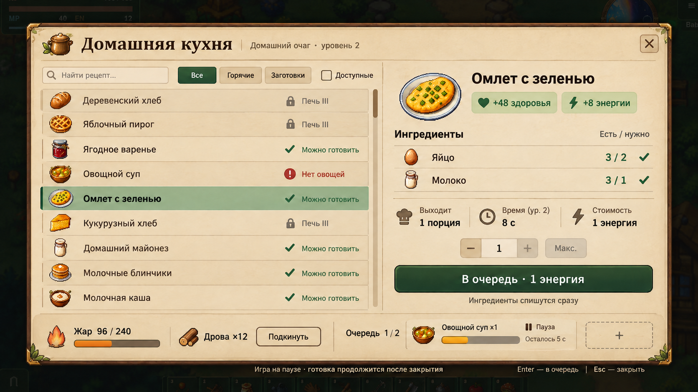
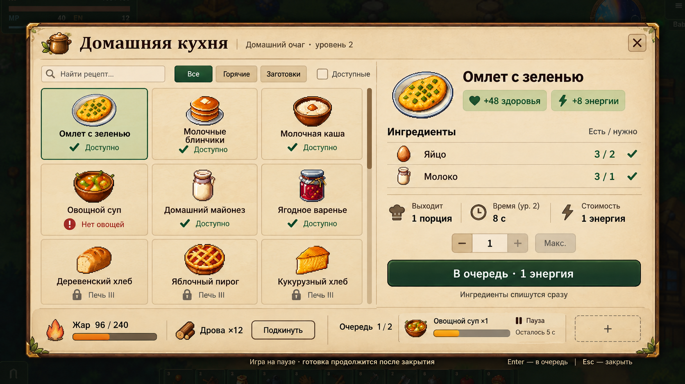

# Окно домашней кухни — варианты переработки

Статус: дизайн на выбор. Игровой интерфейс и механика не изменены. Основание — [AGENTS.md](../../../../AGENTS.md): «Сначала показывай варианты; перенос в игру выполняй после выбора пользователя».

## Что мешает в текущем окне

Декоративная рамка и вложенные панели забирают полезную площадь. Ингредиенты повторяются в строке рецепта и в правой панели, остаются длинными текстовыми перечислениями. Свойства блюда, количество и главное действие разделены большими пустотами. Недостающий один ингредиент окрашивает всё перечисление красным; причина недоступности не отделена от требуемого уровня станка. Открытое окно не объясняет паузу производственной очереди.

## Общее решение

- Тонкая деревянная рамка, светлый пергамент, единый размер основного шрифта и стабильные отступы. Базовое окно горизонтальное, с двумя колонками.
- Заголовок «Домашняя кухня» и отдельная подпись конкретного станка/уровня. Кнопка закрытия в одном месте.
- Поиск, действующие группы «Все / Горячие / Заготовки» и предложенный фильтр «Доступные».
- У рецепта — рисунок, название и краткий статус. Полный состав показывается только в панели выбранного блюда.
- Ингредиенты отдельными строками с иконками и подписями «Есть / нужно». Достаток отмечен цветом и галочкой; недостача — текстом и значком, а требование уровня — замком.
- Эффект еды, выход партии, время, расход энергии, выбор количества и главное действие собраны рядом.
- Отдельная компактная зона топлива и очереди. В открытом окне очередь отмечена как приостановленная, а не показана работающей.
- Рамка и кнопки предполагают сборку из повторно используемых частей и nine-slice; макеты не являются цельным игровым ресурсом.

## Вариант A — список

Компактные строки удобны для длинных названий и большого числа рецептов. Левая колонка занимает примерно половину окна; правая содержит выбранное блюдо и ингредиенты. Основной рекомендуемый вариант для дальнейшего распространения на крафт, алхимию и станки.

## Вариант B — карточки

Сетка с более крупными рисунками облегчает выбор по внешнему виду блюда. Названия могут занимать две строки; на узких экранах потребуется уменьшить число колонок. Панель деталей, количества, топлива и очереди сохраняет тот же порядок, что в A.

## Условия, проверенные по игровой механике

Источники: [kitchen_data.gd](../../../../scripts/systems/kitchen_data.gd), [kitchen_system.gd](../../../../scripts/systems/kitchen_system.gd), [kitchen_renderer.gd](../../../../scripts/presentation/kitchen_renderer.gd).

- Омлет доступен со второго уровня; его партия требует два яйца и одно молоко, выдаёт один омлет и расходует одну единицу энергии.
- На втором уровне время омлета — `10 / 1,25 = 8 с`; вместимость очереди — две партии, максимальный запас жара — 240.
- Пример «яиц 3, молока 3» позволяет поставить одну партию омлета: кнопки увеличения и максимума не должны обещать две порции.
- Горячие блюда расходуют жар во время работы. Для топлива есть дерево, брёвна и древесный уголь; загрузка расходует одну единицу выбранного топлива.
- Ингредиенты и энергия списываются при постановке в очередь. Еда выдаётся после завершения работы. Поэтому основная кнопка называется «В очередь», а не обещает мгновенную выдачу блюда.
- Открытые меню ставят игровые события и очередь на паузу; приготовление продолжается после закрытия.
- Хлеб и пирог требуют печь третьего уровня. Их статус в примере — требование улучшения, даже когда часть ингредиентов есть.

Поиск, фильтр доступности и явный выбор количества — предложения для реализации после выбора макета. Количество для личной кухни ограничивается одновременно материалами, энергией и свободными местами очереди; параметры пересчитываются перед действием. Формат соседних станков адаптируется к их действующим правилам.

## Проверка перед переносом

После выбора: сохранить масштабируемую рамку и реальные игровые иконки; проверить минимальный размер окна и крупный текст, длинные названия и шесть языков; отдельно проверить мышь, клавиатуру и геймпад, недостачу ингредиентов, энергию, заполненную очередь, нехватку топлива и паузу. Добавить профильные тесты и обновить обучение/управление/QA вместе с реализацией.

Варианты созданы встроенным `image_gen` через навык `imagegen`. [Полные промпты и способ генерации](generation.json) сохранены рядом с макетами; [исходный интерфейс](before.png) — для сравнения. Проверка макета подтверждает композицию; точные размеры, локализация и действия будут проверяться при переносе в Godot.
