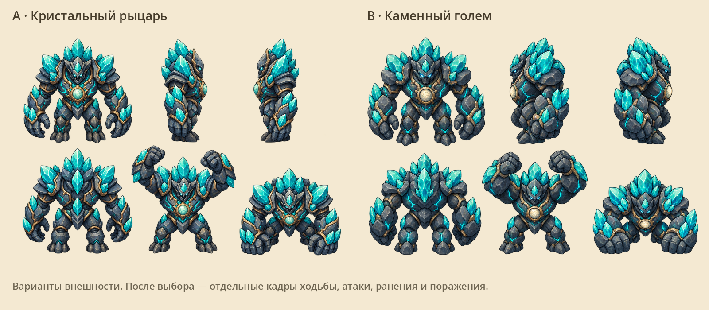
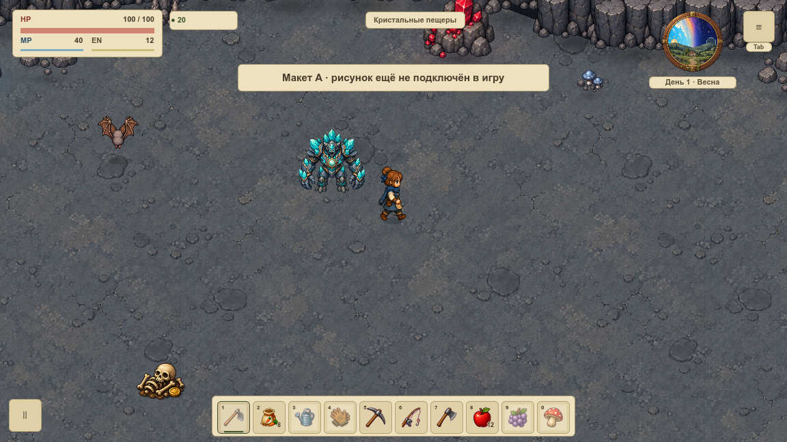
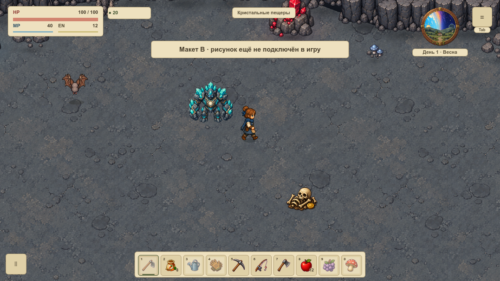
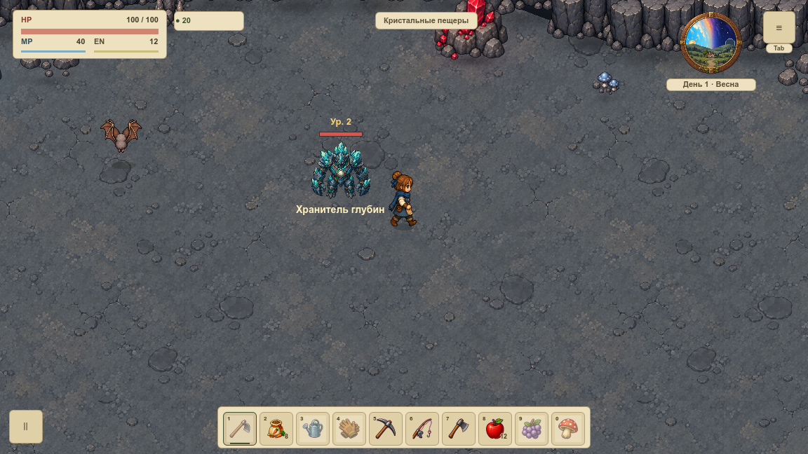

# Хранитель глубин · исправление и перерисовка

## Причина повреждения

На [снимке пользователя](before-user.png) видны части двух соседних фигур. Повреждение находится в самих PNG общего листа `core_enemy_walk_8dir.png`: некоторые части уже отрезаны на границах ячеек. Один сдвиг прямоугольника не возвращает отсутствующие пиксели.

В игре временно подключён прежний цельный [исходный рисунок](../../../../assets/game/enemies/cave_guardian.png). Он не является новым дизайном. Все состояния используют полный исходник256×256 с прозрачными полями; измеренная опора стоп128,236. Повреждённые кадры тела отключены. Кристальная вспышка отделена от тела и сохраняет прежнюю механику удара. До выбора новой серии это одна неподвижная поза, честно отмеченная в реестре и Wiki. Босс святилища использует другую библиотеку и не меняется.

## Новый облик

Встроенный imagegen подготовил два самостоятельных варианта по прежнему цельному рисунку; [точные запросы](prompts.json) сохранены. Исходные прозрачные PNG не редактировались и не перенесены в игровые ресурсы.

- **A — кристальный рыцарь.** Выразительная слоистая броня, ясные грани больших кристаллов, читаемый золотой сердечник. Рекомендуемый вариант, ближе к прежнему персонажу.
- **B — каменный голем.** Более тяжёлые валуны, мощные кулаки и светящиеся трещины, меньше сходства с человеческой бронёй.



Полные листы: [A на светлом фоне](a-review.png), [B на светлом фоне](b-review.png). Мастера с исходным альфа-каналом: [A](sources/a-board.png), [B](sources/b-board.png). Это листы внешности с четырьмя видами и двумя примерами удара, а не готовая таблица ходьбы. Области мастера нерегулярны; делить изображение на равные ячейки нельзя.

## Реальный размер в игре

Два следующих кадра — отдельные макеты с новым передним рисунком высотой96px на фоне реальной пещеры и рядом с настоящим героем. Они не меняют production-ресурсы. Прозрачный рисунок показан без перекраски и растяжения пропорций.





После выбора предстоит подготовить полноценные направленные серии: ходьба, подготовка и контакт сокрушения, восстановление, ранение и поражение. Каждая фигура получает свою измеренную область и общую опору ног; рамки проверяются по альфа-каналу и в настоящем игровом масштабе. Дизайн не подключается раньше выбора пользователя.

## Текущая игра и контроль



Другие реальные состояния: [удар с отдельным эффектом](attack.png), [ранение](hurt.png), [поражение](death.png), [бестиарий](bestiary.png). Съёмка использует отдельный профиль `Codex-Depth-Guardian-20261014`, слоты пользователя не открываются.

Профиль `tools/depth_guardian_review.gd`:351 утверждение,0 ошибок. Проверены весь диапазон направлений и индексов кадров, прозрачные поля тела, опора стоп, полоска здоровья над кристальной короной всех пяти уровней, общая рамка выбора F10, отдельная текстура эффекта и явное ограничение реестра. Проверка очереди требует ровно одну документированную миграциюWS-019, не объявляя временную позу завершённой анимацией. Общий боевой профиль остаётся прежним. Wiki: экспорт, TypeScript, production-сборка и15/15 Node-тестов пройдены, включая честный состав поз хранителя и сохранение двенадцати атак отдельного босса. Перед публикацией полный gate запускает архитектуру и весь игровой набор тестов.

```bash
tools/Godot.app/Contents/MacOS/Godot --headless --path . --script res://tools/depth_guardian_review.gd
tools/Godot.app/Contents/MacOS/Godot --path . --windowed --script res://tools/depth_guardian_capture.gd
tools/Godot.app/Contents/MacOS/Godot --path . --windowed --script res://docs/concepts/depth-guardian-2026-10-14/v1/render.gd
```
