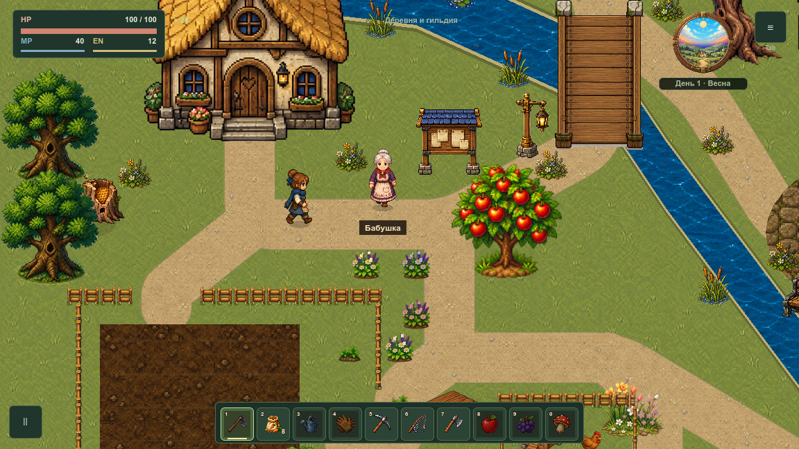
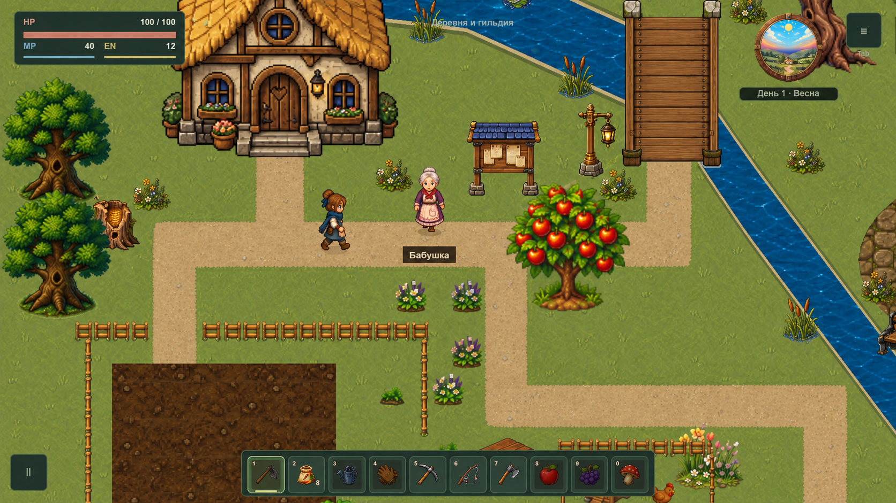
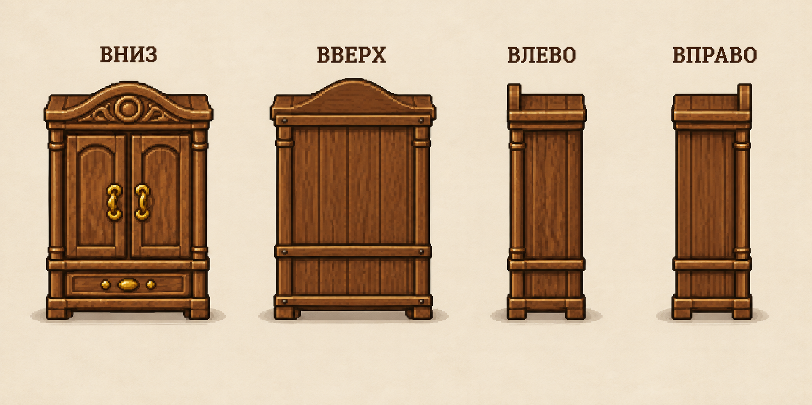

# Дороги и мебель в четырёх направлениях

Статус: предложение на утверждение. Дороги, коллизии и игровые ресурсы мебели этим пакетом не изменяются. Согласно [AGENTS.md](../../../../AGENTS.md), дизайн показывается отдельно, а выбранное решение переносится в игру после выбора пользователя.

## Дороги

Запрос: горизонтальные и вертикальные тропы без диагональных участков. Сохраняются деревенский грунт, ширина проходов, двери, грядка и мост. Повороты — на 90°; шероховатая кромка материала сохраняет естественный вид. Географию реки этот запрос не меняет.

В текущей игре диагонали задаются точками [основной карты](../../../../scripts/systems/village_map_data.gd) и [районов деревни](../../../../scripts/systems/village_region_data.gd). Материалы дороги повторяются через renderer, поэтому перерисовывать землю целым фоном не требуется. Уже имеются горизонтальная/вертикальная дорога, угол, окончание, T и перекрёсток в `assets/game/tiles/editor/terrain`.

При переносе нужно согласованно менять точки полилиний, их отрисовку, кромки и проверку соседства растений. Простая автоматическая замена диагонали любым L-поворотом может вывести тропу на воду, под дерево или в ограждение: варианты обхода проверяются отдельно. Все прежние двери и шестнадцать направленных переходов между шестью районами должны оставаться достижимыми; мосты, входы в поле и доступ к станкам/NPC сохраняются.

## Шкаф

Диагональная перспектива содержится в [исходном спрайте](wardrobe-before.png). Предлагаются четыре самостоятельных рисунка: фасад вниз, задняя стенка вверх, левый и правый бок. Передние ручки не появляются на задней стороне. Основные грани выровнены по экрану; одинаковая высота и нижняя опора сохраняют масштаб.

Это лист просмотра, а не готовый атлас: подписи и фон не попадут в игровые спрайты. При переносе потребуются отдельные изображения с прозрачностью, точные ячейки и опоры, привязка к четырём направлениям, согласованные размеры основания и теней. Поворачивать весь рисунок на 90° вокруг экрана нельзя: мебель должна менять вид, оставаясь стоящей.

Текущий рисунок используется [визуальной системой мебели](../../../../scripts/systems/farm_life_visual_system.gd) и через неё [интерьерами](../../../../scripts/systems/interior_visual_system.gd). После утверждения следует проверить шкафы в доме, магазине, гильдии и кузнице, сохранение мебели, её коллизии и доступ к шкафу снабжения. Для остальных предметов с диагональным ракурсом применяется тот же принцип: отдельные стороны для столов, стульев и лавок с общей опорой; каждую группу нужно проверить по её исходникам.

## Источники и проверка макетов

Оба изображения созданы встроенным `image_gen` через навык `imagegen`. [Полные промпты](generation.json) сохранены вместе с [снимком исходной локации](roads-before.png) и [исходным шкафом](wardrobe-before.png). На изображениях проверены ортогональные участки тропы, подходы к двери/мосту/грядке и четыре различных стороны шкафа. Это визуальная проверка предложения; автотесты маршрутов, сохранений, hit-зон и нативные игровые кадры потребуются вместе с реализацией.
