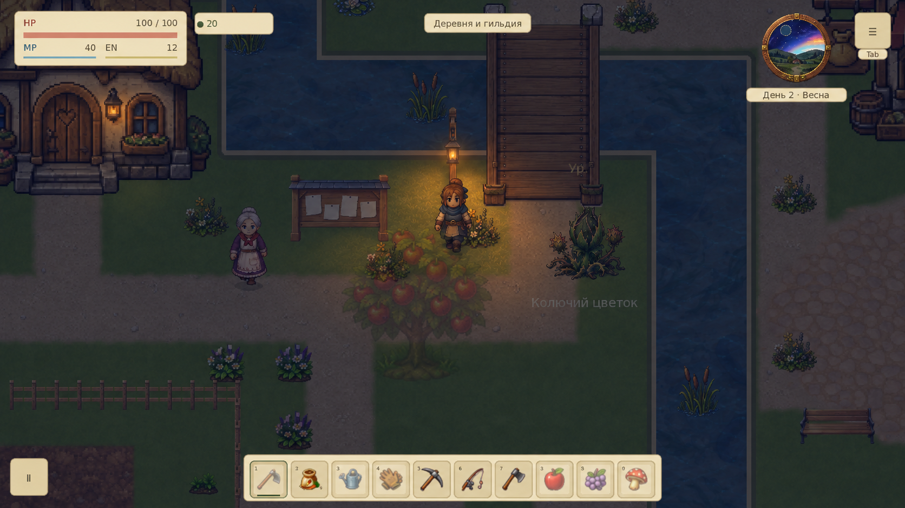

# Ночной фонарь · художественная проба

**Концепт, не кадр новой реализации.** Создан встроенным image_gen 23 ноября 2026 для LIGHT-00. В игру не подключён. Выбран как ориентир по мягкому локальному свету, а не точный эталон пикселей, интерфейса, формы объектов или теней: генератор перерисовывает небольшие детали исходного кадра.

- `native-reference.png` — точная копия члена `1280/street-night-palette.png` из принятого `docs/reports/visual-overhaul/vlight-003/native/candidate.zip` (историческая ночная сцена, не новый запуск).
- `target.png` — AI-концепт на основе этого кадра: тёплый фонарь, мягкое пятно на земле и слабый акцент уже существующей лампы у двери. Он не доказывает динамику, переносимость источника, сохранение HUD, стоимость или правильность перекрытий.
- [Полный prompt](PROMPT.txt) · [Хэши и происхождение](provenance.json).

В production переносится только направление света. Полный игровой кадр, HUD и геометрия должны оставаться настоящими; размеры/яркость выбираются в VLIGHT-004 по нативной пробе, а не копированием картинки. Перемещение источников и гладкость в движении принимаются отдельно по [матрице](../../../epics/night-light/DESIGN.md).
