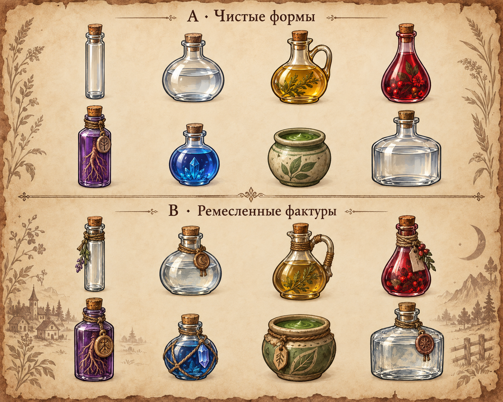
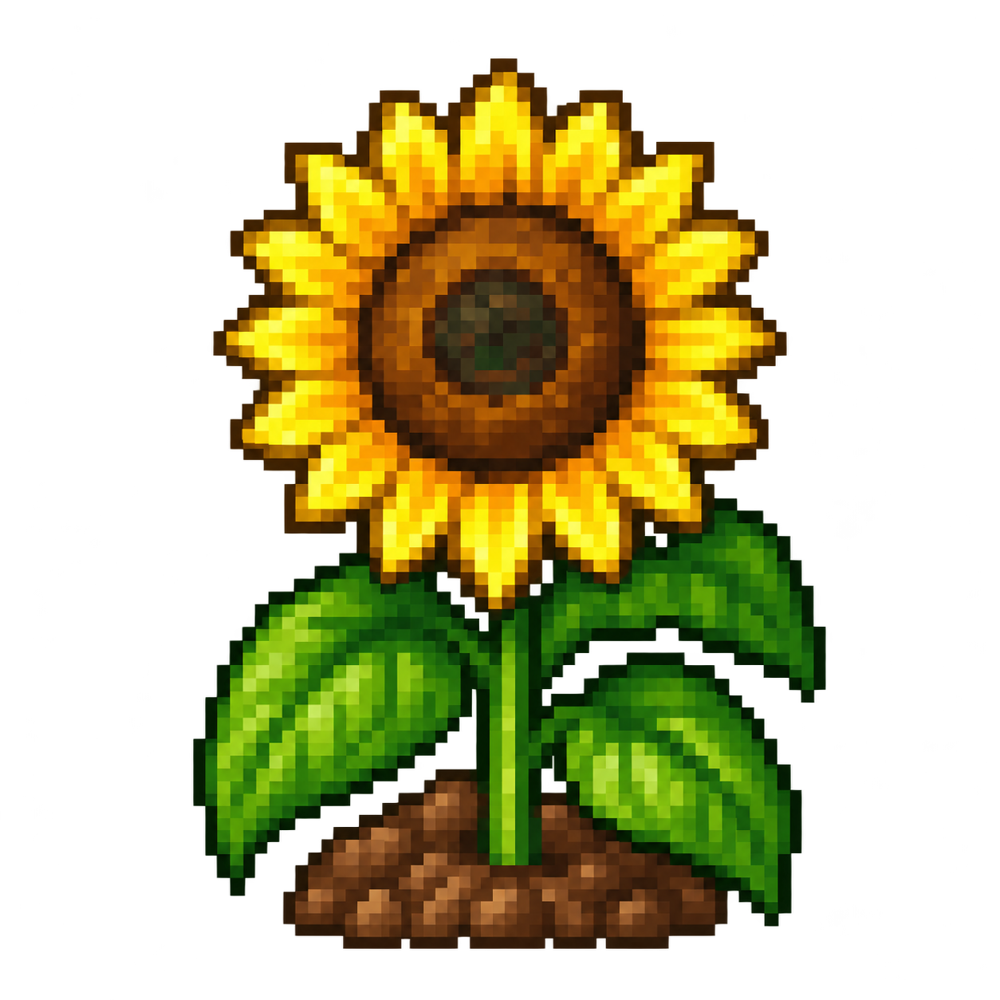

# Колбы и целый подсолнух

Для замены плоских процедурных колб подготовлены два направления: A — чистые формы; B — ремесленные фактуры. На обоих рядах одинаковые восемь типов сосудов. Это отдельный лист дизайна, который не нарезается автоматически в игровые ресурсы.

Подсолнух восстановлен по существующему исходнику с обрезанными верхними лепестками. У предложения целая головка и прозрачный безопасный край.

[Промпты](generation.json) сохранены. Пользователь выбрал A и целый подсолнух. Десять [мастеров сосудов](selected) создают 84 игровых вида сосудов/содержимого; подсолнух — отдельный 85-й ресурс. Исходные мастеры и полные [промпты](selected-generation.json), [пустая тара и коррекция](extra-generation.json) сохранены отдельно. Игровые PNG160px находятся в `assets/game/items/painted`; они подключены через общий визуальный контракт, а миниатюры64px и превью160px пересобраны. Все новые ресурсы имеют прозрачный край; имя и количество остаются текстом интерфейса. Рецептурная окраска применяется при сборке только к насыщенному содержимому выбранного сосуда; стеклянные блики, пробка и обвязка сохраняются. Исходные большие мастеры не загружаются в игре.

Сборка: `Godot --headless --path . --script res://tools/assets/authoring/build_painted_item_icons.gd`, импорт ресурсов, затем `res://tools/assets/authoring/build_item_ui_textures.gd`. [Финальные кадры и проверки](../../../reports/storage-grid-2026-10-13/ART_VALIDATION.md).
