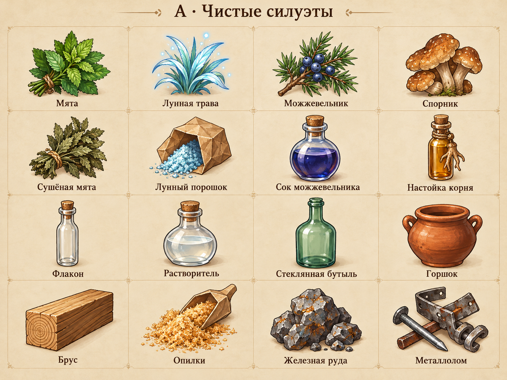
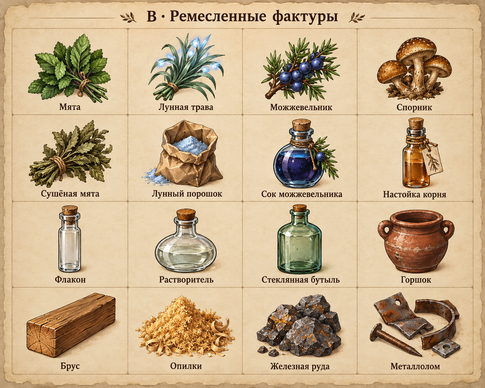
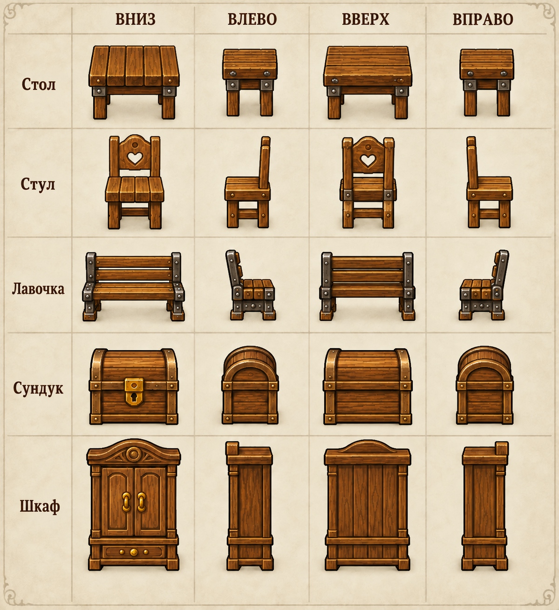

# Большая художественная ревизия

[Полный план](PLAN.md) охватывает все предметы, мебель, направления, дороги, тени, мастерские и обратную связь. [Реестр](current/audit.json) содержит все 385 предметов и 274 неизменённых PNG из настоящих источников игры. [Партии](backlog.json) распределяют каждый ID ровно один раз.

## Смотреть

Запустить с Node.js, который используется для Wiki:

```sh
node tools/art_review_serve.mjs
```

Открыть напечатанный адрес, обычно `http://127.0.0.1:4184/`. Сервер работает только на localhost и отдаёт файлы этого каталога. Страница умеет искать предметы, фильтровать измеримые признаки и партии, сравнивать игровую окраску с прежним отображением Wiki, отмечать решение и выгружать его в JSON. Решения сохраняются только в браузере; они не меняют запасы, сохранения или ресурсы игры.

«Общая картинка» и «повторный силуэт» не означают автоматически плохое качество. Техническая ревизия полная; художественный просмотр и перенос идут партиями после выбора стиля.

[Проверки и кадры браузера](VALIDATION.md) фиксируют первый технический этап и границы выполненной работы.

## Варианты







Это листы просмотра, созданные встроенным `image_gen`; [промпты](generation.json) сохранены рядом. Выбранные предметы позже создаются как отдельные прозрачные игровые ресурсы. Передняя/задняя стороны стула и лавочки исправлены отдельно при проверке листа. Тени и окно кухни в галерее — ссылки на ранее созданные решения, используемые как основа общего плана.

## Воспроизвести

```sh
./tools/Godot.app/Contents/MacOS/Godot --headless --path . --script res://tools/art_review_export.gd
python3 tools/build_art_backlog.py
```

Экспорт использует отдельный пользовательский каталог. Он сохраняет фактические PNG без изменения пикселей, извлекает source/atlas, цвет и размеры силуэта и группирует формы. После изменения реестра/ресурсов ревизию нужно пересоздать вместе с точным составом партий. Версия снимка — версия на момент экспорта до автоматического повышения коммитом.

Общий визуальный контракт: [item_icon_visual_system.gd](../../../../scripts/presentation/item_icon_visual_system.gd). Профильные проверки: `tools/item_icon_contract_review.gd`. Обязательные игровые/Wiki gates описаны в [TESTING.md](../../../../TESTING.md).
