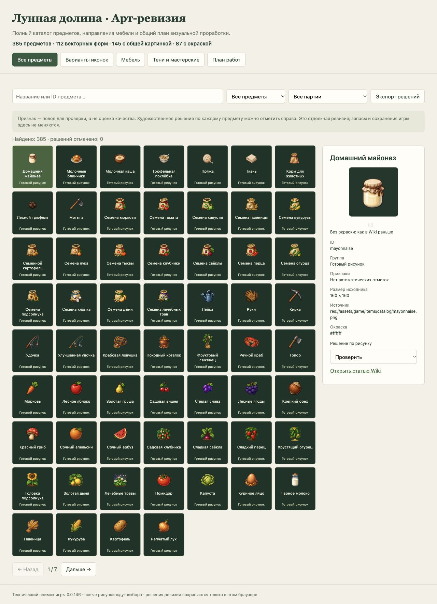
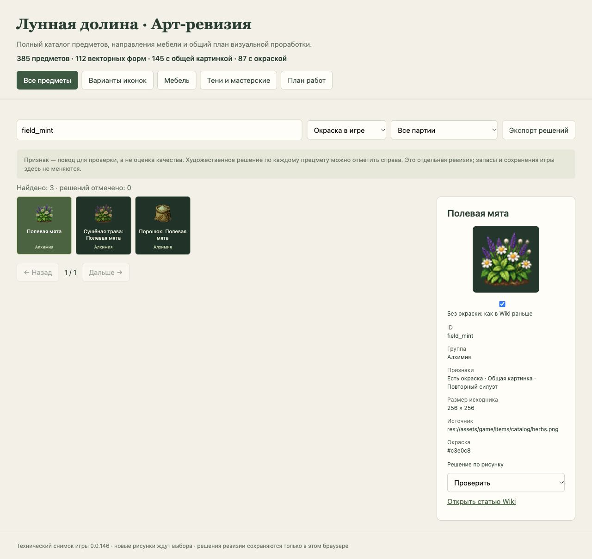
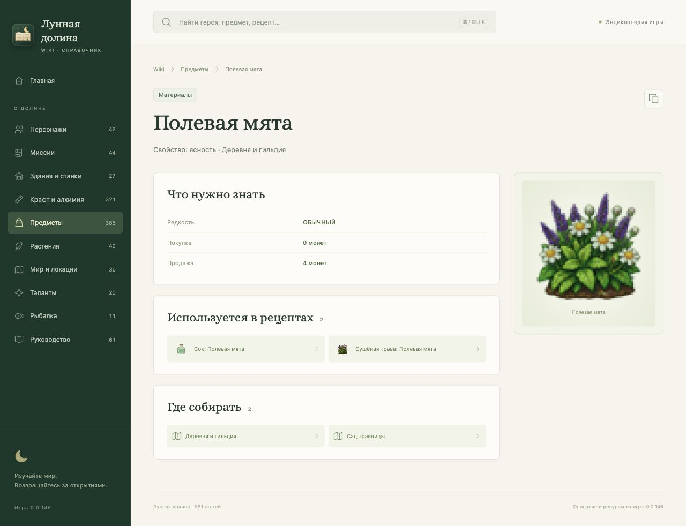
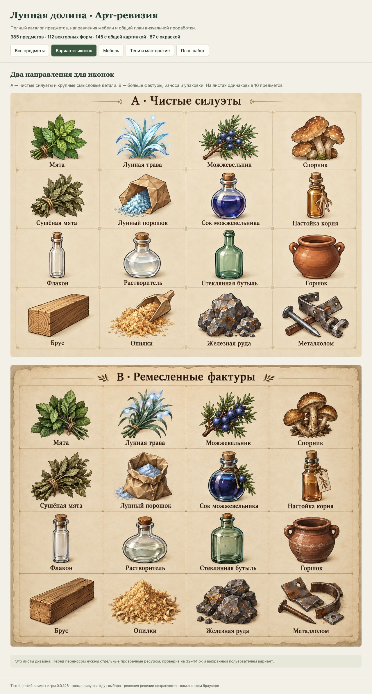
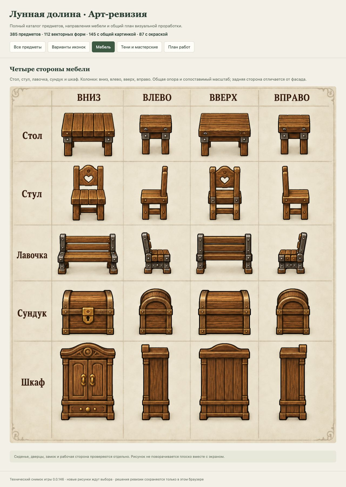

# Проверки первого этапа

Проверен технический контракт и отдельная страница ревизии. Художественное направление ещё не выбрано; мировая мебель, дороги, тени и окна мастерских пока остаются этапами [плана](PLAN.md).

- Профиль `tools/item_icon_contract_review.gd`: 395 проверок, 0 ошибок; нет `ERROR`/`SCRIPT ERROR` движка. Все 385 видов имеют окончательную текстуру; проверены порядок выбора, копирование кеша и явная замена процедурного ресурса.
- Регрессия шкафа: 6 647 проверок, 0 ошибок движка.
- Wiki `pnpm check`: TypeScript, сборка, реестр/ссылки и 12 тестов прошли. Новый тест сверяет цвет предмета с его рецептами/растениями.
- `python3 tools/check_art_review.py`: 385 предметов, 274 исходных PNG, 16 партий; покрытие, хеши, рамки и цвета валидны.
- `python3 tools/test_art_review.py`: 3 теста прошли, включая отрицательные случаи пропусков, повторов, подмены пути/цвета и выхода за рамку.
- Архитектурная проверка прошла. Полный игровой набор дополнительно обязателен в pre-commit перед публикацией; его результат хранит журнал публикации.

В браузере проверены поиск/признаки, партия из 24 трав, все семь страниц, последние 25 предметов, смена карточки при пагинации, пустой поиск, запись/отмена решения, оба вида окраски, все пять разделов и отсутствие ошибок консоли. Проверка выполнена в настольном окне; адаптивная CSS-разметка не означает выполненный мобильный прогон.

Снимок содержит версию 0.0.146 до автоматического повышения при коммите. Прозрачные финальные ресурсы, читаемость новых рисунков на 32–44 px и игровые кадры после переноса проверяются при приёмке выбранной партии.
