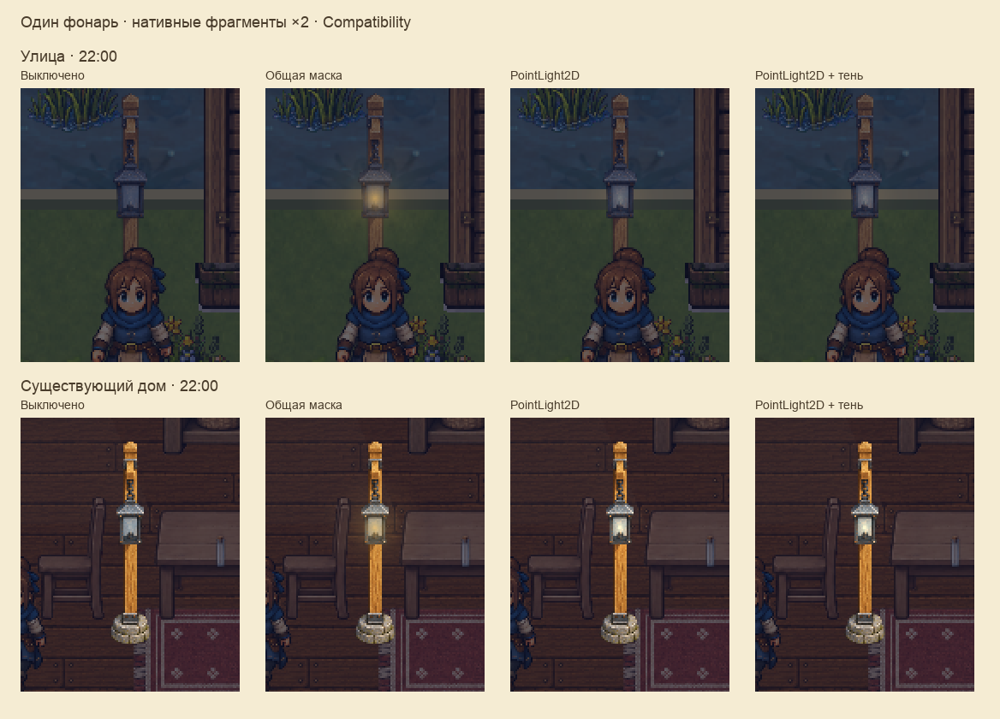
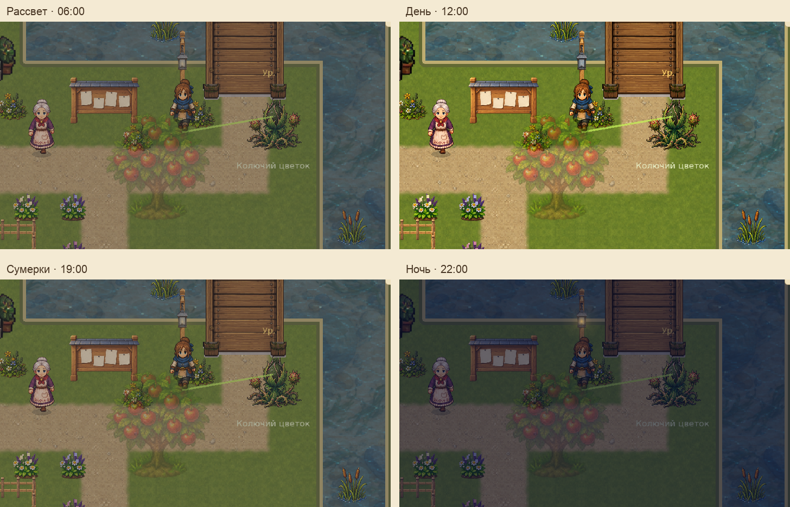

# Осмотр существующего света

Основание постановки — принятая main `e0d393034f36bc4ba27329cd9e4e0b09c3a157d1`, версия **0.0.488**. Осмотрены реальные сохранённые игровые кадры и их исходники. Это не новый интерактивный запуск 23 ноября: Developer занят VLIGHT-010, удалённого интерактивного стенда нет; новый native-прогон этой задачи ещё не получен. По статичным PNG нельзя принять плавность, задержку или аппаратный FPS.

## Что видно

| Наблюдение | Основание | Решение |
|---|---|---|
| Уличный фонарь даёт небольшой тёплый акцент преимущественно внутри стекла; земля под ним почти не освещена | Просмотр `vlight-002/comparison.png`, ночная строка 22:00; `vlight-003/cycle.png`, ночь 22:00 | VLIGHT-004: отдельный мягкий свет на поверхности, стекло остаётся небольшим ярким центром |
| Ночь сохраняет холодное общее затемнение; добавление яркого общего жёлтого круга легко испортит материалы | Те же ночные кадры; actual `atmosphere_renderer.gd`, `daylight_palette.gd` | Сохранять общую палитру 003; локально менять читаемость и цвет без второго полного tint |
| На более свежем принятом вечернем кадре свет стекла также небольшой | VCOMPAT-010 CI2: capture head `1c0590048f38c8f8448abf48a88bb9a4e314f7f5`, run45041661293/job137267236311/artifact14762117327; член `evidence/candidate/1280/evening-on.png` | Использовать как статический контекст принятой графики, не как новую ночную/видеопроверку |
| Современный glow — общий mesh по профилю; локальный emitter для трёх ракурсов уже есть | `village_lamp_visual.gd`, `assets/game/locations/overworld/lamps/profile.json` | Переиспользовать профиль и ресурсы; не переписывать готовые якоря и не возвращать нарисованный в PNG ореол |
| Обход света читает статические PROP_PLACEMENTS + SCENIC_PLACEMENTS; позиция корпуса и света вычисляется в разных проходах, ракурс в вызове остаётся значением по умолчанию | `atmosphere_renderer.gd::draw_lights`, `village_prop_renderer.gd::draw` | Один снимок экземпляра для обоих потребителей; статические placements — лишь нынешний поставщик данных |
| Сейчас ночной halo рисуется после общего затемнения, без отдельного приёма света поверхностями и отсечения стенами | Тот же draw-путь; принятый аудит VLIGHT-001 | Ограниченный поверхностью ground spill, явные правила заслонения; не обещать физическое освещение от простой замены на PointLight2D |
| Рабочий горн находится в кузнице, также поддерживается подвал | `furnace_system.gd::at_station`, `basement_station_system.gd` | VLIGHT-006 уточняется для своей очереди; не объявлять существующей уличной станцией и не блокировать ей009 |
| Внутренний луч — отдельный постоянный полигон; комнатная мебель уже имеет сетку, ракурс, опору и footprint | `interior_renderer.gd` около light_center; `house_furniture_layout_system.gd`, `furniture_facing_system.gd` | Будущий VLIGHT-005 использует тот же контракт размещения, не второй набор координат; интерьер сейчас не переделывать |

Историческая [серия VLIGHT-002](../../reports/visual-overhaul/vlight-002/README.md) сравнила mask/PointLight2D/PCF5 на Compatibility и выбрала общий тёплый mesh для малого halo. Это не доказательство качества большого пятна на земле: его новые размер, перекрытия и стоимость проверяются в 004. [Палитра VLIGHT-003](../../reports/visual-overhaul/vlight-003/README.md) меняет рассвет/сумерки; endpoints дня/ночи сохранены. [VCOMPAT-010](../../reports/visual-overhaul/vcompat-010/closeout/README.md) добавила обратимый общий профиль, который новый свет обязан уважать.

Изображения — прежние нативные доказательства, не нарисованное «после» и не результаты LIGHT-00. Оригиналы, manifest и прежние отказы не меняются.

## Что осталось проверить в реализации

Новая непрерывная запись движения вокруг фонаря и у стены; включение в сумерках; две лампы рядом; перенос/поворот/удаление экземпляра; standard/low/off, дождь и включённый общий rollback. Для каждого опыта — точный SHA, камера/zoom/seed, профиль, поверхность и полные исходные кадры. Измерения CPU submission, полного кадра и GPU не смешивать; software CI не выдавать за аппаратную приёмку.
