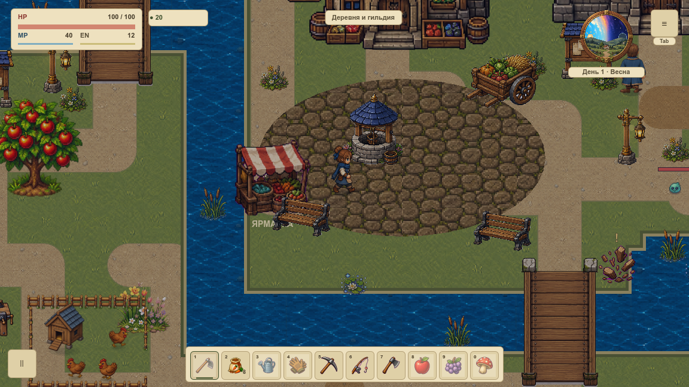

# Аудит перехода к живописной 2D-графике

Основание: текущий `057fbb3` / `0.0.202`; внешний пакет исследовал более ранний `570f808` / `0.0.200`. [Источники](SOURCES.md), [карточки](TASKS.md). Приоритет P0 ниже означает препятствие безопасному переходу, а не доказанный crash текущей игры.

## Что пользователь хочет видеть

На изображении B важны небольшая кладка у воды, видимое мелководье, узкие потёртые тропы, мелкие разные растения, спокойные материалы и сопоставимый масштаб героя/окружения. На одном JPEG нельзя проверить плавность воды, работу шейдера, бесшовность тайлов или стоимость эффекта. Изображение — ориентир композиции и материалов, не готовая игровая локация и не разрешение вырезать из него все ассеты.

В текущем кадре река уже осевая: прежняя жалоба на диагонали частично исправлена, переписывать геометрию заново не требуется. Однако у воды тонкий плоский кант, текстура насыщенна и повторяется, дороги похожи на капсулы с резким краем. Площадь занимает большую однородную область камня. Плотность деталей у яблони, колодца, героя и земли разная. Телега и часть предметов ещё имеют визуально диагональную перспективу; наличие `east/west/south` в данных само по себе не исправляет рисунок. Светлый HUD уже появился — не нужно объявлять его полностью зелёным по старым скриншотам.

Требуется не «накинуть shader на весь экран», а согласовать материал земли, переходы, формы и размер объектов. Сильная рябь, glow и туман могут только усилить визуальный шум. Художественная проверка должна сначала принимать неподвижный кадр с выключенными украшениями.

В свежем [доме](evidence/cottage_interior-current.png) уже есть аккуратная фронтальная мебель и светлый интерфейс. Полезно сохранить формы, но проверить соотношение большого шкафа/кровати/стола и небольшого героя, равномерность деталей пола и контактный свет. В [подвале](evidence/cellar_workshop-current.png) тёплая кирпичная оболочка соответствует выбранному направлению; большой незастроенный пол — ожидаемое начальное состояние, а не ошибка отсутствующих станков. Проверять надо и заполненную мастерскую, это ещё не сделано.

В [пещере](evidence/cave-current.png) есть объёмные стенки и факелы, но повторяющийся материал большого пола слабо разделяет маршруты и зоны интереса. В [святилище](evidence/cave_sanctum-current.png) выбран ракурс от входа: видно сочетание камня, алтаря и колонны, но сам бой с боссом не показан. Здесь нужна отдельная визуальная приёмка арены с действующими телеграфами, а не вывод о всех анимациях по статичному скелету.

## Подтверждённые ограничения кода

| Приоритет / факт | Доказательство в текущем коде | Следствие / ведущая работа |
|---|---|---|
| P0: герой не готовый Player Node2D | `scripts/game_context.gd:94`, `player: Vector2`; `main.tscn` содержит Game и WorldBackground | Пример `actor_anchor.global_position` напрямую не подключается. Нужен читающий адаптер действительной позиции, VRENDER-008 |
| P0: мир преимущественно custom draw | `scripts/systems/render_system.gd:10–39`, вызовы земли, актёров, переднего плана, атмосферы и UI | Один material на Game затронет множество команд. Отдельный узел с z-index не вклинится произвольно между командами одного `_draw`. VRENDER-001/002/004 |
| P0: вода и мост входят в статичный кеш | `village_terrain_renderer.gd:16`, `draw_water`, `_draw_bridge`; `world_background.gd:78`, UPDATE_ONCE | Shader внутри такого viewport замрёт после запекания. Вынести живую поверхность, сохранив неподвижную землю и настил. VRENDER-003, WATER-06 |
| P0: ручная пауза не равна SceneTree.paused | `scripts/core/game_loop.gd:4–71`, ранние return для меню/фокуса/редактора | PROCESS_MODE_PAUSABLE из примера недостаточен. Шейдерный TIME также не следует игровой паузе. VFOLIAGE-009, VCOMPAT-007 |
| P0: update_world выполняется до движения | `game_loop.gd:43,47,105–115` | Контакт растений должен читать результат движения/столкновения/перехода, а не направление кнопки и прошлую позицию. VRENDER-008 |
| P0: UV и корень примера не соответствуют атласу | `village_ambient_renderer.gd`, 4×3, ячейка 362×362, мировой размер 72×72 | MODEL_MATRIX общего canvas — не корень отдельной травинки. Нужны локальная область и явная опора; VFOLIAGE-001/002 |
| P1: растения сейчас двигаются целой картинкой | `village_ambient_renderer.gd:46`, sin смещения позиции и alpha, настенное время | Это не укоренённый ветер и не реакция на героя. В этом конкретном наборе только 12 размещений: 6 камышей, 3 кувшинки, 2 травы, 1 листва. Не выдавать их за полный каталог растительности |
| P1: камера и герой округляются отдельно | `camera_system.gd`, `target_offset().round()`; `animation_renderer.gd:20` | При смене фильтра возможна дрожь относительного положения. Сначала видео и контракт координат, затем решение; VCAMERA |
| P1: nearest задан явно на фоне | `world_background.gd:43,50`; проектный default — отдельная настройка | Одно изменение project.godot не переопределит явные режимы всех ресурсов. VPIPELINE-003 |
| Уже есть ограниченная сортировка и затухание крон | `tree_occlusion_system.gd`, submit/draw_foreground/opacity, transient meta | Сохранить и развить; утверждение «сортировки вообще нет» неверно. VFOLIAGE/VTREE |
| Уже есть свет и тени интерьера/пещеры | `interior_renderer.gd`, `cave_lighting_system.gd`, `atmosphere_renderer.gd` | Проверять двойное затемнение/нарисованные тени; не накладывать новый слой повсюду. VSHADOW/VLIGHT |
| Погода частично привязана к настенному времени | `atmosphere_renderer.gd`, draw_rain/draw_snow, Time.get_ticks_msec | Определить общую политику паузы и reduced motion; VWEATHER-001/008 |
| Вода имеет канонические данные | `water_map_registry.gd`, CACHE_LIMIT=2, has_surface отдельно от blocks; `water_topology.gd`, клетка 24, чанки | Не рисовать вторую независимую геометрию. Сохранить мост, рыбалку и миграции WATER-03/07/11 |
| Редактор и публикация связаны общим renderer | `published_level_renderer.gd:5–9` → LevelEditorRenderer.draw_object | Новые профили обязательны в обоих путях; иначе карта из F12 будет выглядеть иначе. VEDITOR |
| Профиль одновременно содержит visual_size и collision_size | `world_visual_profile_system.gd` | Менять художественный размер без скрытого изменения footprint. Для непропорционального crop сохранять общий масштаб, не растягивать каждый кадр |

Номера строк относятся к указанному baseline. Часть файлов исследована по функциям и imports, а не как доказательство корректности каждой ветки. Перед реализацией карточки требуется полный контекст затрагиваемого модуля. `RenderSystem.opaque_storage` уже прекращает дорогую отрисовку скрытого мира — это полезная оптимизация, её нужно сохранить.

## Почему исходники из ZIP нельзя просто скопировать

| Пример | Что полезно | Чего не хватает именно нашей игре |
|---|---|---|
| `visual_environment.gd` | Один менеджер общих параметров | Vector2 вместо actor Node, ручная пауза, несколько viewport, ограниченная фаза времени, телепорт и владелец при смене карты |
| `grass_patch.gd` | Опора у корней без `_process` на пучок | Явно исключает atlas/regions/flip; в нашей траве это основной формат |
| `grass_interactive.gdshader` | Ветер, регуляризованная дистанция, закрепление низа | Четыре вершины дают наклон, не полноценную кривизну; нет памяти восстановления, скорости, NPC и bounds для деформации |
| `water_surface.gdshader` | Статичная маска и движение мирового шума | Нет готовых дна/берега/mask, flow на поворотах, интеграции WATER. Примерный `(0.020,-0.014)` — глобальная диагональ, её нельзя принять как течение всех рек |
| `water_noise.tres` | Маленький повторяемый шум 256×256 | Seamless не доказывает качество стыков всех масок; формат и масштаб надо проверить в движке |
| shader globals example | Явные исходные параметры | Не заменяет project.godot; несколько миров не должны писать один actor_position |

Примеры в этом аудите не компилировались и не внедрялись. Архивный автор тоже явно не заявляет тестирования. Ни стабильность, ни выигрыш GPU этими файлами не доказаны.

## Инвентарь и масштаб переделки

Свежий экспорт `wiki/scripts/export_catalog.gd` в отдельную временную папку: **921 runtime-статья, 704 изображения экспорта**. Существующий сайт содержал ещё 78 редакционных guides и более раннюю metadata; это не 78 потерянных игровых сущностей.

| Каталог | Число | Как покрыт планом |
|---|---:|---|
| Предметы | 386 | По одной карточке решения reuse/adapt/redraw и пары 64/160, VICON |
| Персонажи/существа | 42 записи / 40 художественных единиц | 160 карточек: паспорт, базовые позы, действия/переходы, подключение. Общая курочка покрывает три записи |
| Растения | 40 | 16 культур + 24 алхимических вида; мировая форма, состояния, отклик/сбор — 120 карточек |
| Здания/станки | 27 | 8 зданий + 18 станков + улей; 81 карточка, реальные уровни и construction только там, где они есть |
| Локации | 30 | 90 карточек композиции, атмосферы и штатного маршрута приёмки |
| Рецепты | 321 | Защита данных и UI; не 321 новый рисунок, используются предметы и станции |
| Задания | 18 реальных миссий, 44 статьи категории missions | Проверка читаемости/ссылок; не добавляем новые сюжетные задания в графическую программу |

В `assets/game` найдено **1188 PNG**, 216 844 301 байт на диске. Теоретическое суммарное RGBA8 без mip — 851 961 992 байт; это **не** реально одновременно занятая GPU-память. 12 групп точных побайтовых дублей содержат 87 дополнительных копий. Дубликат не доказывает неиспользование: он может быть подготовленным размером, вариантом каталога или совместимостью. Ничего не удалено. [Полный размерный реестр](evidence/asset-inventory.json).

Манифест содержит 29 семейств. Старые описания некоторых станков ещё говорят о четырёх видах, тогда как свежий экспорт станций показывает east/south/west: требуется привести документацию и источники к реальному правилу. Полный исходный atlas нельзя оценивать по маленькой иконке. Происхождение/лицензии всех 1188 файлов этим аудитом не подтверждены; это отдельная работа VBASE-007/VPIPELINE-010.

## Свежая диагностика производительности

Использован существующий `tools/water_audit.gd`, новая метка, одна деревня, 3×180 кадров после прогрева. Нативный Godot **4.7.1 stable**, Compatibility / OpenGL3, **AMD Radeon Pro 5300M**. Фокус 180/180 в каждом повторе, фоновая пауза выключена, VSync=1. Камера неподвижна, симуляция работает, герой защищён. Screenshot readback вне измерительного окна.

**Существенное ограничение:** заданная цель 1152×648 действительно отрисована в SubViewport, но фактическое внешнее окно стало **3584×2240**. Это замер target + композитинг большого окна; он не проходит строгий сопоставимый performance gate для обычного окна 1152×648. Не сравнивать напрямую с историческими p95 и не объявлять регрессию конкретного коммита. Исправление/стабилизация протокола — VBASE-001/VPERF-001, владелец OPT-01.

| Повтор | p95 интервала frame_post_draw | p99 | Максимум |
|---|---:|---:|---:|
| 0 | 63.132 мс | 71.248 мс | 76.530 мс |
| 1 | 54.723 мс | 72.431 мс | 73.473 мс |
| 2 | 52.574 мс | 67.013 мс | 67.989 мс |

Конечные мониторы каждого повтора: 166 draw calls, 15 nodes, 1164 resources, текстуры **753 884 042 байт ≈719 MiB**; 0 пересборок terrain в измерительных интервалах. Эти счётчики не локализуют CPU/GPU bottleneck. Низкое число узлов не означает низкую стоимость больших текстур, прозрачности или custom draw. Нулевой rebuild показывает, что именно в этих интервалах пересборка земли не была причиной задержек.

[Raw JSON](evidence/native-1152.json) сохраняет все кадры без удаления выбросов. Время GPU отдельно недоступно. Батарея, тепловой режим и фоновые приложения не контролировались, длинная сессия не измерена. Нужны маршрутные прогоны и сравнение каждого эффекта; «сборщик мусора раз в N секунд» сам по себе не решает эту проблему.

## Риски и решения до реализации

- **Главный риск масштаба:** нарисовать сотни несогласованных предметов раньше эталона. Решение: стандарт/пилот и заблокированные производственные карточки.
- **Главный технический риск:** навесить один shader на Game или запечь анимацию в UPDATE_ONCE. Решение: ограниченный проход и ADR CPU/GPU/CanvasItem, без переписывания state.
- **Память:** увеличение всех исходников до условного 4K даст больше памяти, а не гарантированное качество. Раздельные мастера/runtime и видимые bounds обязательны.
- **Сортировка:** один большой MultiMesh не решает взаимное перекрытие героя и каждой травинки. Сначала low grass под героем и небольшой сортируемый набор высокой растительности; пакетирование после замера.
- **Сохранения и редактор:** новые визуальные поля должны иметь defaults; не добавлять в save зависимые от GPU состояния. F12 и published проверяются до широкого rollout.
- **Визуальная цель:** направление B набережной не означает, что уже приняты все варианты воды, архитектуры, колб и лиц. Прежние выбранные простые формы A и светлый интерфейс сохраняем как ограничения; новые мастера показываем отдельно.
- **Платформы:** `export_presets.cfg` в корне отсутствует. macOS проверен нативно; минимальная конфигурация, Windows/Linux и экспортные shader variants остаются открытыми.

Опциональные normal maps, screen-space distortion, множество динамических источников, костная анимация всех существ и fluid simulation не являются обязательными требованиями. Каждая такая технология должна пройти короткий сравнительный прототип и иметь простой fallback.
