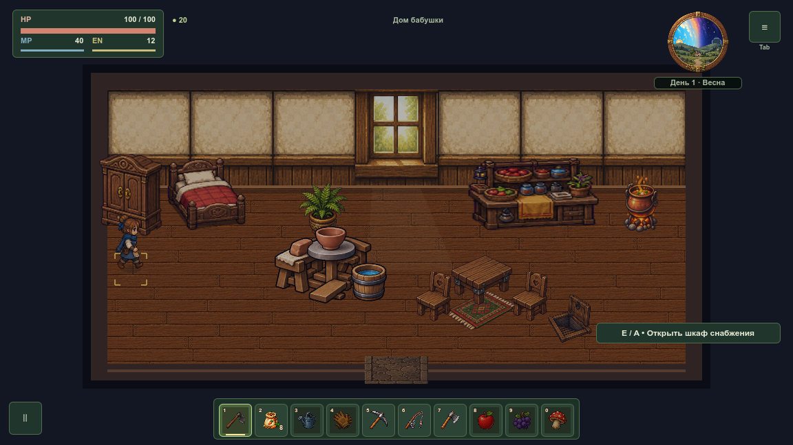
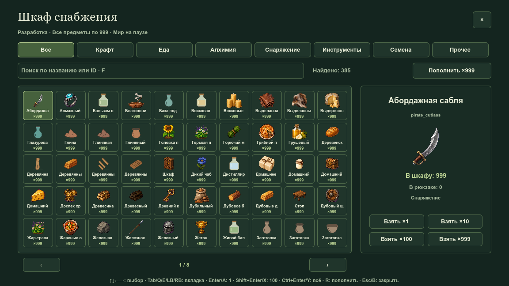
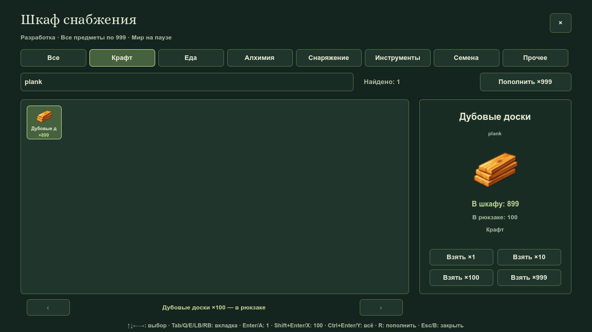
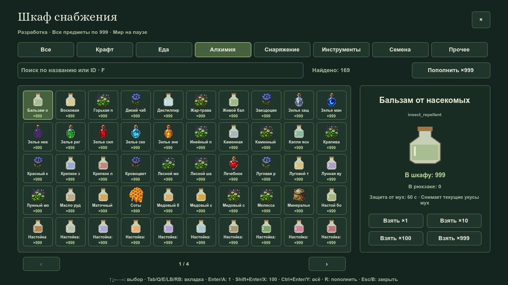
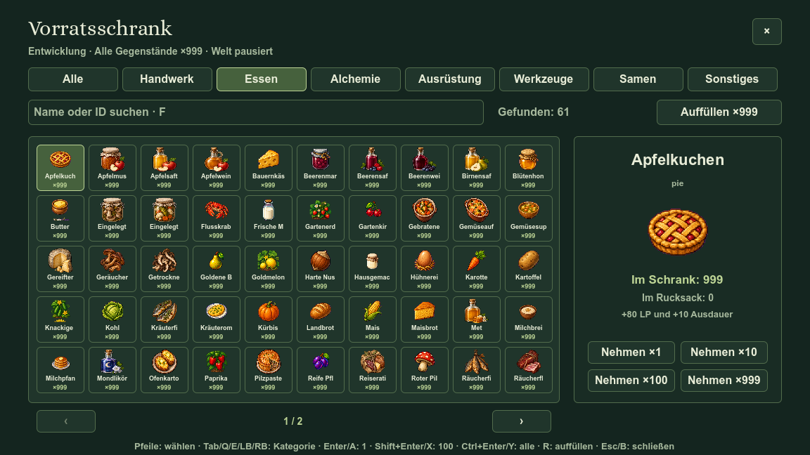
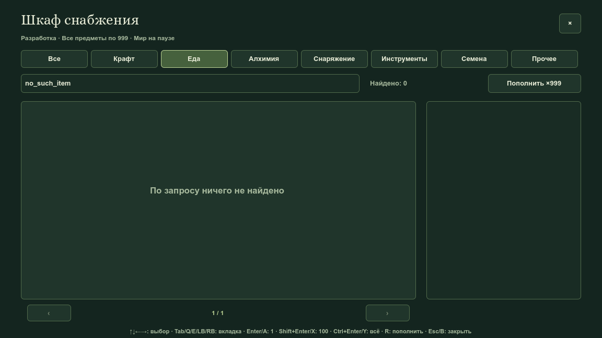
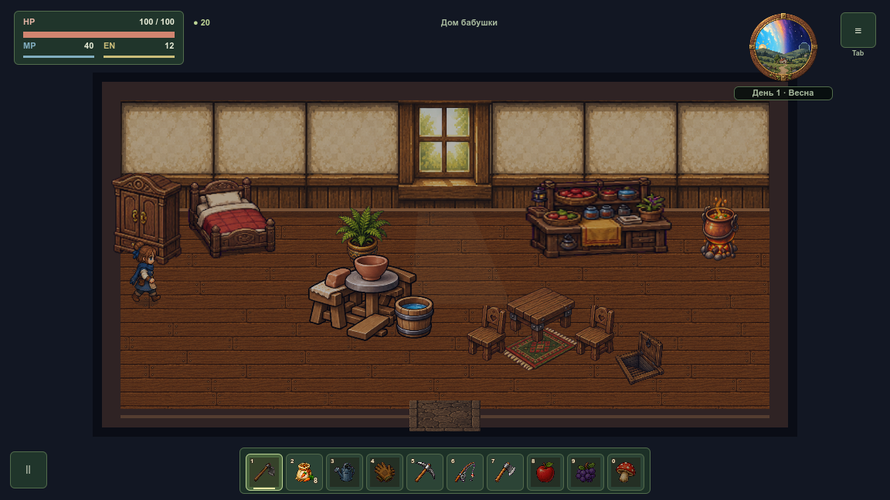

# Шкаф снабжения — 13 октября 2026

Временный склад разработки использует существующий шкаф слева от кровати в доме. Полный реестр содержит 385 видов; каждый начинает с 999 единиц. Новые зарегистрированные предметы автоматически включаются в каталог. Вкладки: все, крафт, еда, алхимия, снаряжение, инструменты, семена, прочее.

Выдача 1/10/100/до 999 переносит реальные предметы в рюкзак без цены и опыта, пополнение восстанавливает только шкаф. Пять прежних инструментов и оружий с флагом владения выдаются по одному, если отсутствуют. Окно останавливает физическую симуляцию мира. Полученное сохраняется; временный запас и окно исключены из JSON. `development/supply_cabinet_enabled=false` отключает снабжение перед релизом.

## Нативные игровые кадры

Сняты обычным renderer main.tscn в SubViewport 1152×648, без масштабирования изображений. Стенд использует отдельный userdata.

## Проверки

Профильный `DevCabinetSuite` включён в общий `StorageForgeSuite`. Проверены полный реестр и разбиение категорий, выдача каждого вида, соответствие счётчиков, JSON-загрузка всех выданных предметов, старые слоты, атомарный отказ невалидной загрузке, реальный маршрут от входа, клавиатура/геймпад/касания, поиск, настоящая физическая пауза очереди станка и времени, отключение перед релизом и шесть языков с текстом 120%.

Нативный захват отдельно проверяет открытие обычным контекстным действием и передачу 100 досок с остатком 899. Журнал проверяется на все ошибки движка и скриптов; один маркер PASS не заменяет эту проверку. Перед публикацией обязательны архитектурный gate и полный тестовый runner согласно [TESTING.md](../../TESTING.md).

Профильный прогон: 2851 успешная проверка, 0 отказов; нативный захват: 7 кадров, PASS. Оба журнала без `ERROR:` / `SCRIPT ERROR`. Архитектурный gate подтвердил лимиты модулей, целостность локальных ссылок и всех 29 семейств спрайтов.
