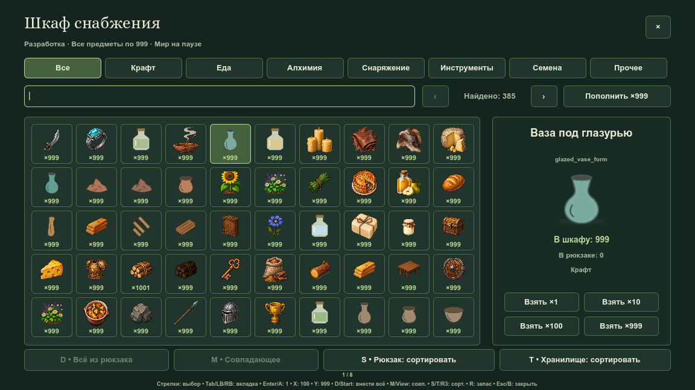
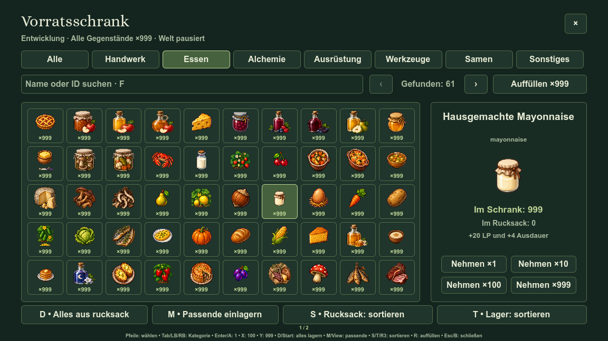

# Шкаф: иконки, количества и карточка фокуса

В ячейках шкафа оставлены только иконка и реальный остаток. Иконки увеличены с 36×36 до 44×44; области рисунка и количества не пересекаются. Полное имя находится справа и переносится на строки вместо однострочного уменьшения.

Движение мыши над существующей ячейкой текущей страницы обновляет общий выбор. Клавиатура, геймпад и касания используют тот же предмет в правой карточке. Наведение не выдаёт вещи, не выбирает промежутки/пустые ячейки и не прерывает ввод поиска. Выдача по-прежнему выполняется явной кнопкой или клавишей.

## Нативные кадры

Дополнительные кадры: [все предметы](dev-cabinet-icons-2026-10-13-all.png), [выдача 100 досок](dev-cabinet-icons-2026-10-13-craft-search.png), [алхимия](dev-cabinet-icons-2026-10-13-alchemy.png), [пустой поиск](dev-cabinet-icons-2026-10-13-empty-search.png), [шкаф в комнате](dev-cabinet-icons-2026-10-13-house.png), [отключённое снабжение](dev-cabinet-icons-2026-10-13-disabled.png).

Снимки 1152×648 получены из настоящего Godot renderer, без обработки итогового изображения, в отдельном пользовательском каталоге тестового стенда.

## Проверки

Профильный `tools/dev_cabinet_review.gd`: **6647 успешных утверждений, 0 отказов**, ошибок движка нет. Он проверяет наведение на второй странице, переключение клавиатуры/геймпада, запрет выдачи от движения указателя, фокус поиска, пустые результаты, раздельную геометрию и полные названия всего реестра на RU/EN/ES/DE/FR/ZH при 120% текста. Проверены прежние выдачи, сортировка, сохранения, пауза, доступ и отключение шкафа, а также общий аудит интерфейса.

Графический `tools/dev_cabinet_capture.gd` сохранил восемь кадров и завершился PASS без `ERROR:` или `SCRIPT ERROR`. Для сохранения прежних снимков использован `FARM_CABINET_CAPTURE_PREFIX=dev-cabinet-icons-2026-10-13`. Обучение и [управление](../CONTROLS.md#шкаф-снабжения) обновлены на шести языках; пользовательский сценарий описан в [руководстве](../GAME_GUIDE.md#шкаф-снабжения-для-разработки) и [QA](../../QA_CHECKLIST.md).
