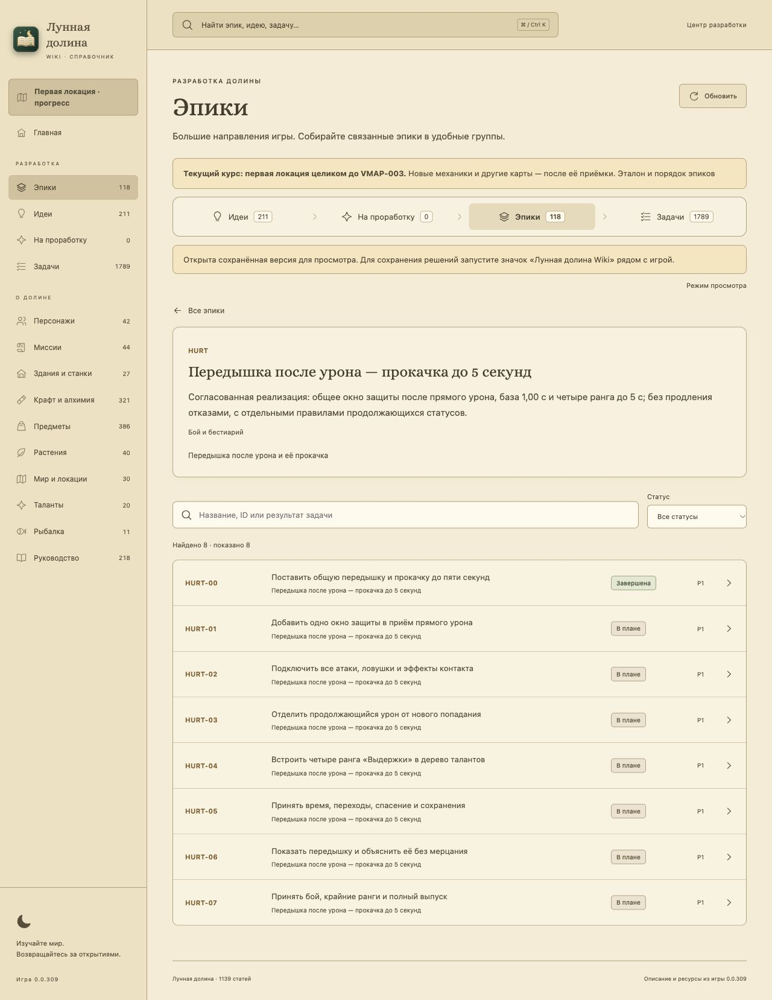

# HURT-00 — постановка защиты после урона

22 октября 2026, прямое поручение пользователя: добавить обязательную механику, оформить задачами, затем увеличить верхний предел прокачки сначала до 3 с, затем уточнить диапазон **от 1 до 5 секунд**. Результат — согласованный [эпик HURT](../../epics/hurt-recovery/README.md), [семь игровых этапов](../../epics/hurt-recovery/TASKS.md) и [Wiki-статья](../../../wiki/articles/combat-hit-recovery.md). Нового номера IDEA нет. Только редакционная HURT-00 закрыта; HURT-01…07 остаются открытыми.

## Исходное состояние и границы

Проверена принятая main 7cf646e22f04353aa4220979623baa852d1d4a9a: общая функция damage_player, 0,32 с рывка, 0,30 с анимации боли, 2 с recovery, локальная защита пещерного босса 0,65 с, periodic от мухи, все текущие вызовы урона и общие таланты/слоты. Яд/холод названы будущими контрактами. Рабочая VFOLIAGE-003 в основном checkout сохранена отдельно; её незавершённые изменения не включены.

Согласованы база 1,00 с и четыре ступени 2/3/4/5 с за общие очки с поздними уровнями доступа. Правило не растягивает реакцию боли, не продлевается от отказов и не выключает продолжающиеся статусы. Есть 14 будущих сценариев, явно отличённых от сегодняшних проверок документов.

## Редакционная приёмка

- Зарегистрирован отдельный источник hurt-recovery / эпик HURT в существующей группе «Бой и бестиарий», восемь карточек: одна редакционная done и семь игровых backlog.
- Статья напрямую связана с эпиком и всеми восемью карточками. Реестр 211 идей и решений пользователя не меняется; задача не отправлена на повторное одобрение.
- Сохранены все прежние источники, статьи, оценки, ID и статусы. В графе новых зависимостей нет цикла, вход в реализацию ждёт VMAP-003.
- Проверки ссылок/документации, Wiki build/TypeScript/Node-тесты и браузерная приёмка выполняются по TESTING.md. Документация корректна; Wiki прошла 127/127 тестов, экспорт/TypeScript/production build прошли. Браузер подтвердил статью, таблицу 1/2/3/4/5, отдельный эпик, восемь карточек, реальные зависимости и четыре ранга. На ширине 390 px карточка имеет scrollWidth 390; временный viewport сброшен.
- Штатный pre-commit выполняет architecture и полный игровой набор; игровой результат H01…14 остаётся непроверенным до реализации.

Обычный commit/локальный merge выполняется по AGENTS. Прямого запроса push в этом поручении нет: результат остаётся в локальной main до пакета из десяти завершённых задач. Нет изменений gameplay, новых игровых тестов, QA-пунктов «готовой фичи» или изменённого руководства игрока о якобы действующей защите.

[Аудит сохранности и графа](editorial-check.json): прежние 211 идей, 60 источников и 122 записи статей сохранены; восемь новых карточек, семь backlog, циклов и сломанных ссылок нет.

