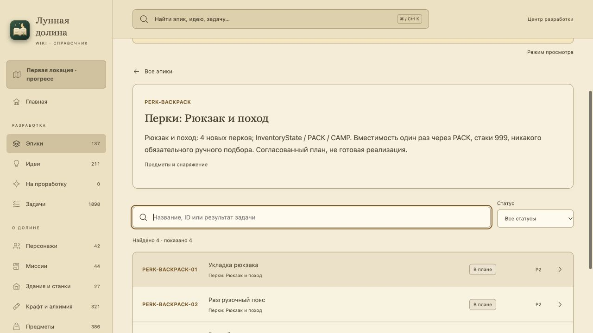

# PERK-00 — направления развития, Skyrim и рюкзак

Постановка 22 октября 2026 по прямому поручению пользователя в ходе HURT-00: одно общее очко за новый уровень, выбор направлений, скрытность/кузнец/готовка/лук/меч/сила/посох и развитие рюкзака. [Исследование и ограничения источников](research.md).

Результат: [общий паспорт](../../epics/perk-progression/README.md), [122 узла в редакционном каталоге](../../epics/perk-progression/catalog.json), [Wiki-статья](../../../wiki/articles/character-perks.md). Общий PERK и 18 отдельных тематических эпиков содержат **109 карточек: одна постановка done и 108 будущих**. Из будущих 11 принимают основания/интеграцию и 97 относятся к отдельным новым перкам. HURT-04 не дублируется.

## Сохранность и границы

Все 20 нынешних талантов и четыре ручных навыка сохраняют ID и владельцев. Общий skill_points один, у нового обычного героя до уровня 20 получается 19 очков; старому слоту очки заново не начисляются. У HURT остаётся 1/2/3/4/5 с; Укладка использует PACK и max купленного/перкового уровня, 60/72/84/96/108 без суммирования. Полный respec отказывает целиком, если после уменьшения сумки вещи не поместятся.

Статусы/истории 211 идей, оценки, группы и прежние источники не меняются. Новая IDEA не создана. Программный код и игровые ресурсы не меняются; новые утверждения геймплея не добавляются в GAME_GUIDE/QA как уже действующие. Реализация ждёт первой локации VMAP-003. Незавершённая рабочая ветка первой локации не включена в редакционную работу.

## Приёмка постановки

Проверки документации, полного графа источников/зависимостей/родителей и сохранности старых решений, Wiki build/TypeScript/Node-тесты и браузер выполняются по TESTING.md. Документация корректна; Wiki прошла экспорт/TypeScript/production build и 127/127 Node-тестов. Аудит подтвердил 122 узла, сохранность 24 нынешних, 19 новых источников/109 карточек, все родительские связи и граф задач без циклов. Браузер подтвердил 18 таблиц/122 строки, отдельный эпик и задачу Укладки, её зависимости/статус и поиск. На 390 px каталог и карточка имеют scrollWidth 390; viewport восстановлен. Штатный pre-commit выполняет architecture и полный игровой набор; будущие P01…11 и сценарии каждого перка этим не принимаются.

Результат вносится обычным commit в локальную main, отдельная ветка удаляется после успешного merge. Публикация по пакету десяти задач: прямого push в этом поручении нет. Каждая будущая игровая карточка получает done только после своего результата и доказательств.

[Редакционный аудит](editorial-check.json) сохраняет прежние 211 идей, 61 источник и 123 записи статей. Проверка 25 сочетаний рюкзака здесь относится к формуле дизайна, не к реализации вместимости.

