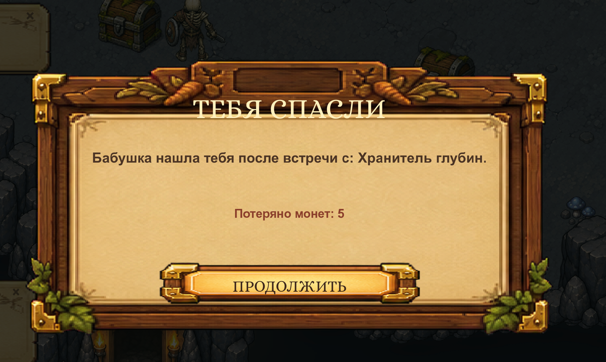
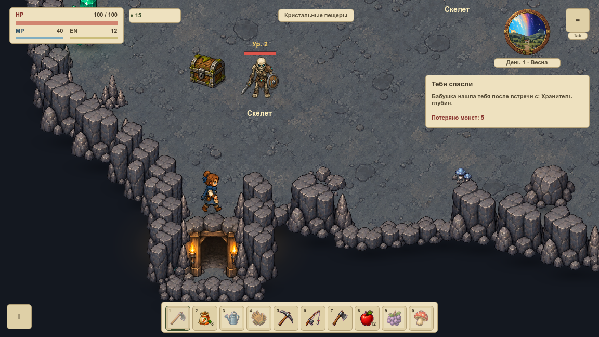
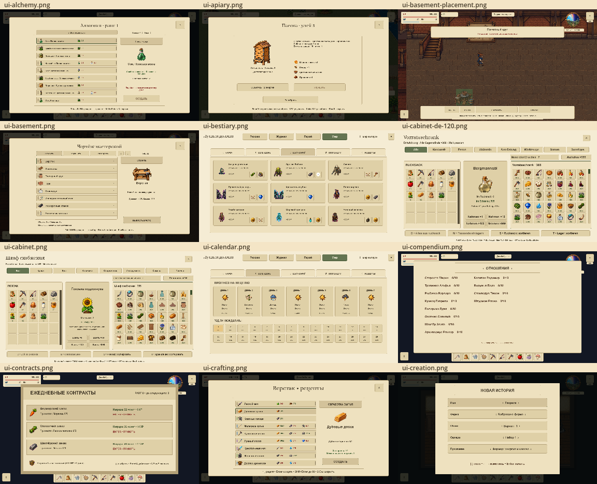
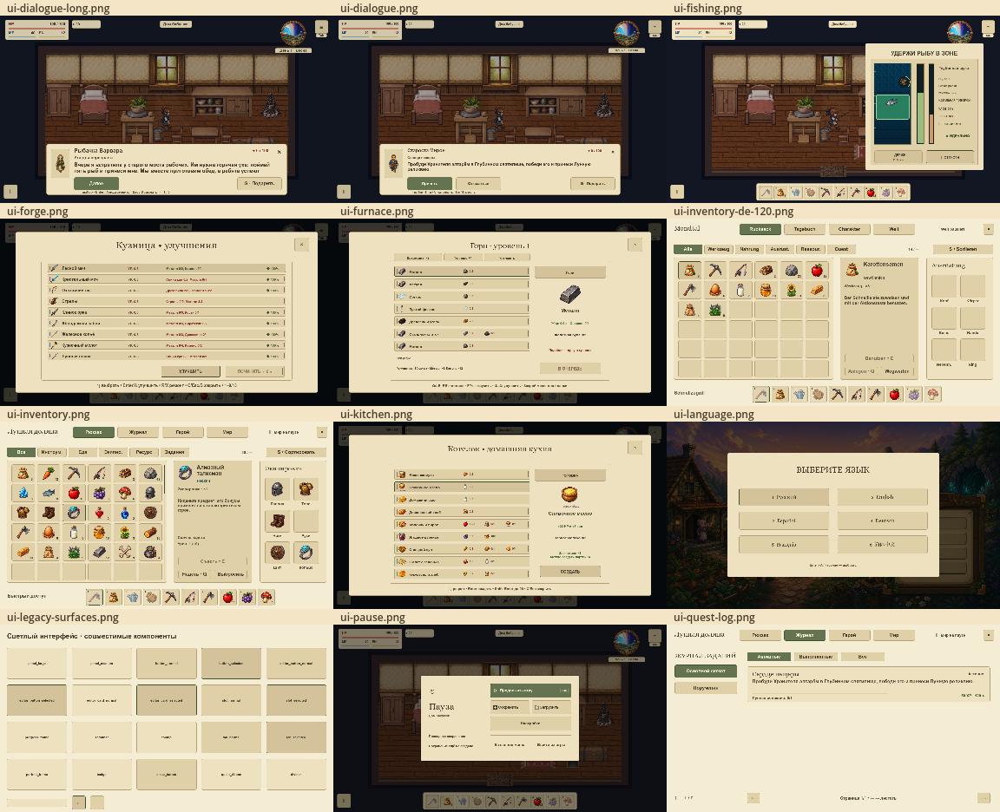
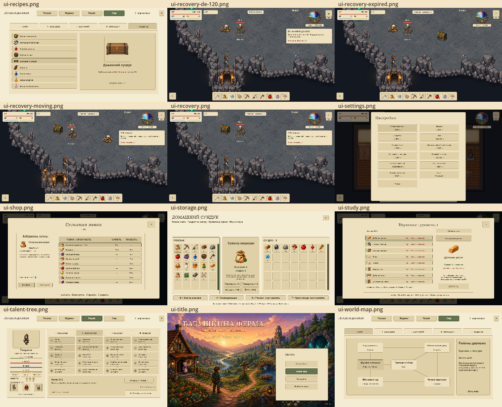

# Восстановление и светлый интерфейс · 14 октября 2026

После смертельного урона герой немедленно получает полное здоровье и возвращается на безопасное место текущей карты. Управление и события продолжаются без подтверждения. Потеря — до5 монет, без очистки инвентаря или заданий. Временные атаки и укусы сброшены, первые2 секунды действует защита.

Причина и потеря монет показаны справа под небесным кругом:316×102px, менее5% кадра. Через7 секунд игрового времени плашка исчезает. Открытое меню скрывает её и приостанавливает отсчёт вместе с миром. Тряска камеры отключена постоянно, включая старые настройки; переключатель удалён.

Исправлена причина неподвижности на ферме: прежняя общая точка260,360 находится в реке. Теперь используется старт соответствующей карты с физической проверкой проходимости и поиском свободной земли рядом. Проверены все30 игровых карт.

Старые API рамок, запасного HUD, квадратных карточек редактора и скроллбаров используют гладкие `StyleBoxFlat` общей светлой темы B: непрозрачный пергамент, тонкая граница, читаемый тёмный текст. Архивные PNG сохранены отдельно; предметы мира и иллюстрации не заменены растянутой картинкой.

## До и после

«До» — исходный снимок пользователя, без обработки. У него другой размер и положение камеры, поэтому это сравнение поведения и оформления, не попиксельный эталон одной сцены. «После» — реальные нативные кадры игры1152×648; текст и UI не наложены редактором.





- [Герой продолжает движение под уведомлением](recovery-moving.png).
- [Уведомление исчезло](recovery-expired.png).
- [Немецкий язык, текст120%](recovery-de-120.png).
- [Настройки без тряски](settings.png).
- [Все20 совместимых компонентов и квадратные элементы редактора](legacy-surfaces.png).

## Проверка

`tools/recovery_review.gd`:757 утверждений,0 ошибок. Проверены настоящий ввод и продвижение времени, отмена заброса и позы инструмента, сохранение вещей и прогресса, конечная защита, точный штраф при ворующем смертельном выстреле, очистка залпа/укусов, пауза и исчезновение сообщения, шесть языков при120%, все30 точек возвращения, миграция старых настроек,20 семейств гладких поверхностей.

UI-аудит:36346/36346 проверок,0 проблем. Полный gate перед публикацией выполняет `tools/check_architecture.sh` и `run_tests.sh` через Git hook; итог полного набора сообщается вместе с коммитом.

`tools/recovery_capture.gd` снял36 состояний в отдельном профиле `Codex-Recovery-Review-20261014` без чтения слотов пользователя. Обзорные листы сохраняют полный кадр каждого состояния; отдельная витрина показывает реальные API компонентов на нейтральном фоне.







## Воспроизведение

```bash
tools/Godot.app/Contents/MacOS/Godot --headless --path . --script res://tools/recovery_review.gd
tools/Godot.app/Contents/MacOS/Godot --path . --windowed --script res://tools/recovery_capture.gd
tools/Godot.app/Contents/MacOS/Godot --headless --path . --script res://tools/generate_ui_layout_audit.gd
```

Полные кадры записываются в `/private/tmp/moon-valley-recovery/`. Переменная `FARM_RECOVERY_ONLY` принимает имена через запятую, например `recovery,recovery-moving,recovery-expired`. Обзорные листы собираются `tools/design_audit_gallery.gd` из копий `ui-*.png` в его временной папке; повторный запуск исключает прежние `ui-sheet-*.png` из входного набора.
