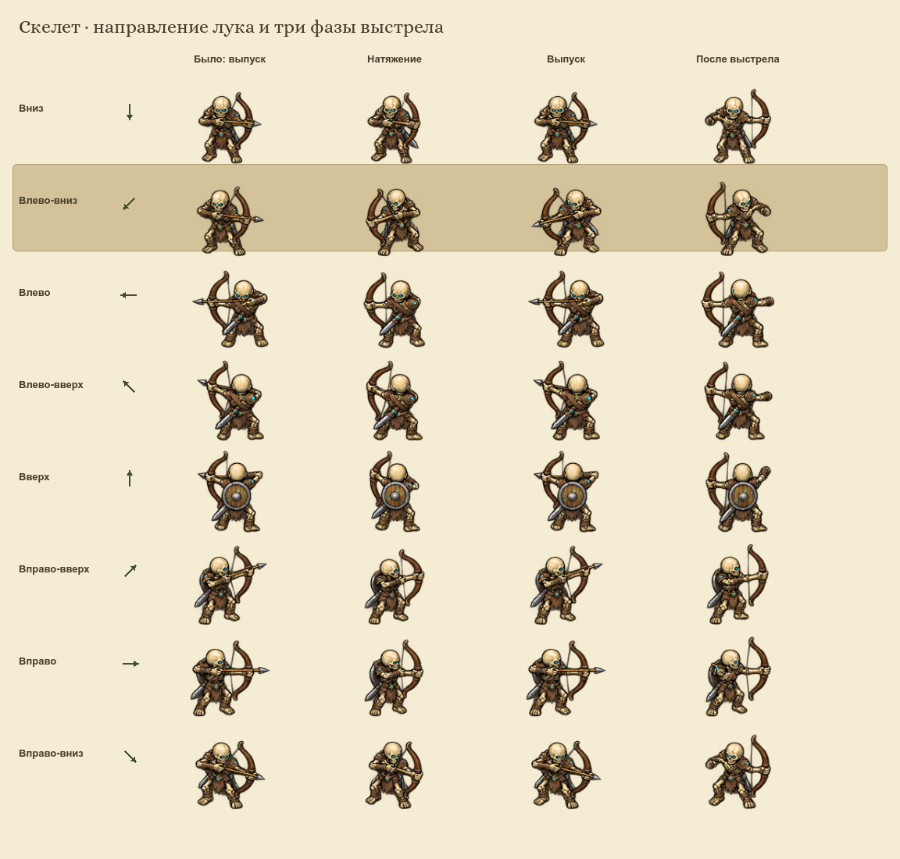
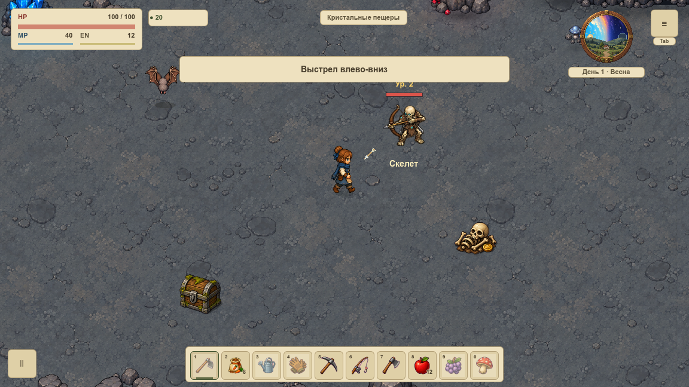

# Скелет: направление лука

При стрельбе влево-вниз исходный юго-западный ряд действительно показывал лук справа от тела, направленный вправо. Для всех трёх фаз используется цельная юго-восточная поза с отражением. Остальные ракурсы и ходьба сохраняют свои области; исходные PNG не редактировались.

Визуальный ракурс дальнего действия теперь берётся по сохранённой цели выстрела. Если герой уходит вправо и враг разворачивает погоню, текущий лук продолжает смотреть к прежней нижней левой цели. Реальная баллистика, контакты, дальность и тайминги сохранены. Отражение не смещает фигуру относительно ног или полосы HP. Wiki использует тот же профиль текстуры, области и отражения.

## Визуальная проверка

Сравнение ниже создано нативным рендерером Godot: первый столбец показывает прежнюю область выпуска без коррекции, следующие три — актуальные натяжение, выпуск и возврат лука. Подсвечен нижний левый ряд. Это воспроизведение исходного рисунка рядом с исправлением, а не снимок прежней запущенной версии.



Настоящие игровые кадры1152×648:



- [Противоположная диагональ](north-east.png).
- [Герой убежал вправо, выстрел сохраняет нижнюю левую цель](evaded.png).

## Автотесты и воспроизведение

Профиль `tools/ranged_combat_review.gd`:365 утверждений,0 ошибок. Проверены24 позы скелета, прозрачные края, опора фигуры на уровнях1–5 и настоящие выстрелы шести дальних семейств после смены позиции героя. Полный игровой набор и архитектурный gate обязательны перед публикацией. Wiki: экспорт, TypeScript, production-сборка и16/16 Node-тестов пройдены, включая все три экспортируемые фазы исправленного направления.

```bash
tools/Godot.app/Contents/MacOS/Godot --headless --path . --script res://tools/ranged_combat_review.gd
tools/Godot.app/Contents/MacOS/Godot --path . --windowed --script res://tools/skeleton_aim_capture.gd
```

Съёмка использует отдельный профиль `Codex-Skeleton-Aim-20261014`, не открывает слоты пользователя и сохраняет PNG непосредственно из SubViewport. Новые художественные мастера не создавались; исправляется использование прежнего согласованного рисунка.
