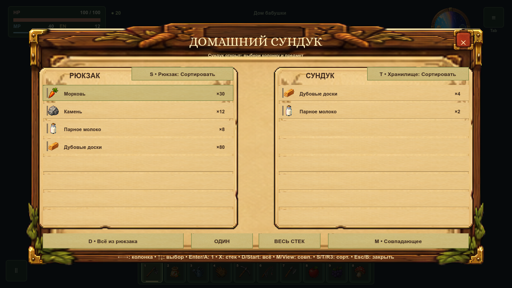
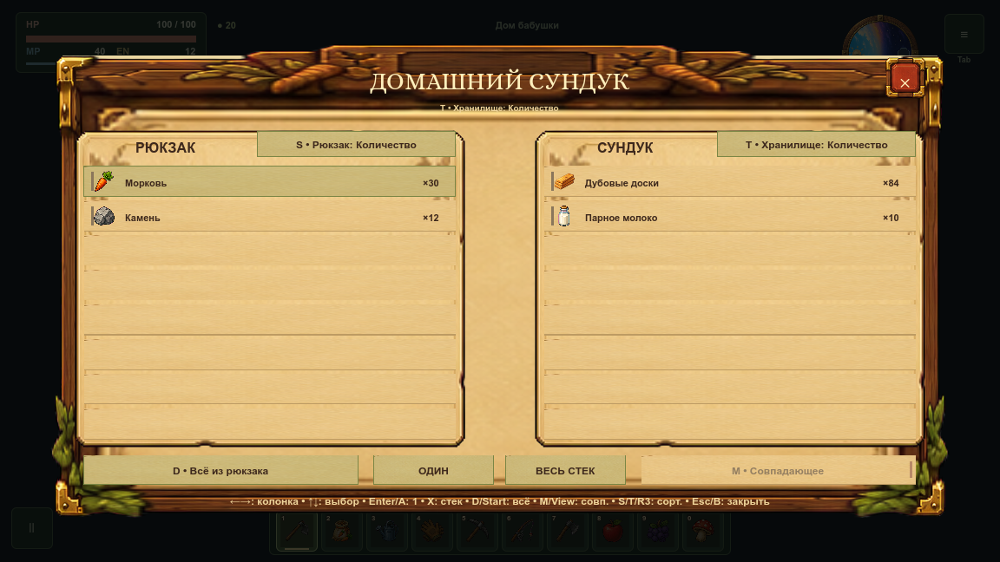
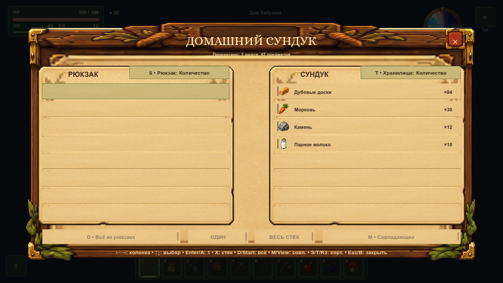
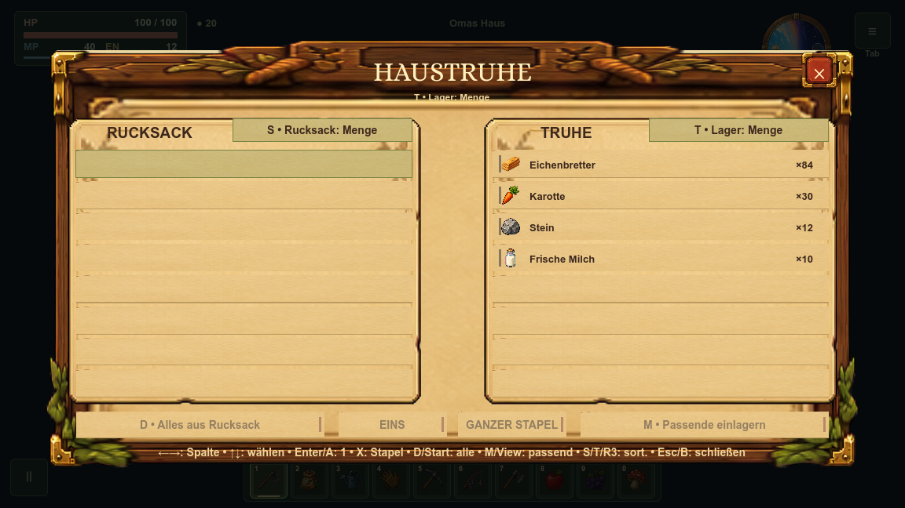
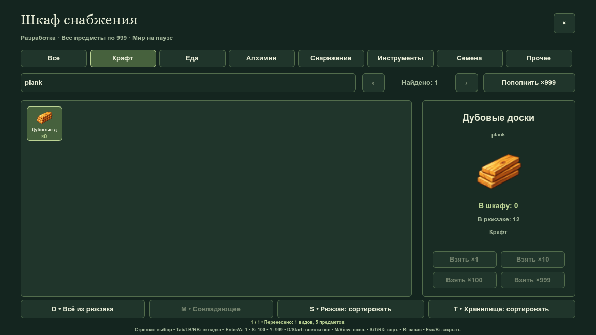
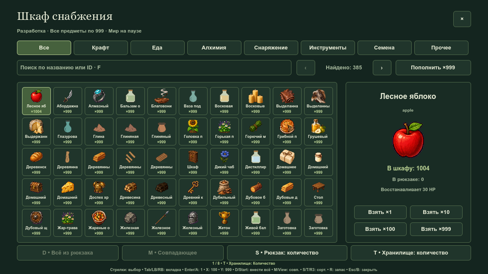
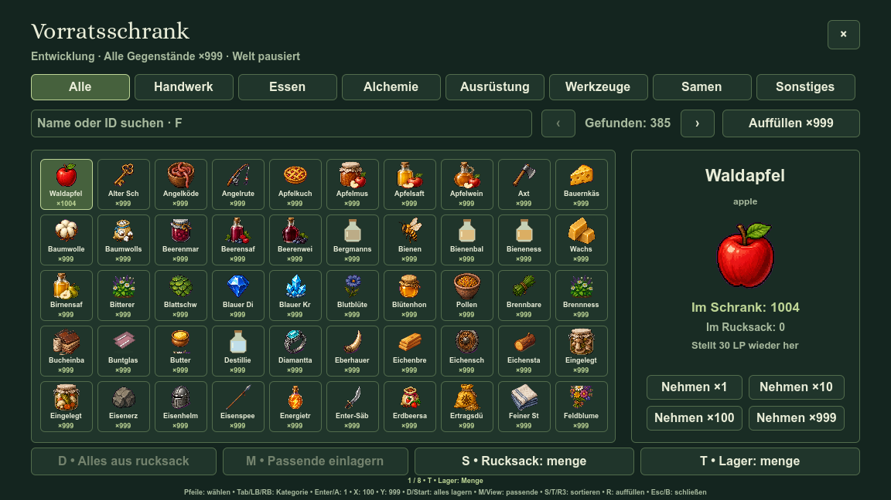

# Быстрые действия хранилищ — 13 октября 2026

Сундук и шкаф получили перенос всего рюкзака и перенос совпадающих видов. Совпадение означает положительный остаток назначения до операции; нулевые записи и текущие фильтры UI не определяют набор переноса. Сортировка отдельно для рюкзака и хранилища: имя, тип, количество по убыванию. Выбор следует за тем же видом, быстрые привязки и игровые количества сохраняются.

Перенос последней надетой копии снимает её и пересчитывает характеристики. Кирка и удочка теперь сохраняют владение, поэтому загрузка не создаёт вторую копию инструмента, находящегося в сундуке. Выдача стека уникальной вещи ограничена одним отсутствующим экземпляром; остальные остаются в сундуке. Отказ инвентаря и неизвестный вид не списывают источник.

Шкаф остаётся временным хранилищем разработки. Внесённый избыток выше 999 сохраняется при пополнении в сеансе; успешная загрузка сбрасывает временный каталог согласно прежнему контракту. Сундук хранится в обычном игровом слоте. Мир стоит на паузе во время быстрых действий.

## Нативные кадры

Кадры 1152×648 получены настоящим renderer main.tscn через отдельный userdata. Для переноса используются общие реальные hit-зоны; сортировка и кнопки выполняют игровые действия, а не макетную имитацию.

## Проверки

`StorageActionsSuite` подключён через `StorageForgeSuite`: весь зарегистрированный каталог и JSON-сохранения, сохранность суммы двух сторон, положительные совпадения, фильтры, повторы, пустые стеки, три режима сортировки, выбор и hotbar, реальный ввод всех четырёх устройств, печать без переноса, физическая пауза, недоступные окна, режим релиза, шесть языков и текст 120%. Обязательные архитектурные проверки и полный runner запускаются Git hook перед коммитом и push согласно [TESTING.md](../../TESTING.md).

Нативный стенд дополнительно проверяет совпадающий и полный перенос, обычный подход к обоим хранилищам и сохранение избытка при пополнении. Журналы проверяются на все ошибки движка и скриптов независимо от маркера PASS.

Профильный прогон: 4278 успешных проверок, 0 отказов; нативный захват: 8 кадров, PASS. Оба журнала без `ERROR:` / `SCRIPT ERROR`. Архитектурный gate подтвердил корректность документов и всех 29 семейств спрайтов. Регрессия перестановки по количеству после выдачи/возврата включена в профильный и обязательный полный runner.
