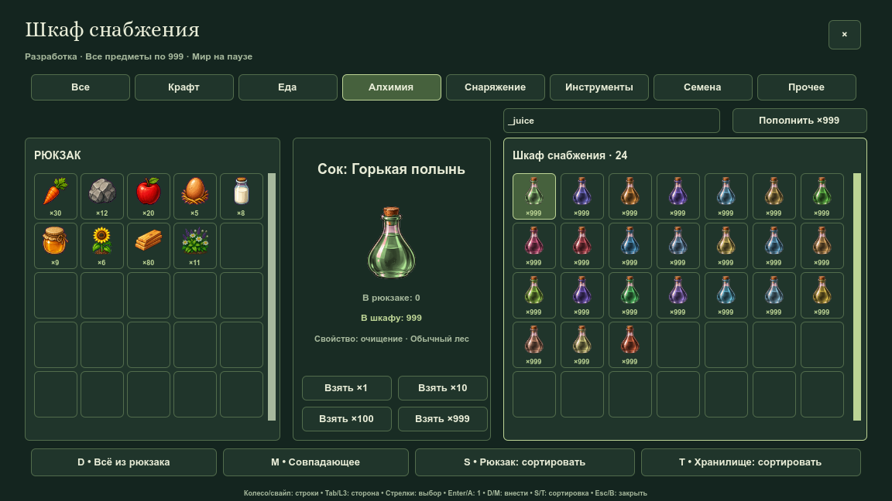
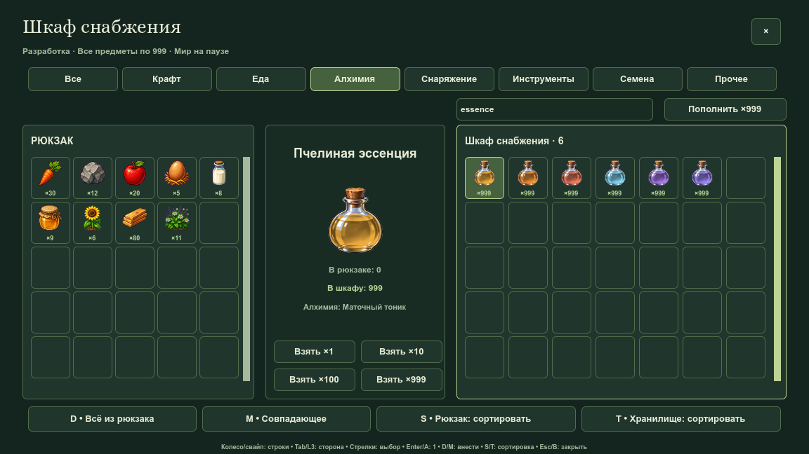
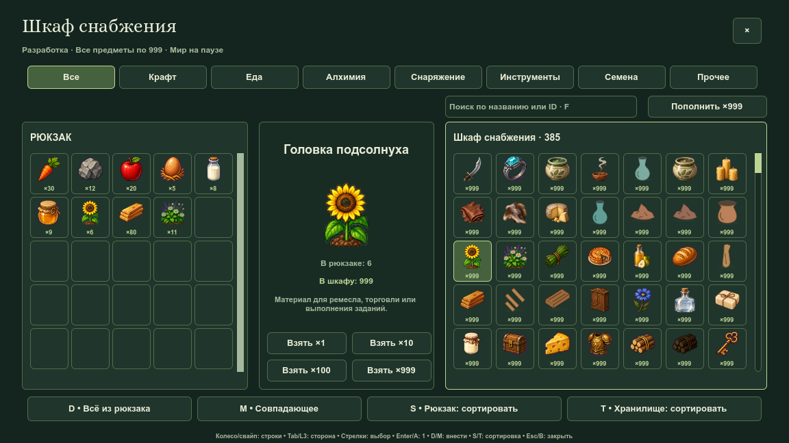
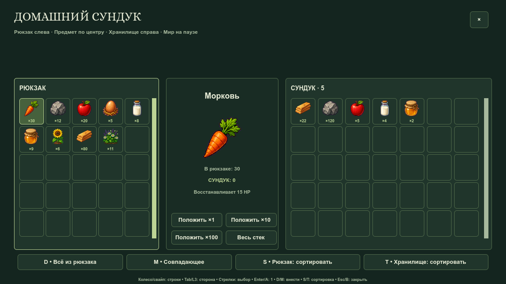
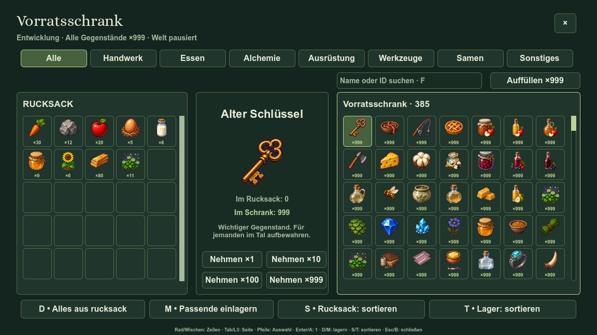

# Выбранная партия A в игре

85 игровых PNG160px: 84 сосуда/варианта содержимого и целый подсолнух. Ботаника, порошки и готовая графика пасеки сохранены. Каждая выбранная замена имеет приоритет над прежней процедурной формой и не получает старую модуляцию. Большие мастеры остаются в [документации](../../concepts/storage-art-2026-10-13/v1/README.md), в игре используются компактные производные.

Профиль иконок: 571 проверка, 0 ошибок. Проверены все выбранные ресурсы, приоритет, отсутствие устаревшего tint, размеры, прозрачные края и восемь разных назначений сосудов. Профиль хранилищ: 7 817 проверок, 0 ошибок; сверены все 385 канонических отпечатков, оба размера и ограничения кеша. Wiki: экспорт, TypeScript, сборка и 12 тестов прошли. Полный игровой набор дополнительно запускается pre-commit перед публикацией.

Финальный первый замер: 49.905мс против исходных89.711мс. Медиана40 кадров33.389мс, p95 35.705мс. Это локальный нативный стенд на той же машине; время включает ожидание дисплея. [Последний прогон](final-metrics.json) обновляется с кадрами и может немного отличаться. Неизменённые цены, рецепты, эффекты и правила сохранений проверяются полным набором.
