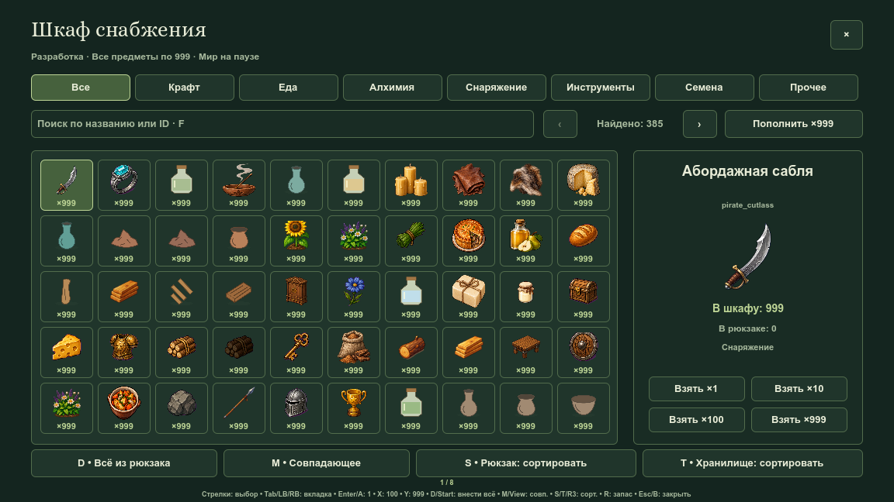
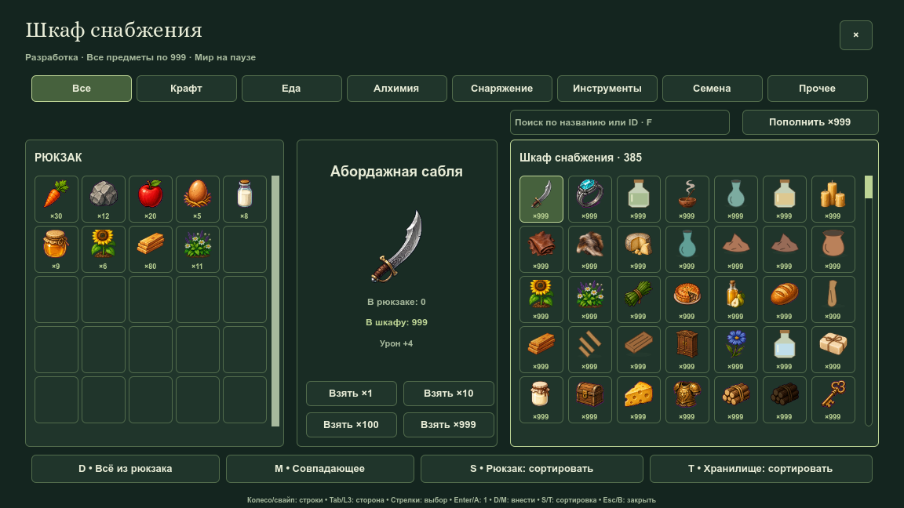
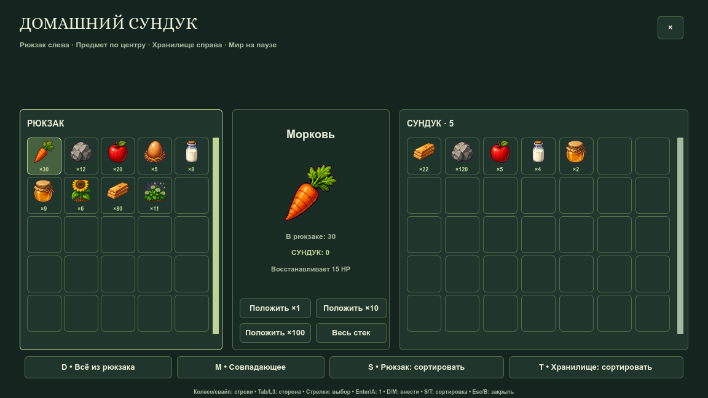
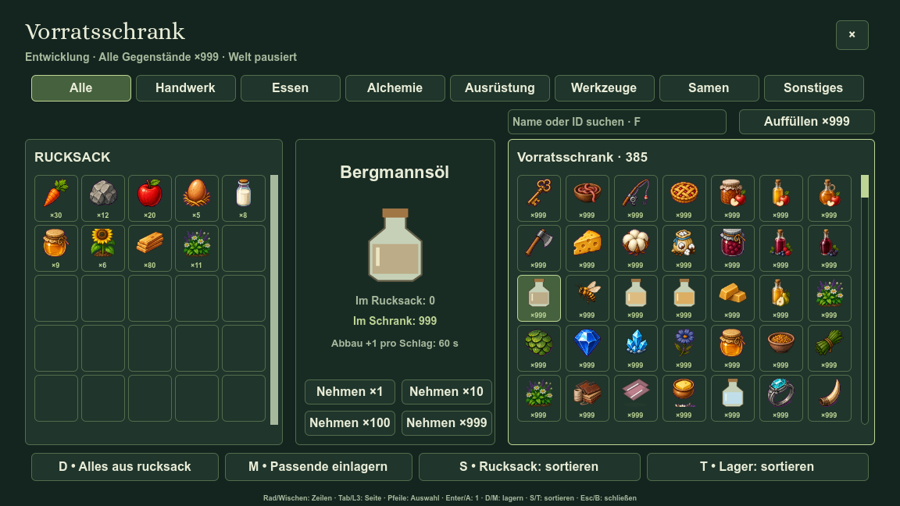

# Сетки шкафа и сундука

Первый технический этап: две независимые сетки, центральное превью, построчное колесо/свайп/бегунок, явный перенос из активной стороны. Рисунки в этих кадрах ещё прежние; новая выбранная партия графики публикуется отдельно.

Стенд `tools/storage_window_capture.gd` использует отдельный userdata, фиксированный SubViewport1152×648, одинаковые девять видов рюкзака и пять видов сундука. Отрисовка настоящая, изображения не редактируются. Открытие измеряется до завершения первого кадра; 40 повторных кадров дают медиану и p95. Время включает ожидание дисплея и не заменяет измерение FPS.

До: первый кадр 89.711мс, медиана33.067мс, p95 38.704мс. Первый прогон после: 49.931мс, медиана33.405мс, p95 33.879мс. Это один сравнительный прогон на AMD Radeon Pro5300M; он подтверждает сокращение первого открытия, а не гарантирует такой результат на любой машине. [Исходные числа](before-metrics.json), [последний кадр после](after-metrics.json).

Миниатюры64px хранятся в одном атласе1024×1600; превью160px загружаются отдельно и ограничены кешем16 видов. Исходники и каноническая окраска не подменяются производными. Имена сортировки вычисляются один раз на вид; набор сундука кешируется до изменения содержимого/языка/режима. Полные проверки перед публикацией обязательны по [TESTING.md](../../../TESTING.md).

Профильный прогон: 7 814 проверок, 0 ошибок движка. Проверены строки, обе стороны, переносы, фокус сортировки, настоящая пауза и все 385 отпечатков источников/размеров/краёв. Кадры `layout` сняты после уточнения описаний и шрифтов; их время не используется как изолированный сравнительный замер, поскольку одновременно выполнялся профильный набор.
