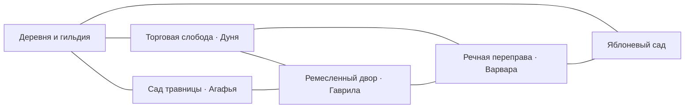
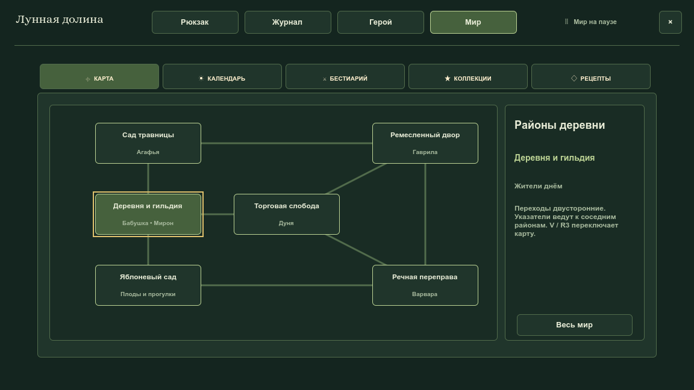

# Районы стартовой деревни — 13 октября 2026

Первоначальная ферма расширена пятью самостоятельными картами из существующих игровых спрайтов. Жители распределены по занятиям; восемь пар дорог дают развилки и несколько круговых маршрутов. Прежние биомы и сюжетный лесной проход продолжаются отдельно.

## Схема в игре

Общая карта доступна той же кнопкой, `V` или `R3`: [кадр всего мира](village-regions-2026-10-13-world-map.png). [Немецкий интерфейс с текстом 120%](village-regions-2026-10-13-district-map-de-120.png).

## Игровые кадры

| Район | Кадр героя 1152×648 | Полная карта 2040×1200 |
| --- | --- | --- |
| Прежняя ферма | [Игровой кадр](village-regions-2026-10-13-overworld-gameplay.png) | — |
| Торговая слобода | [Дуня и торговля](village-regions-2026-10-13-village_market-gameplay.png) | [Обзор](village-regions-2026-10-13-village_market-overview.png) |
| Сад травницы | [Агафья и алхимия](village-regions-2026-10-13-village_garden-gameplay.png) | [Обзор](village-regions-2026-10-13-village_garden-overview.png) |
| Ремесленный двор | [Гаврила и верстак](village-regions-2026-10-13-village_workyard-gameplay.png) | [Обзор](village-regions-2026-10-13-village_workyard-overview.png) |
| Речная переправа | [Варвара и два моста](village-regions-2026-10-13-village_river-gameplay.png) | [Обзор](village-regions-2026-10-13-village_river-overview.png) |
| Яблоневый сад | [Плоды и тропы](village-regions-2026-10-13-village_orchard-gameplay.png) | [Обзор](village-regions-2026-10-13-village_orchard-overview.png) |

Кадры сняты настоящим Godot renderer в отдельном userdata, без масштабирования итогового PNG. Земля собирается из материалов; это не цельная фоновая картинка для игры. Шестой контрольный сюжет: [жители ночью в гильдии](village-regions-2026-10-13-night-guild.png).

## Проверки

`VillageRegionsSuite` проверяет граф, все шестнадцать направленных переходов, отсутствие отскока, действительные пешие маршруты к проходам, NPC, столам и растениям, дневной и ночной распорядок, диалоги, реальные услуги, алхимический рецепт, оба направления заброса, мосты, ограждения, самостоятельный урожай, JSON и старые слоты. Ввод карты проверен через основной маршрутизатор клавиатуры и геймпада. Названия проверены на шести языках с текстом 120%.

Команды и контракты описаны в [руководстве разработчика](../DEVELOPMENT.md), действия игрока — в [руководстве игры](../GAME_GUIDE.md) и [ручном чек-листе](../../QA_CHECKLIST.md). Перед публикацией выполняются `tools/check_architecture.sh` и `./run_tests.sh`.

Профильный прогон районов и связанных регрессий: **2709 успешных утверждений, 0 отказов**; ошибок движка нет. В него включены полный сценарий задания травницы и миграция посаженного дерева из старого слота. Нативный стенд сохранил все 15 кадров и завершился PASS без ошибок движка.
