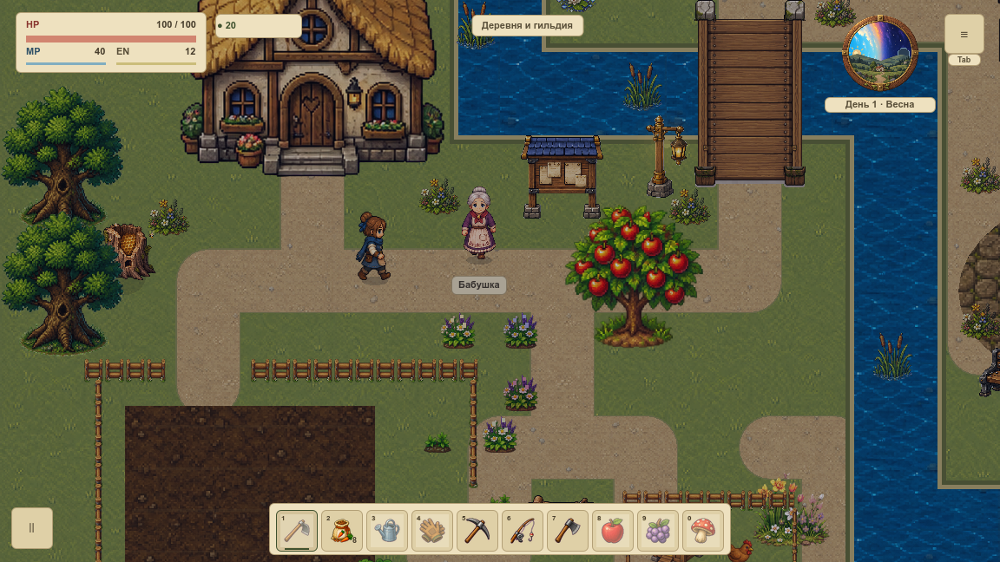

# VBASE-002 · оборудование первой локации

19 октября 2026. Принята **нижняя проверяемая конфигурация разработки**: доступный MacBook Pro с i7-9750H, 16 GiB RAM и Radeon Pro 5300M с 4 GB выделенной видеопамяти, окно и framebuffer 1152×648. Это рабочий ориентир для `overworld` до VMAP-003. Требования к релизу, эквивалентность других GPU и поддержка более слабых машин пока не подтверждены. Решение принято автономно по действующим договорённостям.

## Что принято

Единственный источник аппаратного решения — [profile.json](profile.json). Человекочитаемая глава находится в Wiki → «Оборудование и условия проверки графики»; её адрес `/guides/visual-hardware`.

| Устройство / режим | Состояние |
|---|---|
| MacBookPro16,1; Intel Core i7-9750H 2,60 GHz; 12 логических CPU; 16 GiB | Доступен, три свежих независимых прогона |
| AMD Radeon Pro 5300M; 4 GB dedicated; macOS 15.4.1 x86_64 | Выбранный адаптер действительно записан Godot |
| Intel UHD Graphics 630; shared 1536 MB на том же Mac | Присутствует, отдельно не проверен; shared не складывается с dedicated |
| Apple Silicon / Windows / Linux | Устройство и нативный прогон недоступны; статус `unverified` |
| Питание от батареи, заряд ≥50%, Low Power Mode 0, gpuswitch 2 | Текущий профиль; в принятой серии заряд 69→66% |
| Питание от сети | Старая серия VBASE-001 существует; текущая машина во время проверки работала от батареи. Свежая AC-серия не принята |

Порог заряда 50% — консервативное условие повторяемости этой серии, а не утверждение об автоматическом замедлении ниже него. Настройки питания, GPU, яркость и приложения пользователя не изменялись. `pmset` на всех шести границах показывает CPU Scheduler/Speed Limit 100; это не непрерывное измерение температуры или частоты.

## Один измерительный профиль

- `village-cardinal-1152-v1`, Godot **4.7.1-stable (official)**, source/debug launch, Compatibility / OpenGL3, фактический адаптер `AMD Radeon Pro 5300M OpenGL Engine`. Экспортированная релизная сборка этим не принята.
- Оконный режим, **окно = root viewport = framebuffer = PNG 1152×648**, content scaling выключен, VSync enabled, экран 3584×2240 при scale 2 и приблизительно 60 Hz. Размер встроенного Retina-дисплея не выдаётся за размер измеренного framebuffer.
- Существующая production-графика и эффекты, русский HUD и UI 1.0, звук включён, reduced motion off, screen shake off. Это фиксированный стенд; игровых настроек low/medium/high пока не добавлено.
- Мир 100%, начальная камера `(0,348)`, герой `(432,672)`, день 1 в 06:00, seed 20261015. Целевые **120%** уже выбраны художественно, но их штатное включение и отдельный замер остаются **VCAMERA-006**. Нынешняя серия не принимает этот масштаб.
- Три отдельных процесса/профиля. Прогрев 120 отрисовок, исходный PNG, ещё 8 отрисовок; затем **живой** маршрут из 16 точек через существующий мост/площадь и обратно за 902 физических шага. Камера следует обычным способом. Внутри интервала стенд не выполняет PNG/readback или запись файлов; этот агент не запускал параллельные тесты/сборку.
- Фокус, framebuffer и продвижение мира проверяются на каждом кадре. Сохраняются все интервалы, p95/p99/max, фон и питание до/после каждого процесса. Снимки фоновых процессов не доказывают причину медленного кадра.

Первый снимок фона до принятой серии содержал ещё один процесс Godot (PID 50487, 1,8% по `ps`). По граничным снимкам нельзя установить его назначение или доказать отсутствие параллельной нагрузки внутри интервала. Полная изоляция фона **не подтверждена**. Аппаратные условия и живой маршрут валидны, но строгую пару оптимизации и окончательный FPS-бюджет эта серия не принимает; их владельцы — VPERF-001/002.

## Свежий результат

Исходный runtime **`d2820e0619ba6e59e4f085b2f7e6fb4c71de6bc8`**, приложение **0.0.256**. Измерительный инструмент ещё не был закоммичен; его точные SHA256, проект, сцена, исходная ревизия и изменённые пути сохранены в [capture.json](measurement/capture.json) и [session.json](measurement/native/session.json). Пять точных исходников из момента съёмки сохранены в `measurement/instrumentation/`, включая [тогдашний аппаратный проверяющий](measurement/instrumentation/tools/visual_hardware.py); их подписи проверяются. После съёмки офлайн-проверка получила архив исходников и допуск только численного округления, без изменения raw или рендера. Последующий bump версии не является новой измеренной серией.

| Повтор | Кадров | Среднее, мс | p95, мс | p99, мс | Максимум, мс | Кадров >33,333 мс | Диагностический бюджет 60 FPS |
|---|---:|---:|---:|---:|---:|---:|---|
| 1 | 475 | 31,744 | 44,197 | 51,007 | 53,201 | 206 | FAIL |
| 2 | 466 | 32,364 | 36,526 | 47,255 | 51,415 | 206 | FAIL |
| 3 | 563 | 26,774 | 37,124 | 46,504 | 59,232 | 160 | FAIL |

Все три получили `VALID_REFERENCE_DEVICE` / `VALID_BASELINE`. Полезная валидная база с плохой плавностью сохраняется. Диагностические прежние пороги p95≤18,5 / p99≤33,333 / max≤100 мс не превращены в новое обязательство релиза. **OPT-01, VPERF-001/002, VRELEASE-004 и VMAP-003 остаются открытыми.**

Пик draw calls 171; Godot texture monitor **683 510 472 bytes ≈651,85 MiB**, static monitor до **133 141 054 bytes ≈126,97 MiB**, terrain rebuilds 0. Эти значения не равны RSS или реальной VRAM. Draw interval включает работу CPU/GPU, ожидание дисплея и инструментарий; отдельного GPU time здесь нет. Между первой и третьей серией не выбирался лучший результат.



Исходный кадр первого повтора и конечный кадр третьего просмотрены. Изображения показывают старую игровую сцену и обычные события/HUD; они не являются новым художественным макетом или доказательством плавности. Полный текущий маршрут первой карты, бой, шкаф, длительная сессия и потребление на других устройствах остаются за владельцами последующих проверок.

## Реальный отказ и защита от подмены

Первый запуск запросил прежние AC-условия, однако **все шесть** снимков показали Battery Power. Его три raw-повтора, кадры, исходный профиль и [причина отказа](controls/ac-profile-rejected/rejection.json) сохранены в `controls/ac-profile-rejected/`. У самой трассы `VALID_BASELINE`; аппаратный допуск отклонён с `AC required`. После этого выбран отдельный явный батарейный профиль и снята **полностью новая** серия. Данные отказа не переименованы в успешный замер, ускорение относительно старой AC-базы не рассчитывается.

`tools/visual_hardware.py` проверяет подписи и полноту raw/PNG, декодированный размер PNG, отдельные процессы, единый source commit, GPU/OS/engine, точную камеру, активную секцию питания, заряд и граничные CPU limits. Вызов `capture` проверяет доступные условия ещё до запуска игры и требует новый output. Смена питания в середине серии, неправильная камера во всех трёх повторах и быстрые кадры остановленного мира не получают допуск. EDID, серийные номера и пути из `system_profiler` в инвентарь не попадают.

17 профильных тестов: 16 работают на временных копиях, один офлайн сверяет сохранённый реальный AC-отказ и его подписи. Проверяют неизвестные платформы, встроенную память, противоположные неактивные настройки питания, другой адаптер/ОС, AC вместо батареи, низкий заряд, энергосбережение, явный thermal limit, неверные PNG/окно/фокус/симуляцию, пропажу доказательств/исходников, чужую ревизию, выход пути и устаревшую сводку. Секундный рывок сохраняется с `max_ms=1000` и `FAIL`, даже когда аппаратный допуск валиден. Нативные resize/pause/focus из VBASE-001 остаются историческими контролями; новой нативной съёмки этих трёх отказов в VBASE-002 нет.

Сохранённый пакет и все 17 тестов отдельно прошли на **Python 3.9.6 и 3.12.14**. Последние разряды среднего между этими версиями действительно различаются на ~1–2×10⁻¹⁴ мс. Для пересчитанных float допускается только `rel_tol=1e-12`, `abs_tol=1e-9`; raw SHA, состав данных, целые счётчики и решения остаются точными. Подмена среднего на 0,01 мс отклоняется. Другая версия Python не подменяет проверку другой физической ОС.

При переходе VBASE-002 в Done найден прежний хрупкий тест готовности бэклога: он предполагал, что эта задача всегда открыта. Исправлен только тестовый снимок — незавершённый блокер теперь задаётся явно. Отрицательная проверка готовности сохраняется после дальнейшего выполнения реальных карточек; исходные статусы тест не меняет.

## Повторение и границы

```sh
# Офлайн-проверка сохранённого пакета, без запуска игры:
python3 tools/visual_hardware.py verify
python3 tools/test_visual_hardware.py

# Только в подходящих батарейных условиях, без параллельной нагрузки:
python3 tools/visual_hardware.py capture --output /private/tmp/farm-vbase-002-new
python3 tools/visual_hardware.py verify --output /private/tmp/farm-vbase-002-new
```

Новую ОС, другой Godot/GPU, режим AC, 1920×1080, нативный Retina framebuffer, новый масштаб или экспорт принимаем отдельной версией аппаратного/измерительного профиля с реальными повторами; текущий JSON не подгоняем задним числом. Уменьшенный fallback ещё не реализован, его стоимость и художественная читаемость не подтверждены. Проверка сохранённого исторического пакета не требует от CI той же физической машины.

## Повторение в новом checkout

Объединение проверено в отдельном managed worktree после первичного импорта Godot, с существующим бинарником 4.7.1 и установленными зависимостями Wiki. Обнаружена прежняя зависимость доказательства VPIPELINE-009 от игнорируемого `assets/generated/level_drafts/water_navigation_ingame_preview.png.import`: новый импорт меняет его UID, а в историческом Git blob отсутствует. Для повторения восстановлены точные прежние байты из основной копии, проверенные уже принятым SHA256 `fd5557669eaa3a93d0630eadc770588b89ea0975d265870e986fba6ae9e01a15`. Проверяемые данные и валидатор VPIPELINE-009 не изменялись. Переносимость именно этого старого fixture остаётся долгом владельца VPIPELINE-009; успешный локальный gate не объявляет проблему исправленной.

## Вектор следующих эпиков

VART/VPIPELINE сохраняют принятый мягкий стиль, палитру, свет, три ракурса предметов и раздельные миниатюры. VBASE-005 задаёт маршруты оценки движения; VCAMERA-002/003/006 — фазу/координаты и 120%; VPERF-001/002 — измерительный контракт и бюджет. VRENDER, земля/берег и наружные VPROP собирают статичный пилот, затем растительность/деревья/тени/свет — живой. По ведомости VMAP-001 выбираются только видимые ресурсы первой карты; VMAP-002/003 завершают всю `overworld`. VCOMPAT/VEDITOR проверяют имеющиеся сохранения, взаимодействия и экспорт на каждом нужном шаге. Другие карты, механики и полный каталог не расширяются этой работой.

Откат — отдельный revert инструментов/профиля/статьи и аппаратного пункта gate. Игровой код, ресурсы и сохранения не изменены. Обязательные architecture, полный игровой набор и Wiki check фиксируются в карточке после фактического выполнения.
