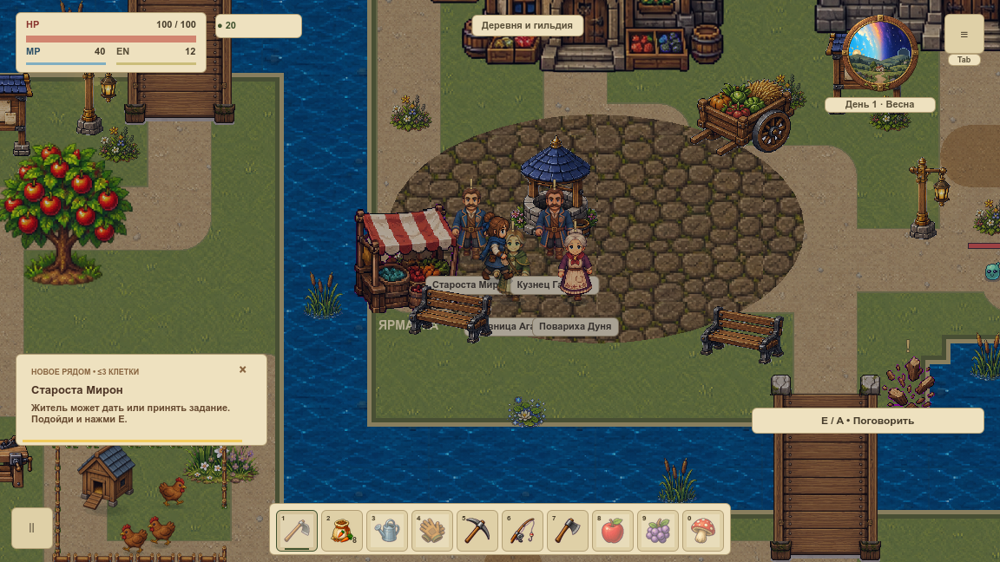
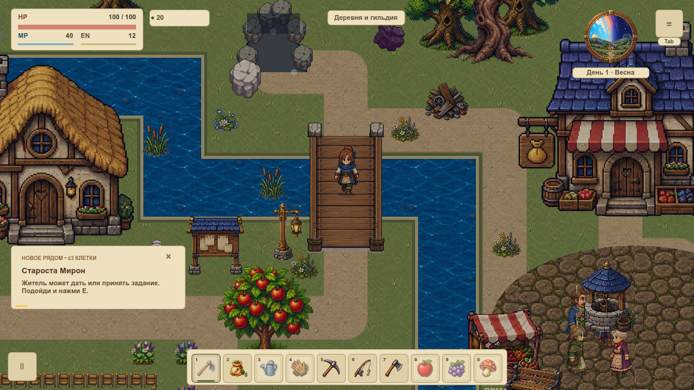

# VBASE-005 · маршруты оценки движения

19 октября 2026. Записан один непрерывный маршрут первой `overworld` с четырьмя обязательными видами прохода: **толпа → мост → трава → дверь и обратно**. Два независимых нативных процесса воспроизвели все 18 точек, 630 физических шагов и одинаковую камеру. Это результат QA-01 для дальнейших сравнений; QA-01 целиком, новый арт, производительность, живой пилот и вся первая карта этим не принимаются.

Пользовательский просмотр — Wiki → «Маршрут проверки движения» (`#/guides/visual-motion`): два плеера, параметры, контроль отказов и JSON. Видео не запускаются автоматически; MP4 доступны только из `docs/reports`, ограничены 8 MiB, публикуются по SHA256. Подписи экранируются; произвольный HTML и внешние адреса в плеер не попадают.

## Маршрут и управление

[routes.json](routes.json) — неизменяемый план версии `overworld-motion-route-v1`. Исходный runtime `0b00534cdeed61f23763f7494e888d8727134bc0`, приложение **0.0.260**. На момент съёмки инструменты не были закоммичены; точные исходники 14 файлов и их SHA сохранены в [native/source.json](native/source.json) и `native/instrumentation/`. Последующий bump приложения не является новой съёмкой. Поздние дополнения офлайн-верификатора не подменяют архив измерявшего кода.

Старт `(1128,744)`, камера `(552,420)`, мир 100%, UI 1.0, день 1 в 06:00, seed 20261015. Скорость 210 единиц/с; только одна клавиша W/A/S/D за шаг. Событие идёт через настоящий `game._input` и маршрутизатор. Автоматические `_physics_process` и GameLoop выполняют коллизии, часы, NPC, события и анимацию. Наблюдатели до/после игровой физики только посылают ввод и записывают результат.

1. Четыре **существующих** жителя подготовлены перед первым шагом в отдельной QA-сцене. Плотная группа нужна для проверки перекрытия; это не новое собрание или изменение производственных расписаний. Во время прохода работает обычная система NPC.
2. Герой идёт через площадь и по дороге к мосту, затем пересекает воду по существующему настилу. Исходный короткий путь после моста упёрся в препятствие; закреплён проходимый обход с зазором, без отключения коллизий.
3. Три участка проходят по траве; зафиксированы 48 шагов на расстоянии не менее 48 единиц от оси действующих дорог.
4. Подход к дому, автоматический вход, отход от триггера внутри, возврат и обычный выход. Переходы сбрасывают удержание: контроллер записывает отпускание и новое нажатие, а не переставляет героя. Короткий прежний интерьер — контроль совместимости двери; интерьерные художественные ворота остаются открытыми.

Координата героя в обычном контроллере назначается только при начальной подготовке. Единственные большие изменения внутри живого следа — настоящие `BuildingSystem.enter/leave`, проверенные по близости к двери, правильному вводу и точной точке появления. Отдельный отрицательный запуск явно внедряет скачок и не принимается.

## Нативная пара

Godot 4.7.1 stable, Compatibility / OpenGL3, AMD Radeon Pro 5300M, macOS, новые `Codex-VBASE-005-*`. Окно, root, фактический framebuffer и Image **1152×648**, windowed, VSync и фокус. До съёмки проходит реальная по времени подготовка окна. Масштаб 120% ещё не подключён к штатной камере; новый projection-preset относится к VCAMERA-006.

| Наблюдение | Повтор 1 | Повтор 2 |
|---|---:|---:|
| Физические шаги | 630 | 630 |
| Контрольные точки | 18 | 18 |
| Моделируемое время | 10,5 с | 10,5 с |
| Нативные кадры ролика | 211 | 211 |
| Видео | 1152×648, 20 fps, 10,55 с | 1152×648, 20 fps, 10,55 с |
| Шаги вне дороги | 48 | 48 |
| Шаги рядом с минимум тремя жителями | 74 | 74 |
| Вход / выход через дверь | 562 / 597 | 562 / 597 |

Все шаги позиции/камеры/жителей, изменения клавиш и переходы совпали. Опора `destination + pivot × scale` соответствует физике; камера сверяется с проекцией текущего мира, а не лишь сама с собой между повторами. Проверяются отсутствие телепорта, конечная точка, нормальные часы, полный ввод и фактическая обработка физики. Изображения первого и декодированного кадра видео сопоставлены с допуском потерь H.264; размеры PNG и выбранные кадры привязаны к следу.

Игровые часы продвинулись с 06:00 до 06:10:30: действующее правило игры — одна секунда симуляции равна одной игровой минуте.





Кадры толпы, моста и входа просмотрены. На плотной QA-группе подписи жителей накладываются — это наблюдение для VUI и последующей читаемости VMAP-003, а не принятый окончательный вид. Действующие изображения и прямые цветовые стыки остаются исходной базой; новые VGROUND/VSHORE/акторы/освещение проверяются своими карточками.

## Граница производительности

**`performance_eligible=false` во всех результатах.** Запуск использует `--fixed-fps 60`, наблюдаемый physics delta 1/60 и GPU-readback каждого третьего кадра с записью PNG. Это 60 фиксированных шагов симуляции, а не доказанные 60 кадров/с реального времени. Ролик сжат после завершения процесса до 20 кадров видео/с; исходный кадр добавляет 0,05 с к длительности. CPU/GPU, ожидания, FPS-бюджет, реальные RSS/VRAM и плавность обычного приложения здесь не измеряются.

Фактическая команда, питание и фон до/после хранятся в `environment.json` каждого повтора. [OS.get_cmdline_args](https://docs.godotengine.org/en/4.6/classes/class_os.html#class-os-method-get-cmdline-args) не возвращает уже обработанные движком параметры; поэтому clock берётся из записанного launcher argv и наблюдаемого delta, а не из попытки повторно прочитать флаг внутри GDScript. Это соответствует фактически наблюдённому Godot 4.7.1.

## Четыре настоящих отказа

[controls/source.json](controls/source.json) связывает коллектор и тот же GDScript с положительной парой. Каждый процесс завершился с кодом 2; сохранены сырой след, журнал, команда и последний Image. Флаг fault сверяется с **независимо наблюдаемой причиной**:

| Контроль | Наблюдение |
|---|---|
| Resize | Image 1000×600 на шаге 30 |
| Pause | `auto_physics=false` и остановившиеся часы на шаге 31 |
| Focus | Реальный `window_is_focused=false`, отдельное тестовое окно |
| Teleport | Скачок свыше допустимого физического шага на шаге 31 |

Тесты на копиях дополнительно подменяют `valid`, finished, source, кадр, камеру, стопы, размеры, ввод и clock. Секретные пользовательские настройки и слоты не читаются. Два ранних неполных отладочных запуска сохранены отдельно в `/private/tmp/farm-motion-setup-type-rejected` и `/private/tmp/farm-motion-clock-metadata-rejected`; в принятую пару они не входят. Это исправления самого коллектора (численный тип размера и недоступный consumed argv), а не якобы наблюдавшиеся дефекты окна или игры.

## Воспроизведение и проверки

```sh
python3 tools/visual_motion.py verify
python3 tools/visual_motion.py verify-controls
python3 tools/test_visual_motion.py
tools/Godot.app/Contents/MacOS/Godot --headless --path . --script tools/visual_motion_review.gd
# Новый каталог, обычный дисплей macOS и Swift/AVFoundation:
python3 tools/visual_motion.py capture --output /private/tmp/farm-motion-new/native
# Controls сохраняются рядом с positive-парой:
python3 tools/visual_motion.py capture-controls --output /private/tmp/farm-motion-new/controls
```

17 Python-сценариев входят в architecture gate; 13 GDScript-утверждений на реальном вводе/цикле — в общий игровой набор и отдельный профиль. Порча выполняется на временных копиях, headless не подменяет нативную приёмку: настоящий запуск без дисплея завершился с кодом 2 (`headless-rejected.json`). Общий Swift-кодировщик сохранил прежний вызов без bitrate; результат отдельной совместимости — `encoder-compatibility.json`. Wiki дополнительно проверяет MP4 MIME, адрес/байты/8 MiB, сигнатуру, экранирование подписей и запрет произвольного URL.

[Приёмка](acceptance.json): architecture пройден, полный игровой набор **44095 passed, 0 failed**, Wiki check — **58/58**. Оба плеера запущены и поставлены на паузу в настоящем браузере; размеры 1152×648, длительность 10,55 с, ошибок декодера и горизонтального переполнения нет. Перед merge штатный commit hook повторяет общий gate и игровой набор.

Нативные прогоны требуют новых профилей и output; ошибочная съёмка не перезаписывается. Полная временная последовательность PNG удаляется после кодирования; в Git остаются видео, семь контрольных PNG и декодированный первый кадр каждого повтора, весь физический след и точные исходники. Всё находится вне runtime-ресурсов игры.

## Следующий результат

Маршрут передаётся VCAMERA-002/003/006 для округления, фазы и 120%, затем VRELEASE-003 и адресным проверкам первой карты. Для другой проекции и изменённой геометрии нужна новая версия fixture с новым нативным повторением; старые свидетельства не пересоздаются автоматически. Вся карта, оба моста, сохранение/пауза/F12 и бюджет остаются за VMAP-001…003/VCOMPAT/VPERF.

Откат — отдельный revert инструментов, тестов и Wiki-главы; обычная игра не подключает QA-расстановку. Изменений сохранений, производственных ресурсов, коллизий и игровых механик нет.
