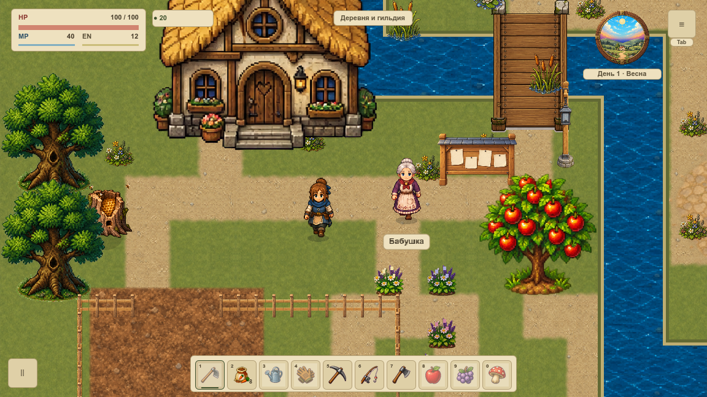

# VCOMPAT-001 — временная графика за границей сохранения

После VRENDER-006 выбрана одна подготовленная P0-карточка живого пилота. Оба полных предшественника завершены; зависимости и Git-база9225275e записаны в dependency-audit.json. Новых механик, карт, рисунков или рецептов нет.

## Найденная проблема и исправление

SaveSystem.snapshot уже выбирает игровые поля явно. Объекты графики в Game metadata и статических ресурсных кешах не попадают в этот snapshot. Но общий AtomicJsonStore.write без игрового валидатора принимал ShaderMaterial внутри вложенного словаря: JSON.stringify превращал ресурс в строку, writer подтверждал документ и ротировал резерв. Это воспроизведено реальными здоровыми записями, затем опасной записью, а не отсутствием доступа к тестовому каталогу.

Изменён только atomic_json_store.gd: перед открытием временного файла проверяются ключи/значения словарей и элементы массивов. Object, включая Resource/Texture2D/ShaderMaterial, RID, Callable и Signal вызывают отказ. Предел64 уровней ограничивает циклические или слишком глубокие кеши; поддерживаемые игровые документы значительно мельче. Отказ сохраняет основной файл, резерв и отсутствие нового tmp. Успешная атомарная запись, валидация, точки отказов и ротация прежние.

Фильтра по словам в строках нет: текст «RID(456)» или имя ресурса остаётся обычным текстом. Существующее кодирование координат сохраняется. Версия игрового JSON остаётся2, миграция v1 сохранена. Guard предотвращает запись ошибочно переданного объекта; он не удаляет поля и не заменяет данные прогресса пустыми значениями.

## Владельцы данных

Персистентные игровые поля выбирает SaveSystem; известные координаты проходят SaveVectorCodec. ID внешности и изученные направления анимации остаются прогрессом. Пользовательские настройки имеют собственное хранилище. Опора/время представления, сгиб/прозрачность, очередь рисунков и GPU-кеши принадлежат сеансу рендера. Карта владельцев и хеши исходников — в ownership.json.

В тестах используется настоящая очередь дерева с Texture2D до flush, реальные визуальные часы и дополнительная QA metadata с ресурсами/сгибом. Это проверка границы для будущих эффектов; новая система ветра и гибкости ею не объявляется реализованной.

## Проверка

61 профильное условие: вложенные типы и объектный ключ, цикл, сохранность двух файлов, отсутствие tmp, отсутствие ложного отказа на строках, настоящий snapshot с GPU metadata, загрузка без воссоздания графических ссылок, очистка очереди, три неизменных синтетических исторических слота и полный JSON round trip. Числа сравниваются после штатной JSON-нормализации int/float, все игровые поля сохраняются. Пять шагов реального удерживаемого ввода при одинаковом seed сравнивают весь игровой результат/RNG между визуальными путями on/off.

Нативный before/after: **8 PNG / 16 production callbacks**, окна1152×648 и1280×720, четыре точные RGBA-пары при одинаковой камере120%. В каждом окне есть обычный кадр и кадр с реальными ссылками в metadata. Сохранения и геометрия каждого draw равны. До исправления материал принимался как строка и менял оба файла; после — отказ при исправной обычной записи, валидном material RID и побайтно сохранённых файлах. Это функциональный контроль на настоящем macOS/OpenGL, не FPS/память или итоговая VMAP-003.

Все393 исходника каждой фазы закреплены хешами; production-скрипты сравниваются с Git-базой, единственное runtime-отклонение — проверенный writer. Игровые assets закреплены неизменным Git tree; QA-overlay одинаков у обеих фаз. Логи/кадры/полные состояния имеют отдельные SHA256. 17 Python-сценариев отвергают утрату покрытия, фиктивный draw/GPU/I/O-контроль, изменение состояния/backup/пикселя и подмену исходников.

Общие SAFE/FARM/WORLD и остальные регрессии выполняются штатным полным набором; фактические результаты — в completion.json после завершения. Пользовательские слоты не открывались: профили Codex-VCOMPAT-001 и синтетические v1/v2 отделены от обычной игры. Обычный Godot не завершался.

Первый полный pre-commit завершился с 46579 успешными условиями и одним отказом: у `_cleanup` нового тестового набора отсутствовал обязательный русский комментарий. Комментарий добавлен; отдельный запуск того же валидатора методов прошёл. Принятый общий результат ниже относится к повторному полному прогону после этой правки.

## Воспроизведение и откат

`tools/transient_save_review.gd`, `python3 tools/transient_save_verify.py` и `python3 tools/test_transient_save.py`. Новый нативный сбор требует свежей phase-папки и собственного профиля; незавершённая серия отвергается. Before воспроизводится на указанной Git-базе с сохранённым QA-overlay. Откат — отдельный revert writer без изменения формата JSON. Стоимость живой карты, новый арт/ветер/вода и полная VMAP-003 остаются у своих карточек.
