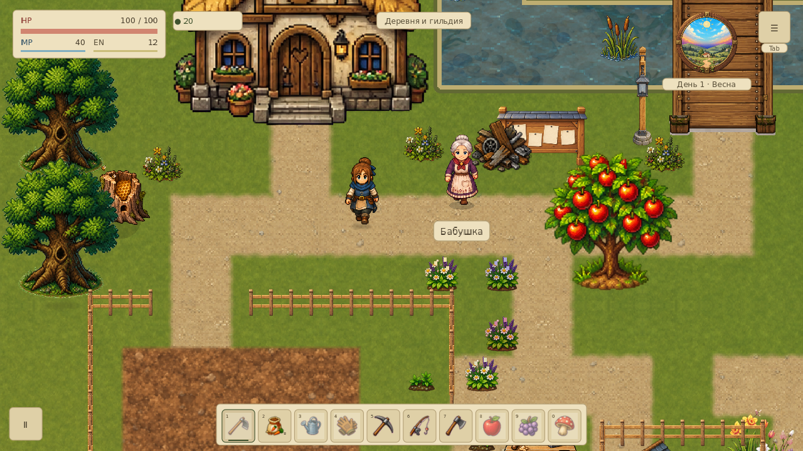
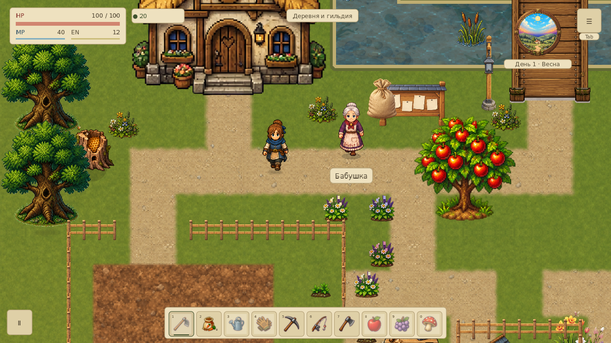

# Первый CI: разные игровые миры после замены скрипта

[CI 45026807462](https://github.com/sergey-leonidovich-shevchenko/babushkina-ferma/actions/runs/45026807462) снял 136 PNG из exact head `ae7485b343a374f04c460b09c9353d822f771e76`. Все четыре процесса съёмки завершились успешно, но semantic verifier отклонил сравнение. Эта серия остаётся **failure**.

`Points.create_game` задавал seed 20261015. Следующий `set_script(Game)` заменял script-state, поэтому настоящий `_ready` получал нулевой seed и создавал случайный мир. В окне 1152 исходные seed baseline/candidate — 1193334609/2697126418, в 1280 — 2297492879/2703168184. Различались RNG и контейнеры; регрессия production-графики таким сравнением не доказана. Независимое P2: [строка PR №88](https://github.com/sergey-leonidovich-shevchenko/babushkina-ferma/pull/88#discussion_r4658308469).

В 1152 кадры home-on полностью совпали, хотя игровые данные были разными. В 1280 home-on изменились 7053 пикселя: мешок и куча мусора занимали одно место. [Все отличия](pixel-differences.json) и [диагноз с источниками](result.json) сохраняют фактические данные.

Baseline 1280, исходный кадр:



Candidate 1280, исходный кадр той же камеры:



## Исходный архив без изменения байтов

GitHub artifact 14756277327: 131554556 байт, SHA256 `dbee328e6fc7d89acf4f9675189a0bfdcf99a39e0022dc1ea741b7cdd57ce918`. ZIP превышает GitHub-лимит одного Git-файла. Он сохранён двумя последовательными частями, без перепаковки: [манифест и SHA каждой части](parts.json). Reader проверяет порядок, пути, размеры, каждый SHA и SHA целого, собирает ZIP только во временную папку и удаляет свою временную копию.

```sh
python3 tools/run.py qa.world.rollback.archive \
  --archive docs/reports/visual-overhaul/vcompat-010/failures/ci-01/parts.json \
  --expected-head ae7485b343a374f04c460b09c9353d822f771e76
```

Обновлённый reader обязан вернуть отказ о потерянном fixed world seed. Старый reader возвращал `default rendering changed`; stdout его фактического локального повтора сохранён. Полный decoded API job log лежит в `job-log.zip` с неизменёнными UTF-8-байтами внутри. `regression-logs.zip` сохраняет исходные журналы red/green, Python и целевых quality-проверок; размеры и SHA отдельных журналов указаны в [result.json](result.json). Эти ZIP-обёртки журналов не подменяют исходный CI artifact.

## Исправление и воспроизведение

Фабрика заново закрепляет глобальный и мировой seed после `set_script`, до `add_child/_ready`. Настоящий headless-тест вызывает эту фабрику при обоих размерах, двух холодных project-флагах и сравнивает полные snapshots. Один и тот же test/driver дал old 214/10 → fixed 224/0; изменён только cases.gd. SHA обеих версий и теста сохранены. Стартовый userdata подтверждён до запуска; обычные файлы red/green не изменились, собственные override удалены.

Reader требует fixed seed каждого кадра и одинаковые полные save/camera/player/location между вариантами. Пиксельные критерии сохранены. Девять archive-тестов включают неизменённый настоящий CI1, все четыре плохих серии и совпавшие настоящие PNG с разными игровыми данными. Вместе с contract/reader — 26 тестов без отказов. Пять Python и три GDScript прошли штатные правила качества со свежей компиляцией.

Эти профильные результаты не закрывают новый полный hook, повторную нативную серию, post-bump Wiki или независимое exact-head ревью. Производительность и VMAP-003 остаются открытыми.
