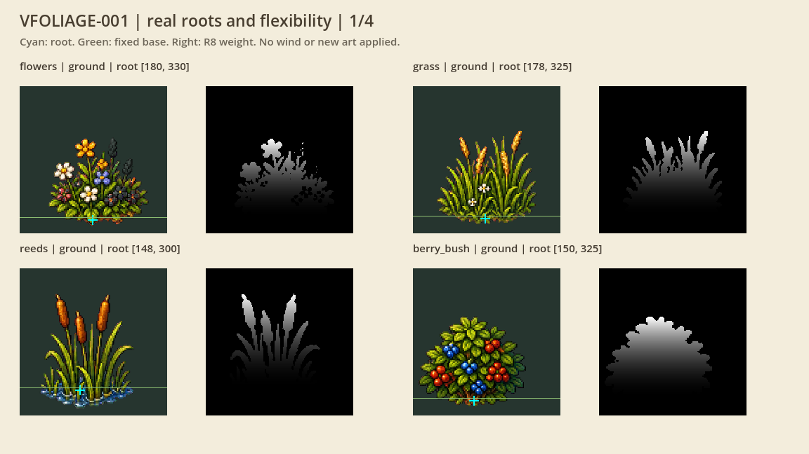
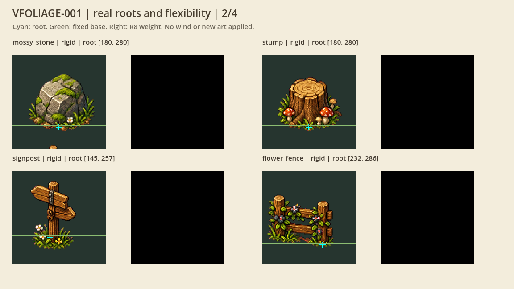
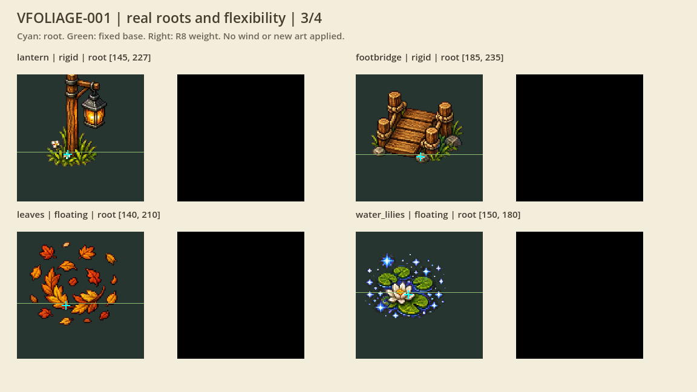
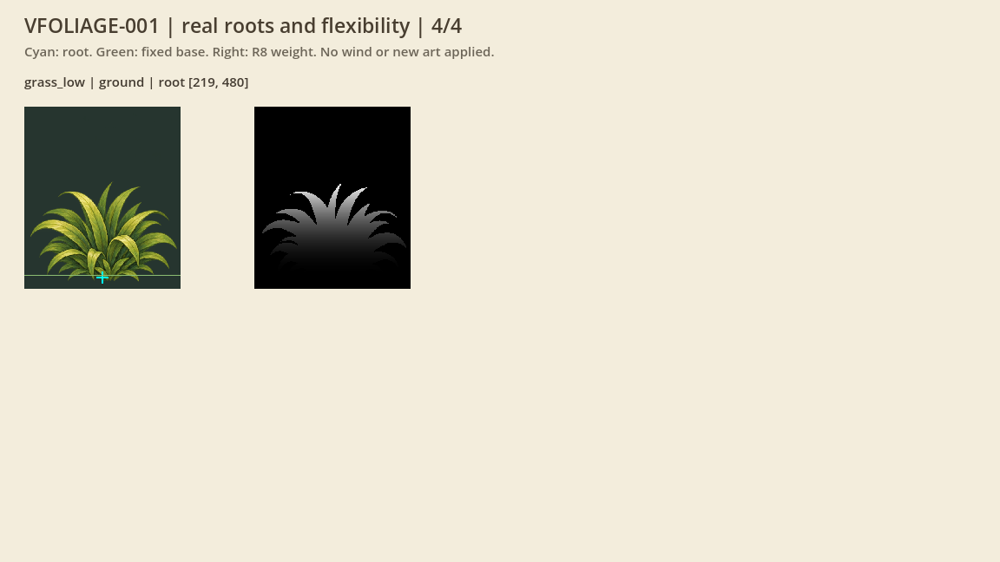
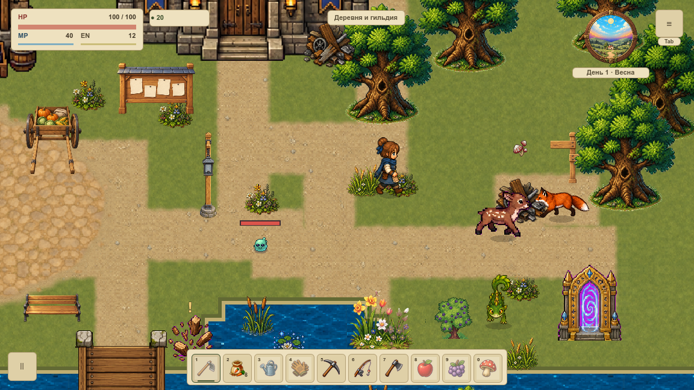

# VFOLIAGE-001 · Опоры рисунка и маски гибкости

Карточка подготовлена после завершения VART-008 и VRENDER-002, внутри полного замыкания живого пилота VRELEASE-003. Основание — локальная main `5dd9ddc4`; активной незавершённой карточки при выборе не было. Это подготовка данных первой карты, а не перенос графики на всю overworld или приёмка VMAP-003.

## Что обнаружено

Атлас `village_ambient_atlas_v1.png` имеет 12 областей 362×362. Прежний draw использует общий прямоугольник 72×72, заканчивающийся на `position.y + 24`. Низ прямоугольника не совпадает с опорой рисунка. Дополнительно в нижней части ячейки камня виден фрагмент соседнего фонаря: автоматический поиск самого нижнего непрозрачного пикселя выбрал бы его. У принятого `grass-low.png` из VART-008 прежний прототипный pivot `(219,490)` имеет alpha 3/255; новая опора `(219,480)` — 249/255.

Положение исходных рисунков, ячейки, коллизии, размещения и существующая анимация не редактировались. Дефект старой нарезки фонаря остаётся видимым наследованным свойством источника; он больше не определяет опору камня. Новая художественная партия этой карточкой не принимается.

## Контракт

`FoliageRootProfile` содержит 13 паспортов: все 12 ячеек и один принятый живописный пример. `VillageAmbientRenderer.root_anchor` переводит пиксельную опору через прежний destination rect. Неизвестный ID возвращает пустой паспорт/невалидную мировую опору, вместо скрытой подмены цветами. Отдельный паспорт нельзя изменить через возвращённый словарь.

| Тип | Опора внутри исходника | Режим |
|---|---:|---|
| flowers | 180,330 | наземное растение |
| grass | 178,325 | наземное растение |
| reeds | 148,300 | стебли выше водной подложки |
| berry_bush | 150,325 | наземное растение |
| mossy_stone | 180,280 | жёсткий |
| stump | 180,280 | жёсткий |
| signpost | 145,257 | жёсткий |
| flower_fence | 232,286 | жёсткий |
| lantern | 145,227 | жёсткий |
| footbridge | 185,235 | жёсткий |
| leaves | 140,210 | плавающий декор, наземный изгиб выключен |
| water_lilies | 150,180 | плавающий декор, наземный изгиб выключен |
| grass_low, 438×512 | 219,480 | живописный пример, пока вне штатной отрисовки |

Маска — один канал L8/R8 в точном пиксельном домене выделенной области. Alpha ниже 224, шесть пикселей перед корнем и всё ниже них имеют вес 0. Выше вес плавно возрастает по квадратной кривой. Камни, пни, указатель, ограда, фонарь, мостик, листья и кувшинки получают полностью нулевую маску: декор или отражения не становятся травой. Все байты исходных RGBA сохраняются.

Компилятор маски получает уже выделенный `Image`; вызывается явно при подготовке будущего материала. В обычный draw не добавлены чтение GPU, выделение масок или проход по пикселям. Система не хранит кеш, список активных пучков или состояние сгиба, не создаёт узлов и не пишет metadata/JSON. Владельцы будущих материалов и локальных UV относятся к VFOLIAGE-002; ветер, контакт и восстановление — к следующим карточкам.

## Нативная витрина

Слева исходная область с голубой опорой и зелёной границей неподвижного основания; справа настоящая одноканальная маска. Это диагностические изображения данных, не новые игровые спрайты.

## Проверка

Профиль: **373/0**, включая отдельный запуск проектного валидатора русских комментариев. Сам игровой suite добавляет 372 условия. Проверяются все области/опоры, каждый пиксель маски, неподвижные основания, жёсткие исключения, неверные ID/размеры, исходные RGBA, четыре направления, полный игровой результат при одинаковом удерживаемом вводе и seed, пауза/остановка/стена/телепорт/offscreen/reduced-motion. Чтения не создают узлов или накапливаемых активных групп. Живой контакт и счётчик работающего ветра ещё не реализованы и этим не объявляются проверенными.

Нативная серия: **48 framebuffer PNG / 96 игровых draw callbacks**, ещё 16 callback витрины, 26 файлов масок. Два физических окна 1152×648 и 1280×720, логический viewport1152×648, проекция 120%. В каждом окне: четыре листа со всеми 13 паспортами и десять контекстов обычной игры с чтением корней/без него. Двадцать полных RGBA-пар и полные snapshots обязаны совпадать; 480 вычисленных корней сверяются с исходными пикселями и destination rect. Реальные удерживаемые флаги проходят через `_physics_process`; перенос выполняется настоящим камнем QA. Пауза удерживает позицию, stop прекращает движение, столкновение ограничивает подход к верстаку.

[Протокол приёмки](native-admission.json) явно отделяет статические данные от физического устройства ввода и FPS. Фокус записан как фактический boolean; при отсутствующем фокусе видимое окно и реальные callback всё равно обязательны. Существующий TESTING.md допускает такой статический протокол для VPROP-007. На время статического readback штатный reduced_motion замораживает посторонний маркер; после кадра предпочтение восстанавливается. Пиксели из сравнения не вырезаются. Физический ввод, FPS/память, новый ветер и вся VMAP-003 **не приняты**.

Предварительные серии с обязательным фокусом отклонены и сохранены вне evidence. Следующая серия была отклонена полным RGBA-контролем из-за Time-driven восклицательного знака. После фиксации статических условий собрана отдельная свежая серия; файлы и флаги старых попыток не переподписывались. Начальный QA-suite также исправлен: `hash(bytes)` вместо отсутствующего метода `PackedByteArray.hash`, оба сравниваемых мира проходят одинаковую нормализацию snapshot.

Все production-сценарии закреплены через неизменный Git-base и полную карту SHA. Архив содержит только два проверенных runtime-отклонения и QA-overlay; неизменённые исходники восстанавливаются из base, игровые изображения не менялись. [Изменения](changes.json), [принятая сводка](summary.json) и [набор паспортов](profiles.json) связывают данные с фактическими источниками. Итоги отрицательных Python-сценариев, общего gate и Wiki — в completion.json после завершения.

Воспроизведение: `tools/foliage_root_review.gd`, `python3 tools/foliage_root_verify.py`, `python3 tools/test_foliage_root.py`. Новый нативный сбор требует свежего каталога и отдельного профиля Codex-VFOLIAGE-001. Пользовательские слоты не открываются. Откат — отдельный revert двух runtime-файлов без миграции сохранений.
