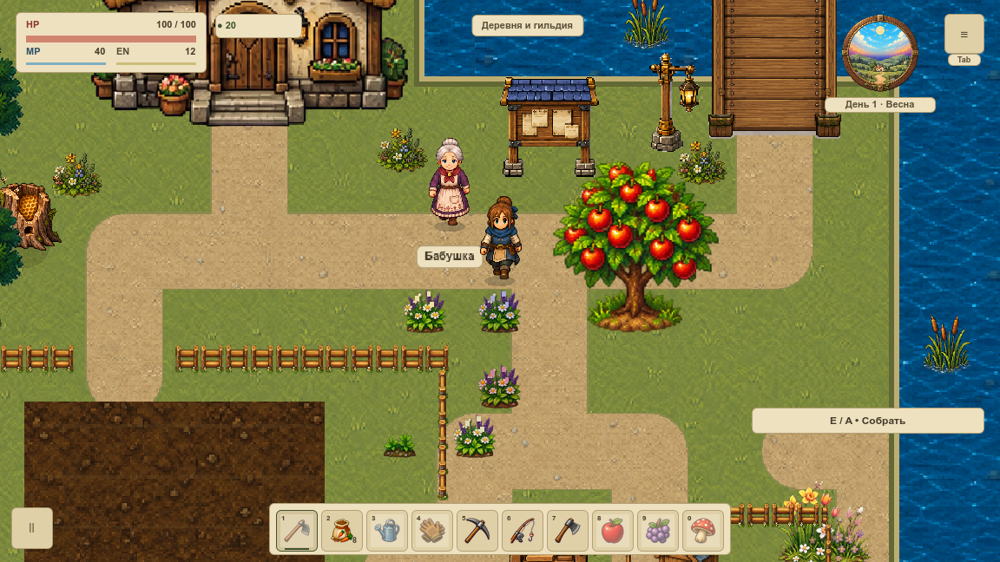
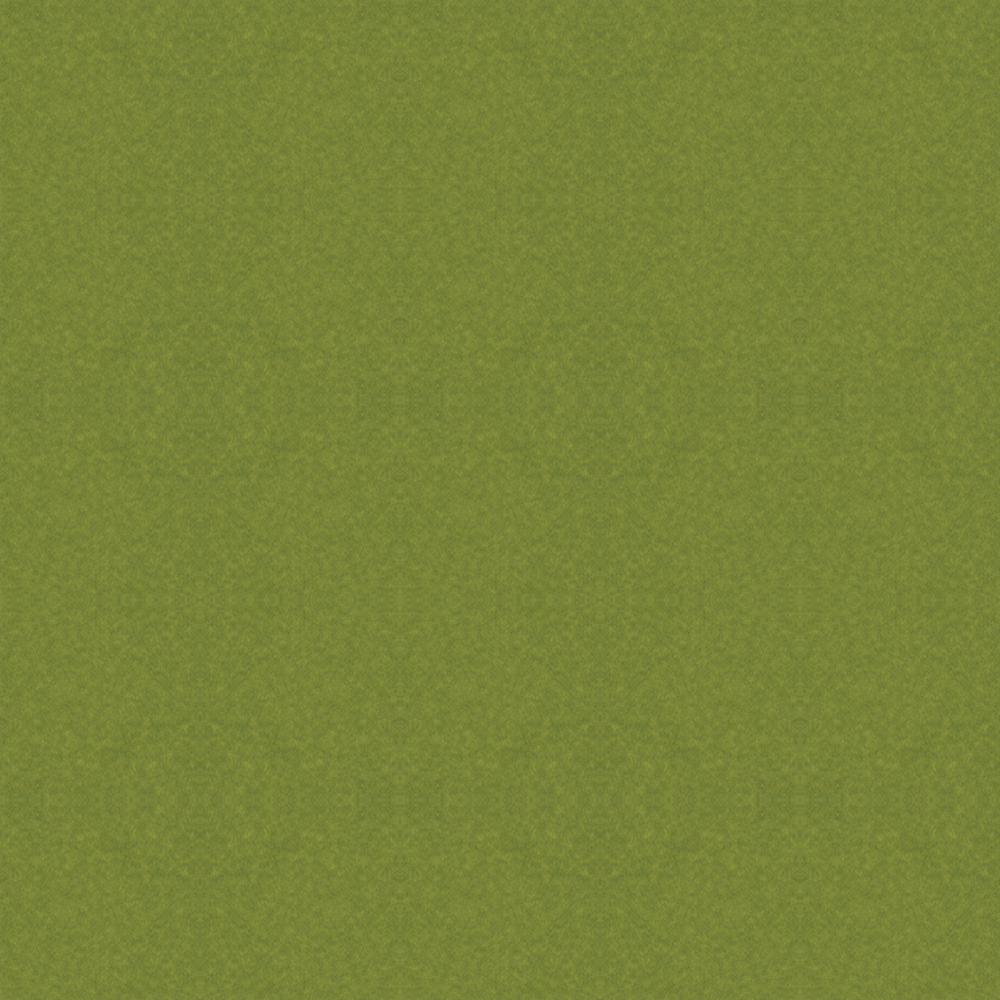
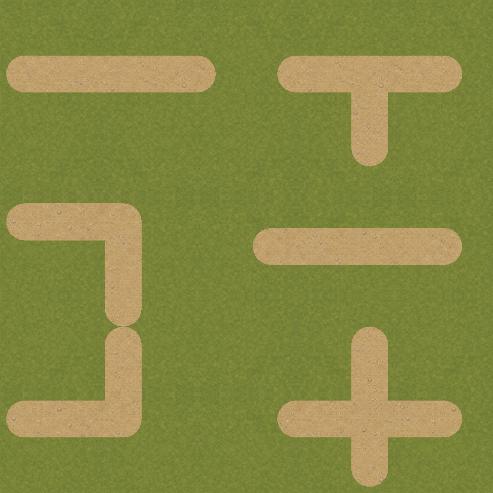

# VGROUND-001 · Бесшовная основа травы

На первой `overworld` подключён спокойный живописный материал **v2**: стиль A, тёплая палитра, масштаб 120%. Меняется только подложка травы. Дороги, вода, берега, растения, постройки и правила земли сохранены. Переходы дороги/берега пока имеют старую резкую кромку; их владельцы — VGROUND-003…009 и VSHORE. Вся карта и FPS этим изменением не принимаются.




## Рисунок и повтор

Мастер нарисован встроенным **image_gen**. Первая версия отклонена: [лист A](rejected/repeat-a.png) слишком явно повторял лиственные островки. Выбраны [второй мастер](masters/grass-calm-v2.png) и [промпт](prompts/grass-calm-v2.txt); подписи и происхождение — в [art-source.json](art-source.json). Мастера отдельно от `assets/game` под `.gdignore`. `tools/meadow_import.gd` выполняет стандартный импорт-размер Lanczos 512×512 RGBA8 без дорисовки/перекраски. Игровой ресурс — `assets/game/locations/overworld/modular/grass_painted_v2.png`.



Это настоящий GPU readback отдельного SubViewport **1152×1152** при 120%: каждый модуль 192 мира занимает 230,4 px. Лист не уменьшен ради помещения в обычное окно. Соседние модули зеркалят UV и читают одинаковые крайние пиксели: скачка цвета нет. Зеркальная периодичность остаётся при внимательном рассмотрении, но крупных контрастных пучков-меток нет. Приёмка рисунка выполнена агентом по полномасштабному листу и игровым кадрам, не только по автотесту.



Лист использует штатные `Terrain.material` / `capsule`, без новых коллизий. Четыре сезонных тона и дождь — диагностическая смена фона при замороженных календаре и симуляции. Зимний тон **не является снежным художественным набором**.

## Устройство и стоимость

`MeadowGround`: удерживаемый ArrayMesh, **416 вершин / 624 индекса**, одна поверхность и команда. Модуль 192 кратен сетке 24; неполные края обрезаны по 2400×1368. CanvasTexture задаёт linear+mipmaps/clamp только траве. Mipmaps содержат **1 398 100 байт Image-данных**, около 1,33 МиБ; это не RSS/полная VRAM. Старый материал сохранён для других карт и отката, уменьшение общей памяти не заявляется.

Новых постоянных узлов, targets, shader-проходов, таймеров или `_process` нет. Рисунок запекается в существующий кеш. За 120 настоящих callbacks число запросов/перерисовок и SHA256 RGBA не менялись. Draw calls **144 → 144** при 1152 и **146 → 146** при 1280. Замороженная съёмка с readback не измеряет FPS/GPU time.

Холодный первый кадр в обоих окнах точно равен полному direct эталону. Direct и уже закешированный кадр отличаются выборкой старых цветочных/оградных спрайтов: полный max RGB 204/191, среднее около 1/255. Существующая особенность fallback не выдаётся за пиксельное равенство. Их ресурсы и порядок не менялись. В парах старой/новой травы непрозрачный HUD и весь интерьер точны.

## Проверки и повторение

Финальная серия **C**: **48 нативных PNG / 162 наблюдения draw**, независимые профили 1152×648 / 1280×720, логический canvas 1152×648 и масштаб 120%. Четыре тона сезона, дождь, оба моста, настоящий вход/выход дома, direct/cold fallback и 5×5. База — `f002d52d426e5bcc93abd378ec8a64529806cfcc`; точный overlay и зависимости — [native/source.json](native/source.json), `native/inputs/`. [summary.json](summary.json) хранит измеренные различия. Вокруг draw сверяются полные saves, геометрия и очередь перекрытий.

[Профиль 8 / 0](review.txt) проверяет UV сторон/углов, обрезку, mipmaps, повторное использование mesh и sampler. Навигация и разрешение вспашки совпали в **1 200 точках** до/после переключения; полный сохранённый мир не менялся. Контрольный snapshot берётся после штатной ленивой инициализации навигации. Семь Python-тестов с 26 отрицательными подслучаями отклоняют неверные окно/масштаб/фокус, HP/камеру, неполные кадры, отсутствие mipmaps, перестройку кеша и FPS-overclaim.

```sh
python3 tools/meadow_verify.py
python3 tools/test_meadow_ground.py
tools/Godot.app/Contents/MacOS/Godot --headless --path . --script res://tools/meadow_review.gd
python3 tools/meadow_collect.py --output /private/tmp/vground-001-new
```

Повторная съёмка требует разрешённого Godot, активного окна, новых output/профилей и отсутствия конкурирующего Godot. Принятую серию не перезаписывать и не смешивать с A. Полный игровой набор, architecture gate, Wiki check и браузер обязательны по `TESTING.md`.

Откат — `WorldBackground.set_painted_grass(false)` с обновлением кеша первой карты либо revert задачи. Формат слотов и схема карты не менялись; остальные карты используют прежний материал.
