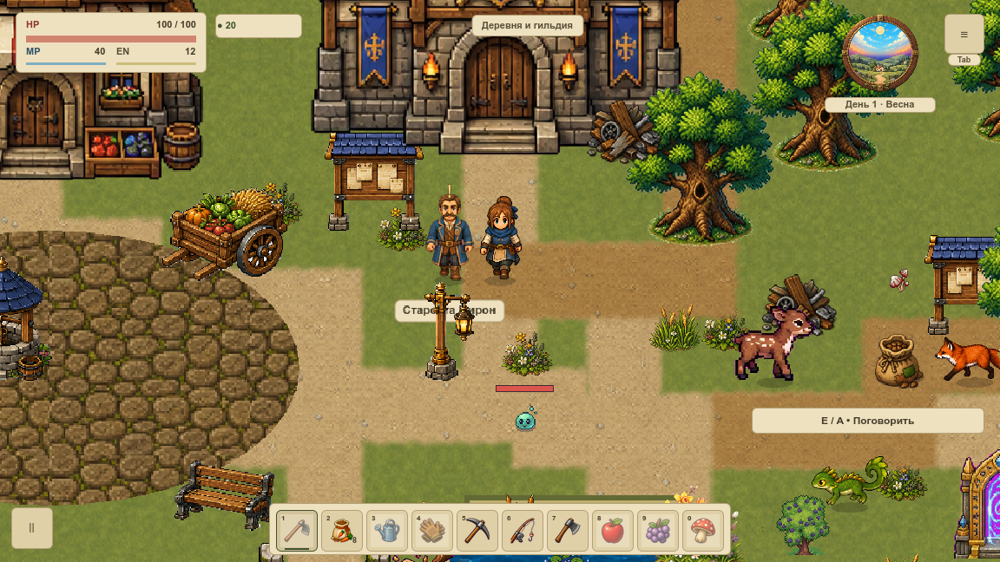
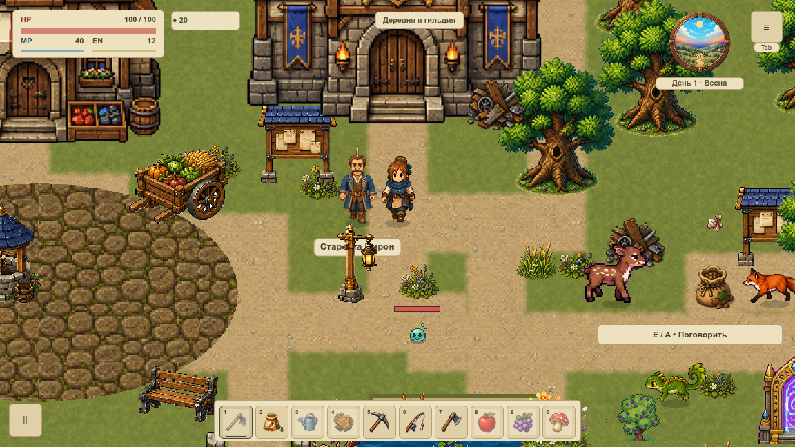
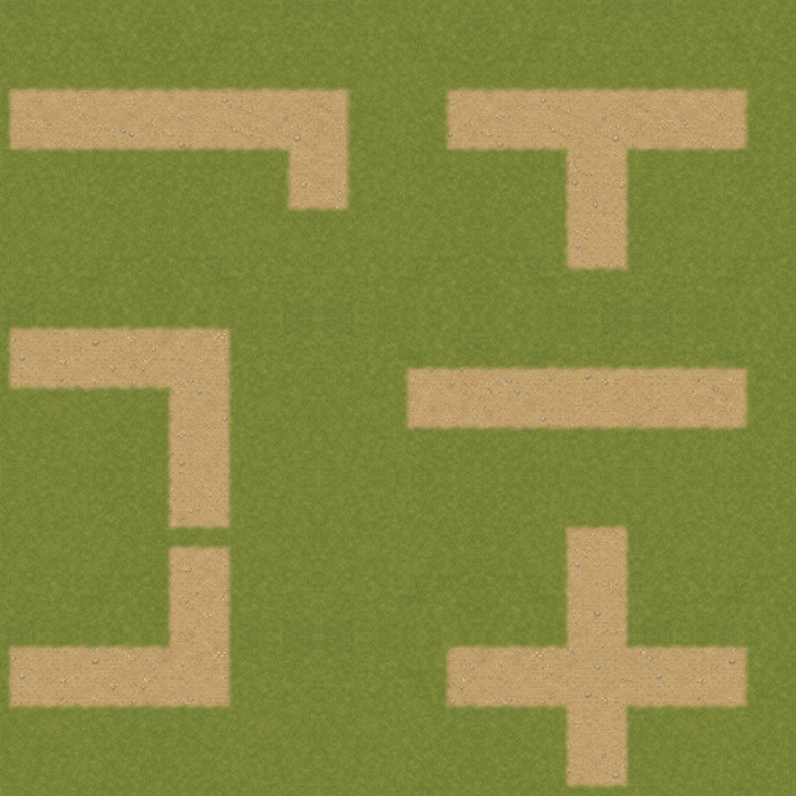

# VGROUND-005 · Соединения дорожной сети

Первая `overworld` использует одну ширину и мировую фазу материала на основных и выходных дорожках. У прежних двух масок был разный оттенок и повторное покрытие в местах пересечения. Новая сеть объединяет оба чертежа до разбиения геометрии; повторной рамки или затемнения от второй альфы в Т-стыках, крестах и поворотах нет. Оси, плоские торцы VGROUND-004, малое скругление и мягкость VGROUND-003 сохранены.




## Геометрия и порядок

Офлайн `road_network_builder.gd` считает общее поле из `MapData.routes()` и `RegionData.routes("overworld")`. Номинальная ширина 72 мира, малое скругление 4, шаг кромки 2, мягкий переход 9, мировые UV /384. Неровность края остаётся художественной, навигация её не читает. Каждая занятая клетка принадлежит ровно одному из двух слоёв. Если четыре угла клетки содержат поддержку выходной дорожки, она передаётся верхнему владельцу; иначе остаётся нижнему. Внутренняя граница не получает собственной альфы или обводки. Оба владельца используют белый цвет и один `PATH`.

Разделение сохраняет нижний проход перед площадью, огородом и берегами, верхний — после прежних оград, цветов и мостов. В пределах двухпиксельной клетки на границе владельца может измениться, какая часть общей дорожки относится к верхнему проходу; это показано в нативных кадрах. Новые объекты, пути и диагональные проходы не добавлены. Другие карты используют прежний путь.

`road_network_masks/main.res`: 41 192 вершины / 214 092 индекса; `connectors.res`: 11 878 / 61 644. По одной поверхности. **166 010 клеток** полностью совпали с отдельно скомпилированным единым полем всей карты; между владельцами нет пересечений. Каждая вершина сверяется по UV, белым RGB и альфе общего поля с учётом 8-битного хранения цвета Godot. Шесть SHA256 связывают маски с обеими картами, осевым преобразованием, новым builder и общими полями. Размер файла не является RSS/VRAM.

```sh
tools/Godot.app/Contents/MacOS/Godot --headless --path . --script res://tools/road_network_compile.gd -- --output=/private/tmp/road-network-new
```

Нужен свежий каталог. Прежние ресурсы/компиляторы не заменены. `WorldBackground.set_joined_roads(false)` возвращает две маски VGROUND-004 с прежними оттенками; отключение `rectangular_roads` или `soft_ground_edges` возвращает предыдущие ступени. Слоты не мигрируются. Новых узлов, targets, шейдеров или пересчётов на кадр нет. [Компиляция](compile.txt), [профиль](review.txt).

## Нативная проверка

Серия A: **68 PNG / 210 полных наблюдений draw**, два свежих профиля/окна 1152×648 и 1280×720, логический canvas 1152×648, камера 120%. Git-база `5182226a04977b7839d7c5d199b3746c44b892bc`; точные исходники, материалы, старые/новые маски и артефакты закреплены в [source.json](native/source.json). Одинаковые камера/поза/состояние до и после, четыре сезонных тона, дождь, оба моста, три настоящих соединения, вход/выход дома. Непрозрачный HUD и интерьер точны; полные saves/геометрия/очередь сохранены.



Каждый лист снят настоящим GPU readback 1152×1152. Независимая контрольная маска объединяет все ветви за один проход старым проверенным builder. У двух владельцев **альфа совпала побайтно** с ней; максимальная разница цвета с единым проходом **1/255**, средняя 0,000331. При смене материала альфа также точна. На пяти свободных рукавах ширина по порогу 50% составила 85/87/85/88/86 px при номинальных 86,4 px: отличие определяется неровностью края и выборкой. Мягкое сечение содержит 11 уровней, max шаг 42/255. Это проверяет фактические пиксели, а не только декларацию ширины.

Первый холодный кадр точно равен direct эталону. Кеш не изменился и не перестраивался за 120 callbacks. Наблюдаемые draw calls 145→145 и 144→144; это не замер FPS. Между cached/direct сохраняется разница выборки прежних цветов/оград, полное пиксельное равенство этих двух путей не заявляется.

23 профильных утверждения включают полное покрытие, источники, 1 200 точек навигации/вспашки и восемь настоящих диагональных движений у обоих мостов; результаты прежние. Девять Python-тестов отклоняют отсутствующий стык, потерю фокуса, размер/камеру/HP, отсутствие переключения, ложный FPS, пересборку кеша, пустой контроль, двойную альфу, цветовой шов и неверную ширину.

```sh
python3 tools/road_network_verify.py
python3 tools/test_road_network.py
tools/Godot.app/Contents/MacOS/Godot --headless --path . --script res://tools/road_network_review.gd
python3 tools/road_network_collect.py --output /private/tmp/vground-005-new
```

Сбор требует разрешённого Godot, фокуса и новых output/профилей. Полный игровой набор и architecture gate выполняются настоящим pre-commit; Wiki check и браузер обязательны. Симуляция серии остановлена, GPU timer — `null`: живой бюджет, новые материалы площади/дороги, берега, снежный набор и вся `overworld` до VMAP-003 остаются открытыми.
