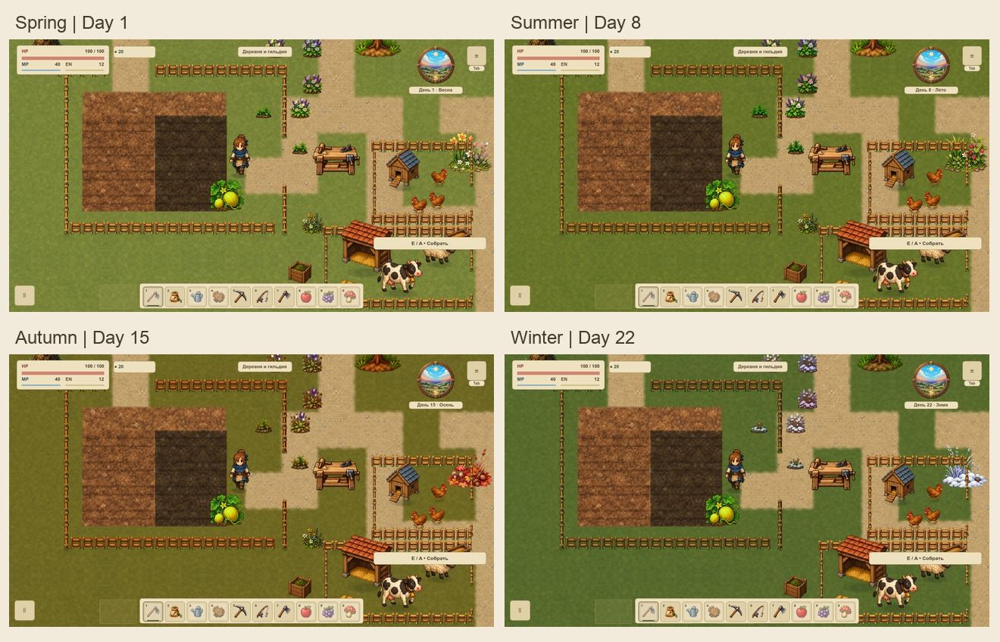

# VGROUND-010 — сезонные переходы земли

Приёмка существующего покрытия первой `overworld`: четыре календарных сезона и естественный дождливый день на одной геометрии. Игровой renderer и ресурсы не изменены. Версия QA-сборки 0.0.289; точная база 0.0.288 / `559277afcefcccc1d8efad5ae04469a193ba13d2`, исходники и SHA сохранены в `native/inputs` и `native/source.json`. Это инженерная ступень курса первой локации; вся карта VMAP-003 ещё не принята.



## Что проверено

| Профиль | День | Настоящая погода |
| --- | --- | --- |
| Весна | 1 | Ясно |
| Лето | 8 | Ясно |
| Осень | 15 | Ясно |
| Зима | 22 | Ясно |
| Мокрая весна | 3 | Дождь |

Календарь и погода берутся из штатного `WorldEventSystem`, включая возвращение весны на 29-й день в логическом профиле. На нативной серии после пяти профилей повторно включается первый весенний день: полный RGBA-кеш и кадр огорода совпадают точно.

34 профильных утверждения: неизменные массивы вершин/UV/альфы и ID 41 настоящего меша (луг, прежние/осевые/объединённые дороги, площадь, основание огорода и 30 клеток); неизменные дороги, вода, берега, мосты и заборы. Все 1 200 результатов навигации/вспашки и восемь настоящих swept-движений у мостов совпадают. Чистая смена графического окружения и reference mode сохраняют полный save. Настоящий дождливый день поливает две обработанные клетки; ровно 30 домашних клеток, прежняя энергия/монеты и зимняя пауза роста сохранены. Это модельный тест, не проверка физического ввода.

## Нативные доказательства

Два окна 1152×648 / 1280×720, логический viewport 1152×648, принятый масштаб 120%. В каждом — один замороженный мир; свежие QA-профили не читают пользовательские сохранения. По шесть одинаковых камер: дом, угол огорода/тупик, площадь/Т-стык, оба моста, поворот дороги. Дополнительно обычные эффекты каждого климата, возврат весны и настоящий вход/выход дома. **88 PNG / 304 наблюдения production draw**. Каждый draw сравнивает полные save и геометрию до/после и требует пустую очередь отложенных перекрытий.

Полная альфа всех пяти кешей 2400×1368 одинакова. Независимые участки луга и площади имеют пять разных средних RGB; дождь темнее весны также в сером. Основание огорода остаётся точным. Цвета меняются, коллизии и покрытие — нет. Нативная влажность клеток намеренно фиксирована одинаково для сравнения: автоматический полив не исполняется при перестановке QA-календаря; он проверен отдельным игровым профилем.

У всех сезонов один и тот же render target и его текстура. На каждую смену — одно обновление; десять повторов того же профиля не создают запросов или записей. Отключение reference mode не меняет ни одного байта кеша земли. Пауза/продолжение и 120 статичных callbacks не меняют его пиксели, ID, счётчики или геометрию. Открытие настоящего меню законно записывает ровно два прежних флага первого использования: `first_chapter.events.pause_menu` и `tutorial.events.pause_menu`; полный остальной save совпадает. Нельзя объявлять весь save до/после этого пользовательского действия одинаковым.

В reference-кадрах подавлены `water_overlays`, `ambient_motion`, `orchard_weather`, `atmosphere`, `action_feedback`, HUD оставлен. Обычные кадры дождя хранятся для осмотра: осадки движутся по системным часам даже при замороженной симуляции, их пиксельное равенство не требуется. Внутри каждого окна сравнивается один мир; два свежих процесса могут иметь разные loot/RNG, поэтому полные save разных процессов не объявляются равными. При отдельной межоконной сверке массивы всех мешей, layout и восемь движений точны; шесть результатов навигации отличаются только `loot`/`walkable` из-за этого случайного лута. Это не сезонное изменение: внутри каждого окна все пять профилей сохраняют все 1 200 правил точно. Подробности — `cross-window.json`; одинаковая навигация разных свежих миров не заявляется.

`sampling-notes.json` сохраняет отклонённые попытки A/B: преждевременное завершение и тайм-аут без принятого полного набора. Причина не доказана. В принятой C QA-окно показывается до первого ожидания post-draw, добавлены сообщения этапов. Обычные процессы Godot не закрывались сборщиком. Сосуществование записано явно и не является проверкой производительности.

## Воспроизведение

```sh
tools/Godot.app/Contents/MacOS/Godot --headless --path . --script res://tools/ground_seasons_review.gd
python3 tools/ground_seasons_verify.py
python3 tools/test_ground_seasons.py
```

Новая съёмка: `python3 tools/ground_seasons_collect.py --output <свежий каталог>` на разрешённом настоящем дисплее с фокусом. `--static-coexistence` только явно фиксирует соседние процессы. Неверные источники, неполный набор, ERROR движка, неверные окна, изменённый save/меш/проход, лишний target, повторный repaint, подменённая альфа, одинаковые сезоны или неверный возврат блокируют проверку. 11 Python-сценариев проверяют эти отказы; verifier и сценарии входят в architecture. Обязательны настоящий pre-commit с полным игровым набором, Wiki check и браузер; итоговые числа находятся в `completion.json` и `quality-check.txt` после их выполнения.

## Границы

Здесь принимается существующая смена тона луга/заборов и площади, прежние сезонные украшения. Дороги, берега и основание огорода не получают нового климатического материала; влажность обработанных клеток остаётся собственным игровым состоянием. Зима — прежний холодный тон, **новый снежный покров не добавлен**. Развитие художественной погоды относится к VWEATHER. Новые механики, другие карты/интерьеры и массовая замена предметов не входят в задачу.

Статические кадры не доказывают FPS, GPU-время, RSS/VRAM, отсутствие долгой утечки, живой бюджет VPERF или приёмку всей первой карты VMAP-003. Production не получает новых readback, таймеров или target; все копии изображений создаёт только QA-инструмент. Для отката самого QA достаточно исключить новую suite/проверки: сохранения и игровой renderer не мигрировали.

[Результаты](summary.json) · [Исходники](native/source.json) · [Серия 1152](native/1152/capture.json) · [Серия 1280](native/1280/capture.json)
