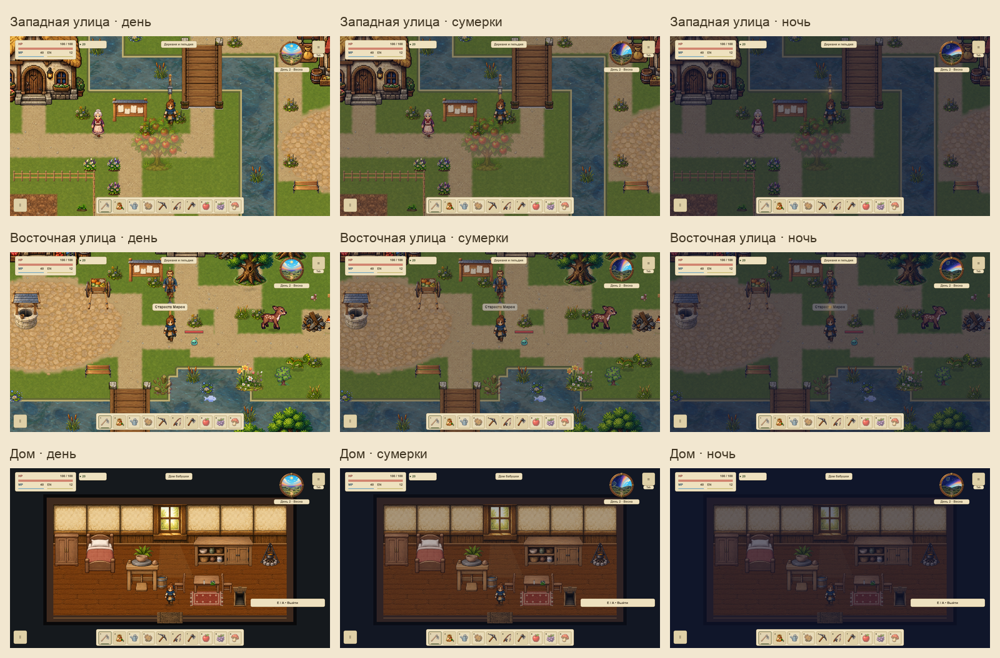
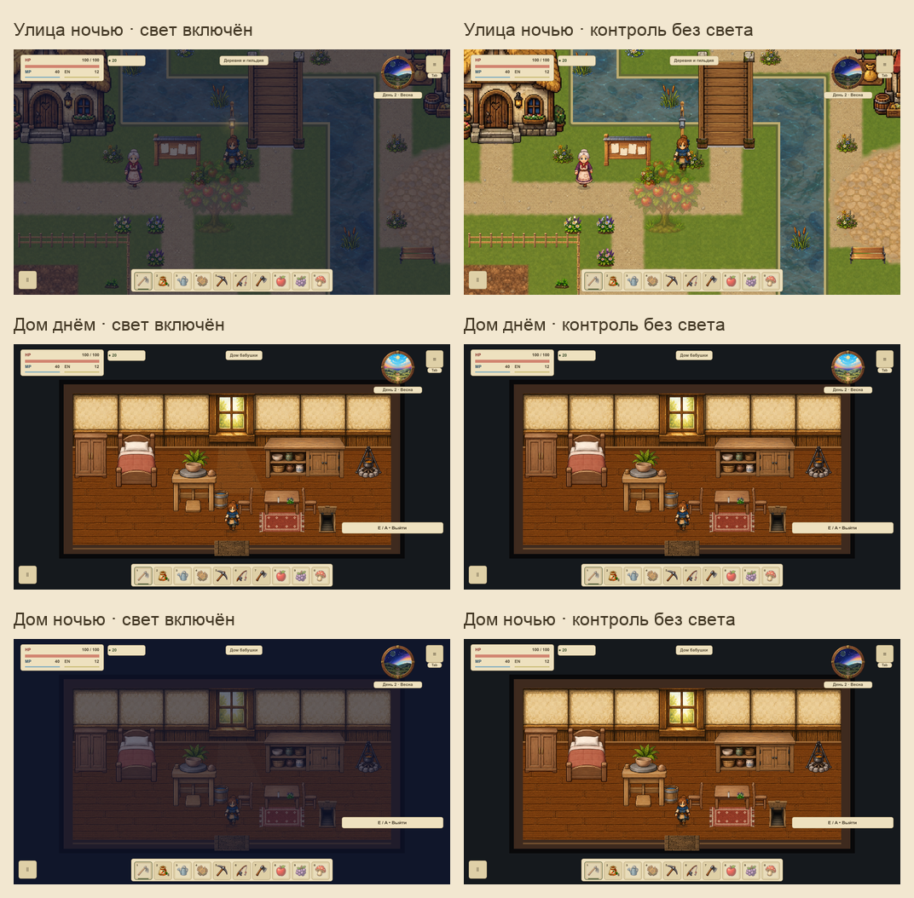
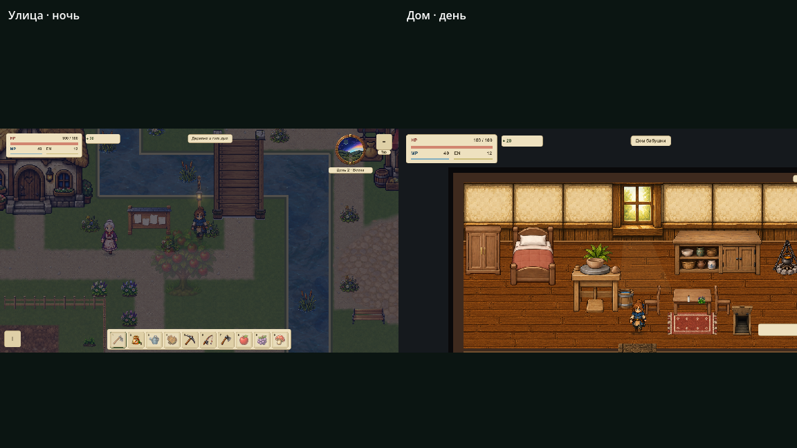

# VLIGHT-001 · Карта существующего света

Статус: `in_progress`. База — принятая `main` `dc4429f89be9ddc29cf5a052ae4dd665fbfd71df`, ветка `codex/vlight-001-visual-task`. Все шесть транзитивных зависимостей проверены и завершены. VSHADOW-010 полностью принята и учтена перед началом этой задачи.

Цель — описать действующие источники, затемнение и рисованные акценты, их координаты, порядок слоёв и стоимость. Для каждого эффекта будет указано, что сохраняется, а что требует следующей отдельной карточки. Основная область — первая `overworld`; существующие помещения и пещерные акценты проверяются как совместимость без новой графики или механик.

План проверки: день, сумерки и ночь при одинаковой камере; улица и помещение; свет включён и выключен; два независимых viewport; HUD отдельно; сравнение стоимости с выключенным эффектом. Нативные кадры и замеры должны быть связаны с фактическими исходниками и конфигурацией. Headless-тесты не принимают аппаратный FPS.

Ведомость закрепляет 15 групп и 16 входных файлов; просмотрены 407 runtime `.gd`/`.tscn`. Прямых ссылок на `PointLight2D`, `DirectionalLight2D`, `CanvasModulate`, `LightOccluder2D` или `WorldEnvironment` не найдено. Это поиск по исходникам, а не утверждение о любом будущем динамически загруженном ресурсе. Сейчас свет рисуется примитивами, мешами, градиентами и кадрами спрайтов.

Дополнительно просмотрены четыре действующих `.gdshader`: `foliage_wind`, `foliage_uv`, `village_water_surface` и `terrain_cutout`. Все объявляют `unshaded`, пользовательской `light()` нет. Ветер, вода и вырезание края — отдельные владельцы, их шейдеры этой задачей не заменяются. Полные scripts/asset trees также закреплены в нативном manifest.

## Решения по действующим эффектам

| Группа | Сейчас | Что сохраняем | Следующая карточка |
|---|---|---|---|
| Общее затемнение | Экранный alpha-прямоугольник после мира, до HUD; день/сумерки/ночь 0/0,31/0,62 | Календарь и условия затмения; заменить плоскую тонировку согласованной палитрой | VLIGHT-003 |
| Деревенские фонари | Общий цветной `ArrayMesh`, сила от календарного затемнения | Корпус, привязку emitter, три разрешённых ракурса и отдельный контакт; способ освещения сравнить | VLIGHT-002/004 |
| Окно дома | Мировая трапеция с постоянной alpha 0,06 перед актёрами, без часов | Окно, привязку, геометрию и коллизии; дневную зависимость и форму луча доработать отдельно | VLIGHT-005 |
| Лунный и событийный порталы | Экранные полупрозрачные круги после затемнения | Игровые условия и координаты; отделить свечение от декоративного символа | VLIGHT-002/009 |
| Грозовая вспышка | Погодный белый прямоугольник, wall-clock | Погодные условия; изолированный light-off его не выключает | VLIGHT-009 |
| Возвратный лунный портал | Экранный круг в существующей moon_glade | Условия возврата; только исходный аудит другой карты | VLIGHT-002 |
| Небо затмения | Декоративные круги; не освещение мира | Небесное событие; общий выключатель света не должен его стирать | VLIGHT-009 |
| Пещерные жилы и факелы | Общий радиальный `GradientTexture2D`, пульсация по `Time.get_ticks_msec` | Истощённые жилы не светятся; при будущей замене отделить clock эффекта от wall-clock | VLIGHT-006/007 |
| Статичные пещерные растения | Кешированная цветная текстура и нарисованная растительность | Сам рисунок и кеш; не создавать второй halo поверх старого | VLIGHT-007 |
| Пещерные динамические грядки/озеро | Радиальные текстуры и декоративные дуги, wall-clock | Игровые условия, растительность и границу воды; отделить декор от света | VLIGHT-007 |
| Кристаллы/печати босса | Радиальная текстура, полигоны и линии, сохранённый `cave_boss.clock` | Стадию и игровой clock; менять только представление | VLIGHT-007 |
| Пещерные проходы | Радиальная текстура и дуга | Маркер/условия перехода; сравнить способ halo | VLIGHT-002 |
| Кухонный огонь и пар | Кадры огня и кружки пара от прогресса оплаченной работы; света на окружение нет | Крафт, прогресс и спрайты; будущий локальный свет отдельно | VLIGHT-006 |
| Подвальный фонарь | Свет нарисован в текстуре, отдельного glow нет | Пропорции и рисунок; не удваивать ореол при добавлении локального эффекта | VLIGHT-006 |

Пещера, кухня и подвал здесь — **аудит совместимости по исходникам**. Их новая графика и нативная приёмка не входят в эту карточку первой `overworld`. Контактные и солнечные тени остаются отдельной системой VSHADOW.

## Как изолирован выключатель света

QA экспортирует принятую production-базу и отдельно замораживает собственные входы. Только в контрольной копии заменяются пять известных draw-вызовов в трёх исходниках: затемнение, два портальных круга, меш фонаря и полигон окна. Погода, вода, тела предметов, контактные тени и небесный декор не отключаются. `visual_reference_mode` для этого непригоден: он меняет сразу несколько эффектов.

После editor/preflight и каждого native запуска collector повторно хеширует **реальные файлы** обеих экспортированных копий: 16 render-входов и 14 QA-входов. Предположение «git archive значит байты не изменились» само по себе не используется.

Прибор включённого света обязан дать точный RGBA исходной production-сцены. Для выключенного света reader ограничивает изменённые пиксели реальными границами вызовов. HUD снимается своим прозрачным native target, а сохранения и геометрия сверяются по самим значениям до/после двух callbacks. Кроме отдельного target, непрозрачные пиксели HUD проверяются в **полном production-кадре** on/off: максимум 1/255 допускается только из-за квантования alpha. Это не позволяет ошибочному порядку слоёв спрятаться за успешным HUD-only draw. Выключатель принадлежит canvas; второй viewport должен остаться точным в обоих направлениях переключения.

## Замечания для следующей реализации

- Уличный `draw_lights` перебирает весь список фонарей без собственного отсечения по влияющему прямоугольнику. В VLIGHT-004 стоит сохранить общий меш и проверять весь ореол, а не только центр фонаря: соседний источник за краем экрана всё ещё может освещать видимый участок.
- Пещерные градиенты уже переиспользуются и частично отсекаются по видимости. Их нельзя заменять покадровым созданием текстур или узлов ради такого же эффекта.
- Луч окна постоянен даже ночью; это художественная условность, которую нужно исправлять в VLIGHT-005 отдельно от календаря и механик комнаты.
- Wall-clock пещерных акцентов, погоды и сохранённый clock босса различаются. Будущая анимация должна явно выбирать владельца времени и правила паузы; текущая карточка их не переписывает.
- Отдельный HDR/bloom-pass сейчас не требуется для воспроизведения исходного вида. Сравнение реального локального света и рисованной маски — следующий эксперимент VLIGHT-002; решение нельзя принимать только по названию техники.
- Мир, атмосфера и HUD сейчас отправляют команды через один `game` CanvasItem, хотя методы и порядок разделены. Для нового локального света и postprocess проверять приёмники мира и интерфейса отдельно в VLIGHT-002/009; полный HUD-контроль должен сохраняться.

## Нативная серия D

Свежая полная матрица снята на официальном Godot `4.7.1.stable.official.a13da4feb`, macOS/OpenGL Compatibility, AMD Radeon Pro 5300M. Источник — неизменная production-база `dc4429f89be9ddc29cf5a052ae4dd665fbfd71df`, версия 0.0.461, плюс 14 замороженных собственных QA-входов. Общие camera/draw helpers, UID наблюдателя и реестр точек закреплены Git-базой; их реальные байты обеих retained export-копий сохранены в `native/base-qa` и проверяются также против текущего кандидата. Игровые скрипты и ресурсы не изменены.

| Условие | Подтверждение |
|---|---|
| Камера | Два прежних участка улицы и дом; actual camera/player/clock/zoom snapshots, seed 20261015 |
| Окна | 1152×648 и 1280×720; улица 120%, дом 100% |
| Время | День 720, сумерки 1140, ночь 1320; day 2, clear |
| Режимы | Production, прибор on, тот же прибор off |
| Кадры | 54 world  + 54 прозрачных HUD  + 12 отдельных viewport target  + 6 настоящих root-composite =126 PNG |
| Состояние | 108 наблюдаемых world draw callbacks  + 24 twin callbacks; полные save/геометрия до и после совпали |
| HUD | Отдельные RGBA точны; непрозрачный HUD полного кадра on/off отличается максимум на 1/255 |
| Прибор | Включённый прибор даёт точный RGBA исходного production во всех 18 парах |
| Границы | Off меняет только области фактических light-вызовов; дневная улица точна |
| Изоляция | Два разных мира/размера/часа, оба направления выключателя; соседний target точен |
| Bloom | WorldEnvironment glow отсутствует в реально снятых сценах |

[Ведомость владельцев](native/inventory.json) · [CSV](inventory.csv) · [Сводка reader](results.json) · [Происхождение иллюстраций](gallery.json) · [Общие QA-входы](shared-qa-inputs.json). Native manifest, замороженные входы и точные ZIP по ширине находятся в `native/`. Упаковка сохраняет SHA каждого исходного PNG/JSON/log; raw и ZIP результаты сверены.

Первые два листа — уменьшенные целые native PNG с подписями вне framebuffer; последняя картинка — byte-exact native root framebuffer. Это фиксация существующего вида, новая художественная система света этой карточкой не реализована.

Второй SubViewport имеет 960×540 и используется для проверки владельца света при другом размере. Его HUD частично выходит за узкий target; адаптивная компоновка HUD на 960 этой витриной не принимается. Основной HUD сравнен отдельно в обоих штатных окнах 1152/1280.

## CPU draw submission

Три повтора, 90 реальных samples на режим/повтор: 270 on  + 270 off в каждой сцене и окне, всего 2160 samples. Сохраняется одинаковый прибор; snapshot-проверки не входят в замер. Измерен полный вызов отправки команд `_draw`, не GPU-время и не hardware FPS. Сырые выборки, полные состояния и повторные медианы лежат в capture.json внутри ZIP; сводка сохраняет отрицательные разницы.

| Окно | Сцена | On, мкс | Off, мкс | On−Off, мкс |
|---|---|---:|---:|---:|
| 1152 | Улица ночью | 7612.5 | 7602.0 | +10.5 |
| 1152 | Дом днём | 4262.0 | 4031.5 | +230.5 |
| 1280 | Улица ночью | 7594.0 | 8072.0 | −478.0 |
| 1280 | Дом днём | 4261.0 | 4022.0 | +239.0 |

Уличная разница сопоставима с разбросом и меняет знак. Это **не доказательство ускорения при выключении света** и не основание выбирать технологию без следующего VLIGHT-002 сравнения. GPU timer здесь не измерялся; вся карта и VMAP-003 не приняты.

CPU-серия выполнена после посещения/прогрева дома. По сравнению с более ранним уличным PNG добавлены только `estate.discovered` и `estate.expansion.workshops` (существующий pottery default); `EstateSystem.discover_location` и `WorkshopSystem.state` отражают эту инициализацию. Это явно показано в `visual_frame_save_delta`. Полные saves **всех on/off и трёх повторов одной CPU-сцены точны между собой**, каждый before/after точен, фактические camera/zoom/context snapshots совпадают с визуальным случаем. Домовой CPU-контекст совпадает также с save раннего PNG. Инициализация отделена от наблюдаемых callbacks; глобальная чистота любого первого draw этой карточкой не принимается.

Первая попытка reader ошибочно требовала равенства CPU-save раннему PNG до прогрева дома. Её отказ сохранён в `failures/reader-initial-state-comparison.txt`; правило уточнено до правильного парного контроля без исключения отдельных полей save. Отрицательный случай меняет сохранение одного повтора вместе с его before/after и получает отказ. Native-D и 14 входов не редактировались.

## Проверки и границы готовности

Пять новых GD прошли настоящий строгий semantic-анализ, 8 contract и 19 actual-archive reader тестов прошли. Они проверяют реальные overlays/Git/пути, неполный набор, неверные argv/логи, мутацию save/геометрии, HUD, второй framebuffer, CPU-пары и изменения текущих общих QA-зависимостей.

Независимое предварительное ревью первого head нашло P2 в pin движка: широкое сравнение версии принимало похожий patch/unofficial и не сверяло фактический журнал. Reader теперь требует точные `capture.engine` и единственный официальный build banner `engine.txt`. Тот же тестовый файл на старом reader дал три failed assertions, на исправленном — 4/0, включая неизменённый baseline. Полный новый reader-набор дал 19/0. [Сценарий, исходный отказ и SHA](review-engine/README.md) сохраняют настоящие копии/журналы; source D, 14 входов и 126 исходных PNG не менялись. `results.json` пересчитан новым анализатором, его SHA указаны явно. Пересъёмка не заявляется.

[Протокол неудачных запусков](failures/README.md) сохраняет A с конфликтом `Projection`, реальный check-only отказ до native и C с runtime Array→Array[bool] в измерителе. Они не засчитаны. D снята после типизированной инициализации и отдельного reverse; реальный collector отказывает при существующем выводе до нового запуска движка: [receipt](collect-existing-output.json). Отдельно проверен настоящий inventory CLI из чужой cwd с пробелами, чужими GIT_DIR/GIT_INDEX_FILE и враждебным PYTHONPATH; прежний отчёт и чужие config/index сохранены: [receipt](source-cli-receipt.json).

Команды — [qa.world.lighting](../../../../tools/qa/world/lighting/README.md). Обычный `verify` исторически привязан к этой базе. `--check-current-candidate` дополнительно проверяет текущие runtime/asset trees, собственные и общие QA-входы. Разрешено только явное изменение `config/version` вместе с `VERSION`; весь остальной project config точен. Номер версии отображается на титульном экране, который не входит в эту игровую матрицу. `results.json` — историческая сводка с SHA анализирующих модулей; текущий кандидат проверяется отдельной командой, без заявления о побайтном совпадении project.godot после штатного version bump.

Первый штатный Wiki build/check прошёл: 167 тестов, 0 ошибок; эффективный UUID-профиль проверен, обычные данные игры сохранены, временный override удалён. В браузере проверены статья, поиск, переход к задаче, три галереи и ширина 390/1280 без горизонтального переполнения. Четыре фактические JSON/CSV-ссылки по HTTP вернули точные исходные байты.

Первый опубликованный кандидат `1fc3379385cd68543a2aebf5ad136b6d1ee24298`, версия 0.0.462, прошёл полный штатный commit hook: quality163/0, architecture PASS, Game53693/0, normal90/0 и F10 90/0. Свежий `verify --check-current-candidate` подтвердил неизменность runtime/asset/QA и только объявленную разницу SemVer461→462. После полного прогона обычные данные игры остались точными, собственный override удалён, движок завершён.

[PR №77](https://github.com/sergey-leonidovich-shevchenko/babushkina-ferma/pull/77) открыт draft. Предварительное source/evidence review завершено с единственным обязательным P2; первый head не принят. Полный штатный hook P2+URL/result-кандидата, post-bump Wiki/браузер, CI, повторное независимое ревью итогового head и решение Team Lead входят в обязательную приёмку; первый SHA не разрешает слияние изменённого кандидата. Статус `in_progress`; trailer завершения не добавлен. Следующий эксперимент VLIGHT-002 не начат.
