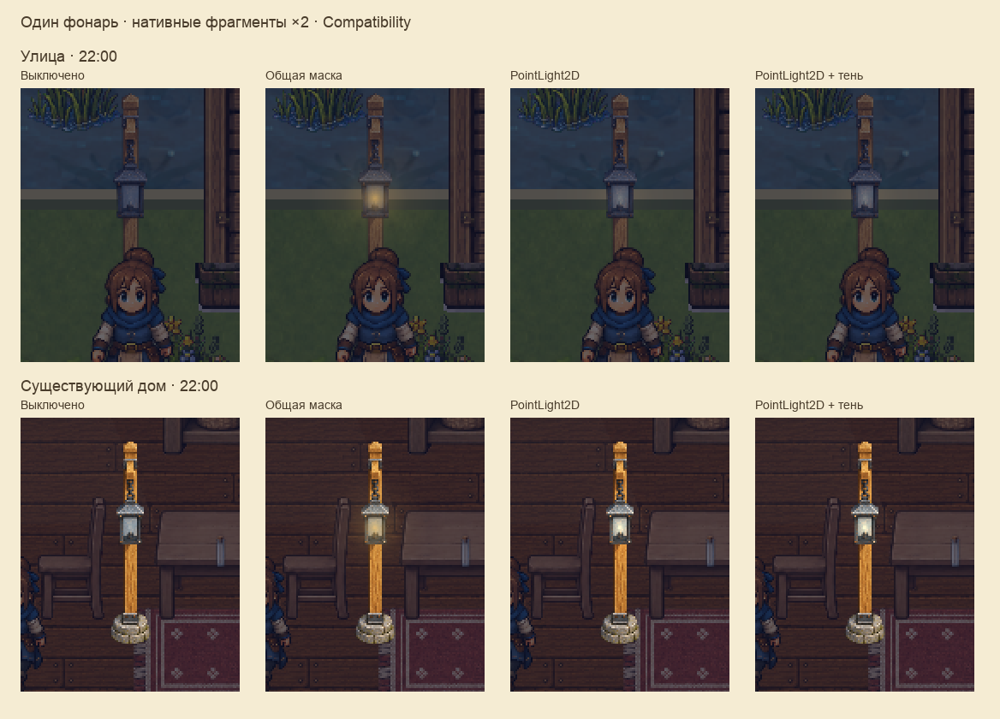
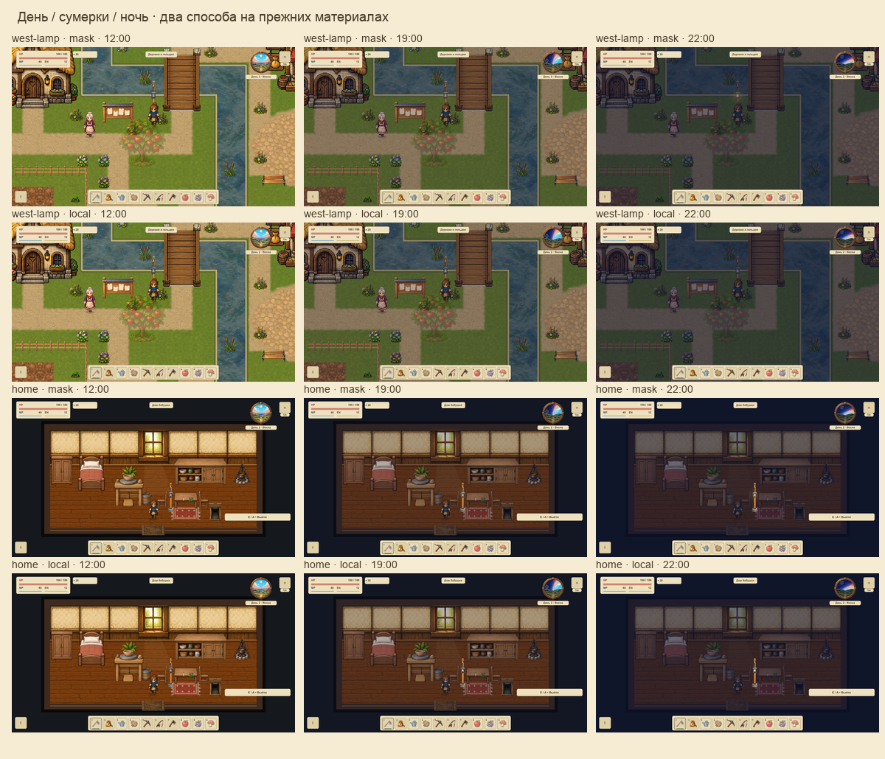
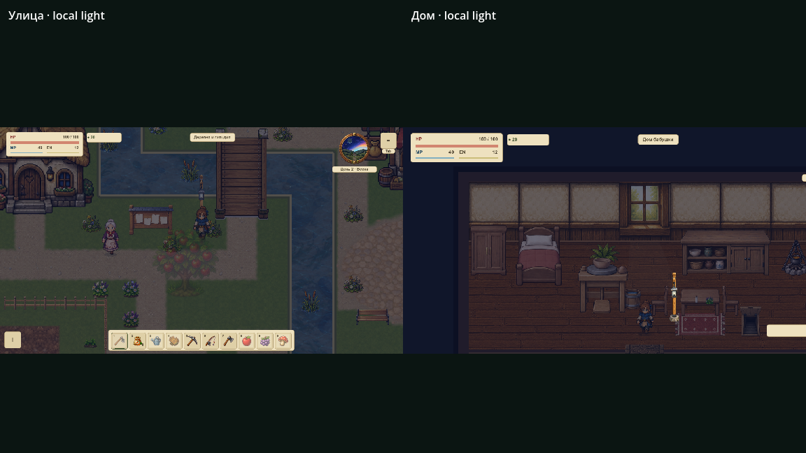

# VLIGHT-002 · Маска или локальный свет

Авторское решение: **для малого свечения существующего стационарного фонаря сохранить общий цветной меш**. На нынешних текстурах он даёт контролируемое тёплое стекло. PointLight2D действительно создаёт динамическую тень, но его отклик в текущей композиции отличается: он работает с освещаемыми CanvasItem, включая ночной прямоугольник, тогда как существующие unshaded-проходы не становятся автоматически освещаемыми поверхностями. Выигрыш времени у одного способа не подтверждён устойчивой парной разницей.

Сравнительный QA-прототип принят 20 ноября 2026 в [PR №80](https://github.com/sergey-leonidovich-shevchenko/babushkina-ferma/pull/80), head `292188c0b1c3808d3db30bde8f5468e4c8cfa870` (0.0.470): независимое APPROVED review 5991403283, CI 9/9, финальный браузер Wiki и решение Team Lead. Обычный merge — `68387d000bdbf82db28bd396f3798add6cc33100`. [Отдельный учёт приёмки](closeout/README.md) сохраняет точные SHA, проверки и ограничения; обычная игра не получает новый источник. Дневная палитра 003, мягкий фонарь 004, окна 005 и вся VMAP-003 не принимаются этим исследованием.

## Что сравнено

Основание — `be306229e41700aa75220c13ab24d3f7c8940dcb`, tree `050252c01309e41a7408cd2f07219ceff844e981`, версия 0.0.467. Проверены все семь зависимостей: VLIGHT-001, VART-007/001, VBASE-004/003/001 и VRENDER-001. [План до измерений](PLAN.md).

В новой Git-копии есть только две явные инструментальные правки: штатный обход уличных halo выключен для одного QA-canvas, а HUD вынесен в отдельный живой CanvasLayer 2. Рисованные тела, текстуры, unshaded-материалы, ночное затемнение и комнатный луч остаются производственными. На улице используется **существующий** фонарь: placement(768,552) + настоящий `VillagePropRenderer.GROUND_OFFSET`(0,24) = опора(768,576). В существующем доме поставлен такой же сухой QA-корпус в(646,470), без новой мебели/коллизий/механики.

| Режим | Свет | Ресурсы и тени |
|---|---|---|
| off | Источник выключен, прежнее ночное затемнение сохранено | Контроль той же сцены |
| mask | Штатный `Lantern.draw_glow` | Общий cached ArrayMesh,576 вершин по профилю; без новой текстуры |
| local | Настоящий PointLight2D, Add | Один GradientTexture2D256×256 на экземпляр; тот же radial falloff/цвет/часы |
| shadow | Тот же PointLight2D + PCF5 | Один LightOccluder2D: явно объявленная QA-аппроксимация нижней стойки, не production-контур |

Текстура создаётся однажды, RID сохраняется между режимами. При RGBA8 её базовый объём оценивается в 256 КиБ; это расчёт, не измерение VRAM. Во время визуального прогрева создаются оба ресурса, поэтому cold allocation не выдаётся за стоимость постоянного кадра.

Радиус 32 мировых единицы и пять уровней falloff берутся из существующего профиля; экранный масштаб улицы 1.2 сохранён. Излучатель выводится из фактического emitter/anchor, опоры и камеры. Reader проверяет его привязку к **телу**, а не только совпадение двух одинаково ошибочных центров; float32-допуск 0.001 относится только к координате, не к PNG.

Это увеличенные диагностические фрагменты native PNG. Изменены только компоновка и подписи вне кадров; каждый блок проверяется по исходным пикселям и объявленному crop. Новая иллюстрация или перерисованный фонарь здесь не создавались.

## Полная серия C

Официальный Godot4.7.1/a13da4feb, macOS, Compatibility/OpenGL4.1, AMD Radeon Pro5300M. Два настоящих окна 1152×648 и 1280×720; улица/существующий дом; минуты 720/1140/1320; off/mask/local/shadow.

- 48 полных игровых PNG и 48 отдельных прозрачных HUD.
- 12 независимых target PNG и 6 настоящих root-composites:114 PNG всего.
- 96 наблюдаемых world draw callbacks; полные saves и геометрия до/после точны.
- HUD RGBA точны между режимами; непрозрачный HUD полного кадра — максимум 1/255 из-за квантования alpha.
- Два разных viewport: выключение левого или правого PointLight меняет только его framebuffer.960×540 — диагностический target, не приёмка узкого игрового HUD.
- 48 временных строк:3 повтора ×4 режима ×2 сцены ×2 окна. По 90 CPU и 90 wall-frame samples после 30 warm-up кадров:4320 каждого типа. В каждом семпле записаны настоящее окно, фокус, process frame, cap 0 и VSync 0.
- Все 3755 production/asset blobs проверены по фактическому принятому Git до и после каждого нативного запуска;30 отдельных QA-входов заморожены по SHA256.

## Время и ограничения

CPU — полный `_draw` основного игрового CanvasItem вместе с добавленной маской/корпусом. Фоновый узел, живой HUD и световой pipeline участвуют в общем наблюдаемом интервале native QA-кадра. Он измерен между завершёнными `frame_post_draw`, без readback внутри серии; это **не GPU timer, не present-to-present и не приёмка FPS живой игры**. Симуляция остановлена, погода ясная.

Ни медленные кадры, ни отрицательные разницы не фильтруются. Порядок режимов переставлен в трёх повторениях. Ниже — медиана трёх медиан, миллисекунды; все отдельные повторы/p95/max и парные разницы от off находятся в[CSV](costs.csv).

| Окно / сцена | off CPU / interval | mask CPU / interval | local CPU / interval | shadow CPU / interval |
|---|---:|---:|---:|---:|
|1152 / улица|4.791 /11.101|4.718 /10.962|4.672 /10.791|4.702 /10.994|
|1152 / дом|1.602 /6.579|1.541 /6.425|1.593 /6.729|1.572 /6.562|
|1280 / улица|4.641 /10.816|4.704 /10.862|4.645 /10.836|4.630 /10.798|
|1280 / дом|1.698 /6.837|1.670 /6.677|1.661 /6.731|1.606 /6.551|

В некоторых парах добавленный эффект оказался быстрее off, а порядок меняется между окнами/сценами. Такие результаты сохранены как разброс; обещать ускорение или выбирать технологию по одной минимальной медиане нельзя. Художественный выбор сделан для малого emission-halo текущего фонаря. Динамическое освещение окружения потребует отдельно согласованных слоёв/материалов и контуров, а не простого включения PointLight на всём Game.

Официальная документация различает[локальные источники, occluders и способы свечения](https://docs.godotengine.org/en/stable/tutorials/2d/2d_lights_and_shadows.html) и описывает[параметры PointLight2D](https://docs.godotengine.org/en/stable/classes/class_pointlight2d.html). Эти источники объясняют API; решение и числа выше получены в нашем нативном опыте.

## Отказы и проверяемость

Серия A отклонена: macOS асинхронно увеличила окно до 3584×2240 после первого кадра. Исправлен оконный прогрев; неверные интервалы не перенесены в C. Полный JSON отказа сохранён[без потерь в ZIP](failures/native-a-capture.zip), SHA — в[receipt](failures/native-a.json).

Серия B прошла прежние приборные проверки, но визуальная проверка обнаружила мою ошибку: использован placement без производственного смещения(0,24), поэтому оба источника светили выше стекла. B не принята и не смешана с C. Старый reader дал exit0, усиленный на том же неизменном packet — exit1 с `production lamp ground including renderer offset`. [Реальный record и ожидаемая опора](failures/native-b-ground.json),[receipt и журналы](failures/ground-regression.json),[неверный диагностический лист](failures/native-b-wrong-ground.png). Полные A/B остаются в своих внешних каталогах; в Git принятия идёт полная новая C.

Native ZIP сохраняют точные исходные PNG/JSON/log. Raw/ZIP сводки сравнены на равенство. [Manifest](native/source.json),[проверенные Git blobs](native/exported-blobs.json),[результаты](results.json),[происхождение листов](gallery.json). Source commit относится к производственной базе; новые QA-входы перечислены отдельно. Обычный reader остаётся историческим, `--check-current-candidate` дополнительно проверяет рабочие runtime/assets/QA; допускается только явно согласованная SemVer metadata.

## Доработки независимого ревью PR80

[Предварительное ревью249c1db](https://github.com/sergey-leonidovich-shevchenko/babushkina-ferma/pull/80#pullrequestreview-5989617089) обнаружило два обязательных P2 в reader. На копиях C после пересчёта SHA он принимал12 timed local/shadow с выключенными enabled/energy/shadow и12 visual local/shadow с texture_scale×4 при прежнем radius. Исходная C содержит правильные параметры; это дефекты проверки, не новые результаты native-опыта.

Теперь реальный номинальный радиус выводится как `texture_width × texture_scale / 2` и отдельно по высоте. Оба значения сверяются с `max(source_profile.glow.radii) × zoom`; поле radius проверяется независимо. Общая функция обслуживает кадры, временные строки и оба viewport. Enabled, энергия0/0.5/1 и shadow/PCF5 сверяются по режиму и закреплённым часам. Временные строки связаны с валидированным визуальным случаем1320 через light и оба scene context.

Full saves остаются строгими до/после каждой timed-пары и между её режимами. С ранним PNG сравниваются контексты, а не весь save: к началу измерений уже законно обнаружен существующий дом и подготовлены прежние workshop defaults. Это различие сохранено явно.

[Те же пакеты, фактические команды и коды выхода](failures/review-regressions.json): baseline0→0 с прежней сводкой; timed-state0→1 (`actual light energy differs from scene time`); texture-scale0→1 (`actual PointLight texture_scale/radius differs from source profile`). [Снимок старого reader](failures/reader-before-review.zip) привязан к Git249c;[компактные испорченные payload](failures/reviewer-invalid-payloads.zip) содержат исходные source/capture JSON ревьюера, остальные данные берутся из неизменной C. Это отрицательные контроли метаданных, не переснятые кадры.

Фактически прошли contract7/0, reader17/0 и mypy15/0. Отдельные контроли enabled/energy/shadow, world/HUD context и геометрии costs/viewports не позволяют общему повреждению скрыть пропущенную проверку. CSV, native source/оба ZIP,30 producer inputs и галереи точны. В results меняются только SHA двух усиленных модулей анализа. Production и повторная native-съёмка не входят в исправление; полный штатный gate, Wiki и новый exact-head review/CI остаются обязательными.

Команды и границы — в[QA comparison](../../../../tools/qa/world/lighting/comparison/README.md). Обязательны профильные/отрицательные проверки, штатный полный hook, Wiki check/браузер и независимый exact-head PR review. Проверки C сами по себе не заменяют приёмку текущего PR.
