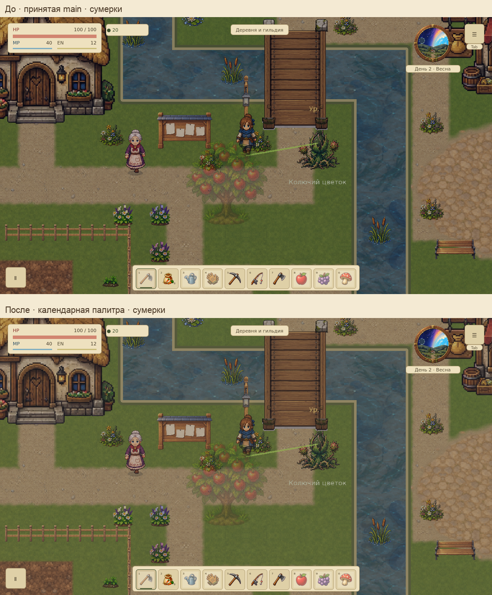
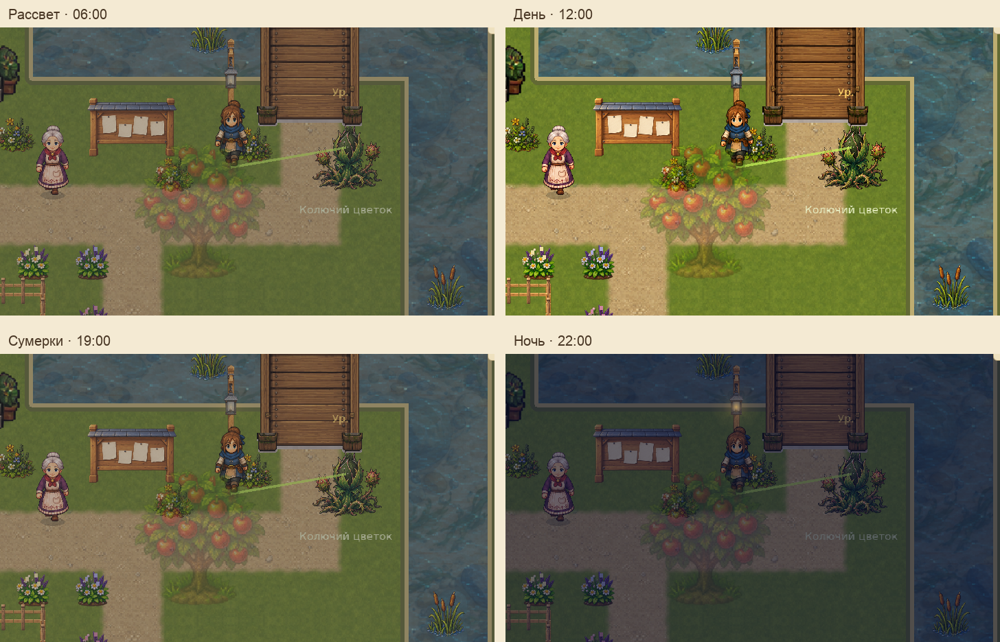
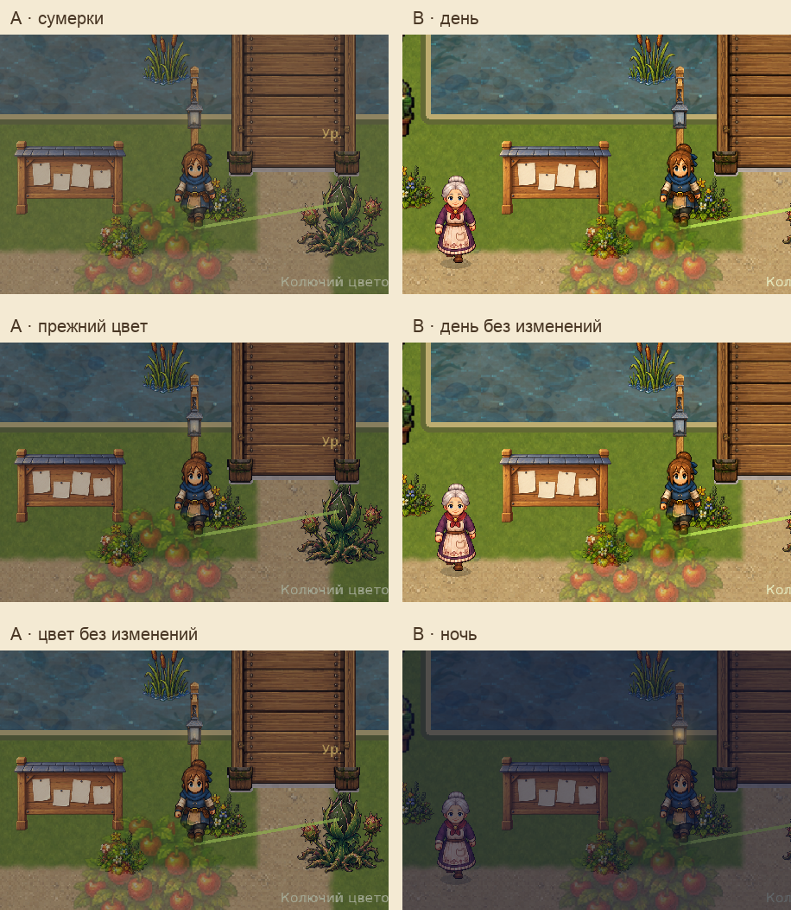

# VLIGHT-003 — день и сумерки

Нативная серия и полный reader проверены. Реализация проходит приёмку в
[PR №82](https://github.com/sergey-leonidovich-shevchenko/babushkina-ferma/pull/82);
карточка остаётся `in_progress` до независимого exact-head review, решения
Team Lead и merge. `Task-Complete` ещё не выставлен. Вся первая локация и VMAP-003
этим отчётом не принимаются.

Меняется общий цвет только первой `overworld`: плавные рассвет и сумерки с небольшим
тёплым пиком, прежние день и ночь. Используются существующие дробные игровые минуты,
без новых часов, текстур, световых узлов, screen-copy и растущих кешей. Существующие
фонари, затмение, помещения, соседние карты, HUD, геометрия и сохранения сохраняются.
Временный строго булевый legacy-флаг принадлежит одному canvas и не записывается в save.

## Настоящие кадры

До — runtime принятой main `c1f2eda0d1d36e1491dab32fef090bb5a3d22e12` (0.0.471).
После — Git `1abc82b229188d437e8d0eaa4217202c6941c78f` (0.0.474).
Растровые ресурсы, масштаб120%, камера, seed и вся сцена одинаковы. Это настоящий production
root с обычным HUD; подписи листа добавлены за пределами кадров.



Рассвет, день, сумерки и ночь показаны фрагментами одной камеры. Числа времени
относятся к подписям отчёта; числовое время в игровой HUD не возвращалось.



Два настоящих SubViewport имеют разные размеры и часы. При legacy-переключении
первого второй сохраняется побайтно; смена часов второго не меняет первый.



[Метаданные всех 12 native-вставок](gallery.json) фиксируют источники, crop и
положение. `gallery.check` сравнивает каждый RGBA пиксель с исходным PNG в пакете.
Resize и цветокоррекция для этих областей не применяются. Тест изменяет пиксель
листа и переподписывает его SHA — reader всё равно отвергает изменённый native crop.

## Происхождение и границы серии

Успешный [CI3](https://github.com/sergey-leonidovich-shevchenko/babushkina-ferma/actions/runs/44797637789),
job136501225030, artifact14659727690. Официальный Godot4.7.1/a13da4feb,
Linux X11, Compatibility, Mesa llvmpipe LLVM20.1.2. Оба размера —1152×648 и1280×720.
Игровая симуляция остановлена, погода ясная, seed20261015, масштаб первой карты1.2.

Сняты10 случаев: четыре времени улицы, четыре времени комнаты, сумерки соседнего
рынка и ночь затмения. У старого Git один обычный режим, у нового — palette,
legacy и прежний reference без набора эффектов. Итого80 обычных root,80 прозрачных
HUD,48 независимых кадров без героя/угрозы,2 настоящих bad-HUD контроля и12 twin PNG:
**222 исходных PNG**,4 capture JSON и30 журналов/launch/production-inventory файлов,
всего**256 артефактов** и**34 QA-входа**.

Producer экспортирует настоящие Git-деревья целиком и проверяет все3755/3757
runtime/asset blobs до и после движка. Production-файлы не заменяются оверлеями;
отдельные QA-входы совпадают с байтами записанного head. Перед импортом и каждым
native запуском проверяется настоящий OS userdata собственного UUID-профиля.
Нативный игровой запуск выполнялся в CI; локально использованы изолированные
headless-проверки. Обычные пользовательские userdata сохранились побайтно.

Исходный ZIP GitHub —135206798 байт,
SHA256 `c16ac562ffe4c69d793cceae311d2807d251cd748cc19dcf2094eb5e270a1277`.
Локальная загрузка сверена целиком. [Пакет](native/package.json) содержит прежний
`source.json` без переписывания и два контейнера с неизменёнными native payload:

- [Source manifest](native/source.json), SHA256 `cfc81c80f9c6b3b4bb9cc0732e6e93d83edc65c521d06a8cd4e3cdda68363907`.
- [Baseline](native/baseline.zip), SHA256 `9f0f0e37ff51a28178819e7a21eebd335ac8fbc77dd541bd3f7344454d5a241d`.
- [Candidate](native/candidate.zip), SHA256 `82711f5c477e70bad70401dbccf3f33040d730bb16851fbd344fd03ca4e0988b`.

## Результат полного reader

Legacy нового runtime совпадает со старой main во всех10 случаях обоих окон.
Новый цвет меняет только улицу на рассвете и в сумерках. День, ночь, комната,
рынок и затмение сохраняются. Полные save и геометрия одинаковы до/после draw
и между старым и новым runtime при одной конфигурации.

Непрозрачные пиксели настоящего HUD совпадают с обычным root; весь RGBA HUD нового
и legacy дополнительно совпадает со старым same-time HUD. Два одинаково испорченных
новых свидетельства не могут подтвердить друг друга. Bad-HUD получен настоящим
draw поверх готового HUD и отклоняется тем же reader.

Герой и колючий цветок проверяются каждый по своему независимому native кадру
без одного объекта. Reader сверяет ROI с реальной камерой, zoom и viewport stretch
(допуск округления1px), требует не менее80 различимых пикселей и сигнал не ниже70%
legacy. Пустой объект, неверный seed и сдвинутый ROI отвергаются.

## Сырые затраты

[Все2160 samples](samples.csv) и [описательная статистика](metrics.json) сохраняются
без удаления выбросов. Каждый режим имеет три чередующихся повтора,20 warm-up
и60 измеряемых redraw в каждом повторе. Во время серии PNG readback не выполняется.
Проверены actual cap0/VSync0, видимость, размеры окна, продвижение process frame
и согласованность microsecond timestamps; фокус записан как фактическое значение.

В таблице — CPU submission **целого production draw**, pooled median/p95, мс.
p95 рассчитан методом nearest rank.

| Окно | Palette | Legacy | Reference |
| --- | --- | --- | --- |
| 1152×648 | 2.994 / 3.129 | 2.987 / 3.430 | 2.878 / 2.977 |
| 1280×720 | 3.043 / 3.805 | 3.146 / 3.978 | 3.001 / 3.351 |

Медиана palette относительно legacy отличается на+0.007мс и−0.103мс соответственно.
Это описательные результаты одной фиксированной сцены; разброс baseline/repeats
не позволяет считать такую разницу изолированным выигрышем эффекта. Reference
выключает прежний набор FX, поэтому его дельта не является стоимостью одного tint.
Драйвер сообщил о неподдерживаемой смене VSync при записанном запросе0.
Software wall-frame интервалы сохранены отдельно; GPU, аппаратный FPS, Retina,
долгая игровая сессия и общая производительность локации этим опытом не принимаются.

## Отказы и ревью

- [CI1](failures/ci-01.json) остановился до движка: локально созданный camera UID
  отсутствовал в Git. Manifest теперь перечисляет34 действительных committed входа.
  [Чистые экспорты](export-preflight.json) прошли actual import/compile с явно
  записанным working QA overlay; это подготовка, не native-приёмка.
- [CI2](failures/ci-02.json) дошёл до X11, но ternary потерял `Array[String]` в
  capture dispatch. Source неполный, PNG0,900s timeout; исходный
  [диагностический ZIP](failures/ci-02-artifact.zip) сохранён. Явно typed helper
  исполняет обе реальные ветки; [headless18/0](dispatch-review.json) =16 модели+2 dispatch.
- [Первый local retry](failures/hook-02-links.json) нашёл неверные относительные
  evidence-ссылки. Они исправлены до успешного полного hook.
- P2 timing: [полный парный протокол](review-regressions.json) связывает реальные
  часы, геометрию, владельца и legacy/reference с валидированным dusk witness.
  Полное save сравнивается внутри timed before/after; законные отличия подготовки
  между ранее посещёнными сценами не объявляются дефектом.

Парный опыт использует неизменённую функцию `capture` из Git d5 **в общем полном
verifier с исправленной P1 closure**. Весь старый head с35 inputs не объявляется
совместимым с новым34-input manifest. На одном и том же настоящем пакете старый
timing принимает три переподписанных дефекта: все режимы фактически noon/reference,
выключенный timed legacy и другая timed сцена. Новый reader отклоняет каждый по
содержательному P2 условию. Pristine старого/нового и неизменённый исходный пакет
проходят. Записаны настоящие OS exit, SHA источников и stdout/stderr.

Полные negative-тесты также проверяют настоящие bad-HUD/hidden-object PNG,
одновременно испорченные HUD-свидетельства, sample length/NaN/frame counter,
неверные ROI/seed/полное save, общий owner, утечку цвета между viewport,
реальные launch/engine logs, Git QA blobs, asset inventory и неполную серию.
Strict-current отдельно проверяется в настоящем историческом Git checkout:
исходник и SemVer-only проходят, изменение runtime отклоняется; parent index/config
сохраняются. Исторические negative-контроли используют исторический режим reader,
чтобы последующие задачи не подменяли байты принятой съёмки.

## Повторная проверка

```sh
python3 tools/run.py qa.world.lighting.daycycle.verify
python3 tools/run.py qa.world.lighting.daycycle.verify --check-current-candidate
python3 tools/run.py qa.world.lighting.daycycle.test_contract
python3 tools/run.py qa.world.lighting.daycycle.test_reader
python3 tools/run.py qa.world.lighting.daycycle.gallery --output docs/reports/visual-overhaul/vlight-003 --check
python3 tools/run.py qa.world.lighting.daycycle.metrics --output docs/reports/visual-overhaul/vlight-003 --check
python3 tools/run.py qa.world.lighting.daycycle.review_regressions --output /новая/внешняя/папка
```

Полный штатный hook у captured head1abc прошёл: quality/architecture,
Game53709/0, normal/F10 по90/0; post-bump Wiki167/0. Эти результаты не заменяют
повторные gates итогового коммита отчёта, CI, независимое ревью и решение Team Lead.
Другие1036 карточек, planning state/sources и132 прежних файла VLIGHT-001/002
остаются неизменными. [Методика до реализации](PLAN.md) сохраняется отдельно.
Откат — отдельный commit подключения palette либо временный per-canvas legacy;
миграция сохранений не нужна.
