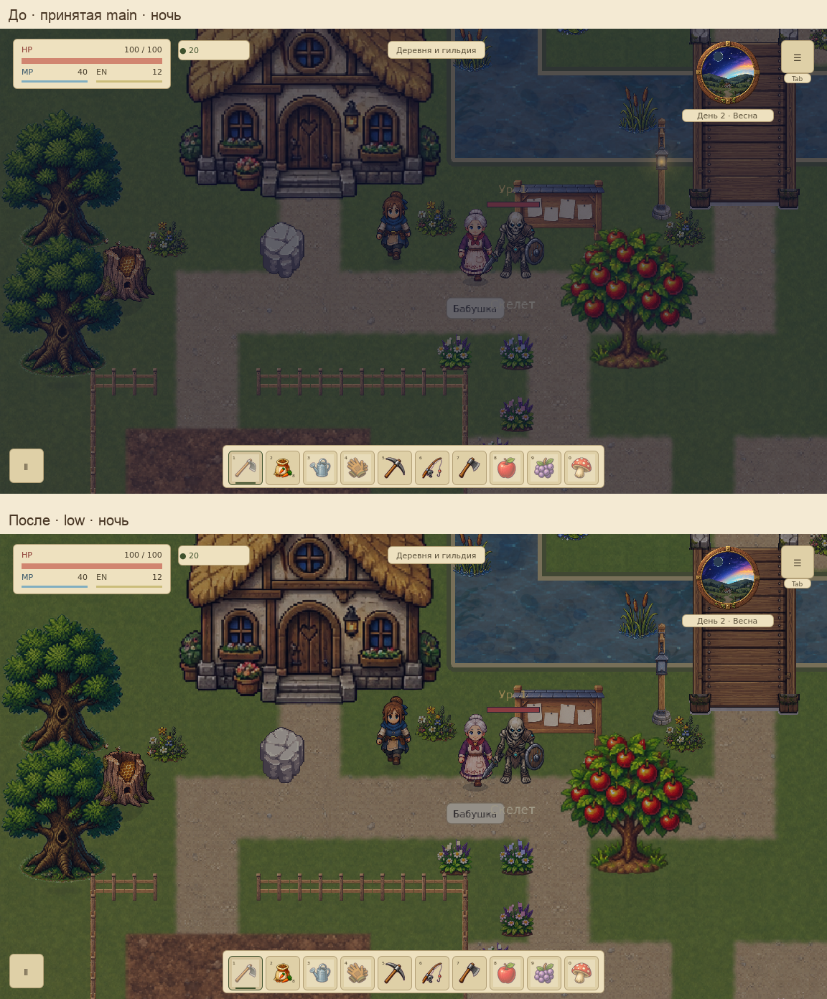
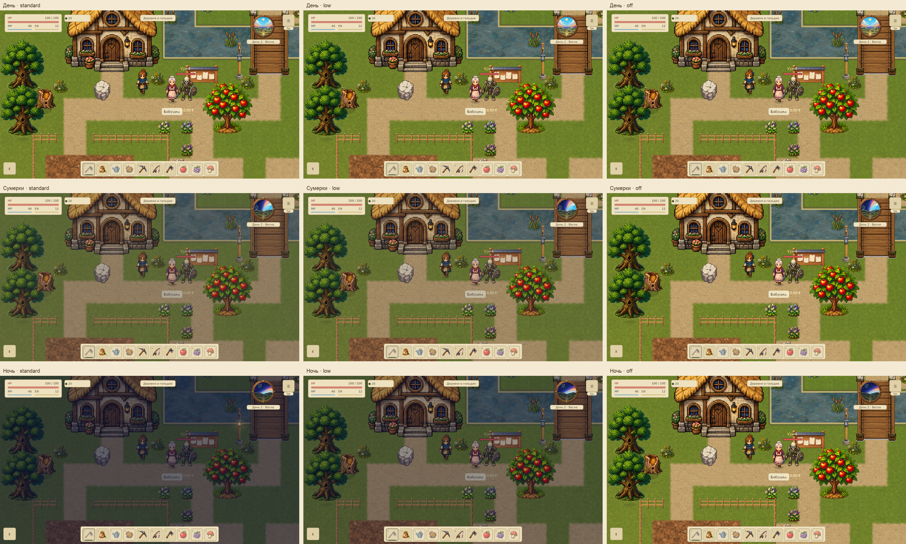
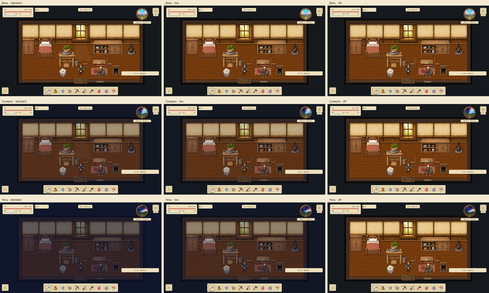
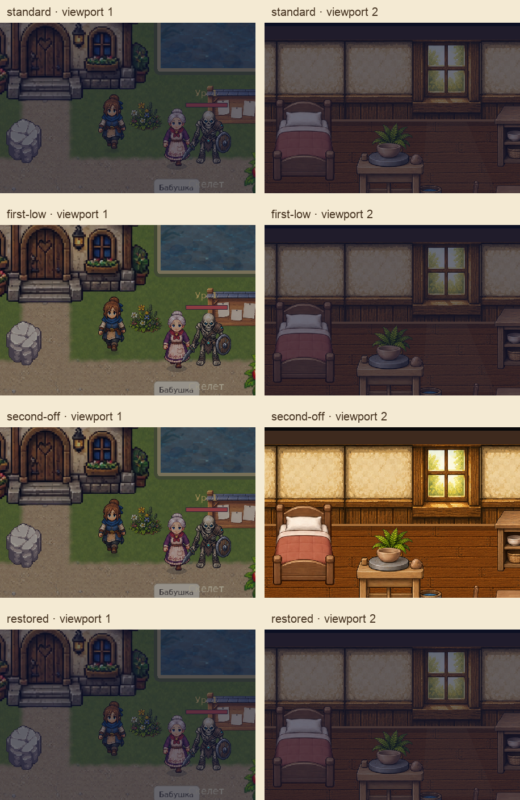

# VLIGHT-010 · Упрощённый свет

Статус `in_progress`, [PR №90](https://github.com/sergey-leonidovich-shevchenko/babushkina-ferma/pull/90).
Реализация и первая native-серия проверены. Отчётный коммит, его полный hook/CI,
финальное независимое ревью точного head и решение Team Lead ещё обязательны.
Предварительный source pass 6015738024 не является окончательным одобрением.

[План](PLAN.md) · [Снимок проверок до отчётного коммита](verification.json) ·
[Wiki](../../../../wiki/articles/lighting-quality.md)

## Поведение и границы

`LightingQuality` задаёт временный профиль одного владельца: `standard`, `low`, `off`.
Обычный режим сохраняет прежние пиксели. Low использует ту же календарную кривую
и RGB, умножает alpha затемнения на 0.65 и пропускает декоративные ореолы/оконный
луч. Off пропускает этот световой проход. Корпуса, двери, ресурсы, враги,
контактные тени, осадки, небесный декор и HUD сохраняются.

Профиль наследуется дочерними canvas, не сохраняется в слот. Два viewport
независимы. Общий visual rollback первой карты имеет приоритет и не забывает
запрошенный low/off. Область — первая `overworld` и существующий дом как
регрессия перехода. Меню качества приложения относится к VPERF-010;
новая графика источников, object-local свет и маски крыш здесь не реализуются.

## Нативная проверка

[CI1](https://github.com/sergey-leonidovich-shevchenko/babushkina-ferma/actions/runs/45095929093)
прошёл на head 93df8ef619d27b86994d8e190023a6f3b744135a, версия 0.0.490.
База — принятая main e0d393034f36bc4ba27329cd9e4e0b09c3a157d1.
Официальный Godot 4.7.1, Linux/X11, Compatibility, llvmpipe; четыре отдельных
процесса, окна 1152×648 и 1280×720, шесть подтверждённых startup UUID userdata.
Production bytes сверены до и после каждого engine-запуска.

Полный набор —270 исходных PNG,304 артефакта и 46 QA-входов. Улица и дом,
день/сумерки/ночь, три режима. Standard точно совпал с baseline во всех 12 парах,
включая отдельно HUD и кадры без целевых проходов. Профили, полные save,
геометрия, seed, сущности, реальные окна/ROI, отдельный HUD, восстановление
standard и два независимых владельца проверены полным readonly reader.
Локальный `--check-current-candidate` прошёл на чистом source2 до добавления
отчётных файлов; после отчётного коммита контроль повторяется.

Автор просмотрел 48 полных кадров обоих размеров, крупные ночные кадры low
и сравнение viewport. Фасад/порог двери, выход дома, силуэт скелета и камень
остаются различимы. Ночной low светлее и сохраняет оттенок ночи; off показывает
мир без затемнения, пока настоящий календарь и луна HUD остаются ночными.
Это проверка читаемости, не новая художественная приёмка интерьера или карты.
Скелет и камень — существующие production-сущности в неподвижной QA-сцене.

[Исходный manifest](native-ci-01/source.json) ·
[Полная сводка reader](native-ci-01/summary.json) ·
[Визуальный просмотр и границы](native-ci-01/visual-review.json)









Подписи лежат за пределами кадров. Каждый native-прямоугольник проверяется
побайтно: без resize, перекрашивания и дорисовки.
[Происхождение иллюстраций](native-ci-01/figures/gallery.json).

## Исходный архив и повторение

Оригинальный Actions ZIP —173941412 байт, SHA256
`a8206c84afd1e48f9a2fc54b12f133c7b51917c4bd0f44148303776d8f4d2c11`.
Он сохранён тремя последовательными двоичными частями по 64MiB/64MiB/остаток,
чтобы не нарушать лимит одного файла GitHub. Это исходные bytes без перепаковки.
`retained` проверяет размеры/SHA частей и целого ZIP, временно соединяет его
и вызывает тот же полный reader. Части и manifest не изменяются.

[Части и общая контрольная сумма](native-ci-01/archive.json)

```sh
python3 tools/run.py qa.world.lighting.quality.retained --manifest docs/reports/visual-overhaul/vlight-010/native-ci-01/archive.json --expected-head 93df8ef619d27b86994d8e190023a6f3b744135a --check-current-candidate
python3 tools/run.py qa.world.lighting.quality.test_contract
python3 tools/run.py qa.world.lighting.quality.test_reader
```

Новая съёмка `quality.collect --output <новый абсолютный каталог>` требует
удалённый Linux/X11, clean exact `VLIGHT_QUALITY_EXPECTED_HEAD`. Локальный GUI
игры на ПК владельца не используется. Смена runtime/asset/46 QA-входов требует
новой серии; отчётные файлы и согласованный SemVer не подменяют её кадры.

## Отрицательные сценарии и исправления

Девятнадцать контролей меняли только копии полного реального пакета,
пересчитывая SHA изменённых членов. Пропуск кадра, иной head/QA input,
профиль/seed/save/сущность, неактивное окно, повтор кадра, неверные actual
hidden passes/ROI, настоящий bad-HUD, отсутствие цели, off=standard,
повреждённые timing/UUID, alias viewport и сломанный возврат отклонены.
Оригинальный ZIP после серии остался точным.

Парный опыт выполнил исторические функции verify/checks из 62f9f697 с общими
текущими source/pixel/timing guards. Оригинальный пакет прошёл оба варианта;
копию off=standard прежние функции приняли, исправленные отклонили по порядку
world luminance. Это сравнение функций, не всего старого head с иной capture
fixture. [Исходный протокол](native-ci-01/regressions.json).

До первого native исправлены контроль двери и возможность подмены off обычным
светом. Контроль пропускает действительные корневые проходы
buildings/interior/enemies/resources и записывает вызовы. Reader читает
оригинальный Actions ZIP с корнем `evidence/`, отвергая неоднозначность и дубли.
Транспорт отдельно проверен на целом историческом неудачном ZIP VLIGHT-003;
тот пакет по-прежнему не принимается.

Новые регрессии также проверяют переподписанную порчу native-вставки галереи,
сырых CSV/медианы и повреждение/опасные имена частей. Первоначальный отказ
Mac-тестов частей был вызван алиасом `/var` в их собственном temp; тесты теперь
используют канонический путь. Защита reader от симлинков сохранена.

Настоящие gallery/metrics CLI создали внешние результаты из оригинального ZIP.
Повторные вызовы из чужой cwd с пробелами отказались перезаписывать эти файлы;
их bytes, режимы и mtime остались прежними. Этот сценарий входит в test_reader.

Actual Linux CLI тест копирует захваченные producer/launcher bytes в собственный
минимальный Git-репозиторий и передаёт существующую копию реального пакета как
output. Он требует отказ до engine и неизменность файлов. Непустой DISPLAY
здесь лишь входное условие ранней проверки; безопасный sentinel не позволяет
случайно запустить движок. Это early guard, не имитация положительного X11.
На macOS тест пропускается; Linux CI ещё должен его исполнить.

## Затраты

Сохранены все 1440 сырых samples: три чередующихся повтора,20 warm-up и 60
наблюдений каждого режима. PNG readback не входит в измеряемый интервал.

| Окно | Standard, median CPU draw | Low | Off |
| --- | ---: | ---: | ---: |
| 1152×648 | 3.652 мс | 3.578 мс | 3.517 мс |
| 1280×720 | 3.582 мс | 3.627 мс | 3.534 мс |

Разброс повторов пересекается; ускорение полного кадра не доказано. Это CPU
submission всего root неподвижной сцены. GPU-время, аппаратный FPS, Retina,
длительные сессии, VPERF-010, VRELEASE-003 и VMAP-003 остаются открытыми.

[Сырые observations CSV](native-ci-01/samples.csv) ·
[Медианы и каждый повтор](native-ci-01/metrics.json)

## Штатные проверки

Все пять PR workflow source2 завершились успешно. [Снимок checks](native-ci-01/ci-status.json)
содержит12 успешных check runs, включая четыре повторных push-проверки.
Он не подтверждает будущий отчётный head.

Source2 прошёл полный hook: quality 269/0, architecture PASS, Game 54121/0,
normal 90/0 иF10 — 90/0; normal userdata неизменны, override удалён. Post-bump Wiki
167/0 и браузер 1280/390px подтвердили 0.0.490, отсутствие overflow/console errors
и статус «В работе». Модель 257/0 и strict 12/12 покрывают старые слоты, настоящий
save roundtrip, вход/выход дома, паузу, двух владельцев и общий rollback.

Первый диагностический quality-check выявил предупреждения старого изменённого
InteriorRenderer и три Variant-утверждения. Типизация исправлена; первоначальный
отказ не считается успешным полным gate. Checkpoints62f9f697/.489 и 93df8ef6/.490
прошли полные обычные hooks отдельно. Эта история не заменяет собственных
проверок нового отчётного head, окончательного ревью и решения Team Lead.
