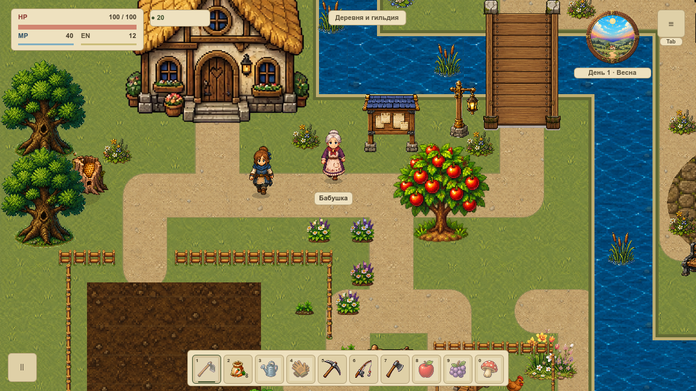

# VPIPELINE-001 — разделение исходников и runtime

База: `10dde42542d3e9a3238c346dbce87995b647e20b`, Godot `4.7.1.stable.official.a13da4feb`, macOS, Compatibility/OpenGL, AMD Radeon Pro 5300M. Ветка `codex/vpipeline-001-visual-task`. Изменения, политика и подтверждения публикуются одним коммитом с этим ID.

## Результат

- Добавлены отслеживаемые барьеры для `docs/`, `assets/source/`, `assets/generated/`, `tmp/` и трёх исторических папок `source/`. Барьер `assets/inbox/` теперь также отслеживается; `wiki/` уже имела барьер.
- Новые мастер-исходники имеют отдельный путь `assets/source/`; игровые файлы остаются в `assets/game/`. Исторические генераторы сохраняют свои входные пути.
- F12 учитывает `.gdignore` и при обходе, и при прямом запросе вложенной папки. Сохраняются действующие шаблоны актёров с историческим именем `master`.
- 25 локальных корневых PNG и их 25 sidecar-файлов обратимо перенесены в закрытую `assets/generated/legacy_root/`. Они не удалены и не добавлены в Git. [Квитанция](local-preview-relocation.json) содержит SHA256 и обе стороны каждого перемещения.
- Дополнительная проверка нашла 94 временных PNG в `tmp/` и два локальных превью травы в игровом дереве. `tmp/` закрыта целиком, два превью и sidecar-файлы перенесены с [отдельной квитанцией](local-tile-preview-relocation.json). [Снимок дополнительного аудита](additional-local-preview-audit.json) сохраняет точные пути.

## Измерение импорта

[Исходный снимок](baseline.json) фиксирует первоначально классифицированные 484 ошибочно импортируемых изображения из неигровых папок, 25 локальных превью и SHA256 2398 игровых растров/профилей. Первый проход дал 1784 → 1275 текстур. Повторная сверка после QA обнаружила среди оставшихся 1275 текстур ещё 94 временных PNG и два тайловых превью. После окончательных барьеров и переноса [результат](import-comparison.json) — 1179 текстур, ни одной в неигровых папках политики и ни одной неотслеживаемой текстуры; все 2398 игровых файлов совпадают побайтно. Это два последовательных аудита, не замер быстродействия. Размеры изображений, альфа, source rect и профили текущей игры не меняются; полный gate дополнительно проверяет существующие манифесты геометрии и импорта.

Исходное состояние прочитано из реального индекса редактора; после изменения выполнен запуск `Godot --headless --editor --path . --quit` и повторно прочитан индекс. Снимок считает записи `CompressedTexture2D` в диагностическом `.godot/editor/filesystem_cache10` Godot 4.7, а не весь ресурсный индекс или публичный API. Парсер явно привязан к этому формату и отклоняет пустой/неизвестный индекс. Это локальные данные импорта, не размер экспорта, не освобождённая VRAM и не измерение FPS. Старый кэш `.godot/imported` намеренно не удаляется.

Для повторной проверки индекса после импорта: `python3 tools/visual_pipeline.py --record-after`. Команда откажет при отличии игровых байтов от базы этой задачи; после будущей художественной замены это ожидаемо. Обычный gate не замораживает игровую графику навсегда.

## Настоящий кадр

Два независимых профиля `Codex-VPIPELINE-001-before-20261018` и `Codex-VPIPELINE-001-final-20261018`, один seed и точка деревни, остановленная симуляция, выключенные декоративные эффекты, HUD включён, 1152×648, текущая игровая камера. Профили игрока не используются. Оба окна сняты настоящим OpenGL readback; сравнивается весь декодированный RGBA, а не только выбранная область. Кадры совпали полностью: [паспорт сравнения](native-comparison.json), [до](native/before/capture.json), [после](native/after/capture.json).

Съёмка: `tools/visual_pipeline_capture.gd`, переменные `VPIPELINE_CAPTURE` (новая абсолютная папка) и `VPIPELINE_PROFILE` (новое имя с префиксом `Codex-VPIPELINE-001-`). Нативный прогон не заменяет живой бой или замер производительности. Он подтверждает сохранение изображения при изменении границ импорта; новый художественный стиль ещё не внедрён.

## Отрицательные сценарии и Wiki

11 Python-сценариев проверяют потерю барьера, повреждённую копию PNG, скрытие runtime, ссылку в исходники, выход за корень, потерянный ресурс, диагностические исключения, неизменность локального переноса и отказ при совпадении путей. 10 утверждений Godot проверяют реальный каталог, прямой запрос вложенного дерева, снятие барьера, сырое чтение эталонов/документов и живой шаблон героя. Файлы игры для отрицательных сценариев не портятся.

Wiki получила постоянные адреса самостоятельных статей, локальные иллюстрации относительно источника и точные внутренние ссылки. Добавлены [описание процесса](../../../../wiki/articles/visual-pipeline.md) и [IDEA-001](../../../../wiki/articles/IDEA-001.md) — только предложение будущей публикации семейств. Пустые статьи, повторные адреса и выход за папку прерывают подготовку до замены готового сайта.

Подробный контракт: [ASSET_PIPELINE](../../../ASSET_PIPELINE.md). Основание границы — [официальная документация Godot](https://docs.godotengine.org/en/stable/tutorials/best_practices/project_organization.html). VPIPELINE-002–010 продолжают метаданные, подготовку и миграцию; эта задача их не закрывает.

Проверки перед публикацией: **37 674 / 0** игровых утверждений, **11 / 0** Python-сценариев границ, **10 / 0** профильных утверждений Godot, **22 / 0** тестов Wiki; TypeScript и production-сборка успешны. Поиск, локальная иллюстрация, один H1 и обе ссылки проверены браузером: [журнал](browser.json). [Сводка проверок](verification.json). Обязательный Git hook повторяет architecture и полный игровой набор перед созданием коммита.
