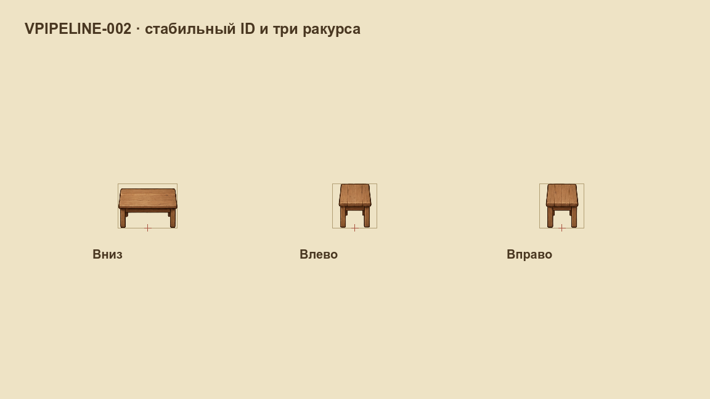

# VPIPELINE-002 — паспорт графического ресурса

База: `7c7facd2b882b063953158b342bbd9a7e69e25b0`, ветка `codex/vpipeline-002-visual-task`. Godot `4.7.1.stable.official.a13da4feb`, Compatibility/OpenGL, macOS, AMD Radeon Pro 5300M. Паспорт, код и свидетельства публикуются одним коммитом с ID задачи.

## Реализация и границы

Добавлены [каталог](../../../../assets/game/visual_resources.json), [единый загрузчик](../../../../scripts/systems/visual_resource_catalog.gd) и [формат](../../../VISUAL_RESOURCE_FORMAT.md). Устойчивый ID `prop.rustic_table` связывает три реальных вида действующего стола. Таблица текстур отделяет имена файлов от ракурсов, нарезки, опоры, мирового размера и физического основания. Новый мастер может иметь отдельный путь и SHA256; у пилота честно указано происхождение `legacy_runtime` и базовый commit.

Игра и F12 читают одну геометрию. Устранён старый дубликат размеров стола; проверка контента теперь получает разрешённые профили. У F12 область и показ соответствуют игре, основание отдельно от рисунка. Старый задний индекс использует передний рисунок; сохранения не меняются. Ресурсы и кешированные дескрипторы неизменяемы; хеши/альфа не вычисляются в кадре.

Пилот сохраняет существующие PNG, `standard` и текущую фильтрацию. Фильтр хранится как требование, смешанная фильтрация CanvasItem остаётся VPIPELINE-003. Отдельные настоящие PNG 16/32 используются только в отрицательных и положительных тестах плотности. Они не объявлены новой качественной графикой игры. Массовые иконки, опубликованные уровни, цветовые маски и анимационные клипы остаются у соответствующих эпиков.

## Нативное сравнение

Два независимых свежих профиля: `Codex-VPIPELINE-002-before-20261018` и `Codex-VPIPELINE-002-delivery-20261018`. Точка `cottage_interior-entry-v1`, фиксированные seed/день/камера/поза, остановленная симуляция, декоративные эффекты выключены, HUD включён. Настоящий framebuffer 1152×648, 20 принудительных перерисовок перед каждым readback. Игровые слоты пользователя не читаются и не записываются.

Комната и лист трёх ракурсов сравниваются целиком по декодированным RGBA; обе пары совпадают без масок. Лист вызывает реальный `HouseFurnitureVisualSystem.draw`, показывает рамки и точки опоры при настоящем игровом размере. Это не перерисованный макет и не увеличение источника. [Сравнение и SHA256](native-comparison.json), [до](native/before/capture.json), [после](native/after/capture.json), [журнал движка](native/after/engine.txt).

Съёмка: `VRESOURCE_OUTPUT=<новая абсолютная папка>` и `VRESOURCE_PROFILE=Codex-VPIPELINE-002-<новый суффикс>` при запуске `tools/visual_resource_capture.gd` обычным графическим Godot. Скрипт проверяет контент и собственные ошибки сохранения; любая `ERROR:` в журнале блокирует приёмку. Headless не заменяет нативный кадр. Измерения FPS/VRAM/времени загрузки здесь не выполнялись.

Для Wiki отдельно снята компактная [иллюстрация 1152×220](native/after/gallery-strip.png) тем же помощником в SubViewport. Она побайтно по пикселям совпадает с областью `[0,260,1152,220]` полного кадра; полные доказательства не обрезаны и не заменены. Хеш и проверка включены в общий валидатор.

## Проверяемые сценарии

13 Python-сценариев используют собственные реальные PNG и `.import`: переименование всех файлов с сохранением ID/видов, порча копии, SHA256, размеры, обрезанная/пустая альфа, выход за область, фильтры, согласованность качеств, двойная плотность, повтор ID, неизвестная ссылка, источник вне импорта и повреждение мастера. Отдельный отрицательный сценарий портит только копию нативного доказательства и проверяет отказ даже после обновления хеша. Повреждённые копии не восстанавливаются автоматически как «успешный» ассет.

`VisualResourceSuite` проверяет общую геометрию игры, аудита и F12, настоящее размещение через редактор, опору при удвоении пиксельной плотности, независимость от имени файла, совместимость старого направления и неизменяемость кешей. Переименование проверено на файловых копиях и чистом разрешении паспорта; реальные игровые файлы не переименовывались. Формат сохранённых уровней по-прежнему требует отдельной миграции путей.

Wiki получила [статью с иллюстрацией](../../../../wiki/articles/visual-resources.md), внутренние переходы к этапу разделения исходников и IDEA-001; идея публикации отмечает реализованный паспорт и оставшуюся будущую работу. Номер новой идеи не занят повторным описанием уже существующего предложения.

[Сводка проверок](verification.json): 13 Python-сценариев, 37 профильных утверждений Godot, 22 проверки Wiki и оба нативных сравнения. Architecture и полный игровой набор выполняются обязательным pre-commit hook; публикация при ошибках блокируется. [Браузерная проверка](browser.json) охватывает поиск, иллюстрацию и внутренние переходы.
