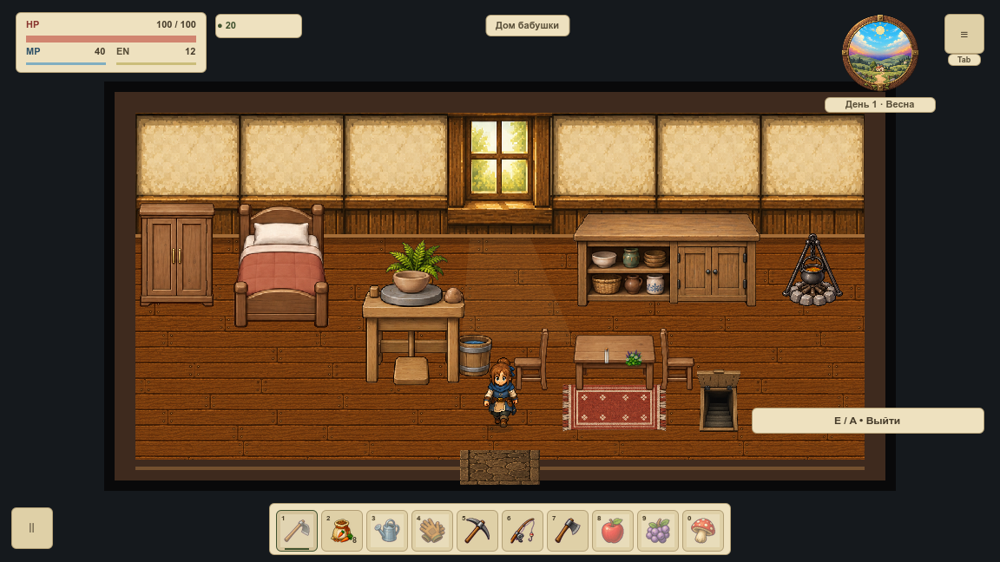

# VPIPELINE-010 — происхождение, размер и экспорт

Аудит исходного commit `6ade4a2c8a2fac640109d3365c69bd4b6ccadfc4` от VPIPELINE-009. Production-пиксели, игровые ссылки, механика и сохранения не изменены. Добавлены ресурсный desktop-preset и read-only проверки. Задача принимает полноту отчёта и технический экспорт; неизвестные источники явно остаются долгом перед выпуском.

## Результат

| Величина | Факт |
|---|---:|
| Production-файлы, включая import, уведомления, шрифт, звук, app/title | 2839 |
| PNG и встроенные ImageTexture | 1183 + 7 = 1190 |
| Файлы на диске | 263 076 718 байт / 250,89 MiB |
| Сумма номинальных RGBA8 по путям, включая объявленные mip | 850 121 500 байт / 810,74 MiB |
| Та же оценка с однократным учётом одинакового SHA файла | 802,24 MiB |
| Записи настоящего ZIP Godot | 3874 |
| Проверенные экспортированные production-ресурсы | 1595 |
| Размер ZIP | 215 218 038 байт / 205,25 MiB |

`inventory.json` содержит каждый файл, SHA-256, сжатый размер, размеры изображения, альфу, параметры импорта, оценку и происхождение с доказательствами. `inventory.csv` — плоская таблица тех же значений. `pack.json` связывает каждый ресурс с настоящим remap и импортированным payload. Прежний аудит VPIPELINE-009 имел другой охват: здесь дополнительно учтены звук, лицензии, шрифт, вспомогательные документы и два корневых изображения.

810,74 MiB — потенциальная сумма всех перечисленных текстур, а не наблюдаемая RAM/VRAM работающей игры. Она не включает дополнительные CPU-копии, очищенные runtime-текстуры, glyph-атласы, драйвер, выравнивание и framebuffer. Одинаковые PNG по разным путям не обязаны делить GPU-объект: 802,24 MiB также не является измерением дедупликации. Кадры AtlasTexture не считаются отдельными backing-текстурами. Семь бинарных `.res` включены по каталогу и независимо измерены настоящим загрузчиком. WAV имеют отдельную оценку PCM; шрифтовая память зависит от размеров/языков и не выводится из байтов TTF. Резидентность, FPS, длительная сессия и выбор минимального оборудования остаются у OPT-03, OPT-11, VBASE/VPERF.

## Происхождение и остающийся долг

| Категория | Файлов | Что подтверждено |
|---|---:|---|
| Неустановленное происхождение | 400 | Только точные байты в Git; автор и разрешение не придуманы |
| Метаданные Godot | 1230 | Ссылка на соответствующий исходный ресурс |
| Проектные записи/дескрипторы/уведомления | 384 | Наличие в репозитории; это не независимое подтверждение авторства |
| Задокументированный процедурный звук | 34 | README и существующие генераторы |
| Задокументированная генерация графики | 362 | Именованные запросы, источники и записи прежних партий |
| Точное совпадение с локальным inbox | 16 | SHA и пути копий, исходные readme/URL; загрузка и авторство отдельно не удостоверены |
| Задокументированные внешние производные | 9 | Мосты и реальный генератор; местное уведомление содержит URL |
| Внешние ресурсы с уведомлениями | 6 | Alice/OFL и Lazy River/CC0 согласно сохранённым документам |
| Подготовленные производные | 398 | Источник/поставщик и каталог; права наследуются от исходника |

У 31 предметного превью поставщик использует вычисляемую текстуру без файлового пути: fingerprint и provider сохранены, но он не превращён в вымышленный путь или лицензию. Общий атлас наследует эти же неопределённости. Список 400 прямых неопознанных медиа находится в `summary.unresolved_media`; каждый имеет адрес, SHA и индивидуальную запись. Наследование у производных не объявляет исходник проверенным.

`release_clearance=false` означает, что данный инструмент не принимает юридическое решение о выпуске. Это не заявление о запрете каждого файла. URL в 35-байтовом `License.txt` не назван сохранённым полным текстом лицензии. Текущая страница [Craftpix](https://craftpix.net/file-licenses/) отдельно описывает встраивание в игру и распространение исходников/экспортируемого арта; конкретный пакет, его условия на момент получения и внешний экспорт F12 требуют проверки у VRELEASE/VEDITOR. [Lazy River](https://foozlecc.itch.io/critters-lazy-river) сейчас указывает CC0, как и локальный Readme, но имя заказанного художника на странице отличается от старого файла; история не переписана. Полный OFL сохранён рядом с Alice, его исходный [репозиторий Google Fonts](https://github.com/google/fonts/tree/main/ofl/alice) указан в README. Веб-страницы сверены 18 октября 2026 года; автоматический gate офлайн.

Эпики художественного переноса используют этот список, сохраняя один источник права и одну цепочку производных. Перед заменой неопознанного файла нужен адресный источник или новый документированный мастер. Новое/изменённое неопознанное медиа блокируется gate; прежний долг ограничен точными путями и SHA. Документированные утверждения также привязаны к точным байтам через `asset_sha256`: новая картинка не наследует старую запись только по имени. После адресного просмотра новая партия обновляет источники и подписи в `tools/asset_provenance.json`. Не нужно сохранять старые пиксели навсегда: актуальная задокументированная партия проходит живой аудит, исторический отчёт читается из Git. Удаление по-прежнему требует VEDITOR/VCOMPAT и принятого плана VPIPELINE-009. Завершение отчёта не закрывает OPT-03 или VRELEASE-010.

## Настоящий экспорт и нативная проверка

`export_presets.cfg` задаёт **ресурсный desktop-пакет**, а не готовый установщик. Реальная копия содержит 3572 исходных файла. В каждую неигровую корневую папку и tools/tests добавлены PNG, JSON и ZIP-канарейки; исходная сторона видит все канарейки, пакет не видит ни одной. Неиспользуемые, но пока живые runtime-мастера сохранены. JSON-каталоги, опубликованные уровни и TXT-уведомления включаются явно. Исходники, Wiki, отчёты, инструменты, тесты и архивы макетов исключены. Это соответствует механике [экспорта Godot](https://docs.godotengine.org/en/stable/tutorials/export/exporting_projects.html); фактический состав проверяется дополнительно, а не выводится только из preset или `.gdignore`.

Восемь GPU-кадров 1152×648: четыре кадра с тремя сторонами настоящего дубового стола на двух фонах до/после упаковки и четыре кадра настоящих деревни/дома до/после. Godot 4.7.1, Compatibility/OpenGL, AMD Radeon Pro 5300M. Камера, конфигурация, импортированные RGBA всех 1190 текстур, игровые состояния и целые framebuffer совпали; различие — **0 пикселей**. Симуляция при статической съёмке выключена. Это проверка существующей графики, не внедрение нового живописного стиля или замер производительности.




Отрицательный настоящий ZIP лишён одного `.ctex` стола и дополнен архивом из `docs`. Проверка состава сообщает обе ошибки; headless-загрузчик видит 1189 текстур и явно отклоняет недостающую. Это диагностическая порча только временной копии. Запуски пакета выполняются **из пустого физического каталога**, иначе Godot способен подобрать недостающий ресурс из checkout. Первые пробы из рабочей директории отброшены и не входят в принятую матрицу. Обычный запуск экспортированного `main.tscn` на 60 headless-кадров также завершился без ошибок; он не подменяет GPU-сравнение.

`proof.json` связывает 26 артефактов, commit, конфигурацию, код инструментов и исходные файлы. SHA-256 — связь с конкретными байтами, а не криптографическая подпись автора. 17 сценариев стоимости/происхождения/ZIP и 8 сценариев порчи доказательств работают только с временными копиями, включая намеренное пересчитывание SHA после порчи. Проверяются потеря payload, JSON, неизвестный ассет, утечка архива, физический fallback, бинарные размеры, состояние, камера и один пиксель игрового кадра.

Полный игровой прогон: **44082 passed / 0 failed**; architecture gate пройден. Wiki: TypeScript/production build и **41 Node-тест**, 921 игровая статья с прежним общим SHA. В настоящем браузере проверены три download-ссылки, CSV скачан через интерфейс: **2839 строк, SHA совпадает с источником**. На 1280 CSS px горизонтального переполнения нет. Это desktop-проверка интерфейса; новый физический телефон ею не принят. [Кадр Wiki](wiki-review.jpg), машинные сведения — `wiki-review.json`.

## Повторение

```sh
python3 tools/asset_report.py
python3 tools/test_asset_report.py
python3 tools/test_asset_pack_proof.py
python3 tools/asset_report.py --current-output /private/tmp/farm-current-assets.json
python3 tools/asset_pack.py fixture /private/tmp/new-vpipeline010-fixture --output /private/tmp/new-fixture.json
tools/Godot.app/Contents/MacOS/Godot --headless --editor --path /private/tmp/new-vpipeline010-fixture --export-pack "Desktop resources" /private/tmp/new-farm.zip
python3 tools/asset_pack.py inspect /private/tmp/new-farm.zip --output /private/tmp/new-pack-report.json
```

Каталоги/выходы должны быть новыми. Для GPU использовать `asset_pack_probe.gd`, `asset_game_probe.gd`, внешний `visual_camera_points.gd` и реестр VBASE-003. Переменные `VASSET_OUTPUT`, `VASSET_PROFILE=Codex-VPIPELINE-010-<новое-имя>`, `VASSET_PROBE`, `VASSET_INPUT` или `VASSET_POINTS`, `VASSET_POINTS_JSON`, `VASSET_GAME_PROBE` задают входы. Пакет запускается с `VASSET_PACK=1`, `--main-pack` и `--path` в пустую физическую папку; рабочая директория тоже должна быть пустой. Не копировать туда `.godot`. Новый графический пакет требует собственной матрицы и приёмки своих владельцев; старый ZIP, намеренно не помещённый в Git, не является релизом. Перед commit обязательны полный `TESTING.md` и Wiki check. [Статья Wiki](../../../../wiki/articles/asset-costs.md).
