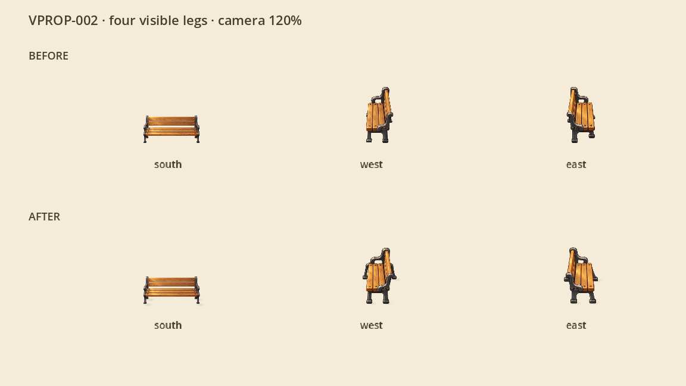
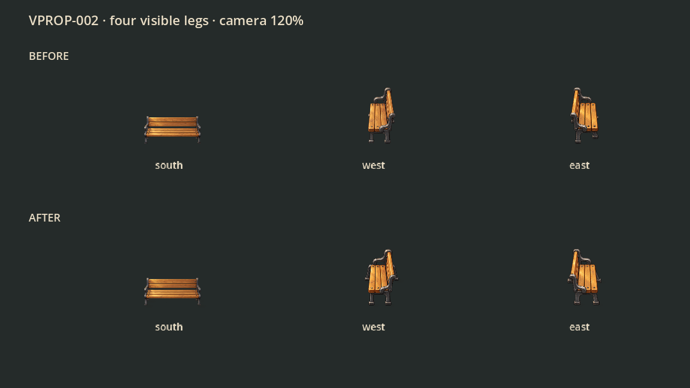

# VPROP-002: четыре читаемые ножки во всех ракурсах

Повторное замечание пользователя от 22 октября 2026: боковая лавочка выглядит двухногой, передняя — четырёхногой. В прежнем паспорте были отмечены четыре непрозрачные точки, но дальняя пара выглядела маленькими выступами под сиденьем. Число точек само по себе не доказывает читаемую конструкцию.

Встроенным `image_gen` перерисованы два боковых мастера. Дальние опоры шире сиденья: видны стойки, соединение с рамой и отдельные подошвы. Влево, вправо и вниз — единственные ракурсы; диагональ и задний вид не добавлены. Передний мастер и его игровой PNG сохранены побайтно. Первая попытка редактирования снова спрятала дальние стойки и не использована.

Мастера находятся в `masters/`, игровые производные — в `assets/game/locations/overworld/benches/`. `tools/village_bench_assets.py --build` воспроизводит нарезку, единое уменьшение и паспорт. Новые точки четырёх опор используются прежним кешированным mesh тени; игрового кода, коллизий, расположения лавочек и механик эта правка не меняет. Исторические мастера и нативные данные первого VPROP-002 остаются в прежнем отчёте.

## Визуальная проверка

`tools/village_bench_leg_capture.gd` показывает старые и новые игровые ресурсы в настоящем CanvasItem Godot: одинаковые 120%, три ракурса, светлый и тёмный фон, окна 1152×648 и 1280×720. Это стенд ресурсов, а не новый обход всей карты или замер FPS. В основной карте пока установлены передние лавочки; боковые доступны в каталоге ресурсов и проверяются на стенде.

Точные исходники и параметры — в [source.json](source.json), запросы к встроенному image_gen — в [prompts.json](prompts.json). Результаты фактических проверок записаны в [completion.json](completion.json).

The first full pre-commit attempt stopped in the pre-existing VPIPELINE-009 fixture check: an ignored generated .import file was recreated in the fresh worktree and was not present in the historical Git commit. Its exact SHA-bound copy was restored from the primary workspace; no validator or historical evidence was changed. The full pre-commit was then restarted.

The second attempt rejected the new PNG hashes in the current asset provenance registry. The existing bench rule was updated to the reviewed derivatives and their new masters/prompts; historical VPIPELINE evidence remains unchanged.
