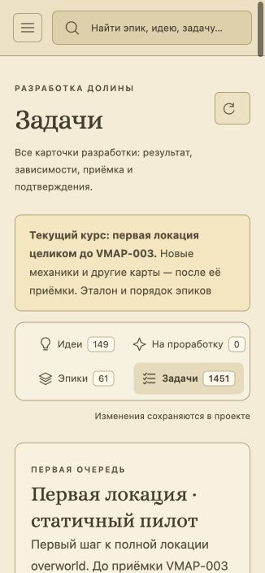
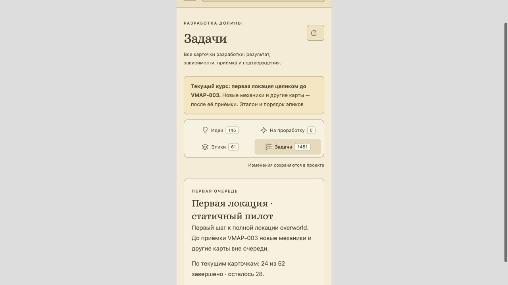

# VRELEASE-001 — первая очередь внедрения

**Курс уточнён пользователем 19 октября 2026:** сначала вся первая локация `overworld` до VMAP-003, новые механики и другие карты откладываются. Эталоны и порядок восьми шагов вынесены в Wiki «Первый живописный участок». Статичный пилот — первый шаг; после его движения и стоимости VMAP-001 задаёт ведомость всей карты, адресные ресурсы VBUILD/VACTOR/VPLANT переносятся только по ней, VMAP-002 принимает атмосферу, VMAP-003 — штатный маршрут и итоговый бюджет. Все существующие игровые механики проверяются на сохранность.

Принят план ограниченного статичного пилота. **52 карточки, два этапа, 10 затронутых графических эпиков**; на момент постановки выполнено 24, открыто 28. Следующая подготовленная карточка — **VBASE-002**, затем очередь выбирается по реальным статусам и открытым условиям. Этот результат не принимает новый арт, живое включение, старый слот или FPS. QA-05 и VRELEASE целиком остаются открытыми.

Исходный checkout: `12e6e2c7ac30f87af839cdb8cd0e2a4d1e558ee5`. Ручные решения и область — [plan.json](plan.json); сгенерированное транзитивное замыкание — [queue.json](queue.json). В Wiki доступна глава **«Первый живописный участок»** и фильтр очереди в разделе «Задачи». Статусы читаются из канонического бэклога, не копируются в план. Числа выше — снимок приёмки, а не постоянно обновляемый второй реестр.

## Область и доказательство исходного состояния

Пилот: `Rect2(240,312,960,576)`, 40×24 клетки, 960 клеток из допуска не более 1000. Входит целый первый мост `Rect2(816,360,96,192)`. Геометрия взята из `scripts/systems/village_map_data.gd` и `water_layout_data.gd`: текущий мир **2400×1368**. Архивный мастер FirstLevelArtSystem 2400×1200 не определяет физическую границу. Схема не меняет коллизии, размещение дома, реку или WaterTopology.

В основной сцене: трава/земля, осевая тропа со стыками, низкий берег, неподвижная вода, мост с отдельными перилами, один модуль дерева, лавка и часть фасада с синей крышей A. Тёплая крыша B сохраняется принятой для дальнейших домов. Проверяются наружные VPROP-002…007 с героем, сеткой и тремя ракурсами ←/↓/→. Интерьер VPROP-008, пещерные опоры VPROP-009 и полная приёмка VPROP-010 исключены из первой очереди и остаются открытыми.

Герой, NPC, HUD, предметные иконки, урожай, стройка, сюжет, рецепты, физика и области вне пилота сохраняют прежний путь. Макеты остаются отдельно от production-ресурсов. Мягкий стиль A, тёплая палитра, естественный край A, ремесленная фактура B и свет сверху-слева уже выбраны; повторный выбор не требуется.

Историческая нативная пара VPIPELINE-010: [source](../vpipeline-010/native/game-source/overworld.png) и [export-pack](../vpipeline-010/native/game-pack/overworld.png). Оба GPU-readback — 1152×648, камера `(0,348)`, герой `(432,672)`, день 1, 12:00, clear/spring, seed 20261015, симуляция заморожена. PNG совпадают точно. Захват сделан на базе `6ade4a2c8a2fac640109d3365c69bd4b6ccadfc4`, пакет доказательств закреплён commit `12e6e2c…`; точные SHA-256 — [reference.json](reference.json). Никакой повторный скрин не объявлен новой реализацией.

Целевая композиция 120%: framebuffer 1152×648, поле 960×540, запрошенное начало `(240,330)`. **Она ещё не принята в штатной камере**; владелец переноса — VCAMERA-006. Для статичной пары VRELEASE-002 нужна одна явно зафиксированная проекция с одинаковыми исходным/новым кадром. Нельзя непосредственно сравнивать текущий 1× с новым 1,2× и приписывать отличия качеству рисунка или скорости.

## Этапы и порядок

| Этап | Состав | Условие перехода |
|---|---|---|
| Основание и пакет художнику | 31 карточка: VBASE-001…005; все VART/VPIPELINE; VCAMERA-001/002/003/006; VPERF-001; VRELEASE-005 | Оборудование, маршрут, целевая камера и художественный пакет. Завершённые 24 используются повторно |
| Первый статичный показ | 21 дополнительная карточки: VRENDER-001…004, VGROUND-001/003…010, VSHORE-001, VPROP-002…007 и VRELEASE-002 | Цельная неподвижная сцена и проверенные уличные предметы |

Полный порядок с прямыми и дополнительными зависимостями находится в queue.json и Wiki. Корни этапа разворачиваются рекурсивно, повторные ID устраняются. Лимит — 64 карточки; переполнение требует нового решения области. VRELEASE-001 — внешний административный владелец очереди и условие VRELEASE-005; он не включает сам себя в очередь и не рекомендует сам себя к работе.

Исправлено расширение области: VRELEASE-002 зависела от общего VPROP-010, включая интерьер и пещеру. Теперь её канонические зависимости ограничены наружными VPROP-002…007, а VPROP-010 получила собственные полные VPROP-001…009 и остаётся вне очереди. VRELEASE-002 дополнительно ждёт VBASE-002/005, VCAMERA-002/003/006, VPERF-001 и VRELEASE-005. VGROUND-005 ждёт осевую форму VGROUND-004. VGROUND-002 с крупными биомными пятнами остаётся вне первого показа, его применимость решается при VMAP-001. Условия видны в Wiki и копируемой карточке. Непроверенная часть широкой задачи не получает done.

`ready` допускается к рекомендации только без открытых условий. `backlog` без блокеров показывается как «можно подготовить», а `blocked` не превращается в `ready` автоматически. Обновление статусов меняет прогресс без регенерации состава. Изменение зависимостей требует `python3 tools/pilot_rollout.py --write` и пересборку Wiki; потерянная зависимость, цикл, неверный порядок или неизвестная очередь показываются как ошибка, а не полный список вместо пилота.

## Остальные эпики и владельцы

Все **25 графических эпиков** имеют явную роль и обоснование в plan.json. VBASE/VART/VCAMERA/VPIPELINE/VPERF — основание; VRENDER/VGROUND/VSHORE/VPROP/VRELEASE — статика; VFOLIAGE/VTREE/VSHADOW/VLIGHT/VEDITOR/VCOMPAT — следующее живое включение; VWEATHER/VFX/VUI/VANIM отложены. VICON/VACTOR/VPLANT/VBUILD/VMAP — **837 производственных карточек после пилота**, а не обязательное условие первого кадра.

Сверен общий каталог Wiki: 11 планов, 61 эпик, 1451 задача. Связи с другими направлениями:

| Направление | Решение пилота |
|---|---|
| Базовые PERF/SAFE/FARM/WORLD/UX/QA | Сохраняются владельцы OPT/QA/UX, прежние статусы и игровые инварианты. План не закрывает родительские задачи |
| WATER | Единственный владелец физической воды и русла; VSHORE оформляет её, не заводит вторую геометрию |
| Живой мир, FAUNA/ATMOS/VILLAGE | Новые существа и события не добавляются ради картинки; переход к живому участку предусматривает их будущее перекрытие, паузу и жизненный цикл |
| ECHO/FAIR/RELIC/CASE | Новые механики не требуются статичному пилоту; не меняем карты/коллизии и формат сохранения под иллюстрацию |
| PACK | Нынешний герой/инвентарь остаются ориентиром; ёмкость, подбор и стаки имеют одного игрового владельца |
| WIKI | Используем существующие ID/статусы и поиск; состояние идей/групп не переписываем |

## Последующие ворота

1. **VRELEASE-003, движение.** Сначала отдельно развернуть полную очередь VRENDER-005…010, VFOLIAGE, VSHORE/WATER, VTREE/VSHADOW/VLIGHT, VEDITOR/VCOMPAT и соответствующие зависимости. Нужны видео, стабильные корни, осевое течение, правильные перила, пауза/возобновление и очистка при переходе карты.
2. **VRELEASE-004, стоимость.** После протокола VPERF-001 согласовать VPERF-002, устройство/preset/размер/фокус. Записать raw интервалы, p95/p99/max, холодный/тёплый вход, наблюдаемую память и работающий fallback. Статичная картинка и потенциальные RGBA8 не принимают FPS/VRAM.
3. **VMAP-001…003.** После живого измеренного пилота довести всю первую карту: ведомость, адресная партия её ресурсов, сборка, атмосфера и штатный маршрут/бюджет. Только после VMAP-003 разрешён переход к интерьеру VRELEASE-006, пещере VRELEASE-007 и следующим картам.
4. **VRELEASE-010, масштабирование/выпуск.** Массовый каталог, лицензирование и реальный export/F12 проходят свои ворота. Неустановленные источники из VPIPELINE-010 не объявлены разрешёнными этим планом.

Старый слот — **открыто**, владелец VCOMPAT-002: обезличенная версионированная fixture, on/off и сравнение сохранённых полей. Обычный вход нового пилота — **открыто**, VRELEASE-003: реальный маршрут, ввод, физика и камера, а не только QA-телепорт. Откат нового пилота — **открыто**, VCOMPAT-010: настоящий флаг/ресурсы, слот и F12 без утечек эффектов. Runtime не изменялся в VRELEASE-001; сейчас откатываются только план, Wiki и инструменты их проверки.

## Приёмка планирования

- `python3 tools/pilot_rollout.py`: read-only проверка 52 ID, полного замыкания, геометрии, всех 25 ролей и исторической нативной пары. `--next` выводит живые статусы и блокеры.
- `python3 tools/test_pilot_rollout.py`: 15 положительных/отрицательных сценариев в копиях, включая цикл, потерянный блокер, массовый арт, ложный done, архивную высоту мира и неподтверждённую камеру/совместимость.
- `pnpm --dir wiki check`: типы, сборка, прежние каталоги и 10 новых сценариев очереди; записи пользователя не меняются. Отдельно проверены настоящий UI, переходы к задаче/обратно, этапы, дополнительные условия и отказ неизвестной очереди.
- Архитектурный gate и полный игровой набор — по TESTING.md перед commit. Результат относится к планированию; новые GPU-эффекты, художественный перенос и профиль скорости не заявляются.

Браузерное подтверждение и проверки записаны в [acceptance.json](acceptance.json): 15 профильных сценариев и 51 Wiki-тест после уточнения курса. Базовая интеграция a3b3c6c2 прошла архитектурный gate и 44083/0 игровых проверок; уточнение также проходит штатные полные commit hooks. VRELEASE-005 проверена после закрытия своего блокера и переведена в Ready; следующий рекомендуемый ID очереди остаётся VBASE-002. Глава Wiki и фильтр очереди — основной пользовательский вход; JSON остаётся проверяемым источником для агента.

