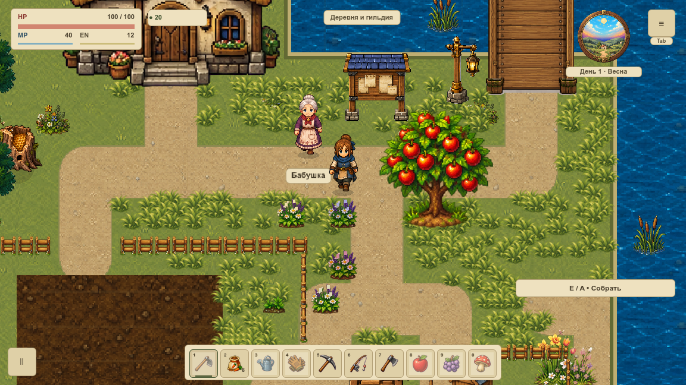

# VRENDER-002 · три способа движения травы

Выбран **статический ArrayMesh группами по 64 куста с общим vertex shader**. Это решение для следующего подключения низкой травы первой карты. Штатная игра, `main.tscn`, `scripts/` и `assets/game/` не изменены. Прототип находится в `tools/grass_compare/`, принятый рисунок травы взят из VART-008 без перерисовки. Плотность тестового участка не является художественной приёмкой первой локации.

[ADR: решение, стоимость и отклонённые варианты](ADR.md) · [воспроизводимый результат](summary.json) · [канонический план](../../../epics/visual-overhaul-2026-10/backlog.json).

## Комплект и происхождение

Все процессы используют Git-базу `58ddc3d0233858d98c0be98e149f79dc5821dc41`, production 0.0.278 и отдельный проектный overlay 0.0.279. Точные 17 входов и SHA256 сохранены в каждом `instrumentation/` и `source.json`; version текущего checkout не подменяет исторический источник.

| Каталог | Нативный результат | Назначение |
|---|---|---|
| `bench/` | 24 отдельных процесса: 3 повтора × 2 плотности × 4 метода | Исходная серия CPU / отдельные узлы / группы / пустой контроль |
| `cpu-only/` | 6 отдельных процессов: 3 повтора × 2 плотности | Повтор CPU после устранения повторного вычисления одинаковых весов |
| `quality/` | 2 процесса, 54 PNG и 216 настоящих draw callbacks | Финальная графика трёх способов, пауза и переходы |
| `controls/` | 2 PNG без нового слоя | Точные Git-байты village-baseline из VRENDER-001 для непрозрачных частей HUD |
| `review.txt` | 1437 / 0 | Headless: геометрия, неподвижный корень, часы, состояние и жизненный цикл; не native/FPS |

Коллектор не переподписывал исходную серию после оптимизации CPU. Из 17 входов изменены только `mesh_data.gd` (веса рядов один раз на группу вместо каждого куста) и `grass_compare_collect.py` (режим `cpu-only`). Общие корни, топология, материал, UV и прочие исходники одинаковые. Финальные кадры используют точные входы повторного CPU-замера. `summary.json` хранит оба CPU-результата отдельно и указывает источник итоговой строки.

## Одинаковая сцена

Окно измерений 1152×648, логический canvas 1152×648, мир 120%, камера `(120.25,430.25)`, герой `(600.25,700.25)`. Для графики дополнительно окно/readback 1280×720. На одном допустимом участке земли заданы 256 и 1024 опоры собственным RNG; сохранённый RNG игры не меняется. Вода, сооружения и твёрдые препятствия исключены без навигационного запроса с побочным заполнением estate-состояния.

Все варианты используют `grass-low.png` 438×512, масштаб 0,09, pivot `(219,490)`, линейную фильтрацию с mipmaps. Куст содержит 18 вершин / 20 треугольников. Горизонтальная амплитуда 2,4 единицы мира; отдельный ряд корня и нижняя часть PNG неподвижны. Квантизированная фаза и формула общие для CPU/GPU. Шейдер использует управляемый `wind_time`, не встроенный TIME, который не следует игровой паузе.

Группы идут в общем порядке Y/X, по 64 соседним в этом порядке опорам; bounds расширены на деформацию. Это низкий слой за актёрами, передним планом и HUD. Он не принимает сортировку высокой травы вокруг ног, контакт с героем, тени, сезонность или художественное распределение плотности. Старые перила остаются запечены в грунт, как установлено VRENDER-001.

## Протокол стоимости и ограничения

MacBookPro16,1, Intel i7-9750H, RAM 16 GiB, AMD Radeon Pro 5300M, macOS 15.4.1, Godot 4.7.1 Compatibility/OpenGL. Вся серия на AC, low power выключен. Схема питания и thermal/CPU limits наблюдаются до/после каждого запуска; мгновенная частота CPU не фиксировалась. В каждом процессе новый профиль и свежий output. Другой Godot, потеря фокуса, изменение окна/камеры или пауза отклоняют сравнение. Порядок методов и плотностей меняется между повторами; фоновые приложения ОС не контролируются полностью.

После подготовки и readback — 120 прогревочных callbacks и **20 секунд всех наблюдений**. VSync=1, max_fps=0, штатный low_processor_usage_mode и sleep=500 µs сохранены. Буфер наблюдателя 1 728 000 байт выделен заранее; CSV, полные snapshot и PNG пишутся вне измеряемых callbacks. Внешний `ps`/питание опрашиваются каждые пять секунд и остаются частью условий наблюдения. Хвосты не удалены, лучший повтор не выбирался.

Это **микрозамер визуального эффекта с остановленной игровой симуляцией**, не замена живой серии VPERF-001 3×30 с + 600 с. `update_ms` измеряет только `_process` слоя: проекцию и управление/обновление вершин. Нагрузка узлов и движка в эту величину полностью не входит; дополнительно дана CPU-доля всего процесса, вычисленная из cumulative OS CPU time относительно wall time (100% = одно ядро). Render interval — интервал настоящих `frame_post_draw`, **не GPU completion и не физическая частота показа**. GPU timer недоступен (`null`).

RSS — редкие наблюдения ОС, не гарантированный пик, не VRAM и не доказательство отсутствия утечек. Счётчики static/texture bytes сохранены отдельно. Размер входных массивов 816 байт/куст не выдаётся за резидентную память GPU. CPU передаёт 144 байта позиций/куст на update; это логический payload API, не замер шины GPU.

## Графика и сохранность

Для каждого метода сняты три одинаковые фазы и случаи дерева, куста, моста, ручной Escape-паузы, входа в существующий дом и возвращения. Пауза подана через production input router; это автоматизированный ввод, не физическая запись клавиатуры. Реальные часы и загрузки CPU останавливаются, затем возобновляются; внутри дома слой скрыт, после выхода meshes повторно не строятся.

Полные RGB-кадры CPU/групп совпали. Отдельные CanvasItem отличаются максимум на 3 уровня канала из 255 (при заявленном допуске 8, средний допуск 0,1). Пауза не включена в попиксельное сравнение методов: её стартовая realtime-фаза различается; проверяются фактические часы/uniform. Фазы 0 и 1,25 изменяют пиксели всех методов. 216 до/после `super._draw()` проверяют полные SaveSystem.snapshot, геометрию и пустую очередь перекрытий. Две непрозрачные области HUD при двух размерах полностью равны прежнему кадру без травы; прозрачные края специально не считаются непрозрачными. Сравнение методов при этом остаётся по всему framebuffer, без масок.



## Повторение

```sh
python3 tools/grass_methods.py all
python3 tools/test_grass_methods.py
# Новые отдельные каталоги; только при разрешённом запуске и активном окне:
python3 tools/grass_compare_collect.py --mode quality --output /private/tmp/grass-quality-new
python3 tools/grass_compare_collect.py --mode bench --output /private/tmp/grass-cost-new
```

`all` — read-only анализ архивного пакета; проверяет Git-базу, источники/артефакты, Git-наличие доказательств, native условия, все raw строки, изображения и snapshots. Новая серия текущего оптимизированного CPU не требует смешивания с историческим первым CPU. `cpu-only` нужен для воспроизведения именно выполненного двухшагового эксперимента. Headless-профиль: `tools/Godot.app/Contents/MacOS/Godot --headless --path . --script res://tools/grass_compare/review.gd`.

18 Python-сценариев портят временные копии: фокус/окно/пауза/камера, raw-хвост и счётчик рендера, неподвижные часы, NaN, скрытое изменение HP, неверный uniform, видимость в интерьере, ложный GPU timer, неполный пакет и пиксель. Синтетический секундный рывок остаётся в максимуме обоих журналов. Историческая проверка не читает текущую версию проекта. Architecture gate, полный игровой набор, Wiki check и браузерные доказательства обязательны перед завершением.

Внедрение и аварийное выключение получает следующая карточка по канонической очереди. В этой задаче откат не меняет сохранения: обычная игра не подключает инструменты прототипа.
