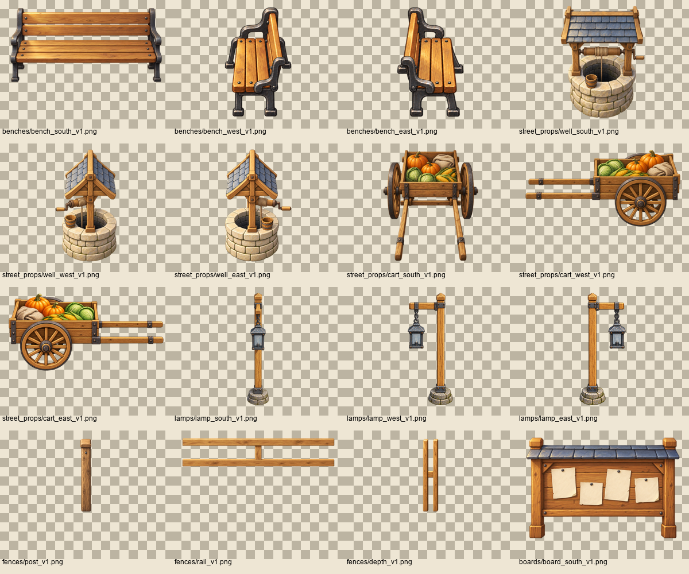
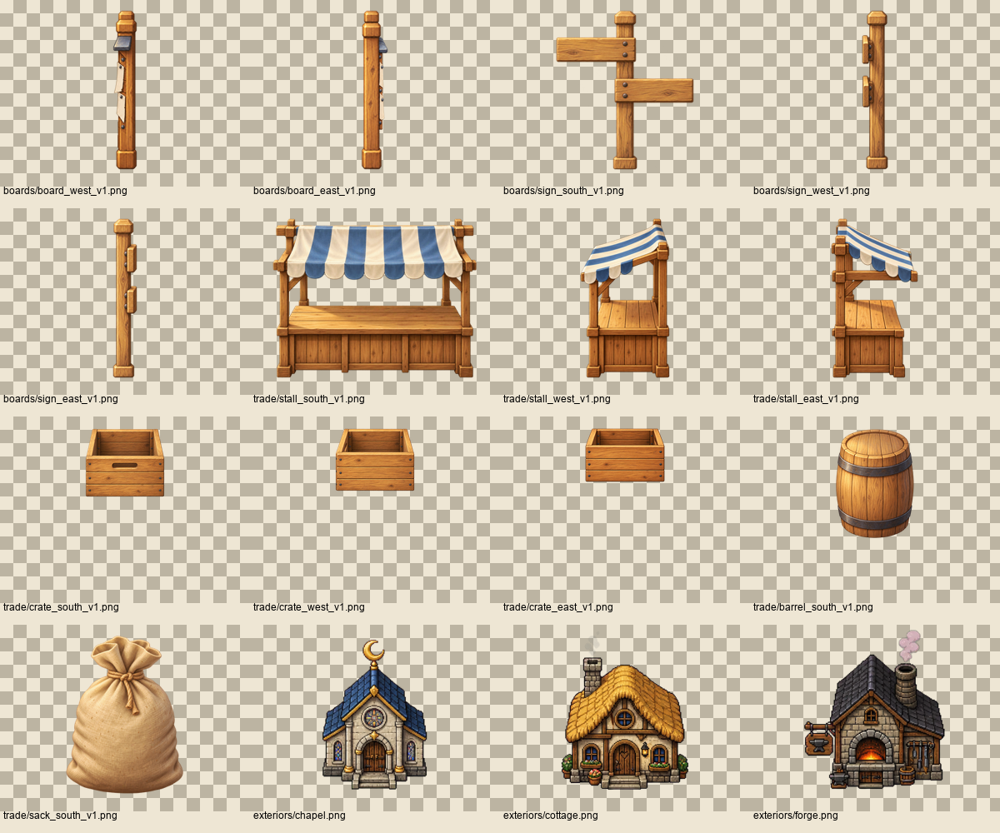
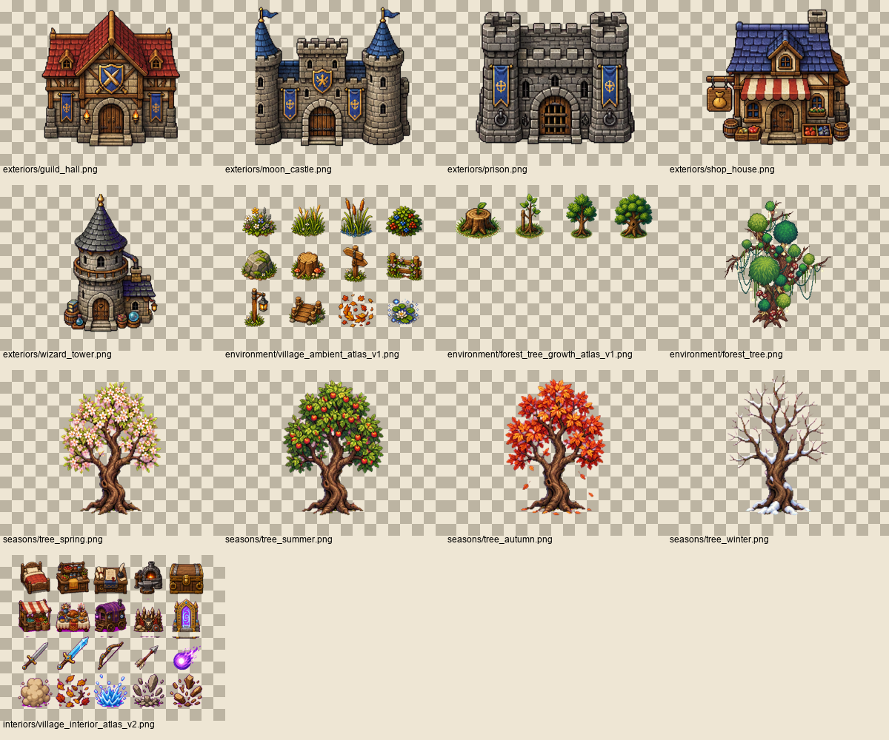
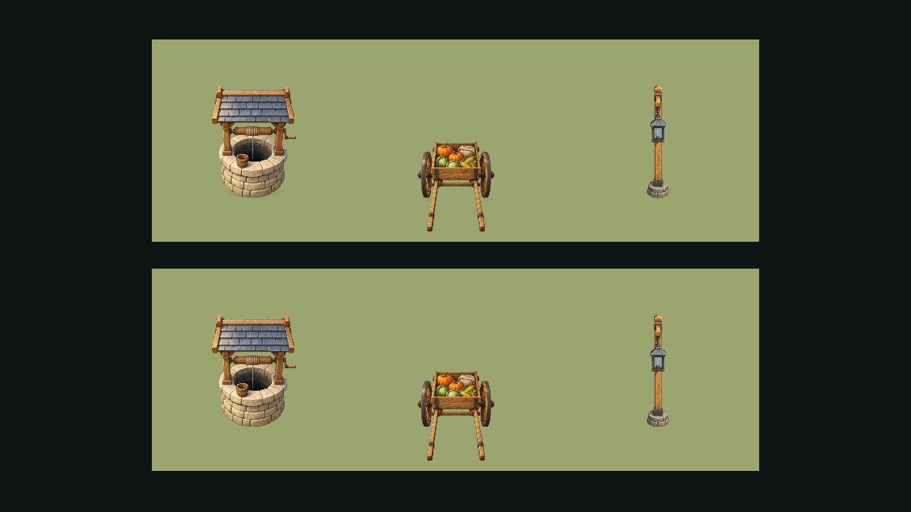
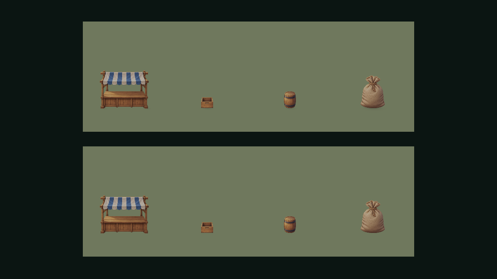
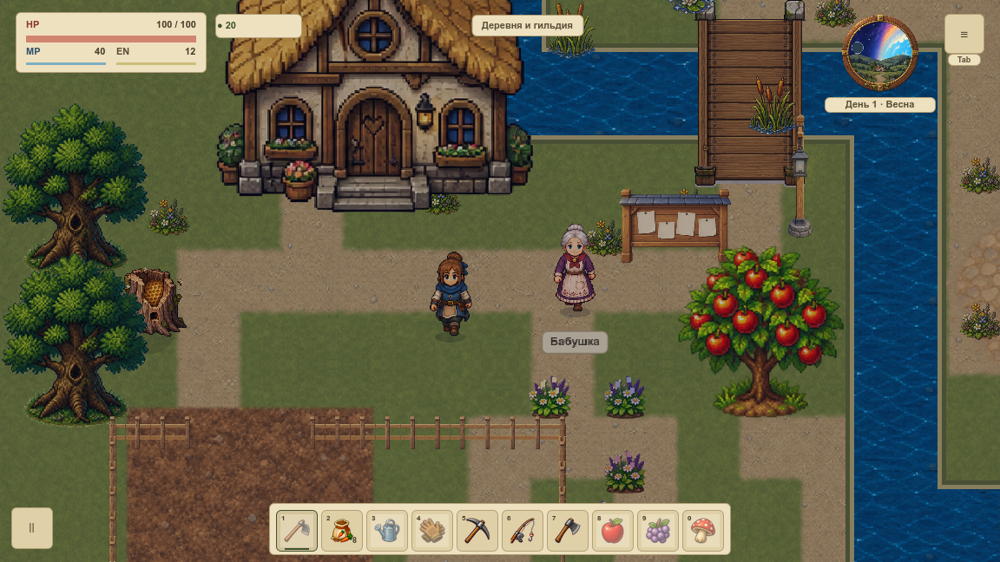

# VSHADOW-001 — где уже есть тень

Карточка готовит первую локацию к новым теням. Это аудит существующей графики и владельцев отрисовки: игровые рисунки, renderer, коллизии и сохранения не изменены. Основание — Git из `dependency-audit.json`; оба прямых предшественника и все их зависимости завершены. Маленький статичный пилот уже принят; живой пилот и вся первая карта до VMAP-003 остаются открытыми.

## Три разных вида затемнения

1. **Материал:** тёмная сторона крыши, щели досок, внутренность колодца, затенение под сиденьем. Остаётся внутри рисунка; извлечение всех тёмных пикселей разрушит предмет.
2. **Контакт и нарисованное основание:** маленький контакт у ног, темнота у ступеней, корни с грунтом или травяная подложка. Их владелец должен быть один. В старых атласах основание не отделено от цвета.
3. **Падающая солнечная тень:** отдельная проекция на землю по направлению света. Общего такого прохода с изменением направления по календарю сейчас нет. Ночное экранное затемнение и свечение фонаря не являются солнечной тенью.

## Проверенные рисунки и код

В [inventory.json](inventory.json) и [CSV](inventory.csv) перечислены **45 уникальных PNG** с SHA256, размером, владельцем, отдельным решением о материале/контакте/солнечной тени. Покрыты все PNG и три вида зарегистрированных уличных предметов, включая общие рисунки бочки/мешка; все восемь существующих фасадов, шесть сезонных/растущих деревьев, атлас декора и прежний интерьерный атлас. Пять фасадов и интерьер рассмотрены как контекст: их реализация не добавлена в объём первой карты.

Все 45 источников просмотрены на шахматном фоне. В новых уличных PNG не обнаружена протяжённая внешняя падающая тень; затенение материала сохраняется. У фасадов остаются тёмные кромки основания и ступеней. У деревьев и ячеек декора нарисованы корни, грунт, травяные основания; готовой независимой маски тени нет. Это не обещание отсутствия контакта во всех кадрах остальных анимационных семейств. Новая или изменённая текстура требует отдельного просмотра до назначения падающей тени.

Восемнадцать владельцев кода привязаны к функции, строке и точному Git SHA. Актёры имеют прежний мягкий эллипс; два прохода у животных образуют один контакт. `TreeOcclusion` управляет глубиной и прозрачностью, а не солнечной проекцией. Интерьер уже рисует полосу у стены. Контекст пещеры сохраняет свои эллипсы без новых эффектов или переделки другой карты.

## Два нативных окна

Серия `native/` содержит окна **1152×648 и 1280×720**. В каждом восемь наблюдений: день 720/вечер 1140 × одна лавочка/три уличных предмета/две доски/четыре торговых предмета. Обычная игра снята отдельно в настоящем production draw, с общим seed, камерой 120%, штатным календарным затемнением и полным snapshot до/после. Симуляция остановлена для статической съёмки. Фокус записан как факт, не выдаётся за проверку физического ввода или бюджета кадра.

В отдельной витрине вызваны **прежние** production helpers: контакт включён сверху, отключён снизу. Неподвижная камера и размеры одинаковы, предмет рисуется один раз. Третий прозрачный target содержит тот же предмет без фона и контакта, чтобы независимо проверить его силуэт и ядро. Новая солнечная система для теста не создавалась: её отключение неприменимо, поскольку такого runtime-прохода ещё нет. Проверено отключение существующего отдельного контакта; будущая солнечная проекция остаётся VSHADOW-004.

Итого **16 наблюдений,48 target PNG,32 полных оконных кадра,96 callbacks targets и 32 production callbacks**. Все destination целиком внутри target с запасом. Контакт меняет не менее 80 пикселей; ядро тела с alpha≥250 сохраняется с допуском 1/255 по всем RGBA-каналам, полностью непрозрачные пиксели совпадают точно. Этот допуск учитывает обычное смешивание: большая часть исходного импортированного тела имеет alpha252–253, а не 255. Полный прозрачный target тела побайтно одинаков при обоих часах и окнах; его нельзя заменить пустым кадром. Всё сравнение выполняется на полном target без удаления краёв.

Первая проба обнаружила обрезанный низ оглоблей телеги и отклонена; опора витрины поднята на 20px без изменения игровых ресурсов. Вторая проба остановилась между окнами из-за нового параллельного headless-процесса. В третьей браузерный просмотр обнаружил случайный мешок перед доской: установка скрипта наблюдателя сбрасывала seed до `_ready`. Это обычный случайный лут, а не утечка материала. Сборщик теперь явно восстанавливает 20261015 после замены скрипта; verifier требует этот seed и полное равенство игровых snapshots между группами и окнами. Принята только четвёртая полная серия. Её файлы перенесены в отчёт без переподписи; первые три остаются в игнорируемом `tmp/` и исключены из счётчиков. Первая попытка общего pre-commit остановлена до завершения для исправления QA; итоговый результат относится к повторному полному запуску.

## Как избежать двойного источника

| Семейство | Решение следующего этапа |
|---|---|
| Лавочки, колодец, телега, фонарь, доски, торговля | Сохранить или заменить прежний контакт, никогда не рисовать второй поверх него. Солнечная проекция получает отдельного владельца. |
| Актёры и животные | Один контакт от общей отображаемой опоры; полный каталог масок анимации ещё требует проверки. |
| Деревья и старый декор | До падающей тени отделить/перерисовать нарисованное основание. Не вырезать тёмные корни автоматическим alpha threshold. |
| Фасады | Оставить щели, тёмную сторону крыши и AO ступеней; не превращать их в новую проекцию. |
| Пол/стены и берег | Существующая тёмная полоса — локальный контакт. Будущие приёмники земли, стен и воды разделить. |

VSHADOW-002…010 сохраняют свои ID и конкретные результаты. Аудит не закрывает их набор контактов, солнечную геометрию, лимиты активных теней или итоговую художественную приёмку. Новая графика всей карты, FPS, память и VMAP-003 не приняты.

## Воспроизведение

`python3 tools/shadow_inventory.py` собирает отдельные таблицы/листы из вручную разобранных источников; это не автоматический детектор тени. `python3 tools/shadow_inventory_verify.py` сверяет неизменную Git-базу, все источники, владельцев и нативные данные. `tools/test_shadow_inventory.py` портит только временные копии: исходник/покрытие/окно/кадр/dispatch/состояние/силуэт. Обе проверки входят в architecture. Для новой нативной серии нужен свежий каталог и отдельный профиль: `python3 tools/shadow_inventory_collect.py --output <каталог>`.

Реальные результаты общего набора, Wiki и браузера записываются в `completion.json` после завершения. Исходные пользовательские сохранения не открываются, другие процессы Godot не завершаются. Откат аудита удаляет только его таблицы/QA-инструменты/статью; runtime-код и формат слотов прежние.
