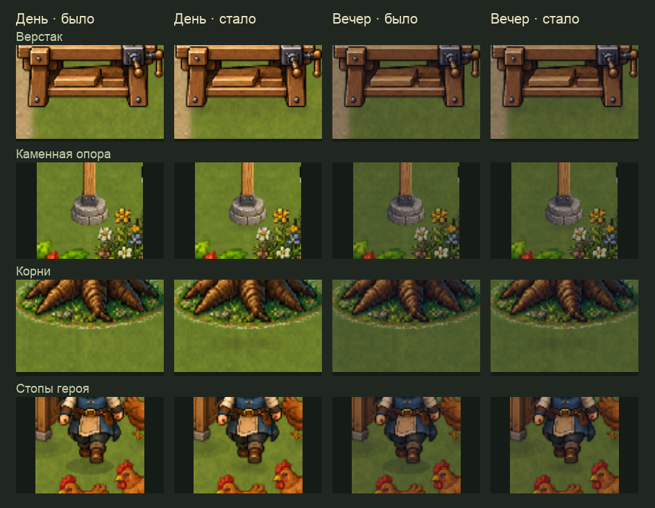

# VSHADOW-002 — контактные тени первой локации

У верстака на ферме четыре контакта под ножками и лёгкая полутень между ними. Каменный цоколь фонаря получает низкий гранёный контур. Контур под взрослыми корнями слегка выступает из-за края нарисованного основания. У героя два мягких пятна следуют за общей экранной точкой стоп.



На `overworld` тени предметов рисуются после земли и перед основной очередью тел. Стопы рисуются перед телом героя, поэтому отдельный вызов отрисовки персонажа также содержит тень. Цоколь заменяет прежний эллипс фонаря, стопы заменяют прежний эллипс героя. Профили используют четыре общих `ArrayMesh` с мягким градиентом прозрачности. Для каждой видимой опоры отправляется одна команда с тем же мешем. Данные коллизий, календаря и сохранений принадлежат своим прежним системам. При откате этого изменения обычный проход возвращается к прежним контактам фонаря и героя.

## Нативная проверка

День в 12:00 и вечер в 19:00 сняты на ферме, на улице и в роще. Камера 120%, нативное окно 1152×648, Godot 4.7.1 в OpenGL Compatibility на macOS. На ферме видны две опоры, в роще и на улице в кадре несколько соседних объектов. Нативные серии с обычным и уменьшенным движением сравниваются отдельно. Неподвижная сцена удерживает реальное игровое окружение, календарную атмосферу и кадр героя. Переключатель падающей солнечной тени относится к отдельной карточке VSHADOW-004.

Для каждой пары валидатор сверяет фактическую камеру, позицию, время, профиль движения, окно и сохранение в обоих вызовах отрисовки. Затем он проверяет, что изменения видны около целевой опоры и стоп, а все пиксели вне зарегистрированных зон опоры совпадают. Эта проверка ловит сдвиг сцены и изменения вне земли под опорами. Камера рощи поставлена на проходимой клетке южнее переправы вне зоны переходного затухания крон. На тестовом снимке переправа уже отремонтирована, поэтому в области сравнения отсутствует анимированный значок ремонта.

Готовы 12 пар, по шесть в каждом режиме движения, и 48 наблюдений производственной отрисовки. В отчёте сохранены все 24 PNG. Измерения и SHA-256 приложены для обеих серий, включая входные файлы исходного коммита и кандидата. Контроль с подстановкой исходного кадра с обеих сторон отклонён. [Ведомость результатов](evidence.json) · [Исходные кадры обычного режима](native/base-normal/) · [Новые кадры обычного режима](native/candidate-normal/) · [Исходные кадры с уменьшенным движением](native/base-reduced/) · [Новые кадры с уменьшенным движением](native/candidate-reduced/).

## Воспроизведение

Сохранённые пары можно проверить из корня checkout кандидата с установленным Pillow. Эти команды читают опубликованные файлы обоих режимов.

```sh
python3 tools/run.py qa.world.contact_shadows_verify \
  docs/reports/visual-overhaul/vshadow-002/native/base-reduced \
  docs/reports/visual-overhaul/vshadow-002/native/candidate-reduced

python3 tools/run.py qa.world.contact_shadows_verify \
  docs/reports/visual-overhaul/vshadow-002/native/base-normal \
  docs/reports/visual-overhaul/vshadow-002/native/candidate-normal
```

Для новой съёмки создайте отдельную копию исходного коммита. В нём ещё отсутствует сценарий захвата, поэтому скопируйте один и тот же файл из checkout кандидата в эту копию. Абсолютный `FARM_GODOT_BIN` должен указывать на Godot 4.7.1. Импорт и захват последовательно выполняются в исходной копии и кандидате. Общий временный каталог согласует пути съёмки и валидатора.

```sh
candidate_dir="$PWD"
baseline_commit=9a1e2f7c571e1b44e6a506b231f2199aa016d4ad
capture_script=tools/qa/world/contact_shadows_capture.gd
capture_root=$(mktemp -d "${TMPDIR:-/tmp}/vshadow-002.XXXXXX")
baseline_dir="$capture_root/baseline"
mkdir "$baseline_dir"
git archive --format=tar "$baseline_commit" > "$capture_root/baseline.tar"
tar -xf "$capture_root/baseline.tar" -C "$baseline_dir"
cp "$candidate_dir/$capture_script" "$baseline_dir/$capture_script"
cp "$candidate_dir/$capture_script.uid" "$baseline_dir/$capture_script.uid"

for phase in base candidate; do
  project_dir="$candidate_dir"
  if [ "$phase" = base ]; then project_dir="$baseline_dir"; fi
  "$FARM_GODOT_BIN" --headless --editor --path "$project_dir" --quit
  "$FARM_GODOT_BIN" --path "$project_dir" --windowed --resolution 1152x648 \
    --rendering-method gl_compatibility --script "res://$capture_script" -- \
    --output="$capture_root/$phase-reduced" \
    --profile="Codex-VSHADOW-002-${capture_root##*/}-$phase-reduced"
  "$FARM_GODOT_BIN" --path "$project_dir" --windowed --resolution 1152x648 \
    --rendering-method gl_compatibility --script "res://$capture_script" -- \
    --output="$capture_root/$phase-normal" \
    --profile="Codex-VSHADOW-002-${capture_root##*/}-$phase-normal" --normal-motion
done

python3 "$candidate_dir/tools/run.py" qa.world.contact_shadows_verify \
  "$capture_root/base-reduced" "$capture_root/candidate-reduced"
python3 "$candidate_dir/tools/run.py" qa.world.contact_shadows_verify \
  "$capture_root/base-normal" "$capture_root/candidate-normal"
```

Журнал нативного процесса должен содержать `CONTACT SHADOWS NATIVE: 6 frames, []`. Приложите обе проверки, SHA исходного коммита и хеши точных файлов кандидата. Результаты полного pre-commit, Wiki и GitHub CI указываются в PR.
