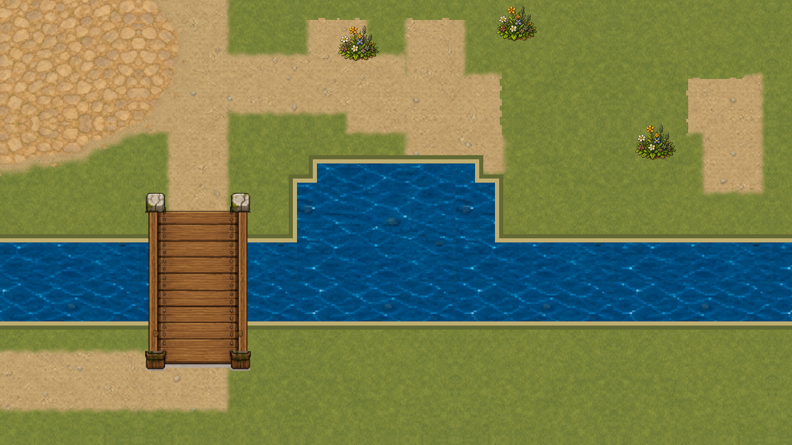
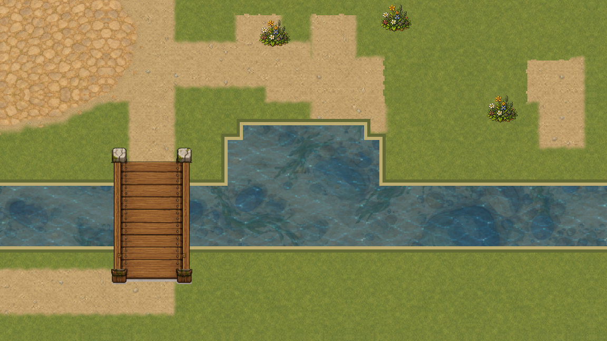
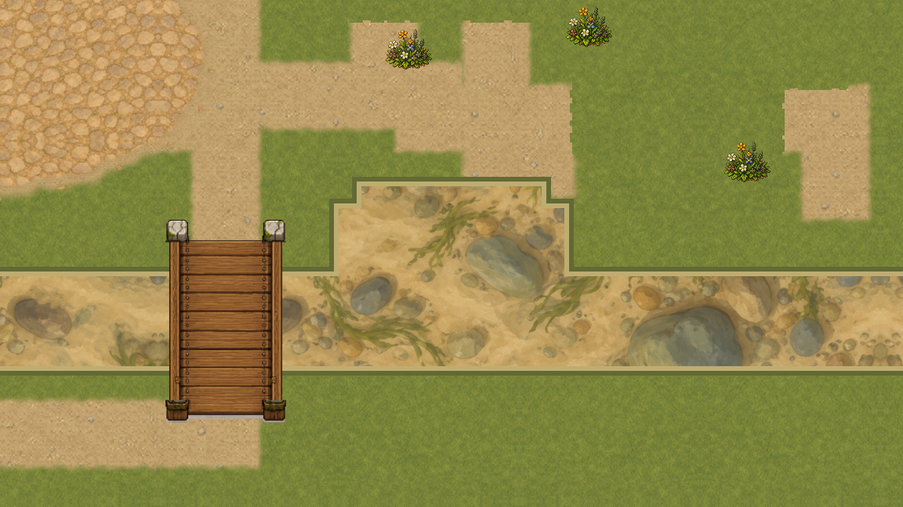
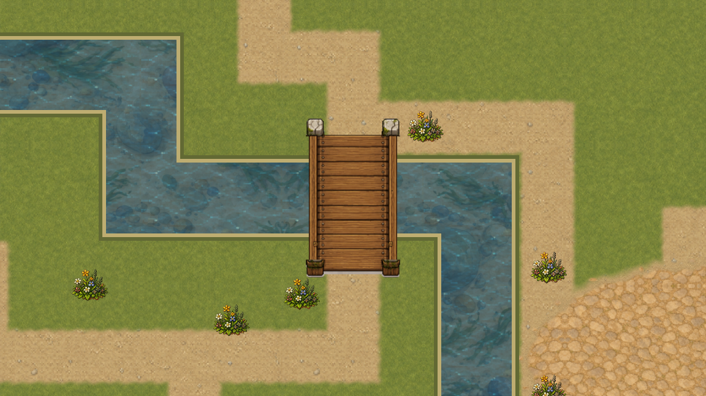

# VSHORE-002 — читаемое подводное дно

[Паспорт](profile.json) · [Происхождение](source.json) · [Нативная съёмка](native/capture.json) · [Ролик камеры](native/camera-pan.mp4) · [Wiki](../../../../wiki/articles/underwater-bottom.md)

В первую `overworld` подключён отдельный живописный слой мелководья: тёплый песок, округлые камни и редкие водоросли. Он рисуется только внутри прежних контуров реки и пруда и не становится новой картой коллизий, навигации, глубины или рыбалки. Обычная игра и пользовательские слоты при съёмке не запускались.

## Реализация

- Мастер 1254×1254 создан встроенным imagegen и перенесён в runtime побайтно. Промпт, мастер и SHA сохранены; программной перекраски и растяжения по одной оси нет.
- Мир разбит на визуальные ячейки 768×768. Соседние UV зеркалятся, поэтому несогласованные противоположные края сгенерированного изображения не соединяются напрямую.
- Все отсечённые части воды собираются в один кешированный `ArrayMesh`: одна поверхность, 36 вершин для текущей `overworld`, одна команда рисования на геометрию. Текстура использует linear + mipmaps, repeat отключён.
- Порядок слоёв: земля и берег → дно → полупрозрачная прежняя поверхность → цветы и мосты. Прозрачность поверхности 0,56; зимой 0,62. Дождь меняет тон, но не скрывает дно.
- Река и пруд объединяются только для визуального прохода. Это устраняет двойное альфа-смешивание в их пересечении; физические контуры WaterTopology остаются раздельными и неизменными.

## Нативная проверка

Оконный Godot 4.7.1 / Compatibility / macOS / AMD Radeon Pro 5300M снял 11 неподвижных GPU-кадров 1152×648 при поле 960×540 и zoom 1,2: четыре точные пары до/после, чистое дно, зима и дождь. Каждая пара использует одну камеру. Повторный readback каждого кадра совпал побайтно.

Мост остаётся поверх воды и дна:

90 кадров движения камеры проходят от стыка русла к речной прогулке. H.264 имеет 1152×648, 30 fps и 3 секунды; все 90 исходных подписей различаются. В Git сохранены ролик, декодированный первый кадр и три PNG-свидетеля, а не все временные исходные кадры. Это fixed-clock проверка стыков, **не** измерение FPS и не запись игрового управления.

## Проверки и границы

Профильный runner повторно выполняет WaterTopology, Navigation, Fishing и Visual. Отдельный Python-verifier проверяет происхождение изображения, точные SHA нативной съёмки, одинаковые камеры, различие до/после, отсутствие двойного альфа-прохода, 90 уникальных кадров, параметры ролика и чистый журнал движка. Негативные тесты повреждают только временные копии доказательств.

Эта карточка принимает живописное дно и его runtime-порядок. Она не принимает новый береговой autotile, анимацию поверхности, течение, глубину, новую физику или полный FPS-бюджет. Эти владельцы остаются у VSHORE-003…006 / WATER. Откат — один revert реализации и удаление ссылки на материал; формат сохранения не менялся.
