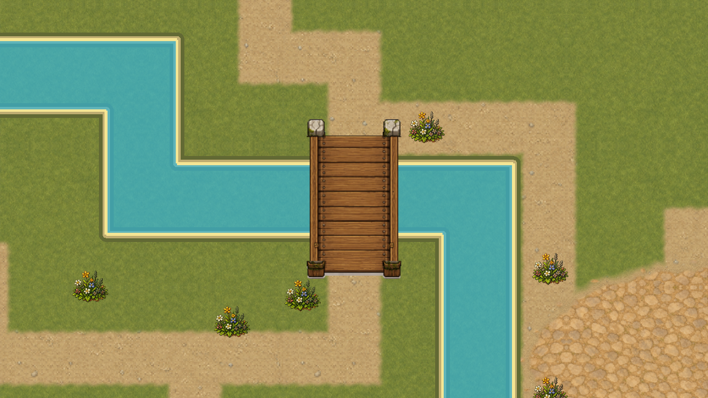
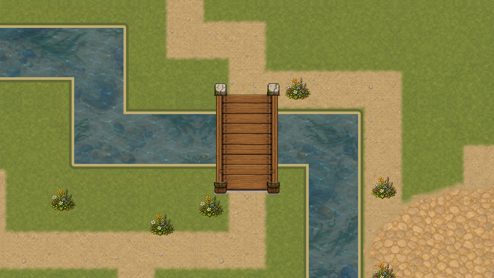
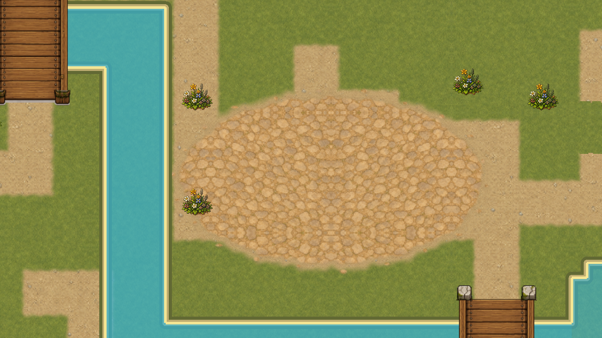
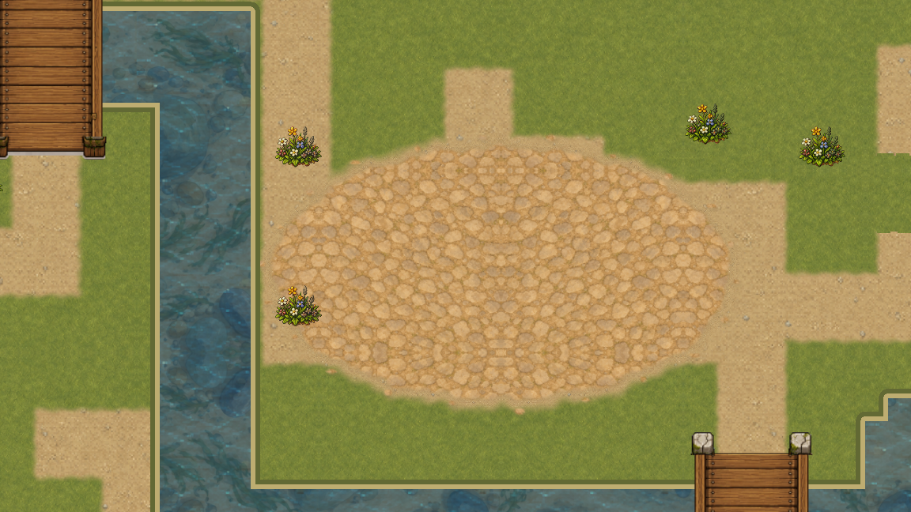
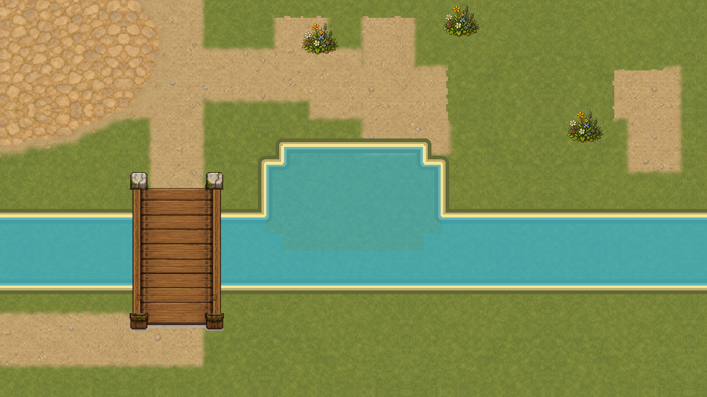
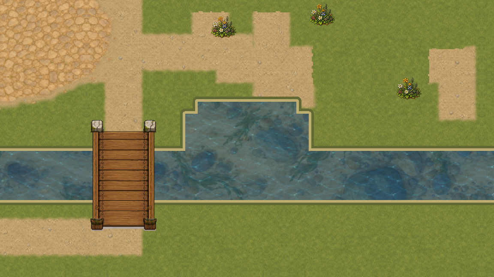
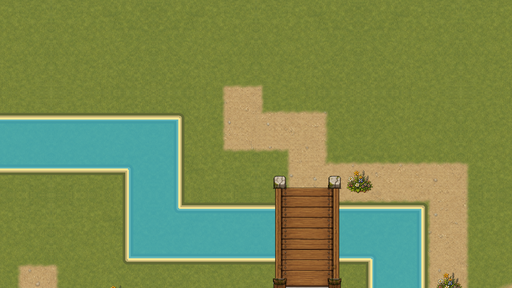
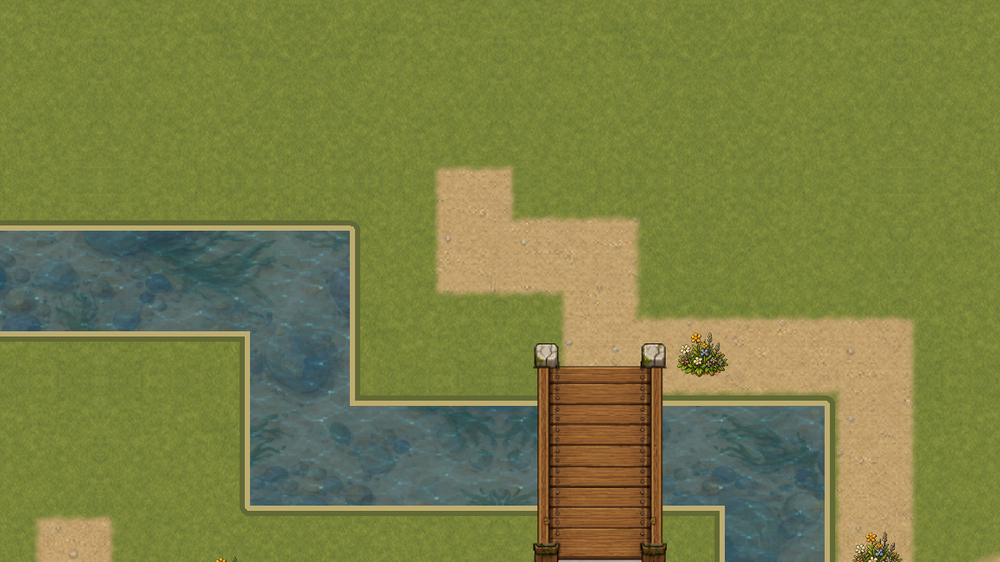

# VSHORE-003 · единая визуальная маска WaterTopology

Карточка переводит покрытие воды, глубину и внешний берег первой `overworld` на один канонический источник — `WaterTopology`. Рендер больше не собирает отдельный контур реки и пруда из `MapData`: он получает кешированный visual snapshot через `WaterMapRegistry`.

## Результат

- 550 канонических водных клеток сжаты в 2 семантических региона.
- Поверхность реки и пруда объединена в 1 визуальный полигон.
- Внешний берег описан 20 кардинальными отрезками; внутренние границы тел не рисуются берегом.
- Мост остаётся самостоятельным верхним слоем, а вода под обеими контрольными клетками моста сохраняется.
- 120 повторных чтений одного revision используют кеш: 1 построение, 0 повторных пересборок.
- Физика, навигация, рыбалка и декоративная вода читают тот же реестр; декоративная вода не получает блокирующую физику.

## Нативная проверка

Четыре камеры сняты дважды: диагностическая маска и production-рендер.

| Участок | Маска WaterTopology | Production-рендер |
|---|---|---|
| Мост |  |  |
| Поворот реки |  |  |
| Пруд |  |  |
| Граница поля |  |  |

Видео содержит 72 различных GPU-кадра, 1152×648, 30 fps, 2,4 секунды. Это fixed-clock проверка маски и движения камеры, **не замер FPS** и не запись пользовательской игры. Захват выполнен отдельным нативным QA-окном Godot 4.7.1; обычные слоты и сохранения не загружались.

## Границы карточки

Диагностическая маска намеренно показывает различия body/depth цветом; production-рендер использует мягкий общий материал. Карточка не объявляет законченными береговые швы и художественную кромку — это VSHORE-004. Рябь, течение и финальная приёмка всей карты остаются у VSHORE-005, VSHORE-006 и VMAP-003.

Все источники захвата, восемь статических кадров, цепочка движения, H.264, лог Godot и 871 WATER-проверка связаны SHA с implementation commit `74eccb25c968311419775ffd2a1152af15ec801b`. Verifier проверяет заголовок H.264 до чтения RGB payload, а затем последовательно и с ограниченной памятью сверяет 72 реальных кадра, длительность, частоту, непрерывность движения и три опорных кадра. Git-история читается только по полному hex commit через безопасный blob reader. Двадцать отрицательных сценариев входят в общий architecture/CI gate.
