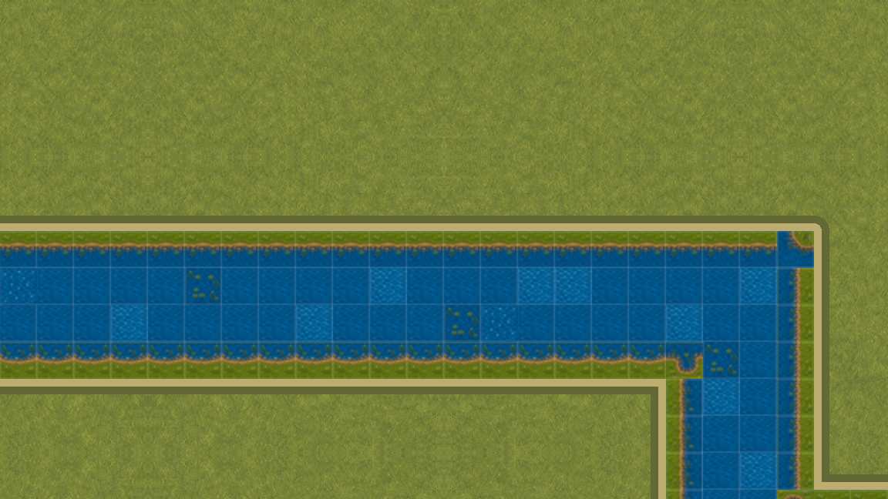
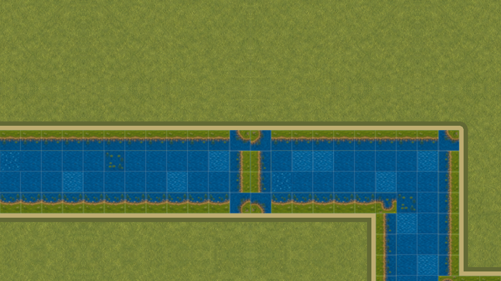
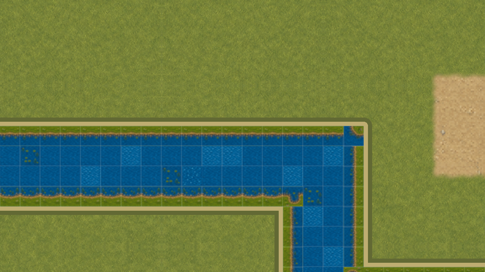
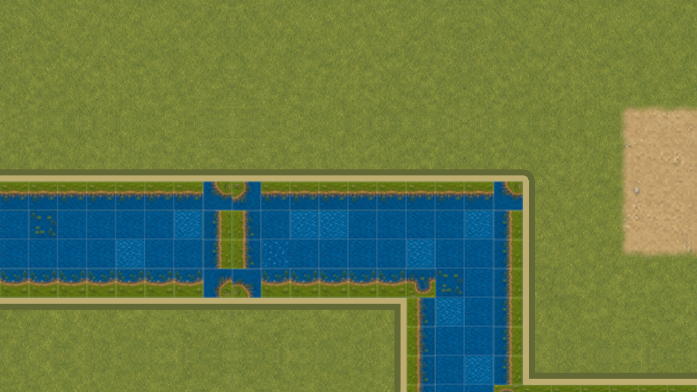

# VSHORE-004 · бесшовные границы водных чанков

Карточка добавляет в `WaterTopology` локальный визуальный снимок чанка. Чанк владеет только своими клетками, но кардинальные и диагональные маски классифицируются по общей топологии через одноклеточный `halo`. Заполненная граница поэтому не превращается в ложный берег, а соседняя клетка не рисуется дважды.

## Результат

- На реальном стыке первой `overworld` `x=15/16` левый чанк владеет 64 клетками, правый — 48.
- Соседний `halo` содержит 4 и 8 клеток; четыре заполненных контакта на востоке и западе совпадают.
- На заполненном участке `x=384` найдено 0 внутренних береговых рёбер.
- 240 повторных чтений двух снимков дали 0 пересборок.
- Далёкая правка не инвалидирует стык; правка граничной клетки перестраивает ровно двух владельцев.

## Одинаковая камера и отрицательный контроль

Для каждой камеры сняты три режима. `global` классифицирует клетку по полному плану. `chunk-safe` рисует клетку владельцем чанка и читает опубликованные маски общего `halo`: обе PNG побайтно одинаковы. `isolated-negative` намеренно скрывает соседний чанк и показывает разрыв, который обязан ловить verifier.

| Камера | Глобальная топология | Seam-safe чанки | Сломанный контроль |
|---|---|---|---|
| Центр стыка |  |  |  |
| Проход к востоку |  |  |  |

Видео содержит 60 различных GPU-кадров, 1152×648, 30 fps, 2 секунды. Для каждого положения камеры перед сохранением `chunk-safe` framebuffer побайтно сравнивался с глобальным эталоном. Это fixed-clock проверка геометрии и движения камеры, **не замер FPS** и не пользовательская игра.

## Проверки и границы

Нативный захват выполнен отдельным QA-окном Godot 4.7.1 с профилем `Codex-VSHORE-004-*`; обычные сохранения не загружались. Профиль WATER прошёл 892 / 0 сценария: суша, мосты, навигация, рыбалка, декоративная вода, модульные варианты и реальный стык `overworld`. Двадцать один отрицательный тест портит только временные копии и проверяет происхождение, метрики чанков, камеры, все 60 PNG, отрицательный контроль, движение, H.264 и логи.

Все исходники захвата и WATER review связаны SHA256 с implementation commit `c19189f39ebef9b335129f145bd4cb641b21e0d7`. Verifier читает историю только по полному hex commit, проверяет каждый сохранённый кадр, декодирует реальный H.264 и не принимает пересобранный манифест вместо кадров.

VSHORE-004 не меняет физику воды, сохранения или художественный материал. Спокойная анимация и направление течения остаются у VSHORE-005 и VSHORE-006; WATER-06 и VMAP-003 закрываются только своими критериями.
