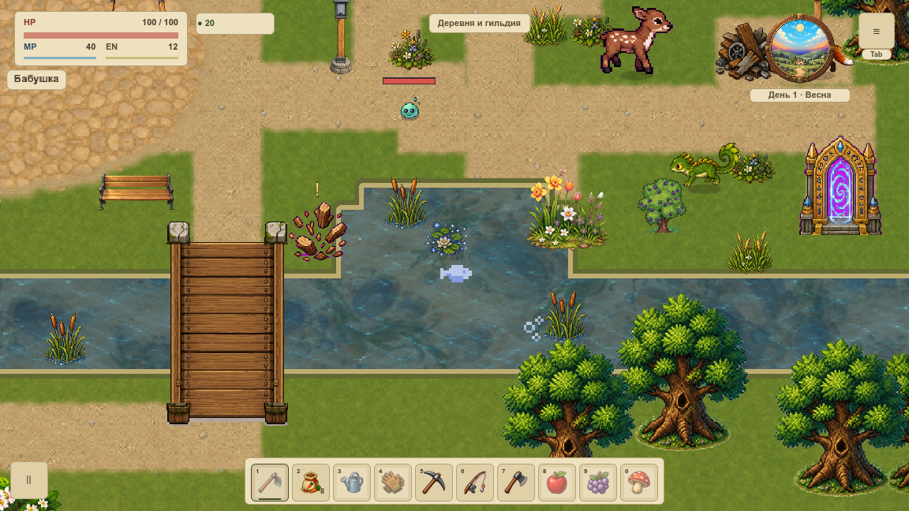

# VSHORE-005 · спокойная поверхность воды

В первой `overworld` шейдер слегка меняет яркость поверхности в двух масштабах. Широкие волны медленно колеблются, мелкая рябь добавляет мягкий блик возле гребней. Камни, песок и водоросли под передним слоем сохраняют прежний цветовой рисунок. Низкий профиль оставляет широкую анимацию и ту же прозрачность.

| Прежняя поверхность | Обычный профиль | Низкий профиль |
| --- | --- | --- |
|  |  |  |


Две секунды у пруда с неподвижной камерой и две секунды движения через границу чанков. 120 нативных кадров при 1152×648 и 30 кадрах в секунду в смонтированном видео. Время между снимками задаёт сценарий, поэтому эта частота относится к ролику.

## Подключение

- Материал принадлежит одному CanvasItem поверхности над сохранённым дном. Он использует прежние полигоны, мировые UV, глубину и RGBA исходной текстуры. Шейдер меняет только цвет. Настил и игровые объекты рисуются поверх.
- CPU вычисляет два временных смещения при смене фазы. GPU использует один обычный выбор текстуры, без экранного чтения и дополнительного буфера. Низкий профиль пропускает мелкую рябь и её блик.
- Фаза приходит из часов завершённого игрового шага и повторяется каждые 64 секунды. При открытом меню она стоит. После возврата продолжается с прежнего значения.
- Предыдущий материал доступен через профиль `static`, настройку уменьшенного движения и эталонный режим. Прямой и цельный рендеры сохраняют собственный статичный проход. Ключ диагностики `water_surface_quality` принимает `normal`, `low` и `static`.

## Проверка

Нативная сцена, Compatibility, AMD Radeon Pro 5300M, масштаб 120%. Три неподвижные камеры показывают стык, реку у моста и пруд. Для каждого места есть статичный контроль и по два момента обычного и низкого профиля. Сравнение всех пикселей проверяет сухую местность и внутреннюю часть обоих настилов. При смещении камеры на 40 мировых пикселей один и тот же водный участок совпадает побайтно. Обёртка фазы совпадает по всем водным пикселям выбранной камеры.

Смена фазы опирается на сохранённые команды поверхности и дна. Счётчик запросов кеша земли и снимок игровых данных не изменились. Проверены пауза, возобновление, настройка уменьшенного движения, эталонный режим, цельная отрисовка и прямой путь. WATER прошёл 898 проверок, включая сушу, мосты, рыбалку, чанки и декоративные водоёмы.

[Манифест нативного захвата](native/capture.json) содержит Git-базу, настройки, камеры и SHA-256 исходников и кадров. [Измерения по кадрам](native/metrics.json) показывают число изменённых пикселей и предел яркости. В отчёте сохранены 17 полноразмерных парных и контрольных кадров и четыре исходных кадра ролика. Сценарий захвата воспроизводит все исходные кадры видео.

```sh
python3 tools/run.py qa.world.water_surface --commit <полный-SHA-реализации>
```

Нативный сценарий `res://tools/qa/world/water_surface_capture.gd` принимает новый абсолютный `--output`, отдельный `--profile=Codex-VSHORE-005-…` и `--base-commit`. В том же окружении verifier принимает `--folder` с копией манифеста, 17 неподвижными PNG и четырьмя исходными свидетельствами ролика, а `--raw` с исходными кадрами создаёт новый MP4. Прогон WATER запускается через `res://tools/qa/world/water_chunk_seam_review.gd`.

Следующая задача VSHORE-006 задаёт течение по руслу. Измерение FPS входит в свои отдельные проверки.
