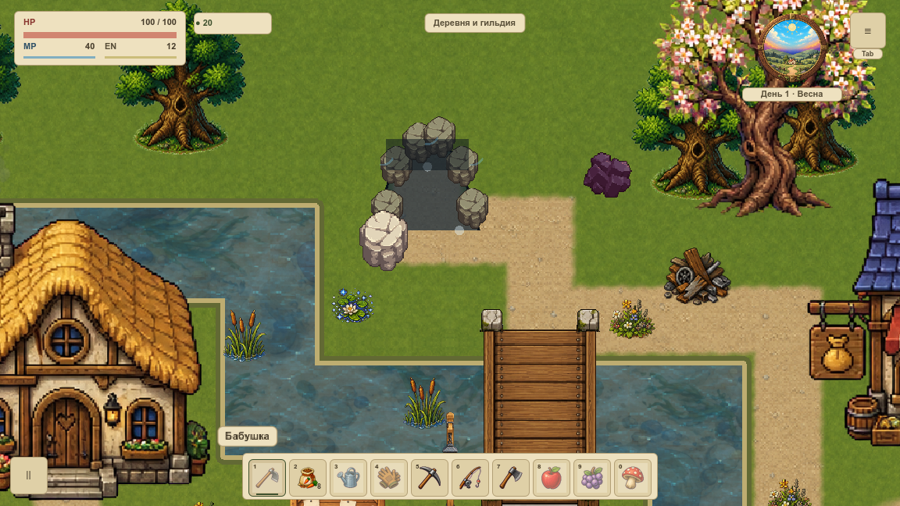
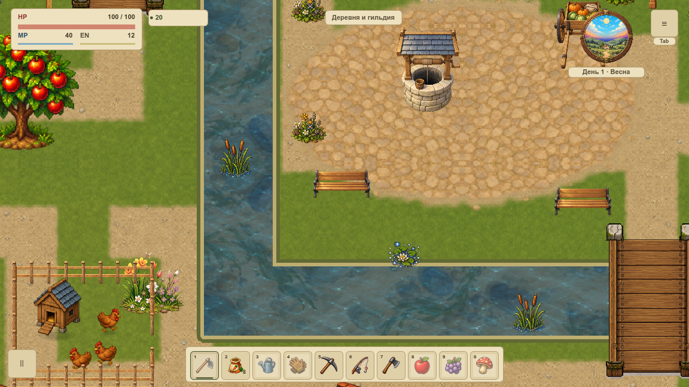

# VSHORE-006 · течение вдоль русла

В первой локации рябь движется вниз по реке. На прямых полосах движение горизонтальное или вертикальное, а на четырёх изгибах постепенно меняет направление. Берег, дно и пруд сохранили прежний рисунок.

| У западного моста · до | У западного моста · после |
| --- | --- |
|  |  |

| У деревенской площади · до | У деревенской площади · после |
| --- | --- |
|  |  |


## Реализация

- Осевые отрезки берутся из `WaterLayoutData.HOME_RIVER`. Углы связываются четвертями окружности. На входе и выходе расстояние по руслу и поперечное смещение совпадают с соседними прямыми. Геометрия, физические клетки и метаданные рыбалки остаются в общем `WaterTopology`.
- Две координаты хранятся в одном атласе 314×98. Он занимает 123 088 байт исходных RGBA8, создаётся при первом использовании и разделяется владельцами поверхности. В шейдере реки один дополнительный линейный выбор атласа. Пруд использует прежнюю рябь без чтения атласа. [Формат данных и фильтрация в Godot 4.7](https://docs.godotengine.org/en/4.7/tutorials/shaders/shader_reference/shading_language.html).
- Мировая скорость на оси составляет 1,5 px/с, полный период 64 с. Настройки обычного и низкого качества используют одну траекторию. Низкое качество пропускает мелкий блик. Пауза удерживает фазу; уменьшенное движение и эталонный режим дают статичную воду. Диагностический ключ `water_surface_directional=false` возвращает рябь VSHORE-005 в той же сцене.

## Проверки

Godot 4.7.1, Compatibility, AMD Radeon Pro 5300M, масштаб 120%, нативный кадр 1152×648. На трёх одинаковых камерах изменения ограничились рекой. Все пиксели суши и пруда, а также центр обоих настилов совпали. Кадр `upper-before.png` побайтно совпал с принятым `seam-normal.png` VSHORE-005.

Нативный верификатор сравнивает изменение яркости на трёх прямых и четырёх поворотах. На прямых движение на 10 мировых пикселей по руслу лучше объясняет следующий кадр, чем обратный, поперечный или неподвижный рисунок. На поворотах проверяется перенос по дуге. После обёртки фазы кадр совпал побайтно. При смещении камеры на 40 мировых пикселей в общей области из 25 830 пикселей изменились 26, каждый на один уровень RGB. WATER прошёл 918 проверок без ошибок. В нативной сцене прошли все 12 проверок паузы, продолжения, профилей, кеша, прямой отрисовки и игровых данных.

Четырёхсекундный ролик сохраняет 120 различных нативных кадров. Первые две секунды показывают нижний поворот с места, вторые проводят камеру через стык чанков. Сценарий задаёт частоту 30 кадров в секунду для выходного файла. Этот захват измеряет направление и согласованность рисунка.

[Захват и SHA-256 исходников](native/capture.json) · [Манифест для истории Wiki](native/comparison.json) · [Измерения](native/metrics.json).

```sh
python3 tools/run.py qa.world.river_flow --commit c874df4892fce54a81b4e21e39595e749898a526
```

Верификатор принимает `--commit <SHA>` для сверки 19 исходников через Git. Для повтора запустите `res://tools/qa/world/river_flow_capture.gd` с нативным дисплеем, новым абсолютным `--output`, изолированным `--profile=Codex-VSHORE-006-…` и `--base-commit`. Скопируйте `capture.json`, 14 неподвижных кадров и четыре исходных свидетеля в папку `--folder`. Первым запуском укажите `--raw` с каталогом всех 120 кадров, чтобы получить проверенный MP4. Вторым запуском укажите `--write-comparison`, чтобы независимо создать манифест для Wiki. Оба файла публикуются после проверки и защищены от перезаписи.

`python3 tools/run.py qa.world.test_river_flow` сверяет точный список обязательных путей и предка в Git. Тесты отклоняют замену обязательного пути другим подлинным Git-файлом, несуществующий базовый коммит и существующую базу из другой линии.
