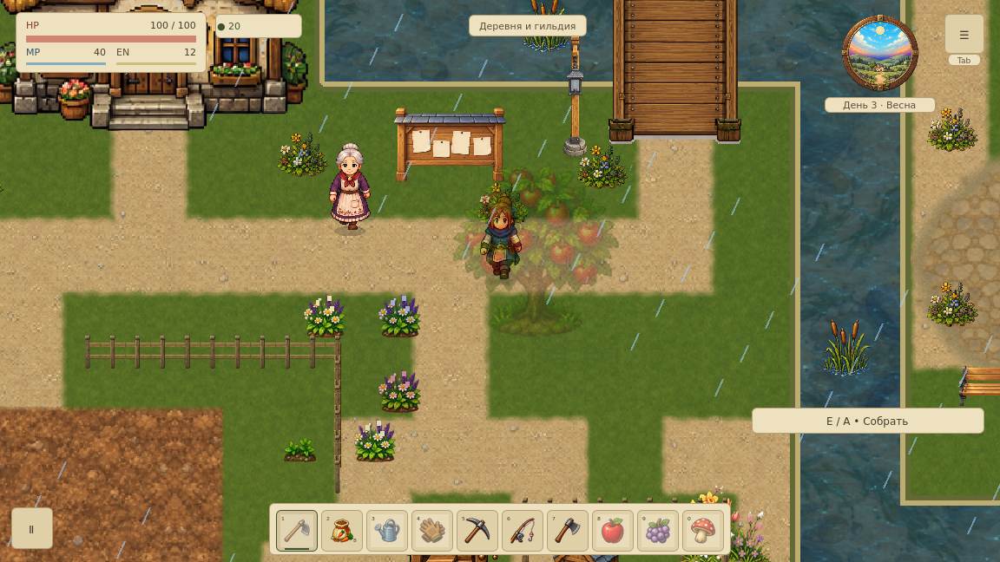
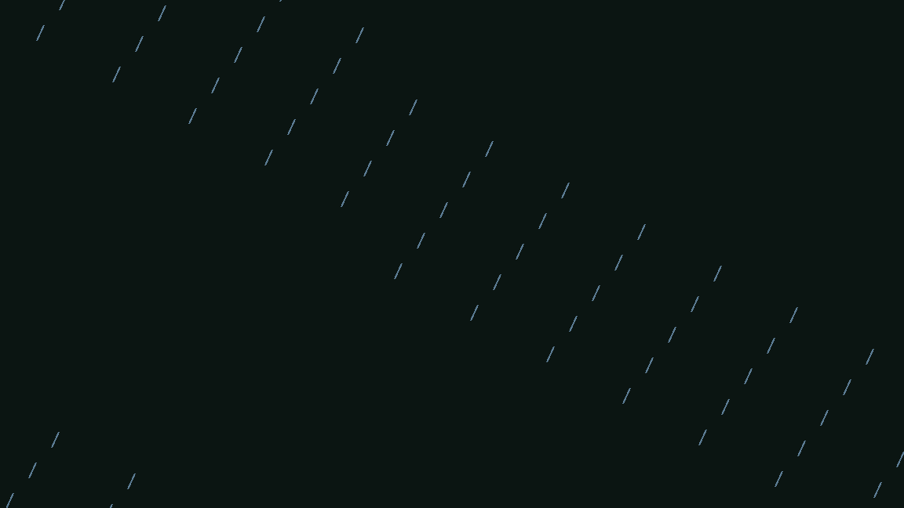
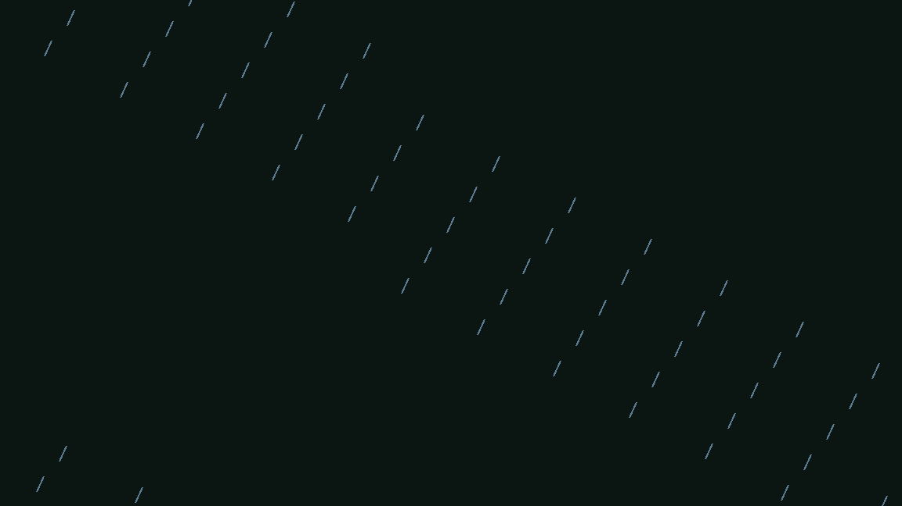
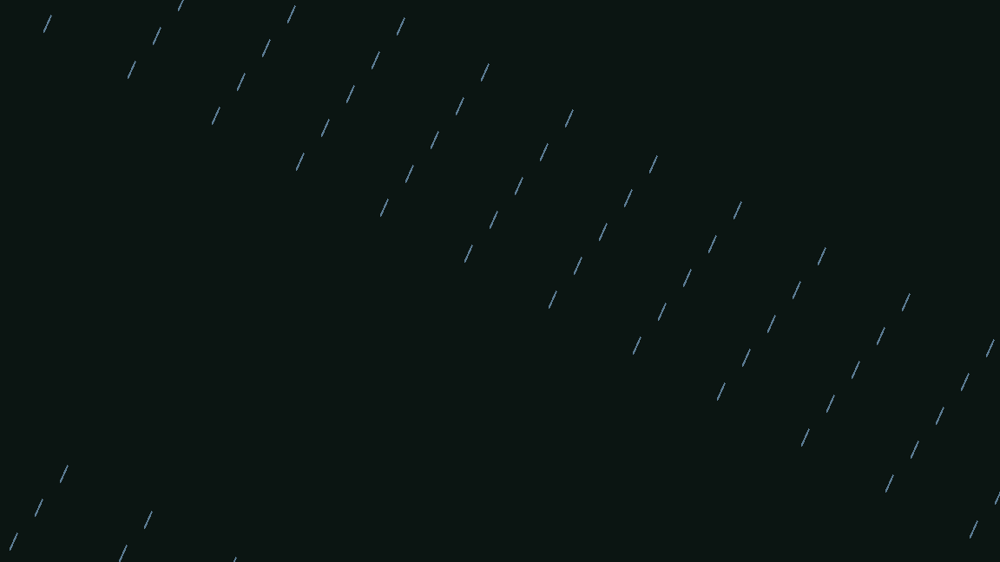

# VWEATHER-001 — согласованное время осадков

Реализация и новый нативный CI готовы в [draft PR №84](https://github.com/sergey-leonidovich-shevchenko/babushkina-ferma/pull/84). Снятый head — `8689c111392c4e2f93f9af0c78a4a5fa4bec5197`, версия 0.0.478. Полный комплект ещё не получил независимого одобрения; карточка остаётся `in_progress`, решения Team Lead и merge ещё нет. VMAP-003 не принят.

[План, база и полные зависимости](PLAN.md) · [Статья Wiki](../../../../wiki/articles/weather-clock.md) · [Инструменты](../../../../tools/qa/world/weather/README.md).

## Изменение

Дождь, снег и вспышка грозы читали системный `Time.get_ticks_msec()`, который продолжает идти при ручной паузе. Теперь их локальная фаза продвигается одним разрешённым delta после движения, рядом с публикацией визуального кадра. Часы не создают узлов или коллекции частиц: хранится один неизменяемый словарь из пяти числовых/строковых значений. Он принадлежит конкретным game/viewport/background и текущей комнате. Рисование только читает это значение.

Общая граница отмены transient при переходе, загрузке и восстановлении удаляет фазу старого визита. Ручная пауза, окна, фокус, редактор, reduced motion и reference не накапливают долг. В reduced motion сохраняются статичные осадки без вспышки грозы. Движение использует дробную фазу; форма, число и цвет существующих штрихов/снежинок сохранены. Общий прогноз и игровые события не переписываются. Затронутый `action_lifecycle_system.gd` целиком отформатирован по действующему quality gate; прежние операции отмены сохранены.

## Фактические проверки подготовки

- Штатный headless-импорт завершён без `ERROR`; эффективный отдельный OS userdata подтверждён, обычные каталоги не изменились, собственный override удалён.
- Исходный профиль имел ошибочное тестовое обращение к редактору. Прогон с `SCRIPT ERROR` отклонён; после исправления — 45 проверок / 0 отказов. Окончательный профиль, включая нечисловую/отрицательную фазу, прошёл 48 проверок / 0 отказов; `ERROR` нет.
- Шесть Python-контролей прошли: настоящий исходный Git/2936 игровых art-файлов, полный QA input closure, обязательные кадры/журналы, отказ локального нативного запуска и настоящие symlink/traversal. Первоначальная ошибочная оценка числа art-файлов исправлена по закреплённой базе; она не объявляется игровым дефектом.
- Для исходной подготовки `e3935bc9` прошли полный hook (quality 217/0, architecture 126 групп, Game 53 759/0, normal 90/0, F10 90/0) и post-bump Wiki 167/0. Первый CI сохранил все 160 PNG, но reader ошибочно требовал 120% внутри дома. Этот отказ сохранён в [диагностическом комплекте](failures/ci-01.json).
- Исправление `8689c111` прошло новый полный hook: quality 219/0, architecture 127 групп, Game 53 759/0, normal 90/0 и F10 90/0. [Сводка](native-ci-02/local-gates.json) и [дословные итоговые строки](native-ci-02/local-gates-output.txt) относятся к этому head; обычные userdata неизменны, собственный override удалён.
- Post-bump Wiki 0.0.478 прошла fresh export/build/TypeScript и 167 тестов. HTTP сверил точные commit/tree и байты сборки. В фактическом браузере открыты текущая карточка и маршрут: VWEATHER-001 в работе, прежние 83/93 и параллельная редакционная карточка. Статья проверена также при ширине 390 px; временный размер сброшен. Сервис 4174 помечен `working-task`.

## Нативная проверка

Перед публикацией обнаружена потеря seed при замене скрипта QA-сцены. [Один и тот же реальный probe](preflight/README.md) дал exit1 до адресного исправления и exit0 после. Полный hook прерван и не принят; окончательный профиль дополнен проверками настоящего producer и прошёл 50 условий / 0 отказов. Native reader требует сохранённый seed 20261015.

Успешный [CI №44948199161](https://github.com/sergey-leonidovich-shevchenko/babushkina-ferma/actions/runs/44948199161) снял настоящую базу `0ca4eb345933d2766b340f3d79ea45fb4f38cf5b` и exact head `8689c111`, без renderer-оверлеев production. Два физических окна 1152×648 и 1280×720, принятая камера 120% на `overworld` и прежние 100% в доме, одинаковый seed, четыре естественных прогноза и полный игровой снимок. Изолированный QA canvas вызывает тот же `AtmosphereRenderer`; он позволяет проверить все пиксели осадков без движущихся соседних эффектов. Полный production root также сохранён для контекста.

Сохранены [исходный CI ZIP](native-ci-02/artifact.zip), [привязка к источникам и фактическая матрица](native-ci-02/summary.json). SHA256 ZIP — `4b68fa34dc99c25f1d6b3dc159dd361589b8194a247a714ee474487d636eaa56`, размер 20 851 843 байта. Локальный `archive --expected-head 8689c111392c4e2f93f9af0c78a4a5fa4bec5197 --check-current-candidate` на чистом head прошёл: 160 PNG, четыре серии, exit0.

| Окно | Пауза дождя/снега/грозы | Возобновление | Вход и возврат |
| --- | --- | --- | --- |
| 1152×648 | 0.04 → 0.04; RGBA совпадают | 0.06; осадки двигаются | фаза 0 |
| 1280×720 | 0.04 → 0.04; RGBA совпадают | 0.06; осадки двигаются | фаза 0 |

Во всех шести исходных парах baseline RGBA меняются за реальное ожидание. В кандидате также совпадают reduced motion PNG, гроза в этом режиме равна дождю без вспышки. Два настоящих SubViewport имеют разные game/viewport/background: первый остаётся на 0.02, второй продвигается с 0.04 до 0.06. Полные snapshots, положение героя и камера сохраняются; исходная/новая полные сцены имеют одинаковый игровой снимок и камеру. Пустой дождь, неподвижный resume, ложные размеры, подставная фаза или неполный архив дают отказ.

[Оригинальный CI1 и его SHA](failures/ci-01.json) сохранены с полным ZIP. При прежней политике камер тот же архив даёт exit1, при исправленной — exit0/160 PNG. Четырнадцать проверок `qa.world.weather.test_reader` проходят на копиях этих реальных данных, включая запуск прежнего CLI из captured Git, обе ошибочные камеры, движущиеся paused PNG, пустой дождь, скачок времени, чужой clock/owner, грязный save, ложное окно и небезопасные ZIP-записи. Исходный архив неизменён; статус CI1 остаётся `failure`. Его данные подтверждают регрессию reader, а не принятую карточку.

`qa.world.weather.archive --archive <ZIP> --expected-head <SHA>` использует тот же verifier через временную папку. ZIP хранится целиком; PNG не становятся игровыми ресурсами. `--check-current-candidate` дополнительно требует чистый текущий runtime/producer, допуская только объявленный SemVer bump. После документального коммита этот контроль выполняется заново; любое изменение production или frozen QA требует новой съёмки.

## Фактическое сравнение

Ниже исходные PNG из успешного CI; пиксели не пересобраны. Фазы другой существующей листвы могут различаться, поэтому пауза проверяется на изолированном слое того же renderer. Это не новый дизайн всего окружения.

Принятая база, полный дождливый кадр:

Кандидат, та же камера и игровой снимок:

| Версия | Первый кадр на паузе | После реального ожидания |
| --- | --- | --- |
| База |  |  |
| Кандидат |  |  |

Просмотрены также полные кадры [снега](native-ci-02/candidate-snow-full.png), [грозы](native-ci-02/candidate-storm-full.png) и [изолированный слой после настоящего входа в дом](native-ci-02/candidate-rain-interior.png). Последний всё ещё содержит дождь: новая маска крыш остаётся за VWEATHER-003.

## Границы приёмки

Проверка крыши фиксирует существующее поведение: полноценная маска крыш принадлежит VWEATHER-003. Этот пакет не закрывает новую форму дождя, навесы, снежный покров или весь VWEATHER. 36 000 модельных шагов — проверка времени и ограниченности данных, не десятичасовая игровая сессия. X11/llvmpipe не принимает Retina, GPU/FPS или VMAP-003.

Откат — отдельный обычный revert принятого изменения, с сохранением совместимости слотов. Отчёты прошлых карточек, остальные 1036 visual-карточек и parallel planning не переписываются. Точные SHA независимой приёмки будут записаны после её получения.
