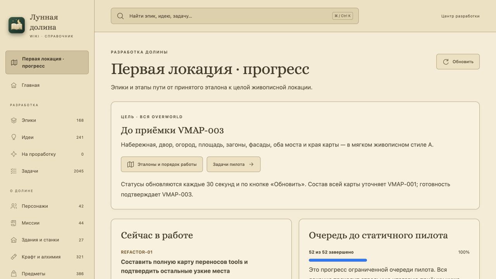
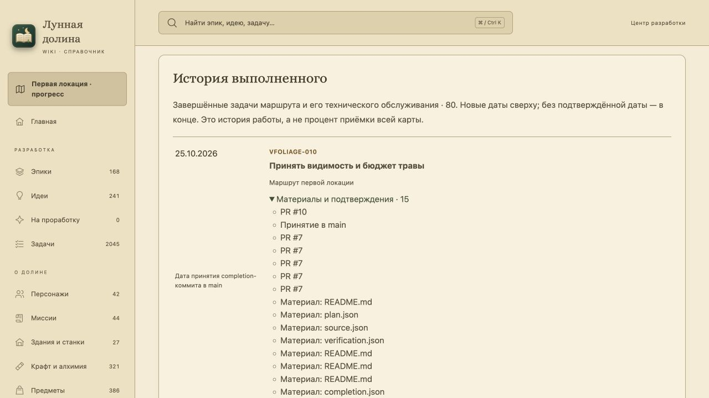
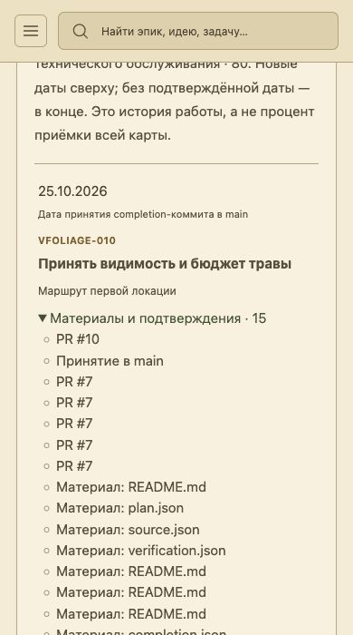

# WIKI-003 — текущая работа и история первой локации

Поручение26 октября2026 после передачи REFACTOR-01 на ревью. Исходный дефект: активные карточки ограничены22 visual/WATER-эпиками, поэтому реальная техническая REFACTOR-01 не видна. Изменение отдельно от PR14 и переносов tools; статусы и исторические доказательства сохраняются.

## Поведение и источники

Активный блок показывает все in_progress того же канонического каталога. Сначала технический REFACTOR, затем маршрут, обслуживание Wiki/базовые PERF/SAFE/QA/UX и другие направления с явным контекстом. История включает только done маршрута и технического обслуживания; редакционные IDEA-обзоры и другие карты в неё не входят. Пять групп/22 эпика, VMAP001…003/VRELEASE001…005,52 карточки пилота и итоговая VMAP003 сохранены. Это классификация объёма, не второй реестр готовности.

Приоритет даты: принятое в main событие Task-Complete → явное поле завершения или ISO-дата в начале результата карточки → «Дата не указана». Для merge берётся дата принятия, не дата автора feature-коммита. Невлитые ветки исключены общим принятым предком HEAD и origin/main (локальная main — резерв). Без Git даты карточек работают; неизвестные остаются неизвестными. Mtime и даты файлов/планов не используются. Для повторного completion берётся последнее принятое событие; одинаковые календарные даты и неизвестные даты сохраняют порядок каталога. Статус done остаётся решающим: дата/trailer не превращают ready/in_progress в завершение.

Git читается с очищенным GIT_окружением, без сетевых вызовов и записей. Индекс принятого commit кешируется в памяти по root+SHA, задачи/статусы пересобираются при каждом запросе. PR берутся из карточки; относительные материалы ссылаются только на пути, существующие в закреплённом принятом Git. Дата не восстанавливается по упоминанию ID/порядку/mtime. Прежние отчёты не меняются.

## Изолированная браузерная проверка

qa-server.mjs читает временную JSON-копию каталога; POST запрещён. Для исходной жалобы карточки REFACTOR прочитаны через git show из фактически опубликованного head c9cea3aef393380f2abdd3c9ef126acbd58c366b PR14, SHA сохранён. Это QA-снимок действительной работы соседнего PR, не принятый статус main и не запись в канонические файлы. Refresh меняет статусы только в tmp/wiki003-browser-catalog.json.

## Полученный результат

Wiki build/TypeScript и145 Node-сценариев прошли. Architecture:82 Python-набора/1135 случаев, historical reader512/36/24 и34 visibility-контроля. Финальный успешный footer сохранён; session exit после прерывания чата недоступен. Game53502/0 и normal/F10 по90/0 прошли отдельно. Игровые/tools исходники неизменны. Последние Wiki-правки ссылки и строгого trailer проверены текущим полным Wiki-набором. [Сводка и SHA](checks.json), [границы исходников](validation/scope.json).

Desktop1280/1280px: настоящая REFACTOR01inprogress из PR14, переход к её карточке,80 строк истории,20 неизвестных дат, пилот52/52; VMAP003 не принят. Изолированный технический переход автоматически меняет историю80→81, пилот остаётся52/52. Кнопка показывает пустое состояние, когда в fixture нет in_progress.390/390px измерены в same-origin iframe высотой700px; проверены меню, карточка и раскрытие подтверждений. Это responsive-layout, не физический телефон. Прямой viewport override сначала не применился; поздний390-кадр назван responsive-intermediate, новая финальная desktop-сессия измерена1280.

Первый финальный Wiki-build отверг новую ссылку на существующий first-location. Guard адресно разрешает этот board и продолжает отвергать дочерний путь/query/hash; регрессия включена. Ошибка старта Game после потери переменных при прерывании сохранена; реальный полный запуск прошёл. Прежние отчёты не менялись.

Карточка остаётся in_progress до exact-head CI, независимого ревью Tech Lead и решения Team Lead. Task-Complete отсутствует. PR14 REFACTOR01 сохранён отдельно и ожидает независимого принятия.
