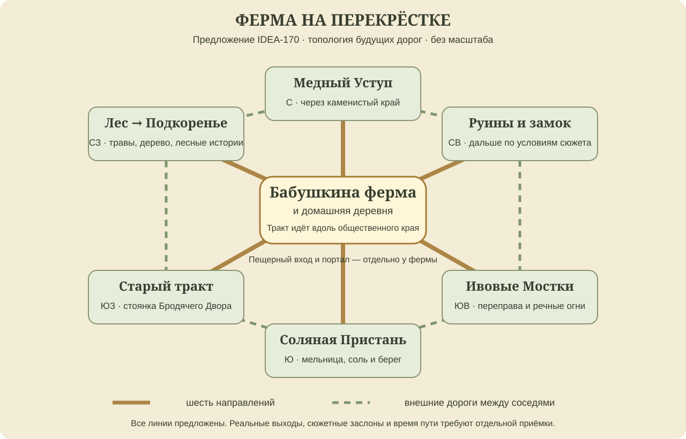

# IDEA-170 — Игровая карта и ферма на перекрёстке шести дорог

**Предложение по прямому запросу пользователя.** Бабушкина ферма становится центральным местом возвращения между шестью направлениями долины. Игрок открывает карту одной командой, переключается между всем миром и текущим поселением, видит своё положение, известные дороги и открытые подземные срезки. Дороги дают повод проходить рядом с домом, а кухня, семья, склад и мастерская делают возвращение полезным.

Это дизайн будущего развития. Новые дороги, перенос географии и интерфейсные изменения не внедрены; очередь первой живописной `overworld` до VMAP-003 сохраняется. Статус идеи — предложение, игровые эпики и дочерние задачи пока не поставлены.

## Что уже есть в игре

Команда `M` уже открывает раздел «Мир»; на странице карты `V`, `R3` или экранная кнопка переключают общую схему и шесть районов домашней деревни. Открытое меню останавливает мир. `WorldMapSystem` определяет текущий регион и сюжетную цель, `VillageRegionMapRenderer` показывает связи районов и дневные места жителей. Это основа для развития, а не отсутствующая система.

Нынешняя общая схема и `WorldMapSystem.CONNECTIONS` не являются владельцем настоящих межрегиональных переходов. Макромаршрут задаёт `WorldSystem`, внутренние пещерные связи — `CaveRoomData.LINKS`, деревенские проходы — `VillageRegionData`. Нарисованная линия не открывает дверь. Перед внедрением новый дорожный граф и его сюжетные условия нужно согласовать с этими владельцами.

## Как игрок открывает карту

- **`M` из мира** открывает именно страницу «Карта» раздела «Мир», даже если последним был справочник рецептов. Впервые в новой области выбран её локальный вид; в уже посещённой области запоминается последний выбранный вид.
- **`V` / `R3` / две видимые кнопки «Мир» и «Местность»** переключают масштаб. Подпись местности конкретная: «Домашняя деревня», «Ивовые Мостки», «Грибной зал». Текущий вид обозначен текстом и формой вкладки.
- **«Поверхность» и «Подземелья»** — отдельный выбор слоя внутри мировой карты. В пещере по умолчанию выбран подземный слой; выбор поверхности не перемещает героя. Надпись указывает «Вы под землёй, под …», только если привязка уже известна.
- **`M`, `Esc`, `B` или ×** закрывают карту. Если редактируется подпись метки, первое `Esc` отменяет ввод, следующее закрывает окно. Нажатие карты не становится игровым ударом при закрытии.
- Мышь и касание используют те же видимые кнопки. На геймпаде раздел «Мир» доступен через нынешнее общее меню; подсказки адаптируются к устройству. Левый/правый плечевой ввод сохраняет общие вкладки меню, новые конфликты не вводятся.

В помещении «Местность» показывает поселение с выделенным зданием и подписью «внутри», а не притворяется картой комнаты. Для отдельного большого подземелья показываем только открытые залы/этажи. Если местность ещё не имеет схемы, остаются имя, известный выход и честная надпись «Подробной карты пока нет»; чужая домашняя деревня вместо неё не рисуется.

Выбор знакомого поселения на мировой карте открывает его изученную локальную схему через «Рассмотреть». Отдельная команда «К герою» возвращает текущую область. Просмотр, масштабирование и отметка никогда не запускают ходьбу, телепортацию или расход ресурсов. Доступность пути проверяется игровым состоянием, а не наличием рисунка.

## Два уровня подробности

**Мир** отвечает на вопросы «где я», «куда ведёт эта дорога» и «как вернуться домой». Видны дом, известные поселения, освоенные входы, выбранная цель и состояния соединений. Шесть направлений фермы получают постоянные названия. Изученное поселение можно выбрать без раскрытия чужих секретов. Карта ориентирована севером вверх; поворот камеры не вращает подписи.

**Местность** показывает районы, улицы, мосты, здания с известными услугами, выходы, текущую точку героя и его направление. Для домашней деревни сохраняются шесть настоящих районов — это не шесть новых поселений. Будущий подробный план уточняет их связность и ориентиры, сохраняя реальные входы. Подписи жителей обозначают известное место работы/встречи, а не всеведущее слежение за NPC. Открытая по просьбе NPC цель может показывать согласованное место встречи.

Панель легенды содержит фильтры «Услуги», «Цели», «Проходы» и «Мои метки». Герой, дом и действующая цель остаются читаемыми при скрытых второстепенных значках. В первом объёме не нужна отдельная постоянная мини-карта на HUD.

## Ферма в центре долины

Центр означает удобное положение в сети дорог и примерно в середине обитаемой поверхности. Дальние хребты, проклятая земля и море могут расширять контур несимметрично. Дом не обязан совпадать с математическим центром каждого слоя. Ниже выбраны **шесть основных направлений**, а не шесть дополнительных деревень:

| Направление от фермы | Основная область и ориентиры | Зачем туда ходить и как растёт опасность |
|---|---|---|
| Северо-запад — лесная дорога | Лес, башня мага → Подкоренье | Древесина, травы, семена, лесные истории. Сначала знакомые G1–G2; более опасные боковые поляны отдельно |
| Север — каменная дорога | Каменистый край → Медный Уступ | Руда, кузнец, ремесло, наблюдение за камнеходом. Доступные подходы G2, шахтные/горные ответвления сложнее |
| Северо-восток — старый дозорный путь | Орочьи руины → подход к Лунному замку | Основной сюжет, спасение спутников и расследования. Начало спокойно, опасные руины и сюжетные ворота отделены от дороги домой |
| Юго-восток — речная дорога | Переправа → Ивовые Мостки | Рыбалка, плетение, лодочник, фонарные праздники. Жилые мостки безопасны; речные испытания в стороне |
| Юг — береговой тракт | Водяная мельница → Соляная Пристань | Соль, рыба, общий стол, береговые вылазки. Безопасная пристань не означает ранний доступ к кораблю и морскому разлому |
| Юго-запад — старый торговый тракт | Дорожные луга и постоянная стоянка Бродячего Двора | Путники, сезонная ярмарка, театр, обмен. После ухода общины остаются дорога и место привала, а не пустая тупиковая локация |

На схеме крайние пункты обозначают региональные направления. Дорога к Подкоренью проходит через лес, к Медному Уступу — через каменистый край; эти промежуточные области сохраняются. Направление не равно одной двери и не обещает прямой переход в поселение. Река пересекает центральную долину; горы остаются севернее, море — южнее. Положение замка, стеклодувной, проклятой земли и корабля уточняется при следующем географическом рисунке без изменения порядка восьми глав.

Вход в существующие пещеры и портал Лунной поляны сохраняются у фермы отдельно. Они не заменяют два из шести наземных направлений. Шесть пещерных комнат и их действующие связи не перестраиваются ради симметрии поверхности.

## Почему здесь будут проходить люди

Главный тракт идёт вдоль **общественного края** фермы: указатель, мостик, ворота домашней деревни и место привала видны с дороги. Спальня, двор животных и грядки находятся за своей оградой; NPC и караваны не выбирают путь через частные посадки. Выходы могут расходиться из нескольких соседних районов домашней деревни, чтобы не создавать шесть телепортирующих дверей вокруг одного дома.

Обратный путь часто удобно совместить со складом, готовкой любимой еды работников, ремонтом, семьёй, сменой спутников и лавкой. Достаточно существующих и уже предложенных занятий; новый обязательный налог за проход или постоянная доставка отчёта бабушке не нужны. Целевая гипотеза: в 4 из 10 правдоподобных поездок между противоположными направлениями путь около дома естественно удобен, хотя бы ещё в 3 игрок имеет сопоставимый обход. Это проверяется на сценариях, не подгоняется перекрытием альтернатив.

Связи между соседними направлениями образуют внешние дороги. Три прежние срезки сохраняют свои пары: домашняя деревня ↔ Ивовые Мостки, Подкоренье ↔ Медный Уступ, Ивовые Мостки ↔ Соляная Пристань. После открытия они по-прежнему целятся в 45–55% времени соответствующей наземной дороги с дверями. Новая центральность не отменяет их пользу и не требует снова побеждать босса.

Пешеходный поток — отдельное будущее расширение. В первом объёме принять граф и проходимость, затем разрешить 1–2 короткие встречи с путниками за игровой день как гипотезу плотности. Дальний караван не симулируется поклеточно на всех картах; фоновое расписание и персонажи сохраняют свои ID. Бродячий Двор и личный караван игрока остаются разными системами.

## Исследование и достоверность отметок

Состояния места: **неизвестно → известно по рассказу → посещено**. Рассказ жителя может открыть приблизительный знак и название поселения без его внутренних улиц. Переход по рассказанной дороге не считается уже пройденным. Не найденные секреты, скрытые ловушки, добыча и непосещённые боссы не выдаются готовыми значками.

У дороги отдельно хранятся знание и доступ: «известна по рассказу», «пройдена», «заперта известным препятствием», «открыта». Сплошная линия — пройденный доступный путь; пунктир — известное направление; закрытый знак сопровождается конкретной известной причиной. До знакомства с причиной пишем «Проход закрыт», не раскрывая имя босса. Пиктограмма и подпись дублируют цвет.

Начальные гипотезы — до 20 пользовательских меток, четыре формы («вернуться», «ресурс», «опасность», «интересное») и подпись до 32 знаков. Установка, перенос и удаление имеют явные команды; одиночный выбор лишь показывает карточку. Новая метка сверх лимита предлагает удалить/заменить выбранную старую без молчаливой потери. Метка известного NPC не превращается в радар его текущей позиции.

Маркер цели на другом слое указывает ближайший **известный допустимый** переход; если путь неизвестен, показывает известную область без выдуманной навигационной линии. В первом объёме достаточно выделенных выходов и цепочки знакомых областей, без автоматического поиска по каждой клетке. Точное время до цели не показываем до измерений; стартовая гипотеза ферма → первый значимый ориентир — 30–60 секунд чистой ходьбы, до ближнего поселения — 90–180 секунд. Размер карты, бои и загрузки ещё требуют проверки.

## Пошаговый сценарий

1. На второй спокойной прогулке бабушка показывает указатель у дороги: «Дом между шестью дорогами». Короткая подсказка предлагает `M`; можно пройти дальше и открыть позже.
2. На локальном плане выделены герой, дом и лесной выход. Игрок выбирает выход, читает «Лесная дорога», затем нажимает `V` и видит положение в долине.
3. После знакомства с жителем Ивовых Мостков на мировой карте появляется рассказанное название. Внутренний план остаётся закрытым до визита.
4. На пути к реке игрок осматривает закрытый нижний ход, ставит метку «вернуться». После открытия карта получает настоящее состояние срезки от владельца UNDERWAY; ручная отметка сама решётку не открывает.
5. В Ивовых Мостках `M` впервые показывает их план: мостки, знакомые услуги, вход и герой. «Мир» возвращает общий вид, «К герою» после просмотра другой деревни снова выделяет Ивовые Мостки.
6. По дороге в Медный Уступ удобно пройти у домашнего края: сдать груз, взять блюдо работнику, продолжить путь. Для следующей соседней поездки можно выбрать внешний тракт или освоенный подземный ход.

## Вид интерфейса и обратная связь

Светлая живописная карта с ясными дорогами, спокойной бумажной подложкой и крупными подписями следует принятому направлению VART и `MoonStyle`. Географию упрощаем для чтения, но не зеркалим стороны выходов. Текущий герой — стрелка с обводкой, дом — отдельный знакомый знак. При фильтрации и масштабе подписи группируются; здания не перекрывают героя.

Команды масштабирования «− / +», «Вместить» и «К герою» всегда имеют кнопки; колесо/щипок и назначенный после аудита ввод геймпада — ускорения, а не единственный способ. Стартовые 1×, 1,5× и 2× проверяются на реальном UI-масштабе. Фокус проходит видимые элементы в понятном порядке, подсказки не требуют наведения мышью. Узкий экран складывает карточку выбранного места под картой и сохраняет кнопки.

Открытие — тихий шорох бумаги, выбор — короткий сухой щелчок, новое известное место — мягкая отметка в легенде. Никакого постоянного мерцания всех значков. Reduced motion убирает перелёт между масштабами и пульсацию. Пауза замораживает бой, календарь, отравление и прочие системы по действующему общему контракту; закрытие не догоняет пропущенное время.

## Сохранения зависимости и риски

`location-ID`, `area-ID`, `route-ID` и `entrance-ID` постоянны. Вид карты хранит ссылку на них и нормализованную локальную позицию, а не индекс подписи или экранные пиксели. Состояния дверей и сюжетные флаги читает у владельцев, не создаёт вторую копию. Данные исследования, метки и предпочтения масштаба разделены. Неполный старый слот сохраняет имеющиеся открытые области; новые схемы добавляются без переезда дома, инвентаря, NPC или флагов. Неизвестная устаревшая метка остаётся недоступной записью до явного исправления, а не переносит героя.

Сам перенос фермы в центре будущего мира — отдельный проект географии после визуальной приёмки. Не сдвигать координаты действующей `overworld` и вещи старого слота. Если меняется только место значка на общей схеме, этого недостаточно: прежде принять реальный граф, входы, сюжетные заслоны и безопасные возвраты. Одновременное открытие всех шести направлений не обязательно; поздние выходы видимы с понятным препятствием и проверкой с обеих сторон, без доступа к замку раньше сюжета.

Связанные владельцы: ATLAS — исходные рисунки, IDEA-067…072 — поселения, IDEA-151 — экспедиции, [IDEA-169](IDEA-169.md) / UNDERWAY — срезки, [IDEA-166](IDEA-166.md) — грузовой караван, [IDEA-073](IDEA-073.md) и [ступени сложности](bestiary-progression.md) — встречи. Карта показывает разрешённые знания этих систем. CAMP, отношения, артель и новые деревни не становятся обязательными блокерами первого улучшения карты.

Риски: декоративный центр без удобных маршрутов; обязательный крюк через дом; утечка секретов; несогласованные этажи; ввод, проходящий сквозь меню; дубли открытий в save. На первом этапе проверять одну настоящую домашнюю область и один выезд. Графовые данные кешируются по изменению открытия, значки — по фильтру/масштабу; дальний живой мир не обновляется ради карты каждый кадр. Цифры производительности принимаются на нативном устройстве отдельно, не по браузерному макету.

## Порядок будущей проработки

1. **Аудит карты и ввод.** Зафиксировать текущие `M`/`V`/`R3`, паузу, меню и сохранение; составить точный контракт двух видов без потери действующих справочников.
2. **Ферма и шесть направлений.** Принять географию, названия входов, внешний обход, безопасный край и таблицу 10 пробных поездок с замерами. Сверить поздние двери и три срезки.
3. **Минимальный полезный интерфейс.** Настоящая домашняя схема, мир, текущий герой, дом, выходы, выбранная цель, прямое открытие страницы и работа всех устройств ввода. Непостроенные поселения честно без подробного плана.
4. **Знание мира и метки.** Рассказанные/посещённые места, постоянные ID, лимиты, фильтры и миграция старого слота.
5. **Другие местности и подземный слой.** Подключать схемы по мере реальной готовности, включая известные этажи и состояния срезок.
6. **Поток путешественников.** Отдельно проверить расписания и безопасность фермы, затем караванные сценарии и бытовые встречи.

Эти пункты — кандидатный состав будущих задач, не зарегистрированные игровые карточки. При постановке использовать отдельные ID с индивидуальной приёмкой и источником. Приоритет P1 для карты и графа, сложность M для первого интерфейсного этапа и L для реальной географии; поток NPC — P2/L. Игровая очередь начинается после VMAP-003 и актуального аудита владельцев.

## Наблюдаемая будущая приёмка

- `M` после просмотра рецептов открывает карту; `V`/`R3` и экранные кнопки меняют только вид. Закрытие не наносит удар и не двигает героя. Другие страницы меню сохраняют доступ.
- В каждом из шести домашних районов, доме и кузнице показаны правильные местность/здание/выход; на неизвестной новой местности нет ложной карты стартовой деревни.
- В пещере выбран подземный слой. Просмотр поверхности, иной деревни и «К герою» возвращает правильные слой и область; этажи не смешиваются.
- Неизвестное место не раскрыто; рассказ открывает приблизительный ориентир, визит — локальную схему. Редкий босс и секретная комната до знакомства не видны.
- Три срезки отображают одно настоящее двустороннее состояние. Перезапуск после открытия не закрывает их, не возвращает босса и не выдаёт награду повторно.
- В 10 согласованных поездках измерены пути через ферму и обходы. Выполнена гипотеза удобства без запрета альтернатив, минимум один соседний маршрут выгоднее по внешней дороге. Нет скрытого обхода сюжетного доступа.
- NPC и тележка проходят общественным краем, не ломают ограду, не топчут посадки, не блокируют сон/услуги/выход. Уход Бродячего Двора не удаляет тракт и сохранённые знакомства.
- 20 меток сохраняются; 21-я не уничтожает старую автоматически. Подпись длиннее лимита не ломает раскладку; одинаковые названия мест различаются по ID. Старый слот не теряет вещи, открытые районы и сюжет.
- Мышь, клавиатура, геймпад, касание, узкий экран и увеличенный UI позволяют выбрать место, переключить вид, прочитать легенду и закрыть карту. Во время паузы не проходят яд, календарь и бой; после закрытия нет скачка времени.

Редакционная ATLAS-03 проверяет сохранение этой идеи, схемы и иллюстраций в Wiki. Перечисленные игровые сценарии остаются будущей приёмкой.

## Нарисованные карты для ориентира

Эти три рисунка сохраняются как исходный прототип ATLAS-00. На поверхности v1 ферма ещё с западного края: **для новой проработки выбираем центральную схему выше**, а живописную географию поверхности перерисуем после принятия дорог. Подземный лист сохраняет реальные пещерные связи; положение на бумаге и названия обходов не задают новые компасные стороны после переноса поверхности. Сюжетный лист сохраняет порядок глав, а не масштаб пути.

[Исходный атлас](world-atlas-prototype.md) · [Покрытие прежних идей и задач](world-atlas-coverage.md) · [Карточка редакционной подготовки](#/development/tasks/atlas--ATLAS-03).
