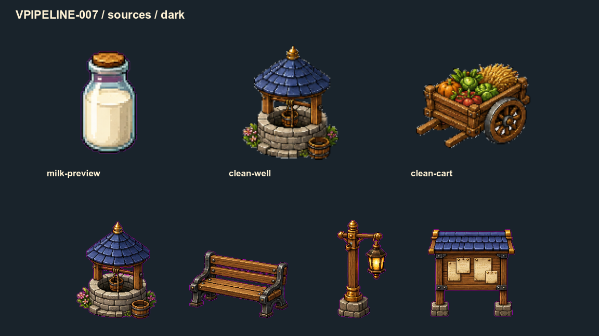
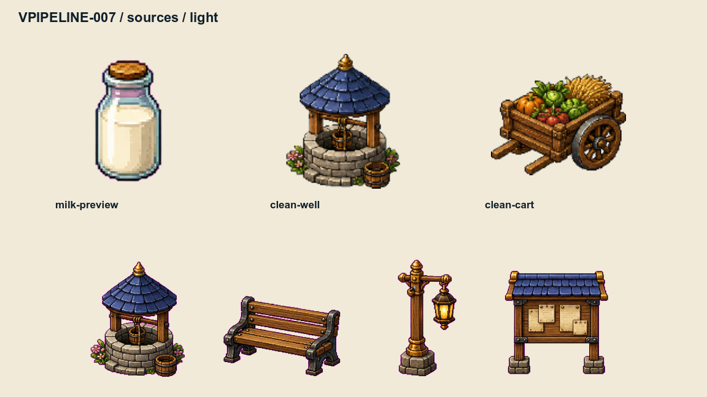
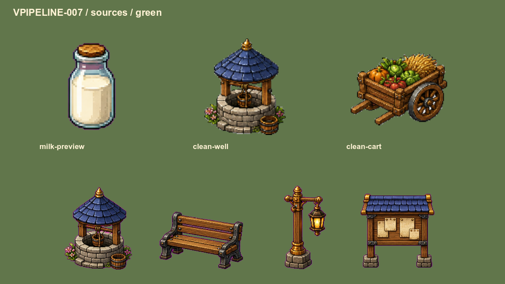
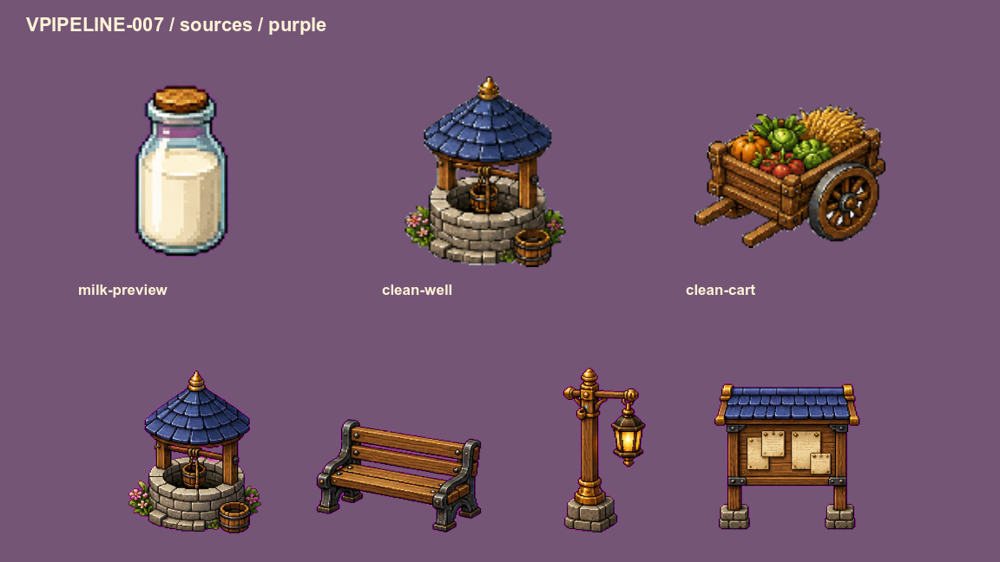
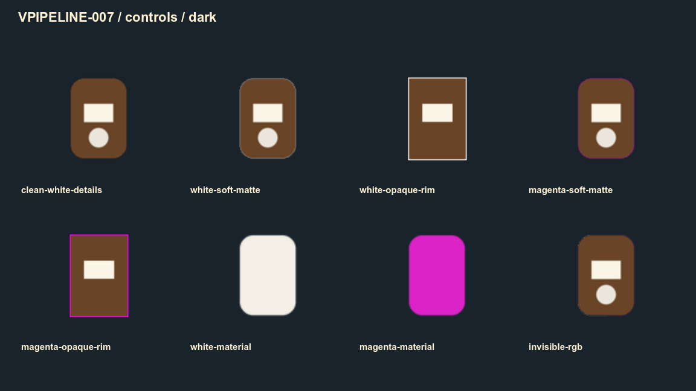
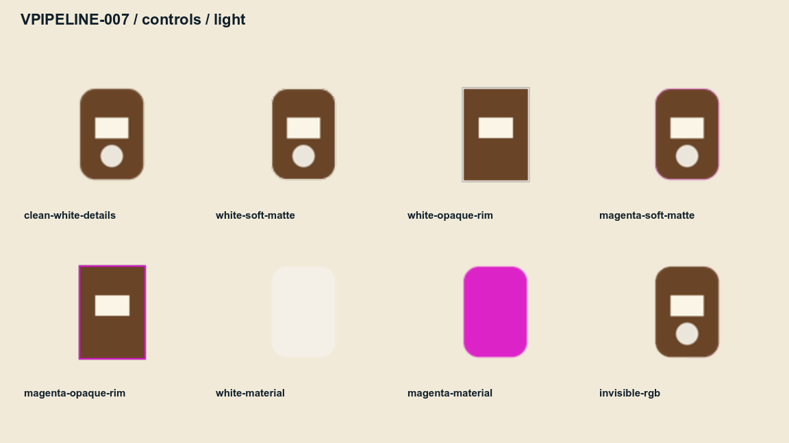
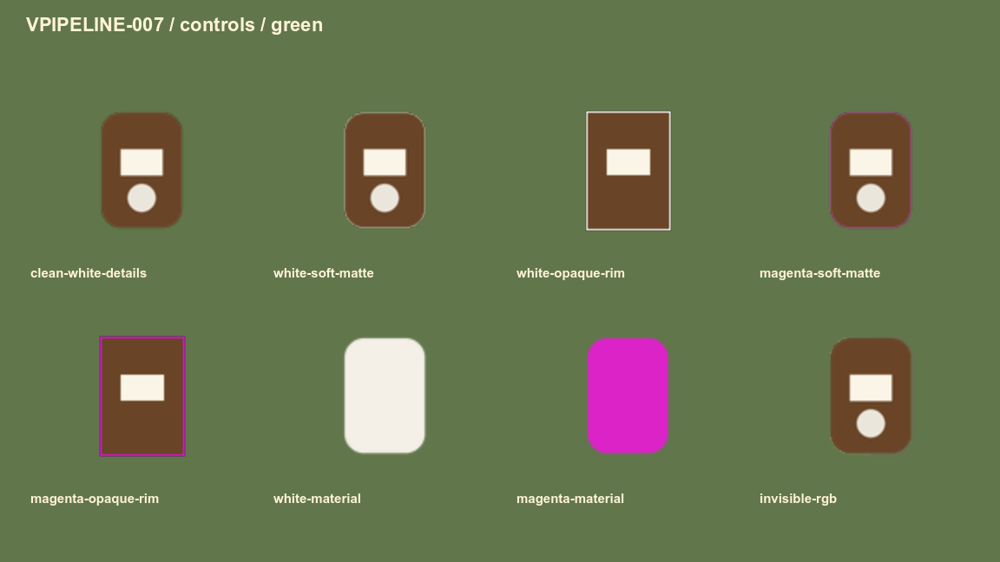
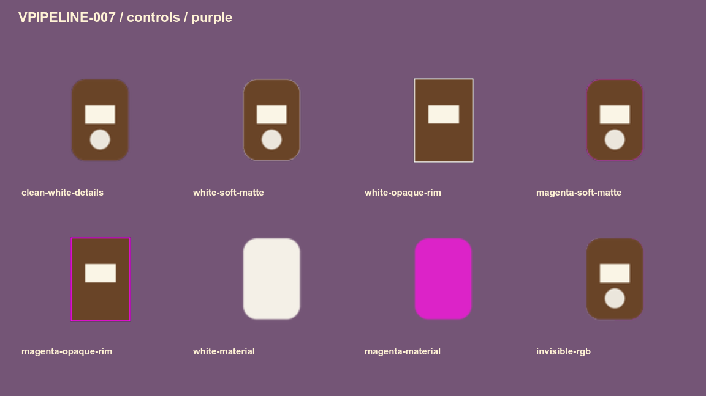

# Альфа-края: кайма и настоящие белые детали

**VPIPELINE-007** добавила проверку краёв изображений перед публикацией. Она ищет возможную белую или пурпурную кайму и показывает её на контрольных фонах. Игровые PNG инструмент не перерисовывает и белые детали не удаляет.

## Что обнаружено

Проверены **1181 PNG** из игрового дерева. У **311** есть подозрительные участки. Это кандидаты для просмотра: некоторые относятся к старым атласам, которые могут не использоваться или обрабатываться отдельно; некоторые могут быть настоящим бликом, тесьмой или свечением. [Полный список кандидатов](alpha-candidates.md) доступен здесь же в Wiki.

В действующем крупном превью молока видна пурпурная кайма: отчёт отметил 93 пикселя. Перерисовка уже имеет владельца **VICON-193 — «Парное молоко — иконка и превью»**. У текущих отдельных источников колодца и телеги сигналов нет. В нижнем ряду показана верхняя половина старого атласа, чтобы сравнить сырую кайму; этот ряд не доказывает её присутствие в текущем игровом кадре.

## Как отличить кайму от материала

Инструмент сравнивает край с близким непрозрачным участком. Мягкий край дополнительно проверяется на смешивание с посторонним фоном. Один только белый цвет не означает ошибку: белая ткань, кость и блик остаются частью рисунка. Проверяются и непрозрачные белые/пурпурные полосы.

На контрольных листах верхний ряд: чистый предмет с белыми деталями, белая мягкая кайма, белая непрозрачная полоса, пурпурная мягкая кайма. Нижний: пурпурная непрозрачная полоса, белый материал, пурпурный материал и скрытые RGB при нулевой альфе. Это числовые тестовые картинки для диагностики, а не новый игровой арт.

Все четыре намеренных повреждения обнаружены. Чистые белые детали и белый/пурпурный материалы прошли без сигнала. В нативных кадрах на всех четырёх фонах точно сохранились:

| Контроль | RGB |
|---|---|
| Белая деталь | 250 / 245 / 230 |
| Белый материал | 244 / 240 / 231 |
| Пурпурный материал | 220 / 35 / 200 |

## Скрытый RGB тоже имеет значение

При нулевой альфе цвет сам по себе невидим. Однако сырая линейная фильтрация может смешать его с краем: контроль со скрытыми белыми/пурпурными RGB дал видимую разницу против чистого предмета. Поэтому отчёт хранит этот показатель отдельно, а просмотр на фонах остаётся обязательным. Это не автоматический вердикт видимого matte.

У цветового рисунка импорт может подготовить прозрачный край. **Числовые маски для шейдеров** требуют сохранения каждого канала, включая скрытый RGB: обработка как цвета запрещена. Этот контракт описан в [цветовых и data-текстурах](data-textures.md).

## Как использовать при замене графики

1. Обновить источник и производные изображения по задаче их владельца.
2. Выполнить `python3 tools/run.py assets.alpha.alpha_audit`. Неизменённые старые файлы проверяются по SHA256 без повторного анализа; новые и изменённые анализируются заново.
3. Если появился сигнал, посмотреть рисунок на четырёх фонах. Исправить реальную кайму либо сохранить объяснение настоящей детали с точным хешем картинки и доказательств в `tools/assets/alpha/alpha_policy.json`.
4. Повторить профильные проверки и полный quality gate. Новый SHA256 делает прежнее разрешение устаревшим.

Для подробностей одного файла: `python3 tools/run.py assets.alpha.alpha_audit --inspect assets/game/items/ui/preview/milk.png`. Полный новый отчёт: `--scan /private/tmp/alpha-new-report.json`; путь должен быть новым и вне assets. Инструмент не содержит команды удаления белых или пурпурных пикселей. Известный старый долг не означает художественного одобрения всех 311 файлов.

## Что подтверждают проверки

Сняты восемь кадров при одинаковой геометрии: контроли и источники на четырёх фонах. Конфигурация — Godot 4.7.1, Compatibility/opengl3, 1152×648, отдельный профиль. Числовые контроли выводились сырыми, чтобы импортёр не спрятал ошибку; настоящие источники загружались со своим импортом. Все 1181 исходных PNG сохранили точные байты.

Первый полный проход занял 34,517 с офлайн. В игровом кадре анализа нет. Эти данные не являются замером FPS. 12 тестов аудитора и 5 тестов доказательств проверяют намеренно испорченные копии: белые детали, новый matte, устаревшие разрешения, data-import, неполные кадры, неверные цвета и происхождение. Сам алгоритм остаётся эвристикой и не гарантирует отсутствие всех возможных ореолов.

Повтор нативной съёмки: создать новую папку через `python3 tools/run.py assets.alpha.alpha_fixtures /private/tmp/alpha-new-controls`, затем запустить `tools/assets/alpha/alpha_capture.gd` с `VALPHA_FIXTURES`, новым `VALPHA_OUTPUT` и профилем `VALPHA_PROFILE=Codex-VPIPELINE-007-new`, renderer `gl_compatibility`, driver `opengl3`. Headless не подходит. Полные параметры, журналы и хеши лежат в `docs/reports/visual-overhaul/vpipeline-007/`.

Основание снимка — commit `a55ebc1`; новые художественные замены могут менять эти исходники и не обязаны сохранять старую кайму. VPIPELINE-008 отдельно проверяет нарезку, VICON/VACTOR/VBUILD продолжают рисунки, OPT-03/VPERF — производительность. Эта задача их не закрывает.
